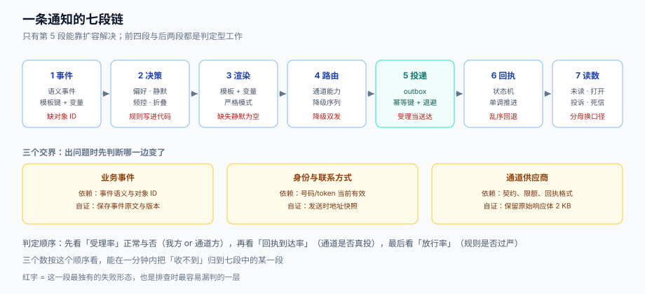

# 总览：一条通知的七道闸

通知系统的失败都**很安静**：没有异常栈、没有 5xx、监控面板一片绿——只是用户不再点开，或者客服每天收到二十条「验证码收不到」。原因在于这条链路的每一段都**有自己的成功定义**：业务方认为「事件发出去了」就算成功，通道方认为「接口返回 200」就算成功，而用户只认「我手机亮了、我看懂了、它对我有用」。三个成功定义之间没有自动对齐机制，于是链路越完整，**失真的空间越大**。

本页给出一张全局图：七段链各自的输入、输出与独有失败形态，以及四类通知在合规上的两条分岔。本页判据族 `NDO-A` ~ `NDO-H`，共 8 条，定义表见文末「本页判据」。



## 一、七段链：每段都有自己的失败形态

| # | 段 | 输入 | 输出 | 这一段独有的失败 |
| --- | --- | --- | --- | --- |
| 1 | 事件 | 业务事实（已支付、已发货、被指派） | 一条**语义事件**（谁、什么事、对象是什么） | 事件里只有 `order_id`，到了渲染段才发现拿不到收件人与文案参数 |
| 2 | 决策 | 事件 + 收件人偏好 + 频控状态 | 一个**决定**：发给谁、走哪类、要不要压后 | 把「该不该发」写进了模板或业务代码，改一次规则要发一次版 |
| 3 | 渲染 | 模板版本 + 变量 | 每个通道各一份内容 | 缺失变量被静默替换成空串，用户收到「您的订单 **** 已发货」 |
| 4 | 路由 | 通道能力 + 用户可达性 | 一条通道或一个降级序列 | 首选通道不可用时没有降级，或降级后**重复发**（两条通道都发了） |
| 5 | 投递 | 内容 + 地址/token + 幂等键 | 通道方的受理结果 | 把受理当送达；重试没有幂等键，同一条发三遍 |
| 6 | 回执 | 通道方回调 / 轮询 | 状态机的一次迁移 | 回执乱序（先到 `delivered` 后到 `submitted`）把状态打回去 |
| 7 | 读数 | 状态机 + 事件 | 未读数、打开率、投诉率 | 分母换个口径，同一个系统能算出 82% 和 31% 两个「打开率」 |

七段里**只有第 5 段可以横向扩容**（多开投递 worker），其余六段都是**判定型**工作——加机器不会让判定变对。这也是通知系统最常见的误判：性能问题当成容量问题，正确性问题当成性能问题。

### 每段该产出什么，不该产出什么

1. **事件段不该带文案**。事件带 `template_key` + 变量，不带「您的订单已发货」这类句子。文案一变就要重放事件，是设计错误的信号。
2. **决策段不该访问数据库行锁**。决策只需要三样东西：偏好快照、频控计数、通道可达性。任何需要「锁住某个用户」的决策，都会在活动高峰变成串行队列。
3. **渲染段不该调外部接口**。渲染要能被单测覆盖、能被预览、能离线批跑；一旦渲染里查了用户昵称，它就有了 I/O，就有了超时。
4. **路由段不该重试**。路由只回答「走哪条」，重试属于投递段。把重试写在路由里，会出现「路由重试 3 次 × 投递重试 3 次 = 9 次」的放大（见[投递与回执](../Delivery/index.md)）。
5. **投递段不该判断业务**。它只认「一条已渲染的消息 + 一个地址 + 一个幂等键」。
6. **回执段不该改业务状态**。回执只改通知自己的状态机；「短信失败所以要给订单打个标记」属于业务，必须走事件回去。
7. **读数段不该反写**。读数是只读投影，任何「根据打开率调整频控」的动作必须经过决策段的规则，不能在报表里直接改计数。

## 二、四类通知：合规上只有两条路

分类不是为了报表好看，是因为**合规要求按类别分岔**：

| 类别 | 例子 | 能否退订 | 静默时段 | 频控 | 通道偏好 |
| --- | --- | --- | --- | --- | --- |
| **事务型** | 验证码、支付成功、发货、退款到账 | **不能**（用户主动请求或合同履行必需） | 除验证码外可延后至次日 | 只按「同一事件不重复」 | 短信/推送优先，追求到达 |
| **协同型** | 被 @、被指派、评论回复 | 能（按项目/按类型） | **必须遵守** | 按会话折叠，强 | 站内信 + 推送 |
| **系统型** | 安全提醒、额度用尽、服务变更 | 部分能（法律要求的不能） | 安全类不受限 | 弱 | 站内信 + 邮件 |
| **营销型** | 活动、优惠券、召回 | 能，且必须一键 | **必须遵守**，且更严 | 最强，按天/周计 | 站内信优先，短信需单独同意 |

四条口径必须写进代码，而不是写进文档：

1. **`category` 是必填枚举，不是自由字符串**。缺失时**默认为营销型**（最严的那一档）——这个默认方向很重要：默认为事务型，等于给所有漏填的调用方开了后门。
2. **事务豁免的是频控，不是合规**。验证码不进频控配额，但仍受「同一 `event_id` 不重复」与「单用户单通道并发上限」约束，否则会被当作短信轰炸的跳板。
3. **撤回同意只影响营销型与协同型**。用户撤回营销同意之后，支付成功通知仍应发出——把撤回做成「全局静音」是产品事故，不是合规。
4. **营销型的退订入口必须和推送一样便捷**（《个人信息保护法》第二十四条的「便捷的拒绝方式」）。一封信底部藏一个需要登录的偏好中心，不叫便捷。

## 三、三个分母：同一个「打开率」能有三个数

通知的每一个率都有分母选择题，选错不会报错，只会让结论反过来：

| 指标 | 分子 | 分母候选 | 什么时候该用 |
| --- | --- | --- | --- |
| 提交率 | 通道方受理成功条数 | 决策放行条数 | 排查「我们这边有没有漏发」 |
| 送达率 | 回执为 `delivered` 的条数 | **受理成功条数**（不是放行条数） | 评估通道质量；含通道侧失败 |
| 打开率 | 打开事件数 | 送达条数 / 会话数 / 用户数 | 评估内容；**看「多少人」用用户，看「多少次」用送达** |
| 退订率 | 退订人数 | **收到过营销消息的人数** | 评估打扰程度；用「全站用户」当分母会把问题稀释 10 倍 |

一组常见错配的后果：某次活动放行 10 万条、通道受理 9.2 万条（8,000 条因空号被拒）、送达回执 8.4 万条、打开 1.2 万次。三种「打开率」分别是 **13.0%**（/受理）、**14.3%**（/送达）、**12.0%**（/放行）。差 2 个百分点看起来不大，但如果这次活动的目标是「判断文案好坏」，只有 /送达 那个数能在两次活动之间比较——因为其余两个都被通道质量污染了。

::: warning 说明
分母一旦定下，要写进指标定义文档并固定下来。本库反复出现的教训是：**同一指标换分母不会报错，只会让季度对比变成两个故事的拼接**。见[度量与止血](../Operations/index.md)的「一个指标一个分母」判据。
:::

## 四、五个必失点

这五条是复盘中反复出现、且都能在代码里提前拦住的：

1. **把通知当 fire-and-forget**。`try { send(); } catch (e) { log.warn(e); }` ——失败只留一行日志，没有补偿、没有死信、没有告警。正确做法是 outbox + 至少一次 + 死信表（见[投递与回执](../Delivery/index.md)）。
2. **把通道当可靠队列**。通道方的 SLA 是「尽力而为」，短信在运营商侧的重试窗口通常只有几分钟；你这边不重试，就等于放弃。但**重试必须在投递段做，且必须带幂等键**，否则「补救」会变成「重复打扰」。
3. **把用户偏好当一个全局开关**。真实用户的需求是「订单消息要、活动消息不要、@我的人要」，一个 `notification_enabled` 布尔值满足不了任何一种。偏好必须是**二维矩阵**（类别 × 通道），见[偏好中心](../Preferences/index.md)。
4. **用 PV 当分母**。通知是「一次事件对一个用户」，PV 里含刷新与多端，用它当分母会让打开率凭空翻倍。
5. **只监控接口 200**。接口 200 只覆盖第 5 段。第 2 段（决策放行率骤降）、第 3 段（渲染异常率）、第 6 段（回执断流）都不会让接口报错——但它们让整条链失效。

## 五、三个交界：出问题时先看哪一边

通知系统夹在三个系统之间，故障定责的第一件事是判断**交界在哪**：

| 交界 | 你依赖对方什么 | 对方变了会怎样 | 怎么自证清白 |
| --- | --- | --- | --- |
| 业务事件 | 事件语义与事件里的对象 ID | 业务把「已支付」拆成「支付受理 + 支付成功」，你的模板变量对不上 | 保存收到的事件原文（含 `event_id` 与版本号） |
| 身份与联系方式 | 手机号、邮箱、设备 token 的**当前有效性** | 用户换了手机号，旧号被回收给了别人——通知发给了陌生人 | 记录发送时的地址**快照**，并在退信/失效回执时反查 |
| 通道供应商 | 接口契约、限额、回执格式 | 供应商改了错误码，你的「可重试」判定全错 | 保留原始响应体（截断到 2 KB），错误码映射表进版本控制 |

第三条最容易被忽略：**错误码映射是一份需要维护的契约**。把它写死在代码的 `switch` 里，供应商新增一个 `rate_limited` 变体，你的系统就会把它当「永久失败」直接丢弃——用户看到的是「通知发了但没到」，而你看到的是「投递成功率 100%」。

## 六、一条合格通知的判据链

把七段串起来，一条「合格」的通知要同时满足：

```text
事件有 event_id 且可重放
  → 决策有 category（缺失按营销处理）
  → 偏好按 (user, category, channel) 查得到，且退订在发送时刻复核
  → 频控窗口内未超限，且不在静默时段（事务型豁免项单独列）
  → 模板版本经过校验，变量全部命中（缺失即失败，不静默）
  → 路由给出主通道 + 降级序列，且降级不重复发
  → 投递带幂等键，重试有退避与上限，失败进死信
  → 回执按状态机推进，乱序不回退
  → 读数的分子分母都写进指标定义
```

这九行是本专题的目录：后面八页逐段展开，最后一页把它们装成一个能验收的最小系统。

## 七、本页判据

| 编号 | 看什么现象 | 判成什么 | 不满足时改哪里 |
| --- | --- | --- | --- |
| `NDO-A` | 事件里是否带 `template_key` + 变量字典，而不是成品文案 | 带成品文案即失败：改文案要重放事件 | 事件契约加 `template_key`/`vars`，文案进模板表 |
| `NDO-B` | 调用方是否必须显式传 `category`，缺失时落到哪一档 | 缺失落到「事务型」即失败：等于开后门 | 枚举必填，缺失默认营销型 |
| `NDO-C` | 事务型是否真的豁免了频控，同时仍受「同事件不重复」约束 | 完全豁免（含去重）即失败 | 频控分两张表：配额表与去重表 |
| `NDO-D` | 撤回同意后，已排队的营销消息是否被拦截 | 未拦截即失败：一次违规发送 | 发送时刻复核偏好快照 |
| `NDO-E` | 每个对外指标是否只有一个分母，且写进了指标定义 | 同一指标出现两个分母即失败 | 指标定义表 + 报表口径评审 |
| `NDO-F` | 失败是否只写日志、没有死信与告警 | 是即失败：链路静默断裂 | outbox + 死信表 + 死信积压告警 |
| `NDO-G` | 「送达」是否用通道方 200 代替 | 是即失败：把受理当送达 | 回执状态机独立于受理结果 |
| `NDO-H` | 是否保存了发送时刻的地址快照与 `event_id` | 都没有即失败：无法定责、无法重放 | 投递记录加 `addr_snapshot`、`event_id` |

## 参考资料

- [通道矩阵](../Channels/index.md)（七段链第 4 段的展开）
- [偏好中心](../Preferences/index.md)（第 2 段的展开）
- [度量与止血](../Operations/index.md)（第 7 段的展开）
- Google, *Email sender guidelines*（批量发信人与投诉率口径）：<https://support.google.com/a/answer/81126>
- Twilio, *A2P 10DLC* 与短信可达性文档（通道侧失败分类的现实参照）：<https://www.twilio.com/docs/messaging>
- 《中华人民共和国个人信息保护法》第二十四条（自动化决策与便捷拒绝）：<https://flk.npc.gov.cn/>
