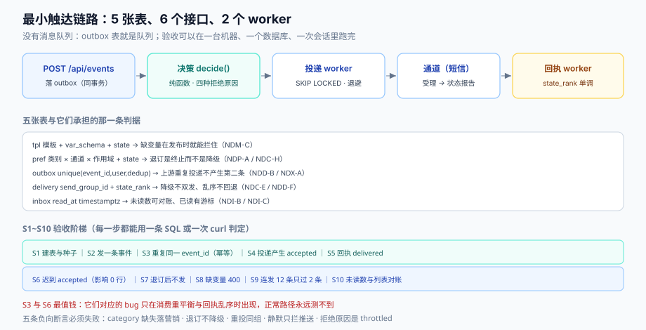

# 实战：一条能验收的最小触达链路

前面八页把七道闸逐段拆开了。这一页把它们装回去：**5 张表、6 个接口、2 个 worker**，跑起来能验证「该发的一条不落、不该发的一条不发、发出去的能证明」。

范围刻意收窄：只做**站内信 + 短信**两条通道（一条能证明已读、一条能证明送达），邮件与推送按同样结构加表即可。这样做的目的是让验收可以在**一台机器、一个数据库、一次会话**里跑完。



本页判据族 `NDX-A` ~ `NDX-H`，共 8 条。定义表见文末「本页判据」一节。

## 一、组件与依赖

| 组件 | 职责 | 不做什么 |
| --- | --- | --- |
| `POST /api/events` | 接收业务事件，落 outbox（同事务） | 不渲染、不发 |
| **决策器**（同进程函数） | 偏好 → 频控 → 静默 → 渲染 → 路由 | 不做 I/O 重试 |
| **投递 worker** | 捞 `pending` → 发通道 → 写 `delivery` | 不改业务状态 |
| **回执 worker** | 接收/轮询回执 → 状态机推进 | 不回写 outbox |
| `GET /api/inbox` | 收件箱列表（游标分页） | 不计算未读数 |
| `GET /api/unread` | 未读数 | 不做全量 `count` 之外的优化（先正确） |
| `POST /api/inbox/read` | 已读（单条 / 到某条为止） | 不删消息 |
| `POST /api/unsubscribe/{token}` | 一键退订（RFC 8058 风格） | 不要求登录 |

依赖只有两个：PostgreSQL（表与事务）、Redis（频控与退订增量集合）。没有消息队列——outbox 表就是队列。

## 二、五张表

```sql
-- 1. 模板：一个 key + 版本 + 通道 一行
create table tpl (
  tpl_key   text not null, version int not null, channel text not null,
  locale    text not null default 'zh-CN',
  body      text not null,
  var_schema jsonb not null,
  state     text not null default 'active' check (state in ('draft','active','retired')),
  primary key (tpl_key, version, channel, locale)
);

-- 2. 偏好：五维矩阵的前三维
create table pref (
  user_id bigint not null,
  scope_type text not null default 'global',
  scope_id   text not null default '',
  category   text not null,
  channel    text not null,
  state      text not null check (state in ('on','off','suppressed','legal')),
  reason     text,
  updated_at timestamptz not null default now(),
  primary key (user_id, scope_type, scope_id, category, channel)
);

-- 3. 发件箱：既是队列也是幂等闸门
create table outbox (
  id bigserial primary key,
  event_id text not null,
  user_id  bigint not null,
  category text not null,
  dedup_key text not null,
  channel  text not null,
  target   text not null,                  -- 地址快照
  body     text not null,                  -- 写时渲染的结果
  state    text not null default 'pending'
           check (state in ('pending','sending','sent','failed','dead')),
  attempts smallint not null default 0,
  next_at  timestamptz not null default now(),
  expire_at timestamptz not null,
  last_error text,
  created_at timestamptz not null default now(),
  unique (event_id, user_id, dedup_key)
);
create index outbox_pick on outbox (next_at) where state = 'pending';

-- 4. 投递记录：一组尝试 + 回执状态机
create table delivery (
  id bigserial primary key,
  outbox_id bigint not null references outbox(id),
  send_group_id uuid not null,
  attempt_no smallint not null,
  channel text not null,
  state text not null default 'accepted'
        check (state in ('accepted','delivered','read','failed','complaint','unknown')),
  state_rank smallint not null default 1,
  provider_msg_id text,
  error_code text,
  updated_at timestamptz not null default now(),
  unique (send_group_id, attempt_no)
);

-- 5. 收件箱：写扩散的那一半（站内信）
create table inbox (
  user_id bigint not null,
  notif_id bigint not null,             -- = outbox.id
  created_at timestamptz not null default now(),
  read_at timestamptz,
  primary key (user_id, notif_id)
);
create index inbox_unread on inbox (user_id, created_at desc) where read_at is null;
```

五个设计取舍，每条都能对应前面某一页的判据：

1. **`outbox.unique(event_id, user_id, dedup_key)`** —— 上游重复投递的物理闸门（`NDD-B`）。
2. **`outbox.body` 存渲染结果** —— 写时渲染，站内信历史不随模板变化（`NDM-E`）。
3. **`delivery.state_rank`** —— 回执单调推进的唯一手段（`NDD-F`）。
4. **`inbox.read_at` 用时间戳不用布尔** —— 保留游标与证据（`NDI-C`）。
5. **`outbox_pick` 是部分索引** —— 只索引 `pending`，避免索引随历史行数膨胀。

## 三、六个接口的契约

| 方法 | 路径 | 入参 | 出参 | 幂等 |
| --- | --- | --- | --- | --- |
| POST | `/api/events` | `{event_id, type, user_id, category, vars, expire_in}` | `{accepted, outbox_ids[]}` | 按 `event_id` |
| GET | `/api/inbox?cursor=&limit=` | 游标 + 条数（≤50） | `{items[], next_cursor}` | 天然 |
| GET | `/api/unread` | — | `{unread, by_category{}}` | 天然 |
| POST | `/api/inbox/read` | `{notif_id}` 或 `{until_id}` | `{updated}` | 天然 |
| POST | `/api/unsubscribe/{token}` | 无 body（RFC 8058 风格） | `204` | 天然 |
| POST | `/api/callback/sms` | 供应商回执 | `204`（快速返回） | 按 `(provider_msg_id, state)` |

错误码只有四个：`400 INVALID_VARS`（渲染前校验失败）、`409 DUPLICATE_EVENT`（可当成功）、`422 PREFERENCE_BLOCKED`（决策拒绝，**不是错误**，返回 200 + 原因更合适）、`429 RATE_LIMITED`。第四条单独说明：**决策拒绝不是 HTTP 错误**，它是正常业务结果，用 200 + `{accepted:false, reason:"throttled"}` 表达，否则你的调用方会把它记成「接口失败率」。

## 四、决策器：一个纯函数

```ts
type Decision =
  | { send: false; reason: 'unsubscribed' | 'quiet_hours' | 'throttled' | 'no_target' }
  | { send: true; channel: 'inbox' | 'sms'; body: string };

function decide(ev: Event, ctx: Ctx): Decision {
  // 1. 地址可达性（没有地址就不必算后面）
  const target = ctx.addr[ev.userId];
  if (!target) return { send: false, reason: 'no_target' };

  // 2. 偏好（legal > off > suppressed > on > 默认值）
  const p = ctx.pref(ev.userId, ev.category, 'sms');
  if (p === 'off' || p === 'suppressed') return { send: false, reason: 'unsubscribed' };

  // 3. 静默时段（事务型豁免；用 UTC 时间戳判定）
  if (!isTransactional(ev.category) && inQuietHours(ev.userId, ctx.nowMs))
    return { send: false, reason: 'quiet_hours' };

  // 4. 频控（三维 key，一次原子操作）
  if (!rateLimit.tryConsume(`${ev.userId}:${ev.category}:sms`, ctx.nowMs))
    return { send: false, reason: 'throttled' };

  // 5. 渲染（严格模式：缺变量抛错，由调用方落 failed）
  const body = render(ev.tplKey, ev.vars);
  return { send: true, channel: 'sms', body };
}
```

这个函数的三个性质值得单独说：

1. **无 I/O 重试、无外部调用**。`ctx` 把地址、偏好、时间都预先喂进来，函数本身可单测（给定输入必然给定输出）。
2. **拒绝原因是一个封闭枚举**。四种原因覆盖了全部拒绝路径；如果你发现自己想加第五种，说明前面某一层的模型缺了一个维度。
3. **计数发生在放行时**，而不是发送成功时（`NDT-H`）。重试不重复消耗配额。

## 五、投递与回执：两个 worker

**投递 worker**（每 200 ms 一轮）：

```sql
-- 认领一批（SKIP LOCKED 避免多实例互抢）
with picked as (
  select id from outbox
   where state = 'pending' and next_at <= now()
   order by next_at
   limit 200
   for update skip locked
)
update outbox o set state = 'sending', attempts = attempts + 1
  from picked p where o.id = p.id
returning o.*;
```

发失败时按错误类型分流：可重试 → `state='pending'` + `next_at = now() + backoff(attempts)`；不可重试 → `state='dead'`。**注意 `sending` 是必要的中间态**：worker 崩溃后，`sending` 会被一个超时任务捞回 `pending`，而 `sent` 不会。

**回执 worker** 分两条路径：短信走「轮询状态报告」（每 30 秒拉一次），站内信不打回执（`read` 由用户动作直接写入）。回执处理只做一件事：

```sql
update delivery
   set state = $1, state_rank = $2, updated_at = now()
 where id = $3 and state_rank < $2;   -- 乱序回执影响 0 行，属正常
```

## 六、S1~S10：可执行的验收序列

下面十条按顺序执行，每条都给「做什么」与「期望看到什么」。全部通过，说明七道闸都通了。

| # | 做什么 | 期望 |
| --- | --- | --- |
| S1 | 建表 + 插一条 `order_shipped` 模板（v1，含 `order_no/amount`）+ 一个用户 + 一条 `pref(on)` | 5 张表创建成功，`select count(*) from tpl` = 1 |
| S2 | `POST /api/events` 发一条 `event_id=E1` | 返回 `accepted:true`，`outbox` 新增 1 行 `state=pending` |
| S3 | **重复**发同一条 `event_id=E1` | 返回 `accepted:true, outbox_ids:[]`（幂等），`outbox` 仍 1 行 |
| S4 | 等投递 worker 跑一轮，查 `delivery` | 新增 1 行 `state=accepted`，`attempt_no=1` |
| S5 | 调 `POST /api/callback/sms` 回执 `DELIVRD` | `delivery.state=delivered, state_rank=2` |
| S6 | **再**发一条迟到的 `ACCEPTD` 回执 | 影响 0 行，`state` 仍是 `delivered`（乱序不回退） |
| S7 | 把 `pref` 改成 `state='off'`，再发 `event_id=E2` | 返回 `accepted:false, reason:'unsubscribed'`，`outbox` 不新增 |
| S8 | 模板删掉 `amount` 字段声明，发 `event_id=E3`（缺 `amount`） | 返回 `400 INVALID_VARS`，`outbox` 不新增 |
| S9 | 连发 12 条 `event_id=E10..E21`（营销类，日上限 2） | 第 1~2 条放行，第 3 条起 `reason:'throttled'` |
| S10 | `GET /api/unread` 与 `GET /api/inbox` 对账 | 未读数 = 列表里 `read_at is null` 的条数 |

::: tip S3 与 S6 是这套验收里最值钱的两条
S3 验证「上游重复投递不产生第二条消息」，S6 验证「乱序回执不回退状态」。这两条对应的 bug 都**不会在正常路径上暴露**——只有消费组重平衡、供应商回执乱序时才出现，而那时你已经在事故里了。
:::

## 七、五条负向断言：必须失败

正向通过不代表系统正确；下面五条必须**被拦住**，拦不住就是缺陷：

1. 发一条 `category` 为空的营销事件 → 必须落成 **营销型**（最严档），而不是事务型。
2. 给已退订用户发营销短信 → 必须拒绝，且**不得降级到站内信**（退订是终止）。
3. 把 `outbox` 里一条 `sent` 的消息手动改回 `pending` → 重投时 `delivery` 必须**新增 `attempt_no=2` 而不是新消息**。
4. 静默时段（UTC 换算后落在 22:00–08:00）发协同推送 → 必须拒绝，但**同一事件的站内信必须已写入**。
5. 连续 12 条营销消息 → 第 3 条起拒绝，且**拒绝原因必须是 `throttled` 而不是 `unsubscribed`**（原因错会让排障走错方向）。

## 八、分诊表：十种症状与第一动作

| 症状 | 最可能的原因 | 第一动作 |
| --- | --- | --- |
| 验证码收不到 | 短信通道限额打满 / 号码黑名单 | 查 429 占比与状态报告错误码 |
| 用户说「没收到推送」 | token 失效（重装/换机） | 查 `delivery` 最近是否有 `UNREGISTERED` |
| 红点和列表条数不一致 | 未读数用了计数器且漂移 | 跑一次 `count(*)` 对账 |
| 同一条消息收到两次 | 上游重复投递且去重键缺失 | 查 `outbox` 同 `event_id` 的行数 |
| 消息延迟 30 分钟才到 | 队列滞留（worker 跟不上 / 重试风暴） | 查 `oldest pending` 年龄与 `attempts` 分布 |
| 退订后还收到 | 只在入队时判定 / 队列未撤销 | 查发送时刻是否复核退订集合 |
| 文案里出现 `${amount}` | 渲染用了宽容模式 | 改严格模式，缺失即 `failed` |
| 邮件进垃圾箱 | 营销与事务共用发信域 | 拆子域，查 DMARC 与投诉率 |
| 活动期间事务消息延迟 | 单队列 FIFO | 加双队列优先（实测 p99 51.82 s → 0） |
| 送达率突然 60% | 回执断流（webhook 挂了） | 查回执到达率，而不是查发送 |

## 九、十二问自测

1. `event_id` 重复投递时，你的系统会产生几条消息？
2. 渲染缺变量时，消息会「发出但残缺」还是「失败进死信」？
3. 用户在第 23:59 收到 10 条、00:01 又收到 10 条，你的频控挡得住吗？
4. 静默时段内到达的验证码，会被压到早上 8 点吗？
5. 降级通道与主通道会不会双发？怎么证明不会？
6. `delivered` 之后收到 `accepted` 回执，你的状态会退回吗？
7. 未读数是 `count(*)` 还是计数器？偏差怎么发现？
8. 一键退订的 URL 里是签名 token 还是自增 ID？
9. 营销消息与验证码是否共用短信签名/推送凭据？
10. 死信表里能按模板聚合吗？最近 24 小时的 Top 3 是什么？
11. 收件箱的广播消息是写扩散还是读扩散？100 万用户时写一行还是写一百万行？
12. 你的「送达率」分母是放行条数还是受理条数？

## 十、五条常见但错误的建议

| 错误建议 | 为什么错 | 正确做法 |
| --- | --- | --- |
| 「先发出去，失败再补」 | 补发没有幂等键就是重复打扰 | outbox + 幂等键 + 死信 |
| 「用 Redis 计数器做未读数，快」 | 漏更新会永久偏，且无自愈 | `count(*)` 先上，需要时再加对账 |
| 「退订就全关」 | 用户会连验证码一起收不到 | 按类别 × 通道退订 |
| 「超时设短一点，快速失败」 | 过载时放大负载（实测 12 倍） | 超时不缩短，压并发 |
| 「营销和验证码用同一个短信通道，省钱」 | 限额与投诉互相污染 | 拆签名/拆应用/拆域 |

## 十一、本页判据

| 编号 | 看什么现象 | 判成什么 | 不满足时改哪里 |
| --- | --- | --- | --- |
| `NDX-A` | `outbox` 是否有 `(event_id, user_id, dedup_key)` 唯一键 | 无唯一键即失败：重复投递变重复消息 | 加唯一键，冲突当成功 |
| `NDX-B` | `body` 是否在入队前渲染并落库 | 投递时渲染即失败：历史消息会变样 | 决策段渲染，结果入 `outbox.body` |
| `NDX-C` | 是否有 `sending` 中间态与超时回收 | 只有 `pending/sent` 即失败：崩溃后卡单 | 加 `sending` + 回收任务 |
| `NDX-D` | 回执更新是否带 `state_rank` 条件 | 直接覆盖即失败：乱序回退 | `where state_rank < ?` |
| `NDX-E` | 决策拒绝是否用 200 + reason，而非 HTTP 错误 | 用 4xx/5xx 即失败：污染接口失败率 | 200 + 封闭 reason 枚举 |
| `NDX-F` | 频控计数是否在放行时（而非发送成功时） | 按成功计数即失败：重试打穿配额 | 放行即 `tryConsume` |
| `NDX-G` | S3/S6 两条幂等与乱序用例是否进回归 | 未进即失败：只在事故中暴露 | 加进 CI 的集成用例 |
| `NDX-H` | 负向五条是否都有对应断言 | 缺任一条即失败 | 逐条写成测试用例 |

## 参考资料

- [总览](../Overview/index.md)（七段链的全局图）
- [投递与回执](../Delivery/index.md)（outbox 与状态机的完整讨论）
- [收件箱读模型](../Inbox/index.md)（未读数与游标的取舍）
- PostgreSQL, `FOR UPDATE SKIP LOCKED`（队列认领的标准写法）：<https://www.postgresql.org/docs/18/sql-select.html>
- RFC 8058（一键退订的 POST 语义）：<https://www.rfc-editor.org/rfc/rfc8058>
- Google, *Email sender guidelines*（合规自查基线）：<https://support.google.com/a/answer/81126>
