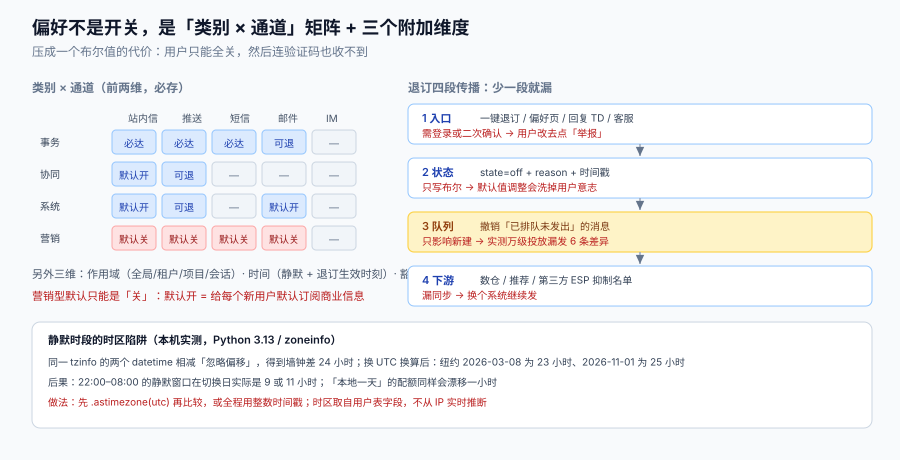

# 偏好中心：订阅、静默与退订的传播

「用户能不能关掉通知」这件事，在需求里是一句话，在实现上是一张**三维矩阵**：类别 × 通道 × 订阅对象（某个项目、某个店铺、某个人）。再叠加两个时间维度（静默时段、退订生效时刻），就变成五个维度。

把五个维度压成一个布尔值，是所有通知系统最早犯、也最难改的错——因为改它要迁移存量数据、改所有调用方，还要重新解释给用户听。



本页判据族 `NDP-A` ~ `NDP-H`，共 8 条。定义表见文末「本页判据」一节。

## 一、五个维度，一个都不能省

| 维度 | 取值 | 省了会怎样 |
| --- | --- | --- |
| **类别** | 事务 / 协同 / 系统 / 营销 | 用户无法「只关营销」，只能全关——然后连验证码也收不到 |
| **通道** | 站内信 / 推送 / 短信 / 邮件 / IM | 用户想「App 里能看到、但别弹我」，做不到 |
| **订阅对象** | 全局 / 租户 / 项目 / 会话 / 关注对象 | 用户退订了某个吵闹的项目，等于退订了全部 |
| **时间** | 静默时段（含时区）、退订生效时刻 | 半夜推送、退订后仍收到 |
| **优先级** | 事务豁免、法律必达 | 用户关掉全部通知后，收不到扣款失败提醒，责任在你 |

数据模型上，前两维是矩阵（`category × channel`），第三维是矩阵的**作用域**，第四维是**求值时的时间条件**，第五维是**豁免规则**。把它们塞进一张 `user_preference(user_id, enabled)` 表，第五维必然变成散落在代码里的 `if`。

```sql
-- 一张表表达前三维：作用域为空串表示「全局」
create table notification_preference (
  user_id     bigint not null,
  scope_type  text   not null check (scope_type in ('global','tenant','project','thread')),
  scope_id    text   not null default '',        -- global 时为空串，避免 NULL 参与唯一键
  category    text   not null check (category in ('transactional','collaborative','system','marketing')),
  channel     text   not null check (channel in ('inbox','push','sms','email','im')),
  state       text   not null check (state in ('on','off','suppressed','legal')),
  reason      text,                               -- off:user / off:oneclick / suppressed:bounce / legal:pipl
  updated_at  timestamptz not null default now(),
  primary key (user_id, scope_type, scope_id, category, channel)
);
```

::: danger 注意
1. **`scope_id` 不要用 `NULL` 表示全局**。PostgreSQL 的唯一索引里 `NULL` 互不相等，你会得到同一个用户三条「全局偏好」。用空串（或独立 `scope_type='global'` + 常量 id）才能让唯一键生效。
2. **不要把「未订阅」和「已退订」存成同一个 `off`**。前者是**默认值**（可能随产品策略变化），后者是**用户的明确意志**（永远不能覆盖）。两者混在一起，一次默认值调整就会把几百万人的主动退订洗掉。
3. **不要给 `state` 加 `pending` 这种过渡态**。偏好是当前事实，不是流程。需要「待确认」的是**变更审计**，不是状态本身。
:::

## 二、订阅四态 + 一个派生态

严格说只有两个真实状态（`on` / `off`），但工程上必须区分四个，因为它们的**可覆盖性**不同：

| 状态 | 谁写的 | 能否被默认值覆盖 | 能否被用户改回 | 典型来源 |
| --- | --- | --- | --- | --- |
| `on` | 用户或默认值 | 能 | — | 用户开启、默认开启 |
| `off` | **只有用户** | **不能** | 能 | 偏好页、一键退订、回复 TD |
| `suppressed` | 系统 | 不能 | 能（用户可重新订阅） | 硬退信、投诉、号码黑名单 |
| `legal` | 合规要求 | 不能 | **不能** | 扣款失败、安全提醒 |

第五个是**派生态**：`unset`（表里没有这一行）。它必须存在，因为「用户从没表过态」和「用户表态要」在合规上是两件事——前者可以用默认值，后者不能用默认值去改。

判断顺序（短路求值，顺序不能换）：

```text
1. legal 命中（该类别在该通道是法律必达）→ 发
2. 表里有行且 state=off      → 不发（用户意志最高）
3. 表里有行且 state=suppressed → 不发（系统抑制）
4. 表里有行且 state=on        → 发
5. 无行 → 用默认值：事务 on / 协同 on / 系统 on / 营销 off
```

第 5 步的默认值是**产品决策**，但有一条硬约束：**营销型的默认值只能是 `off`**。默认 `on` 意味着你给每个新用户默认订阅了商业信息，这与《个人信息保护法》第十三条的「同意」要求相冲突。

## 三、静默时段：本地墙钟不是时间轴

静默时段（quiet hours）的实现看起来是四行代码：取用户时区的当前小时，落在 `[22, 8)` 就不发。真实实现要处理四个坑。

### 坑一：两个带时区的 `datetime` 相减，可能不等于真实经过时间

Python 的 `datetime` 有一条容易忘的规则：**两个 aware `datetime` 若带同一个 `tzinfo` 对象，相减时忽略偏移，按墙钟差计算**。本机实测：

| 时区 | 日期 | 墙钟差 | 真实经过 |
| --- | --- | --- | --- |
| America/New_York | 2026-03-08（进入夏令时） | 24 小时 | **23 小时** |
| America/New_York | 2026-11-01（退出夏令时） | 24 小时 | **25 小时** |
| Europe/Berlin | 2026-03-29 | 24 小时 | **23 小时** |
| Australia/Sydney | 2026-04-05 | 24 小时 | **25 小时** |
| Asia/Shanghai | 2026-03-08 | 24 小时 | 24 小时 |

后果：一个「22:00–08:00」的静默窗口在夏令时切换日实际是 **9 小时或 11 小时**，而不是 10 小时。如果你的每日配额也是按「本地一天」算的，那天会多算或少算一小时额度。**正确做法是先 `.astimezone(timezone.utc)` 再相减，或者全程用整数时间戳。**

### 坑二：静默时段不是「不发」，而是「压后」

| 类别 | 静默时段的行为 | 原因 |
| --- | --- | --- |
| 事务型（验证码） | **照发** | 用户正在等，延迟 8 小时等于失败 |
| 事务型（发货/退款） | 压后到 08:00，但**站内信立即写** | 可回溯，不必吵醒 |
| 协同型 | 压后到 08:00，折叠成一条 | 夜间积累的 @ 会合并 |
| 系统型（安全） | 照发 | 账号被盗不该等到早上 |
| 营销型 | **直接丢弃**（不压后） | 早上补发的营销消息同样令人反感 |

「压后到 08:00」还需要一个**批量错峰**：如果所有用户都在 08:00 补发，峰值会打成白天的尖峰。

### 坑三：按「当地 9 点」投放会把峰值挪走，而不是消除

本机用 20 个时区、每时区 1 万人做了一次静态换算：

| 投放策略 | 峰值（人/小时） | 说明 |
| --- | --- | --- |
| 统一在 UTC 02:00 发 | **200,000** | 全部同时，20 万/小时 |
| 按各地当地 09:00 发 | **20,000** | 峰值为原来的 **1/10**，但落到 15 个不同的 UTC 小时 |

结论有两层：**按当地时间投放能把峰值压到 1/10**（这是收益）；但峰值并没有消失，只是分散到了 15 个小时里（这是代价）——对短信通道来说，这意味着你要在 15 个小时里都保持通道配额，而不是在 1 个小时里打满。

### 坑四：时区是用户属性，会变

用户出差、移民、改手机系统时区，都会让「当地 22:00」漂移。所以时区必须是**用户表上的一个字段**（`iana_tz`，默认取注册时推断值），不能从「最后一次请求的 IP」实时推断——一次 VPN 就会让静默时段错 8 小时。

## 四、退订的传播：四段，少一段就漏

退订不是改一行表，它要穿过四段。任何一段缺失，都会出现「退了还在发」。

| 段 | 动作 | 失败形态 |
| --- | --- | --- |
| 1 入口 | 邮件一键退订（RFC 8058）、偏好页、回复 TD、客服代操作 | 入口需要登录 / 需要二次确认 → 用户改去点「举报垃圾邮件」 |
| 2 状态 | 写 `state='off'`，`reason='off:oneclick'`，**记时间戳** | 只写布尔值，无法区分默认值与用户意志 |
| 3 队列 | 把**已在队列里、尚未发出**的消息撤销 | 只影响「以后新建的」消息，已排队的照发 |
| 4 下游 | 通知下游系统（数据仓库、推荐、第三方 ESP 的抑制名单） | 下游还在发，用户收到「已在你退订的平台之外」的消息 |

第 3 段是最容易漏的一段，因为它要求队列里有一条「按 (user, category) 可撤销」的能力。本机模拟了一次 10,000 人的营销投放（队列 500 条/秒、抖动最多 60 秒、5% 用户在投放过程中退订）：

| 判定时机 | 实际发出 | 差额 |
| --- | --- | --- |
| 只在**入队时**判定 | 9,999 条 | 基准 |
| 在**发送时刻**再判一次 | 9,993 条 | **少发 6 条**（0.06%） |

6 条看起来很小，但这是「队列只有 60 秒抖动」的理想场景。活动队列积压 30 分钟时，同样的 5% 退订率会放大到数百条——而每一条都是**用户明确说了不要之后仍然发出**的消息，性质与「没收到」完全不同。

::: tip 实现上的最小改动
不需要在发送前查一次数据库（那会在高峰放大 QPS）。做法是**在进程内维护一个按秒刷新的退订布隆过滤器/集合**（key 为 `user_id:category`），发送前查内存，命中再回查数据库确认。代价是一次内存查找，收益是「退订即刻生效」。
:::

## 五、一键退订：RFC 8058 的实现要点

批量发信人必须支持「一键退订」，它在协议层是两个头：

```text
List-Unsubscribe: <https://example.com/u/9f3a...>, <mailto:unsub@example.com?subject=unsubscribe>
List-Unsubscribe-Post: List-Unsubscribe=One-Click
```

四个实现要点：

1. **URL 里必须是签名 token，不能是自增 ID**。一键退订的 POST 由邮箱方代发，**没有登录态**。`?uid=12345` 这种形式会被扫号，也会被伪造退订攻击。
2. **POST 必须是一个动作，不能是页面**。收到 `POST` 就直接落 `state='off'` 并返回 200；返回「确认页」会被 Gmail 判为不符合要求。
3. **生效时限**：RFC 8058 要求即时生效，Gmail/Yahoo 的批量发信人规则给出 **48 小时**上限（Yahoo 明确 48 小时，Google 的文档口径为「2 天内」）。工程上按**即时**做，不要按 48 小时做。
4. **`mailto:` 作为兜底**，但主路径必须是 HTTPS。只给 `mailto:` 在现代 webmail 里基本等于没有退订入口。

## 六、偏好快照：决策读缓存，发送再复核

高频路径（一次活动 10 万条）不可能每条都查三次偏好。做法是**两段读**：

| 阶段 | 读什么 | 一致性要求 |
| --- | --- | --- |
| 决策（批量） | 偏好**快照**（活动开始时的批量导出，或按用户分片缓存） | 允许滞后（1 分钟内） |
| 发送（逐条） | 只查**退订增量**（按秒刷新的集合，见上节 tip） | 必须最新 |

这两段的组合，既保住了批量吞吐（快照一次读 10 万行），又保住了「退订即刻生效」（增量集合足够小）。反之，只做快照会有上一节的竞态；只做逐条查询会把决策段打成数据库热点。

## 七、用户看到的「开关」与系统里的「状态」

产品界面上的开关通常是三个（「订单通知」「互动通知」「营销通知」），而系统里有五个维度。中间必须有一层**映射表**，且这层映射要写进代码而不是散在组件里：

| 界面开关 | 映射到 | 关掉时是否级联 |
| --- | --- | --- |
| 订单通知 | `transactional` × {push, sms} | **不级联**到站内信（订单记录必须在站内可查） |
| 互动通知 | `collaborative` × {push} | 不级联到站内信 |
| 营销通知 | `marketing` × {push, sms, email} | 级联关闭全部营销通道 |
| 静默时段 | 时间维度 | — |

这张表的价值在于：**当运营问「为什么这个用户收不到活动推送」时，答案能从表里查出来**，而不是靠读代码猜。

## 八、本页判据

| 编号 | 看什么现象 | 判成什么 | 不满足时改哪里 |
| --- | --- | --- | --- |
| `NDP-A` | 偏好是否按 (类别, 通道) 二维存储，而非单一布尔 | 单一布尔即失败 | 建矩阵表，见第一节 DDL |
| `NDP-B` | 「未订阅」与「已退订」是否可区分 | 混为一谈即失败：默认值调整会洗掉用户意志 | 三态 + 缺行语义 |
| `NDP-C` | 营销型默认值是否为 `off` | 默认 `on` 即失败：合规风险 | 默认值按类别配置，营销恒 `off` |
| `NDP-D` | 静默时段是否用 UTC 或时间戳计算，而不是本地墙钟相减 | 墙钟相减即失败：DST 日错 1 小时 | `.astimezone(utc)` 或整数时间戳 |
| `NDP-E` | 静默时段内的事务型（验证码/安全）是否照发 | 一律压后即失败：用户等不到验证码 | 豁免表按 category + template 粒度 |
| `NDP-F` | 退订是否在发送时刻复核（增量集合） | 只在入队时判定即失败：实测漏 6 条/万级 | 秒级刷新的退订集合 |
| `NDP-G` | 一键退订 URL 是否为签名 token、POST 是否直接生效 | 自增 ID 或需二次确认即失败 | 签名 token + 直接落库 |
| `NDP-H` | 偏好变更是否写审计（谁、何时、从什么到什么、reason） | 无审计即失败：无法处理「我没退订」的申诉 | 追加式审计表 + reason 枚举 |

## 参考资料

- [通道矩阵](../Channels/index.md)（退订与降级的边界）
- [频控与折叠](../Throttling/index.md)（配额与静默的叠加）
- [隐私工程 · 同意与目的](../../../Others/PrivacyEngineering/ConsentPurpose/index.md)（同意的五态与撤回传播）
- RFC 8058（一键退订）：<https://www.rfc-editor.org/rfc/rfc8058>
- Google, *Email sender guidelines*（一键退订与投诉率）：<https://support.google.com/a/answer/81126>
- Python 官方文档 `datetime` 一节（aware 相减与 `fold` 语义）：<https://docs.python.org/3/library/datetime.html>
- IANA Time Zone Database（tzdb 发布节奏）：<https://www.iana.org/time-zones>
