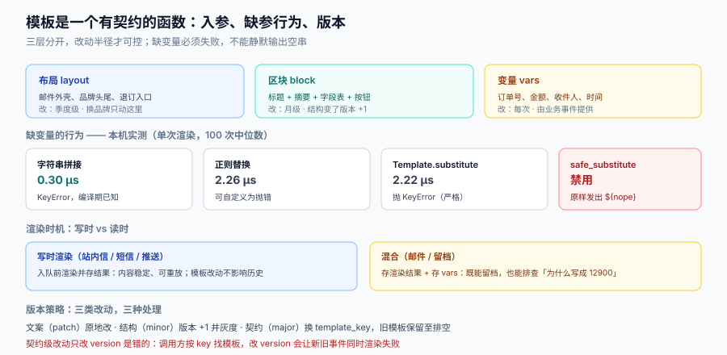

# 模板与渲染：变量契约、缺失与版本

模板最容易背锅：「文案是运营改的，跟我们没关系」。但只要渲染是**运行时**发生的，模板就是代码——它有入参、有异常、有版本、有回归。区别只在于它的「提交」发生在数据库里，而不是 Git 里。

本页把一个通知模板当成**一个有契约的函数**来看：入参是什么、缺参数时怎么办、在哪一步执行、怎么升级与回滚。



本页判据族 `NDM-A` ~ `NDM-H`，共 8 条。定义表见文末「本页判据」一节。

## 一、三层结构：布局、区块、变量

一条通知的内容不是一段字符串，是三层拼出来的：

| 层 | 内容 | 谁维护 | 变更频率 |
| --- | --- | --- | --- |
| **布局（layout）** | 邮件外壳、品牌头尾、退订入口、深色模式变量 | 前端/设计 | 季度级 |
| **区块（block）** | 一类通知的固定结构：标题 + 摘要 + 关键字段表 + 行动按钮 | 后端/产品 | 月级 |
| **变量（vars）** | 具体值：订单号、金额、收件人、时间 | 业务事件提供 | 每次 |

三层分开的直接收益是**改动半径可控**：改一个错别字只动变量；换品牌只动布局；改结构只动区块。三层搅在一起（把 HTML 与变量拼成一大段字符串存库）的后果是——改一个标点要发一次版，或者要允许运营改 HTML（等于允许运营注入脚本）。

```text
layout(mail-v3) + block(order_shipped-v5) + vars{order_no, amount, eta}
        │                    │                            │
        └── 外壳与退订 ───────┴── 结构与文案 ──────────────┴── 具体值
```

## 二、变量契约：缺失必须失败，不能静默

这是本页最重要的一条。几乎每个模板引擎都有一个「宽容模式」，缺失变量输出空串——它让开发期很舒服，让生产期很尴尬：用户收到「您的订单 **** 已发货」。

本机对三种实现做了实测（Python 3.13.12，单次渲染，取 100 次中位数）：

| 实现 | 单次耗时 | 缺失变量的行为 | 适合场景 |
| --- | --- | --- | --- |
| f-string / 字符串拼接 | **0.30 µs** | `KeyError`（要显式取） | 固定文案 + 少量变量，编译期已知 |
| 正则替换 `\$\{(\w+)\}` | 2.26 µs | 自定义：可抛错，也可输出空 | 需要运营配模板、要严格控制 |
| `string.Template.safe_substitute` | 2.22 µs | **原样保留 `${nope}`** | **不该用**：占位符会直接发给用户 |
| `string.Template.substitute` | 2.22 µs | 抛 `KeyError` | 可接受的严格模式 |

实测输出值得贴出来：`Template("Hi ${nope}").safe_substitute({})` 得到的是 `'Hi ${nope}'`——**不是空串，是把占位符原样发出去**。这比空串更糟：空串至少看起来像「数据缺失」，`${nope}` 让用户直接看到你的内部命名。

::: danger 注意
1. **生产环境禁止 `safe_substitute` 与任何「缺失即忽略」的模式**。渲染函数必须在变量缺失时抛错，由投递段把它落成 `failed` 并进死信——**在渲染阶段失败，比发出去一条残缺消息便宜 100 倍**。
2. **变量值本身也要校验类型与长度**。`amount` 传进来一个 `Decimal('129.00')` 还是 `12900`（分），取决于上游；不校验就会出现「您的订单 12900 元」。
3. **不要把 HTML 当变量传**。变量要经过转义；一旦允许调用方传 HTML，你就把注入面开给了所有业务方。需要富文本的字段单独定义成受限子集（粗体、链接），由渲染层做白名单转义。
:::

### 变量契约写成 schema

```json
{
  "template_key": "order_shipped",
  "version": 5,
  "required": {
    "order_no":  {"type": "string", "pattern": "^SO[0-9]{14}$"},
    "amount":    {"type": "money_cents", "min": 0},
    "eta_date":  {"type": "date", "format": "yyyy-MM-dd"},
    "recipient": {"type": "string", "max": 32}
  },
  "optional": {
    "carrier":   {"type": "string", "max": 16, "default": "快递"}
  },
  "channels": ["inbox", "push", "sms", "email"]
}
```

契约的价值在**发布时**体现：模板上线前拿它跑一遍全部字段校验，比线上撞到「`order_no` 长度 18 位」要早得多。

## 三、渲染时机：写时渲染还是读时渲染

| 策略 | 做法 | 优点 | 缺点 | 适用 |
| --- | --- | --- | --- | --- |
| **写时渲染** | 入队前把最终内容渲染好存起来 | 投递段无依赖、可完美重放 | 模板改了，历史消息不会变（这通常是**优点**）；多语言要按用户语言各渲染一次 | 站内信、短信、推送 |
| **读时渲染** | 只存 `template_key + vars`，展示时渲染 | 模板改了历史消息跟着变 | 历史消息会「变样」，且读路径要加载模板 | 极少数需要「实时刷新」的场景 |
| **混合** | 存渲染结果 + 存 vars | 可回溯、可重渲染 | 存储翻倍 | 邮件（留档需要）+ 站内信 |

**站内信与短信必须写时渲染**：站内信的「已读」语义要求内容稳定（用户昨天看到的是 A，今天变成 B 会以为是 bug）；短信发出去就改不了，写时渲染是唯一选择。

**邮件建议混合**：存渲染后的 HTML 用于留档与「查看原始邮件」，同时存 vars 用于排查「为什么这条写的是 12900 元」。

::: tip 一个额外的判据
渲染是**幂等**的吗？同一个 `(template_key, version, vars)` 渲染两次必须字节相同。如果不相同，八成是模板里插了 `now()` 或随机数——这类模板无法重放，也无法做回归对比。
:::

## 四、版本化：模板也要有 SemVer

模板改动分三类，它们的风险完全不同：

| 改动类型 | 例子 | 风险 | 版本策略 |
| --- | --- | --- | --- |
| **文案**（patch） | 改错别字、调标点 | 无 | 原地改，保留上一版可回滚 |
| **结构**（minor） | 增加一个字段、调整顺序 | 变量集不变，但排版可能溢出 | 版本 +1，灰度 10% 用户 |
| **契约**（major） | 新增必填变量、改语义（`amount` 从元改成分） | **调用方不兼容** | 新 `template_key`，旧模板保留至排空 |

Major 改动**必须换 key**，不能改版本号——因为版本号是你自己控制的，而调用方是按 key 找模板的。改 key 让「新旧并存」成为可能：老事件继续用老 key（能渲染），新事件用新 key。

```sql
create table notification_template (
  template_key text not null,
  version      int  not null,
  channel      text not null,
  locale       text not null default 'zh-CN',
  body         text not null,
  var_schema   jsonb not null,
  state        text not null check (state in ('draft','active','retired')),
  created_at   timestamptz not null default now(),
  primary key (template_key, version, channel, locale)
);
```

**「同源」是这张表的隐含要求**：发给用户的内容与后台预览、客服查询看到的内容，必须来自同一行。如果客服系统自己拼了一段文案，用户与客服看到的就不是同一件事——这是通知类工单最常见的争议来源。

## 五、多语言：不是翻译，是排版

多语言的坑集中在三处，且都不是「翻译质量」问题：

1. **占位符位置与语序**。中文「订单 %s 已发货」，日语是「注文 %s は発送されました」，阿拉伯语序完全不同。所以模板里**只能用命名占位符**（`{order_no}`），不能用位置占位符。
2. **复数规则**。英语 2 种、中文 1 种、俄语 3 种、阿拉伯语 6 种。写 `{n} 条消息` 在俄语里会出错，必须用 ICU MessageFormat 的 `plural` 语法：
   ```text
   {count, plural, =0{没有新消息} one{# 条新消息} other{# 条新消息}}
   ```
3. **长度膨胀**。德语通常比英语长 30%，阿拉伯语可能短但方向相反。推送标题按中文 40 字设计，德语版会被截断——**标题上限要按最长语言设计**，或者按语言分别设上限。

::: warning 说明
不要在代码里做 `if locale == 'zh' then ... else ...` 的分支。语言是数据，不是逻辑：新增一门语言应该只加一行数据，不应该改一行代码。判据很简单——**加语言要不要发版**？要发版说明分层错了。
:::

## 六、邮件模板的五个额外约束

邮件是本专题里最「不现代」的通道，它有自己的物理约束：

| 约束 | 具体表现 | 应对 |
| --- | --- | --- |
| CSS 支持不完整 | Gmail 会剥离 `<style>` 中的部分选择器、不支持 flex/grid | **内联样式**为主，布局用 table |
| 深色模式 | 部分客户端反色，白底黑字变成黑底黑字 | 用 `prefers-color-scheme` + 显式设置文字色，别依赖默认色 |
| 图片默认不加载 | 首屏一片空白 | 图片必须有 `alt`，关键信息用文字而不是图片 |
| preheader（预览文本） | 收件箱列表里显示的第一段文字 | 在正文第一行前放一段隐藏 preheader，不要让它变成「在浏览器中查看」 |
| 客户端截断 | Outlook 在 ~102 KB 处截断 | 正文控制在 100 KB 以内；超出的内容用「查看全文」链接 |

这五条都属于**发出去之后无法修**的类型，所以只能在预览环节拦住：模板发布前必须过一遍「纯文本降级 + 图片关闭 + 深色模式」三个预览。

## 七、渲染的可观测性

渲染段不需要复杂监控，但三个数必须有：

| 指标 | 定义 | 异常阈值示例 |
| --- | --- | --- |
| 渲染失败率 | 渲染抛错次数 / 渲染总次数 | > 0.5% 告警（通常是上游事件缺字段） |
| 变量缺失 Top N | 按 `template_key + 缺失字段` 聚合 | 任一字段连续 5 分钟 > 0 就查 |
| 渲染耗时 p99 | 单次渲染时间 | > 5 ms（纯字符串操作不该到这个量级） |

第一项与第二项要分开看：**失败率是结果，缺失字段是原因**。只看失败率，你会知道「今天坏了」；看缺失字段，你会知道「坏在 `order_shipped` 的 `eta_date` 上，因为上游把字段改名叫 `estimated_arrival`」。

## 八、本页判据

| 编号 | 看什么现象 | 判成什么 | 不满足时改哪里 |
| --- | --- | --- | --- |
| `NDM-A` | 模板是否分 layout / block / vars 三层 | 拼成一大段字符串即失败：改动半径不可控 | 拆三层，布局与区块版本化 |
| `NDM-B` | 变量缺失时是否抛错（禁止 `safe_substitute`） | 静默输出空串或保留 `${x}` 即失败 | 严格模式 + 渲染失败进死信 |
| `NDM-C` | 是否有 `var_schema` 且发布前校验 | 无 schema 即失败：残缺内容直接发出 | 模板表加 `var_schema`，发布时校验 |
| `NDM-D` | 变量是否转义，是否禁止传 HTML | 允许 HTML 变量即失败：注入面 | 白名单子集 + 转义 |
| `NDM-E` | 站内信/短信是否写时渲染（内容稳定） | 读时渲染即失败：历史消息会变样 | 入队前渲染并存结果 |
| `NDM-F` | 契约级改动是否换了 `template_key` | 只改 version 即失败：调用方不兼容 | 新 key + 旧模板保留至排空 |
| `NDM-G` | 占位符是否全部命名式，复数是否走 ICU | 位置占位符/手写复数即失败 | 命名占位符 + `plural` 语法 |
| `NDM-H` | 邮件是否过「纯文本 + 图片关闭 + 深色模式」三预览 | 只预览桌面 HTML 即失败 | 发布门禁加三预览 |

## 参考资料

- [通道矩阵](../Channels/index.md)（各通道对内容的物理限制）
- [投递与回执](../Delivery/index.md)（渲染失败如何进死信）
- Unicode, *ICU MessageFormat*（复数与选择语法）：<https://unicode-org.github.io/icu/userguide/format_parse/messages/>
- Python `string.Template` 文档（`substitute` 与 `safe_substitute` 的差异）：<https://docs.python.org/3/library/string.html#template-strings>
- MDN, `prefers-color-scheme`（深色模式适配）：<https://developer.mozilla.org/en-US/docs/Web/CSS/@media/prefers-color-scheme>
- Google, *Gmail 支持的 CSS*：<https://developers.google.com/gmail/design/css>
