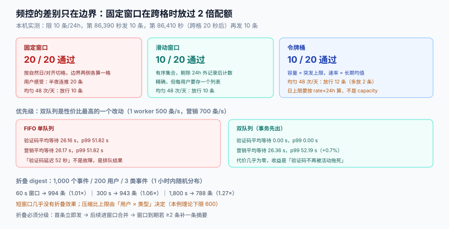

# 频控与折叠：三种窗口算法与优先级

频控的目标不是「限制条数」，是**限制打扰**。这两件事在均匀流量下等价，在突发流量下完全不同：一个活动在 10 分钟内推 3 条，比一天推 10 条更让人反感；而固定窗口的算法对此毫无感知。

本页回答四个问题：窗口怎么选、维度怎么定、优先级怎么插队、太多条怎么折叠成一条。



本页判据族 `NDT-A` ~ `NDT-H`，共 8 条。定义表见文末「本页判据」一节。

## 一、三种窗口：固定、滑动、令牌桶

三者的差别只在**边界**：固定窗口把时间切成格子，滑动窗口看「过去 24 小时」，令牌桶按速率匀速回填。

本机实测（限 10 条/24 小时，用户在第 86,390 秒连发 10 条，第 86,410 秒——跨过窗口边界 20 秒后——再连发 10 条）：

| 算法 | 通过条数 | 问题 |
| --- | --- | --- |
| **固定窗口**（按自然日/按 24h 对齐切格） | **20 / 20** | 边界处可发 2 倍配额。用户视角：半夜连推 20 条 |
| **滑动窗口**（有序集合，去掉 24h 外的记录） | **10 / 20** | 精确，但每个用户要存一个列表 |
| **令牌桶**（容量 10，速率 10/24h） | **10 / 20** | 精确挡边界，且内存是 O(1)（只存令牌数 + 时间戳） |

再换一个场景——均匀发送 48 次/天（每 30 分钟一次）：

| 算法 | 通过条数 | 说明 |
| --- | --- | --- |
| 固定窗口 | 10 | 第 11 次起拒绝 |
| 滑动窗口 | 10 | 同上 |
| **令牌桶** | **12** | **多放 2 条**：前 10 次消耗完容量后，速率仍在回填，一天内又攒出 2 个令牌 |

令牌桶多放 2 条不是 bug，是它的语义：**桶容量是突发上限，速率是长期均值**。所以配置令牌桶时，「日上限」要按 `rate × 24h` 而不是 `capacity` 来算——如果你的合规要求是「每天最多 10 条营销短信」，令牌桶的 `capacity` 必须设为 10 且 `rate` 设为 0（纯计数），否则一定超。

::: danger 注意
1. **不要用「自然日」做固定窗口**。用户在 23:59 收到 10 条、00:01 再收到 10 条，是同一个夜间被打扰 20 次；而在合规口径下，「每日上限」通常按**滚动 24 小时**理解。两者在边界上差一倍。
2. **不要用「先查再写」实现计数**。`GET` 判限额、`INCR` 记账的两步之间，并发请求会全部通过。必须用一次原子操作（Redis `INCR` + `EXPIRE`，或 `INCR` 后判返回值）。
3. **不要把所有维度塞进一个 key**。`user:{id}:all` 这种 key 会让你无法回答「他到底是被哪一类拦下的」，也无法做分类豁免。
:::

### 一个够用的实现

```lua
-- Redis：滑动窗口日志（精确，适合高价值通道如短信）
-- KEYS[1] = fc:{user_id}:{category}:{channel}
-- ARGV[1] = now_ms, ARGV[2] = window_ms, ARGV[3] = limit
local key, now, win, limit = KEYS[1], tonumber(ARGV[1]), tonumber(ARGV[2]), tonumber(ARGV[3])
redis.call('ZREMRANGEBYSCORE', key, 0, now - win)   -- 清掉窗口外
local used = redis.call('ZCARD', key)
if used >= limit then
  return {0, used}                                   -- 拒绝，返回已用
end
redis.call('ZADD', key, now, now .. ':' .. math.random(1000000))
redis.call('PEXPIRE', key, win)
return {1, used + 1}
```

```lua
-- Redis：令牌桶（省内存，适合高频低价值通道如站内信）
-- ARGV: now_ms, rate_per_ms, capacity
local k, now, rate, cap = KEYS[1], tonumber(ARGV[1]), tonumber(ARGV[2]), tonumber(ARGV[3])
local t = redis.call('HMGET', k, 'tokens', 'ts')
local tokens = tonumber(t[1]) or cap
local ts = tonumber(t[2]) or now
tokens = math.min(cap, tokens + (now - ts) * rate)
local ok = 0
if tokens >= 1 then tokens = tokens - 1; ok = 1 end
redis.call('HMSET', k, 'tokens', tokens, 'ts', now)
redis.call('PEXPIRE', k, math.ceil(cap / rate) + 1000)
return ok
```

两段脚本都是**单次往返 + 原子**，这是它们唯一的正确性来源。

## 二、计数维度：三个必须，两个不要

| 维度 | 要不要进 key | 理由 |
| --- | --- | --- |
| `user_id` | **必须** | 频控的对象是人 |
| `category` | **必须** | 事务必须豁免，营销必须更严 |
| `channel` | **必须** | 「一天 3 条短信」和「一天 3 条推送」不是同一件事 |
| `tenant_id` | 不要（进 key） | 租户配额是另一套（见[多租户 SaaS](../../MultiTenantSaaS/index.md)），混进用户 key 会让租户级统计变复杂 |
| `template_key` | 不要 | 模板是内容维度，把它加进 key 等于「每类消息各有一份配额」——配额失去意义 |
| `device_id` | 不要 | 一个用户多设备，按设备计数会让「换手机就重置配额」成为漏洞 |

三维（用户 × 类别 × 通道）× 每类每天一条记录，规模是可算的：100 万日活 × 4 类 × 3 常用通道 ≈ **1,200 万个 key**。用 `EXPIRE` 自动过期，内存可控；如果嫌多，可以只对**受限类别**（营销、协同）计数——事务型本来就不进配额。

## 三、配额分层：日、周、月各管一件事

单层配额挡不住「每天 3 条、连续 30 天」的骚扰。三层配额各管一个时间尺度：

| 层 | 典型值 | 挡的是什么 |
| --- | --- | --- |
| 日 | 营销 2 / 协同 20（折叠后） | 单日爆发 |
| 周 | 营销 5 | 「一天 2 条、天天发」的累积 |
| 月 | 营销 10 / 全类别 60 | 长期骚扰 |

实现上不必三套算法：**用同一个滑动窗口，只是 `window` 与 `limit` 不同**。三层都过才算放行，拒绝时返回**最紧的那一层**（这样运营看到的拒绝原因才是可行动的）。

## 四、优先级：为什么必须有两条队列

频控只决定「能不能发」，不决定「先发谁」。当一个活动把投递队列打满时，**验证码会排在营销消息后面**——这是通知系统最严重的一类事故，因为它的表现是「验证码延迟 50 秒」，而不是「系统挂了」。

本机做了一次离散事件仿真（1 个 worker、500 条/秒、营销 700 条/秒持续注入 180 秒、事务 5 条/秒）：

| 调度策略 | 事务平均等待 | 事务 p99 | 营销平均等待 | 营销 p99 |
| --- | --- | --- | --- | --- |
| **FIFO（单队列）** | **26.16 s** | **51.82 s** | 26.17 s | 51.82 s |
| **双队列优先（事务先出）** | **0.00 s** | **0.00 s** | 26.36 s | 52.19 s |

结论很干脆：**双队列让事务消息的 p99 从 51.82 秒降到 0 秒，代价是营销消息的 p99 只涨了 0.37 秒（+0.7%）**。这是整个专题里性价比最高的一个改动。

三条实现纪律：

1. **优先级按类别定，不按通道定**。「短信优先于推送」是错的——一条营销短信不该插到一条验证码推送前面。
2. **优先级队列必须有老化（aging）**。低优先级在队列里等太久要提权，否则活动期间的低优先级消息会被饿死（这里表现为「活动结束后才收到三天前的通知」）。
3. **优先级不跨租户**。多租户场景下，一个租户的活动不该挤占另一个租户的事务消息；这需要「租户内优先 + 租户间公平」两级调度。

## 五、折叠：把 N 条合成 1 条

对协同型通知，「今天有 8 个人 @ 你」不需要 8 条推送，一条「8 条新提及」更好。折叠（digest）就是按 `(user, category, 时间窗)` 合并。

本机实测（1,000 个事件、200 个用户、每用户 5 个事件、3 种类型，事件在 1 小时内随机分布）：

| 折叠窗口 | 折叠后条数 | 压缩比 |
| --- | --- | --- |
| 60 s | 994 | 1.01× |
| 300 s | 943 | 1.06× |
| 1,800 s | **788** | **1.27×** |

三个可直接用的结论：

1. **短窗口几乎没有折叠效果**。60 秒窗口只省 6 条——因为真实事件本来就分散在几分钟里。想要明显收益，窗口至少要 15 分钟以上。
2. **压缩比的上限由「用户 × 类型」决定**，不是由窗口决定。200 用户 × 3 类型 = 600 是理论上限，1,800 秒窗口做到 788 已经接近极限（剩下的是同一用户同一类型跨了窗口）。
3. **折叠会引入延迟**。1,800 秒窗口意味着「最后一条要等 30 分钟才发」。所以折叠必须**分级**：第一条立即发，后续的进窗口合并，窗口结束时若累计 ≥ 2 条再补一条摘要。

::: tip 折叠的三种触发方式
① **时间驱动**：窗口到期发摘要（简单，但有延迟）；② **计数驱动**：累计满 N 条立即发（适合高频场景，如 CI 失败通知）；③ **事件驱动**：出现「更强」的事件时提前结束窗口（如「被指派」优先级高于「被评论」）。生产上三者叠加：时间兜底、计数提前、强事件打断。
:::

## 六、静默配额：别把压后的消息堆到早上 8 点

静默时段（见[偏好中心](../Preferences/index.md)）会把夜间消息压后。如果所有压后消息都在 08:00 一起发，你只是把「半夜骚扰」变成了「早高峰轰炸」，顺带把投递系统打出一个尖峰。

处理办法是**在配额层做二次限制**：

| 时间段 | 营销配额 | 协同配额 | 说明 |
| --- | --- | --- | --- |
| 08:00–09:00（补发高峰） | 0（只发前一天折叠摘要 1 条） | 1 | 补发窗口内的消息必须合并 |
| 09:00–21:00 | 正常 | 正常 | — |
| 21:00–22:00 | 0（当日额度已用尽则不发） | 正常 | 睡前不打营销 |
| 22:00–08:00 | 0 | 0（折叠进次日摘要） | 静默 |

补发高峰用「1 条摘要」而不是「N 条补发」，是这一节唯一需要记住的设计。

## 七、频控与业务的关系：三个反模式

| 反模式 | 表现 | 后果 |
| --- | --- | --- |
| **频控写在业务代码里** | 每个业务方自己 `if (count < 3) send()` | 规则不一致，且无法统一豁免事务型 |
| **频控按「发送成功」计数** | 失败的不计数 | 重试会把配额打穿：一次发送 3 次重试 = 用掉 3 个配额 |
| **频控拒绝后静默丢弃** | 直接 `return` | 用户永远不知道「有一条通知没发」，运营也看不到拒绝率 |

第一项的正确做法是**决策段统一入口**：任何通知都必须经过 `decide()`，业务方只能提供 `(event, category, vars)`。第二项的正确做法是**在决策放行时计数**（一次决定 = 一个配额），投递重试不再消耗配额——重试是投递段的事，与配额无关。

## 八、本页判据

| 编号 | 看什么现象 | 判成什么 | 不满足时改哪里 |
| --- | --- | --- | --- |
| `NDT-A` | 窗口是否用滑动/令牌桶，是否存在自然日固定窗口 | 固定窗口即失败：边界可发 2 倍 | 换滑动窗口或令牌桶 |
| `NDT-B` | 计数是否为单次原子操作 | 先查再写即失败：并发穿透 | Lua 脚本或 `INCR` 返回值判定 |
| `NDT-C` | 令牌桶的 `rate × 24h` 是否等于合规日上限 | 只用 `capacity` 算上限即失败：实测多放 2 条 | `capacity = rate×24h` 或纯计数 |
| `NDT-D` | key 是否含 (用户, 类别, 通道) 三维 | 缺少类别即失败：事务无法豁免 | 三维 key + 类别豁免表 |
| `NDT-E` | 是否有多时间尺度配额（日/周/月） | 只有日配额即失败：挡不住「天天发」 | 同算法三次评估，取最紧 |
| `NDT-F` | 是否有按类别的优先级队列 | 单队列即失败：事务 p99 达 51.82 s | 双队列 + 老化 |
| `NDT-G` | 折叠是否分级（首条即发 + 窗口摘要） | 全部压到窗口结束即失败：延迟 30 分钟 | 首条直发 + 计数/强事件打断 |
| `NDT-H` | 配额是否在「决策放行」时计，而非「发送成功」时计 | 按成功计数即失败：重试打穿配额 | 放行即计数，重试不计数 |

## 参考资料

- [偏好中心](../Preferences/index.md)（静默时段与退订）
- [投递与回执](../Delivery/index.md)（重试与配额的关系）
- [多租户 SaaS 架构](../../MultiTenantSaaS/index.md)（租户维度的配额）
- Redis, *INCR / ZADD / Lua scripting* 文档（原子计数实现）：<https://redis.io/docs/latest/commands/incr/>
- Cloudflare, *Token bucket vs sliding window*（限流算法对照）：<https://blog.cloudflare.com/counting-things-a-lot-of-different-things/>
