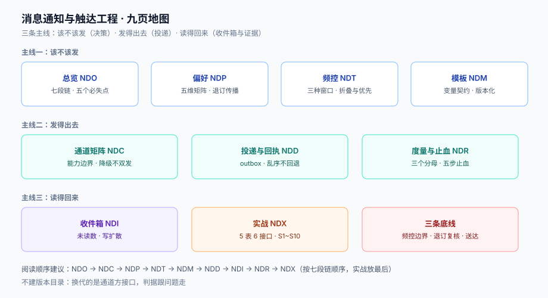

# 消息通知与触达工程

一条通知从「业务发生了一件事」到「用户手机上亮了一下」，中间要过**七道闸**：该不该发、发给谁、什么时候发、发几次、长什么样、走哪条通道、到底送到没。每一道闸走错，用户感知到的都是同一个词——**烦**；每一道闸漏掉，用户感知到的是另一个词——**没收到**。

本专题只讲这七道闸的工程实现：通道怎么选、偏好怎么存、频控怎么算、模板怎么渲染、投递怎么保证、收件箱怎么读、送达怎么证。营销活动的策划、文案怎么写、增长怎么算，不在范围内。

::: tip 一句话理解
通知系统不是「把消息发出去」，而是**在有限的用户注意力上做配额管理**——发得少但发得准，比发得多但发得烂，送达率和信任度都更高。
:::

::: info 本专题与相邻专题的分工
- **邮件的投递协议与发信声誉** → [邮件送达工程](../EmailDeliverability/index.md)：那 11 页讲 SPF/DKIM/DMARC、退信分类、预热与 IP 声誉，回答「这封信能不能进收件箱」；本专题只把邮件当成**一条通道**，回答「这条事件该不该走邮件」。
- **项目侧的收件箱读接口** → [TeamBoard · 通知中心读接口](../../../project/Complete/TeamBoard/NotificationCenter/index.md)：那页是一个具体租户系统的实现（未读数、已读游标、权限过滤），本专题提供它背后的**读模型取舍算式**。
- **同意、撤回与删除传播** → [隐私工程 · 同意与目的](../../Others/PrivacyEngineering/ConsentPurpose/index.md)：同意的五态与撤回传播在那边，本专题只讲「撤回之后，已经排进队列的那条消息怎么办」。
- **至少一次投递与消费幂等** → [消息队列 · 幂等](../MessageQueue/Idempotency/index.md)：队列语义在那边，本专题讲「同一条事件被投三次时，通知去重的键长什么样」。
- **写侧幂等键** → [幂等与状态机工程](../IdempotencyStateMachine/IdempotencyKey/index.md)：`Idempotency-Key` 的形状与去重表在那边，本专题复用它的结论，只补**通知侧**的折叠维度。
- **订单事件从哪来** → [订单状态机](../Ecommerce/OrderStateMachine/index.md)：十个状态、十六条迁移在那边，本专题消费它发出的事件，不重新定义状态。
- **告警阈值的定法** → [监控与告警](../../Ops/Monitoring/index.md)：告警的技术形态在那边，本专题只给对方一组**触达侧的分母**（送达率、投诉率怎么算才不骗人）。
- **移动端推送权限与 PWA** → [PWA](../../Frontend/PWA/index.md)：浏览器权限申请时机在那边，本专题讲「权限被拒绝之后怎么降级」。
- **多租户的配额与计量** → [多租户 SaaS 架构](../MultiTenantSaaS/index.md)：租户维度的配额执行在那边，本专题讲「用户维度」的频控，两者维度不同、不可复用同一张计数表。
:::

## 目录

- [总览：一条通知的七道闸](Overview/index.md)
- [通道矩阵：每组通道能保证什么、不能保证什么](Channels/index.md)
- [偏好中心：订阅、静默与退订的传播](Preferences/index.md)
- [模板与渲染：变量契约、缺失与版本](Templates/index.md)
- [频控与折叠：三种窗口算法与优先级](Throttling/index.md)
- [投递与回执：至少一次、去重与退信](Delivery/index.md)
- [收件箱读模型：未读数、游标与扩散方式](Inbox/index.md)
- [度量与止血：送达率的分母、告警与降级](Operations/index.md)
- [实战：一条能验收的最小触达链路](Practice/index.md)

## 专题地图

## 判据纪律

沿用全库写法：**每页 8 条，编号形如 `NDO-A`**，逐页前缀唯一，可被 `utils/audit` 下的判据类巡检机械核对。每条判据回答四件事：**看什么现象、判成什么、不满足时改哪里**。

| 页 | 判据族 | 这一族管什么 | 条数 |
| --- | --- | --- | --- |
| 总览 | `NDO-A` ~ `NDO-H` | 七段链、四类通知、三个分母、五个必失点 | 8 |
| 通道矩阵 | `NDC-A` ~ `NDC-H` | 通道能力表、回执语义、降级顺序、成本 | 8 |
| 偏好中心 | `NDP-A` ~ `NDP-H` | 订阅五态、事务豁免、静默时段、时区、退订传播 | 8 |
| 模板与渲染 | `NDM-A` ~ `NDM-H` | 变量契约、缺失变量、渲染位置、版本化、i18n | 8 |
| 频控与折叠 | `NDT-A` ~ `NDT-H` | 三种窗口、计数维度、优先级、digest、静默配额 | 8 |
| 投递与回执 | `NDD-A` ~ `NDD-H` | outbox、幂等键、退避、死信、回执状态机 | 8 |
| 收件箱读模型 | `NDI-A` ~ `NDI-H` | 未读数、已读游标、写扩散、分页、实时 | 8 |
| 度量与止血 | `NDR-A` ~ `NDR-H` | 送达率分母、投诉率、告警、降级、止血顺序 | 8 |
| 实战 | `NDX-A` ~ `NDX-H` | 表结构、接口契约、验收序列、负向断言 | 8 |

合计 **9 族 72 条**。

## 事实与规格速览（2026-10 口径）

通知这块的「版本」不体现在你自己的代码里，而体现在**通道方的接口与规则**上——它们变一次，你就得改一次。下面这些是写代码前必须知道的事实：

| 事项 | 现状 | 对实现的影响 |
| --- | --- | --- |
| Android 推送接口 | Firebase Cloud Messaging **legacy HTTP API 已于 2024-06-20 停用**，只剩 HTTP v1（OAuth 2.0 服务账号令牌，`POST /v1/projects/{id}/messages:send`） | 还在用 `fcm/send` + server key 的代码是**死代码**；批量发送官方上限 **500 条/次**（`sendEach`） |
| iOS 推送接口 | APNs 走 HTTP/2，鉴权用 **token-based（`.p8` + JWT，`ES256`）** 或证书；JWT 需在 **1 小时内**刷新，官方建议 **20~60 分钟** | 每条连接可复用，但 JWT 不能缓存过久；`apns-push-type` 必填（`alert`/`background`…），填错会被拒 |
| Web 推送 | Web Push 走 **VAPID（RFC 8292）**，载荷加密用 **aes128gcm（RFC 8188）** | 订阅对象有 `endpoint` + 两个密钥；`endpoint` 会过期，**410/404 必须删订阅** |
| 一键退订 | **RFC 8058**：`List-Unsubscribe` + `List-Unsubscribe-Post: List-Unsubscribe=One-Click`，邮箱方直接向你 POST | 批量发信（Gmail/Yahoo 口径 **5,000 封/天/服务商**）必须带这两个头，且**不能要求登录或二次确认** |
| 批量发信要求 | 2024-02 起 Gmail/Yahoo 强制：SPF + DKIM + DMARC（≥`p=none`）且与 `From` 对齐、一键退订、垃圾邮件投诉率 **< 0.3%**（建议 < 0.1%）；微软 2025-05 起同规则 | 通知类邮件与营销类邮件**必须分域或分 IP**，否则一封营销投诉会拖累登录验证码 |
| 商业短信 | 《通信短信息和语音呼叫服务管理规定》（工信部令第 51 号，**2020-09-01 施行**）：未经用户同意或请求，不得发送商业性短信息；短信须**签名 + 模板报备** | 「营销短信」与「验证码短信」是两条完全不同的合规路径，代码里必须是两个 `category` |
| 个人信息处理 | 《个人信息保护法》第十五条（撤回同意）、第二十四条（自动化决策与信息推送应提供**便捷的拒绝方式**）、第十七条（告知） | 退订入口必须**和推送本身一样便捷**；「回复 TD 退订」只是渠道要求，不是产品豁免 |
| 时区与夏令时 | IANA tzdb 每年多次更新；同一 `tzinfo` 的两个 `datetime` 相减**忽略偏移**（本机实测：纽约 2026-03-08 墙钟差 24 小时，真实经过 **23 小时**） | 静默时段、每日配额、定时投放**必须换算到 UTC 或时间戳**再比较，不能拿本地墙钟做减法 |

## 为什么这里没有版本目录

本专题**不建 `v1/` `v2/` 这类版本目录**，理由三条：

1. **换代的是通道方接口，不是判据**。FCM 从 legacy 换到 v1、APNs 从证书换到 token、Web Push 从 `aesgcm` 换到 `aes128gcm`——换的都是「怎么把这段字节交给它」；而「同一事件不能发两次」「静默时段不能吵醒人」「未读数不能算错」这三类问题一字未变。判据跟着问题走，不跟着接口走。
2. **并存差异是「多通道并存」，不是「新旧两代」**。同一时刻你必然同时在用邮件、短信、推送、站内信、IM Webhook——它们是**五条并行通道**，不是五个版本。按版本建目录会把「通道对照」拆成「历史存档」，读者反而要跨目录才能比较。
3. **可验证的差异已收敛进两张表**。凡是「两种做法」的地方（固定窗口 vs 滑动窗口、写扩散 vs 读扩散、`count(*)` vs 计数器），都用同一张表写清「什么时候用哪个、差多少」，并附本机读数。

作为对照，本库确实存在需要版本目录的主题：[Spring 5 / Spring 6](../Java/Frame/Spring/index.md)、[Vue 2 / Vue 3](../../Frontend/Frame/Vue/index.md)、[MCP 两代协议](../../AI/AgentToolProtocol/index.md)、[MySQL 5.7 / 8.4](../../DB/SchemaEvolution/index.md)——它们的共同点是**同一个产品的两代 API 不兼容且旧版仍在跑**，与本题不同。

## 三条底线

::: danger 三条不可让步的底线
1. **频控必须能拦住「跨窗口边界」的爆发**。本机实测：同一个用户在第 86,390 秒连发 10 条、第 86,410 秒（跨过 24 小时窗口边界 20 秒后）再连发 10 条，**固定窗口放过了全部 20 条**，滑动窗口与令牌桶各只放 10 条。用户看到的不是「配额用完了」，而是「你们半夜连推我 20 条」。见[频控与折叠](Throttling/index.md)。
2. **退订必须在「发送那一刻」再判一次，不能只在入队时判**。本机模拟 10,000 人投放、5% 在投放过程中退订、队列抖动最多 60 秒：只在入队时判定会多发出 **6 条**给已退订的人（9,999 vs 9,993）。一条退订后的营销短信，在监管口径下就是一次违规。见[偏好中心](Preferences/index.md)。
3. **「已送达」不能等于「接口返回 200」**。通道方的 200 只代表**它收下了**：短信返回 `OK` 后仍可能因空号、关机、黑名单而失败，推送返回 `message_id` 后仍可能因 token 失效而不投。回执必须是一条**独立的状态机**（已提交 → 已送达 → 已失败/已退订/已投诉），且每个状态都有自己的分母。见[投递与回执](Delivery/index.md)。
:::

## 阅读顺序

先读[总览](Overview/index.md)拿到七道闸的全局图，然后按手上的问题选主线：

- **用户说「没收到验证码」** → [通道矩阵](Channels/index.md) 的降级顺序 → [投递与回执](Delivery/index.md) 的回执状态机
- **用户说「一天推我十几条」** → [频控与折叠](Throttling/index.md) → [偏好中心](Preferences/index.md) 的静默时段
- **运营说「活动发不出去」** → [度量与止血](Operations/index.md) 的送达率分母 → [通道矩阵](Channels/index.md) 的通道限额
- **要做「未读红点」和「消息中心页」** → [收件箱读模型](Inbox/index.md)
- **模板改了字，线上还是旧的** → [模板与渲染](Templates/index.md) 的版本化与同源
- **要从零搭一条能验收的链路** → [实战](Practice/index.md)，按 S1~S10 走
- **正在被投诉，先止血** → [度量与止血](Operations/index.md) 的五步止血顺序

## 参考资料

- RFC 8058, *Signaling One-Click Functionality for List Email Headers*：<https://www.rfc-editor.org/rfc/rfc8058>
- RFC 8292, *Voluntary Application Server Identification (VAPID) for Web Push*：<https://www.rfc-editor.org/rfc/rfc8292>
- RFC 8030, *Generic Event Delivery Using HTTP Push*（Web Push 协议本体，含 410/404 语义）：<https://www.rfc-editor.org/rfc/rfc8030>
- Firebase Cloud Messaging HTTP v1 文档（含 legacy API 停用说明与 500 条批量上限）：<https://firebase.google.com/docs/cloud-messaging/migrate-v1>
- Apple Developer, *Sending notification requests to APNs*（HTTP/2、JWT 刷新周期、`apns-push-type`）：<https://developer.apple.com/documentation/usernotifications/sending-notification-requests-to-apns>
- Google, *Email sender guidelines*（5,000 封阈值、SPF/DKIM/DMARC、一键退订、0.3% 投诉率）：<https://support.google.com/a/answer/81126>
- 工业和信息化部《通信短信息和语音呼叫服务管理规定》（令第 51 号，2020-09-01 施行）：<https://www.miit.gov.cn/>
- 《中华人民共和国个人信息保护法》全文（国家法律法规数据库）：<https://flk.npc.gov.cn/>
- IANA Time Zone Database：<https://www.iana.org/time-zones>
