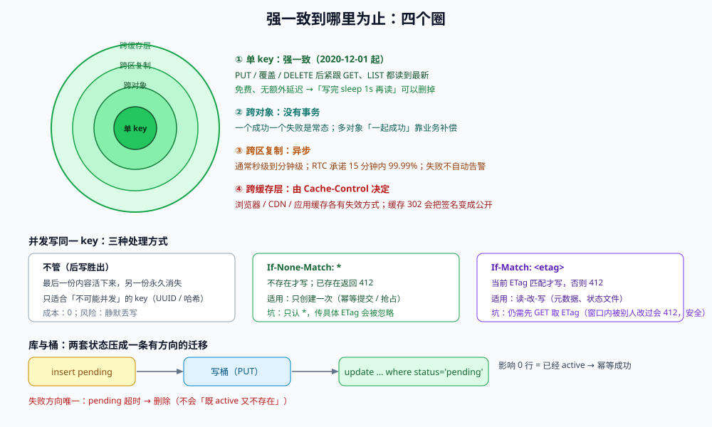

# 一致性与并发写：读到的是不是刚写的那份

关于对象存储的「一致性」，流传最广的一句话是错的：**「对象存储是最终一致的」**。这句话在 2020 年 12 月 1 日之后对 S3 已经不成立——它现在对 PUT（新建与覆盖）、DELETE、LIST 都提供**强一致**，不加价、不加延迟。

但这条强一致有一个非常明确的边界：**它是「单个 key」的、是「单个桶」的、是「同一个区域端点」的**。一旦跨出这三个圈——跨对象、跨区复制、跨缓存层——一致性立刻退化，而且退化时**没有错误码**。

::: tip 一句话定位
对象存储给你的是「**单 key 线性一致**」；你以为你需要的「多个对象一起成功」「跨区立即可见」「CDN 立刻刷新」，它一个都没给——这些必须自己补。
:::

本页判据族 `OSC-A` ~ `OSC-H`，共 8 条。定义表在第七节。



## 一、四个圈：强一致到哪里为止

| 圈 | 范围 | 一致性 | 典型误判 |
| --- | --- | --- | --- |
| **① 单 key** | 同一桶、同一区域端点 | **强一致**（PUT / 覆盖 / DELETE 后紧跟 GET、LIST 都读到最新） | 还以为需要「写入后等 1 秒再读」 |
| **② 跨对象** | 同一桶内多个 key | **无事务**：一个成功一个失败是常态 | 以为「批量上传要么全成要么全败」 |
| **③ 跨区复制** | 源桶 → 目标桶（CRR / 双写） | **异步**，通常分钟级；失败会重试 | 以为切到备区就能读到刚写的数据 |
| **④ 跨缓存层** | CDN / 反向代理 / 本地缓存 | **由 `Cache-Control` 与失效策略决定** | 以为「桶里换了，用户就看到新的」 |

::: warning 「强一致」这条事实要写进文档，否则团队会继续按旧常识设计
Amazon S3 自 **2020-12-01** 起对所有区域提供强读后写一致性：一个新的 PUT 完成后，任何后续的 GET 都会返回该对象；覆盖写与删除同理；LIST 也能立即反映变更。官方明确这是**免费且无性能代价**的。
这条事实的直接后果是：**「写完 sleep 1 秒再读」的代码可以删掉**，而「靠最终一致来给架构留余地」的设计需要重新审视。
:::

## 二、并发写同一个 key：后写胜出，除非你加条件

强一致说的是「写完之后的读」，**不包括「两个写同时发生」**。两个并发 PUT 到同一个 key，结果是「后到的覆盖先到的」——**没有任何冲突提示**，最后只剩一份，另一份内容永久消失。

三种处理方式：

| 方式 | 语义 | 适用 | 边界 |
| --- | --- | --- | --- |
| **不管**（后写胜出） | 最后一次写生效 | key 天然唯一（UUID / 内容哈希） | 只适合「不可能并发」的 key |
| **`If-None-Match: *`** | 不存在才写；已存在返回 `412 Precondition Failed` | 「只创建一次」：幂等提交、去重落地、抢占式创建 | 不支持「已存在则比较内容」；不支持指定某个 ETag |
| **`If-Match: <etag>`** | 当前 ETag 匹配才写；不匹配返回 `412` | 读-改-写（如元数据覆盖、状态文件） | 需要先 GET 取 ETag，仍有「取完到写之间」的窗口（但窗口内若被别人改过会 412，安全） |

```python
# conditional_put.py —— 「只创建一次」的落地写法（幂等提交的关键）
import boto3
from botocore.exceptions import ClientError

s3 = boto3.client("s3")

def put_once(bucket: str, key: str, body: bytes) -> bool:
    """返回 True 表示本次写入成功；False 表示对端已存在（不是我写的）。"""
    try:
        s3.put_object(Bucket=bucket, Key=key, Body=body, IfNoneMatch="*")
        return True
    except ClientError as e:
        if e.response["Error"]["Code"] in ("PreconditionFailed", "412"):
            return False
        raise
```

::: danger 条件写的三个坑
1. **`If-None-Match` 只认 `*`**：传一个具体 ETag 进去在写请求上会被忽略（不报错），你以为做了「版本比对」，实际是普通覆盖。
2. **`412` 被当成失败重试**：幂等场景下 `412` 是**成功的一种**（对端已经写好了）。重试会让日志充满「失败」，并可能引发重复副作用。
3. **条件写不能替代数据库唯一约束**：桶里的 `412` 是「对象不存在」，不是「业务记录不存在」。业务唯一性仍要靠数据库，两者是**两道闸**而不是一道。
:::

## 三、跨区复制：RPO 不是一个数字，是一个分布

开了跨区复制（CRR）之后，「备区能读到最新数据」是一个**概率性**承诺：

| 指标 | 现实 |
| --- | --- |
| 复制延迟 | 通常秒级到分钟级；官方对**复制时间控制（RTC）**承诺 15 分钟内 99.99% 的对象完成复制 |
| 失败 | 复制失败会重试（默认几天），仍失败则进入 `FAILED` 状态，**不会自动告警** |
| 删除 | 删除标记是否复制取决于配置（`DeleteMarkerReplication`），不配就「源区删了备区还在」 |
| 版本 | 复制的是**版本**，不是「最新内容」；版本控制必须两边都开 |

所以「切到备区」这个动作的时间点必须由**复制指标**决定，而不是由「我们已经开了 CRR」决定：

```shell
# 复制延迟与失败：用 CloudWatch 的 ReplicationLatency 与 OperationsFailedReplication
aws cloudwatch get-metric-statistics --namespace AWS/S3 --metric-name ReplicationLatency \
  --dimensions Name=SourceBucket,Value="$BUCKET" Name=DestinationBucket,Value="$REPLICA" \
  Name=RuleId,Value="$RULE" --start-time "$(date -u -v-1H +%FT%TZ)" \
  --end-time "$(date -u +%FT%TZ)" --period 60 --statistics Maximum

# 未完成的复制：列出版本级的复制状态（需要 S3 Inventory 或 ListObjectVersions 的 ReplicationStatus）
aws s3api list-object-versions --bucket "$BUCKET" --prefix "attachments/" \
  --query 'Versions[?ReplicationStatus!=`COMPLETED`].[Key,VersionId,ReplicationStatus]' --output table
```

::: danger 「切备区」前必须回答的三个问题
1. **备区读到的最后一条写入是什么时候？** 没有这个时间点，「切换」就是拿一个未知状态的副本顶上。
2. **删除标记复制了吗？** 没复制的话，源区已删的敏感文件在备区**仍然可读**。
3. **写路径切过去之后，回切时谁补数据？** 双写期间两个区各有一半新数据，回切必须做双向对账。
:::

## 四、跨缓存层：最容易被当成「存储 bug」的一层

「我明明覆盖了，用户还是看到旧图」——90% 不是存储的问题，是缓存。三层缓存各有各的失效方式：

| 层 | 缓存键 | 失效方式 | 陷阱 |
| --- | --- | --- | --- |
| **浏览器** | URL | 用户刷新 / 强刷 | `max-age=31536000` 时用户永远看不到新版 |
| **CDN** | URL + 若干头 | 主动 purge / 等 TTL | purge 有延迟（秒级到分钟级），且按 URL 逐条 |
| **应用内缓存** | 业务键 | 主动删键 | 「删了缓存但对象还没写完」→ 缓存回源拿到旧对象 |

**根治方案是「key 不可变」**（见[键空间](../KeysLayout/index.md)）：内容变了就换 key，所有缓存层都不需要失效，`max-age` 可以放心设一年。代价是「URL 会变」，所以业务侧要有一个稳定的间接层（接口返回当前 key）。

::: danger 一个真实的组合故障
页面把「下载链接」做成了 `302` 跳转到**预签名 URL**，而 CDN 缓存了这个 `302`：
1. 第一个用户拿到 `302`，CDN 缓存 5 分钟；
2. 5 分钟内所有用户都被导向**同一个预签名 URL**（同一个签名、同一个过期时间）；
3. 该 URL 过期后，所有人拿到 `403`，直到缓存过期；
4. 更糟的是——这个 URL 是**可转发的 bearer token**，缓存它等于把它公开。

正确做法：`302` 响应必须 `Cache-Control: no-store`；或者签名在 CDN 边缘完成（边缘签名），不把签名结果交给共享缓存。
:::

## 五、数据库与桶：两套状态怎么不打架

业务里几乎一定有两套状态：**桶里的对象**与**数据库里的记录**。它们之间只有两种写入顺序，两种都会产生脏数据：

| 顺序 | 失败点 | 产生的脏数据 | 补法 |
| --- | --- | --- | --- |
| **先写桶，再写库** | 写库失败 | **孤儿对象**（桶里有、库里没有，无人引用、无人删除） | 定时对账：`LIST` 前缀 → 减去库中 key 集合 → 宽限期后删除 |
| **先写库，再写桶** | 写桶失败 | **幽灵记录**（库里有、桶里没有，用户点开 404） | 状态机：记录先 `pending`，桶写成功后 `active`；`pending` 超时回收 |

推荐形状是「**先落库为 pending → 写桶 → 条件更新为 active**」：

```sql
-- 状态机的两条语句（都在应用层同一事务外，靠条件更新保证幂等）
insert into attachment (id, tenant_id, object_key, status, created_at)
values ($1, $2, $3, 'pending', now());

-- 桶写入成功后：
update attachment set status = 'active', size_bytes = $3, sha256 = $4
 where id = $1 and status = 'pending';        -- 影响 0 行说明已经 active，直接返回成功
```

这条形状的好处是把「两套状态」压成**一条有方向的迁移**：`pending → active`，反向只有「超时回收 → 删除」，不会出现「既 active 又不存在」。

## 六、读己之写：跨服务时最常断的地方

单 key 强一致解决不了「我刚在 A 服务写完，B 服务读不到」。断点通常在这几处：

| 断点 | 表现 | 修法 |
| --- | --- | --- |
| **不同 region 端点** | A 区写、B 区读 | 读路径固定到主区端点；或读己之写时带 `ExpectedBucketOwner` + 主区 |
| **应用缓存** | 写完不清缓存 | 写后删键（不是更新键），并接受「删失败则短 TTL 兜底」 |
| **异步索引** | 写完等搜索引擎索引 | 返回「处理中」而不是「已完成」；或用「写后按 ID 直读」兜底 |
| **多副本读** | 读到了另一个副本 | 对象存储本身不做「多副本读」，这一条只在自建存储里出现 |

## 七、本页判据定义表

| 判据 | 约定 | 定错的后果 | 如何验证 |
| --- | --- | --- | --- |
| `OSC-A` | 同一 key 的覆盖写**必须有前置条件**（`If-None-Match` 或 `If-Match`），或 key 本身不可变 | 并发丢写，且无任何痕迹 | grep `put_object`，每次调用带 `IfNoneMatch`/`IfMatch` 或使用内容哈希 key |
| `OSC-B` | `412 PreconditionFailed` 被当作**幂等成功**处理，不进入重试队列 | 重试风暴、重复副作用 | 连续两次幂等提交，第二次日志为 `already_exists` 且无 ERROR |
| `OSC-C` | 删除是「删当前版本」还是「删所有版本」在文档中写明，且与用户提示一致 | 用户以为删了，实际只加了删除标记 | 删后 `list-object-versions` 无残留版本，或明确保留 N 个 |
| `OSC-D` | 跨区复制的 **RPO 目标**与**判定指标**（复制延迟、失败数）成文 | 「切备区」时数据状态未知 | 有 RPO 数值 + 监控项名 + 判定阈值 |
| `OSC-E` | 预签名下载的 `302` 响应带 `Cache-Control: no-store` | 共享缓存持有签名 URL，泄漏 + 集体过期 403 | `curl -sI` 该跳转接口，响应头含 `no-store` |
| `OSC-F` | 对外返回的 URL 一律使用**不可变 key**（含内容哈希或版本号），或经间接层解析 | 每次覆盖都要全链路失效 | 抽样接口返回的 URL，其 key 含 16 位以上哈希或版本段 |
| `OSC-G` | 库与桶之间有**方向明确的迁移**（`pending → active`）与对账任务 | 孤儿对象与幽灵记录长期累积 | `select count(*) from attachment where status='pending' and created_at < now()-interval '24 hours'` 为 0 |
| `OSC-H` | 「写完 sleep 再读」的代码不存在（强一致已覆盖） | 无谓延迟、掩盖真实竞态 | grep `sleep` 邻近 `get_object`/`head_object` 的调用点为 0 |

## 八、如何验证这一页

```shell
# 1. 强一致自测：写完立刻读，重复 20 次（每次用不同的 key，避免缓存干扰）
for i in $(seq 1 20); do
  k="consistency/$RANDOM-$i.bin"
  aws s3api put-object --bucket "$BUCKET" --key "$k" --body /etc/hosts --metadata seq="$i" >/dev/null
  got=$(aws s3api head-object --bucket "$BUCKET" --key "$k" --query 'Metadata.seq' --output text)
  [ "$got" = "$i" ] || echo "STALE $k want=$i got=$got"
done; echo "done"

# 2. 条件写：同一 key 连写两次
aws s3api put-object --bucket "$BUCKET" --key "ifnone/test" --body /etc/hosts --if-none-match '*' >/dev/null && echo "first=ok"
aws s3api put-object --bucket "$BUCKET" --key "ifnone/test" --body /etc/hosts --if-none-match '*' 2>&1 | grep -o 'PreconditionFailed'

# 3. 302 是否禁止缓存
curl -sI "https://app.example.com/download/$ID" | grep -i cache-control
```

预期：第 1 条只有一行 `done`（无 `STALE`）；第 2 条输出 `first=ok` 与 `PreconditionFailed`；第 3 条 `cache-control: no-store`。

## 参考资料

- Amazon S3《强一致性模型》：<https://docs.aws.amazon.com/AmazonS3/latest/userguide/Welcome.html#ConsistencyModel>（2020-12-01 起）
- AWS 博客《Amazon S3 条件写》：<https://aws.amazon.com/about-aws/whats-new/2024/08/amazon-s3-conditional-writes/>
- Amazon S3《跨区域复制与复制时间控制（RTC）》：<https://docs.aws.amazon.com/AmazonS3/latest/userguide/replication.html>
- Amazon S3《删除标记与版本控制》：<https://docs.aws.amazon.com/AmazonS3/latest/userguide/DeleteMarker.html>
- RFC 9111《HTTP Caching》（`no-store`、`max-age`、`Vary` 的语义）
