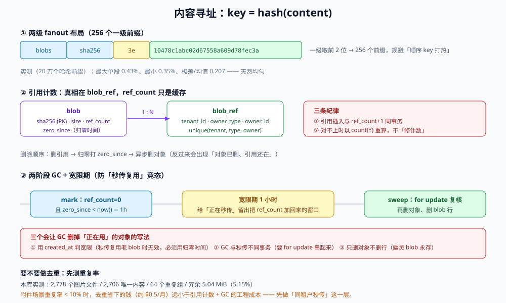

# 去重与内容寻址：同一份字节只存一次

当业务开始「同一张图被 8 个页面引用」「同一个安装包被 3 个版本共用」「用户反复上传同一份合同」时，存储成本的增长曲线就和业务增长脱钩了：**它跟着「上传次数」涨，而不是跟着「内容种类」涨**。

去重就是把这条曲线掰回来的手段。它有一个非常干净的实现方式——**内容寻址（content-addressed storage）**：key 不再是「谁传的、叫什么」，而是「内容的哈希」。代价是：删除变成引用计数、上传变成「先问再传」、而跨租户去重会带来一个法务问题。

::: tip 一句话定位
内容寻址把「文件名」和「内容」解耦：**key = hash(content)**。于是「同一份内容」天然只有一个 key，去重不需要额外逻辑；需要额外逻辑的是**删除**（引用计数）和**可见性**（谁能知道这个 key 存在）。
:::

本页判据族 `OSD-A` ~ `OSD-H`，共 8 条。定义表在第七节。



## 一、key 布局：为什么要两级 fanout

内容哈希是均匀随机的，直接平铺会有两个问题：**列举变慢**（单前缀对象无限增长）与**运维不可读**（你无法按前缀定位一批对象）。业界通用做法是取哈希前 2 位做一级目录：

```text
blobs/sha256/3e/3e10478c1abc02d67558a609d78fec3a
blobs/sha256/90/902dfe11e8e8a6d7b6a490e2d8031d26
```

`256` 个一级前缀，每个前缀下对象数约为总量 1/256。这正好解决了[键空间](../KeysLayout/index.md)里那个「顺序 key 把写入打热」的问题——内容哈希天然是均匀分布的，本机实测 20 万个哈希前缀的首段分布：**最大 0.43%、最小 0.35%、极差/均值 0.207**。

| 布局 | 一级前缀数 | 适用规模 | 备注 |
| --- | --- | --- | --- |
| `blobs/{hash}` | 1 | < 10 万对象 | 简单，但列举与运维都难受 |
| `blobs/{hash[:2]}/{hash}` | 256 | 10 万 ~ 1 亿 | **推荐默认** |
| `blobs/{hash[:2]}/{hash[2:4]}/{hash}` | 65,536 | > 1 亿 | 过度设计，除非单桶对象数确实过亿 |

## 二、去重能省多少：一次真实盘点

本机对文档库的全部配图做了一次内容哈希盘点（`docs/` + `project/` 下 2,778 个图片文件，逐个算 SHA-256）：

| 指标 | 读数 |
| --- | --- |
| 文件数 | **2,778** |
| 唯一内容数 | **2,706** |
| 重复组数 | **64** |
| 冗余字节 | **5.04 MiB** |
| 总字节 | 97.9 MiB |
| 冗余占比 | **5.15%** |

具体重复形态很有意思：

| 重复组 | 大小 | 说明 |
| --- | --- | --- |
| `test-pyramid.svg` ×2 | 1,636 B | 同一张图在「前端工程化」与「前端测试」两个专题各存一份 |
| `fe-logo.png` / `testing-logo.png` ×2 | 2,692 B | **文件名不同、内容相同**（同一 logo 被当两种用途存两次） |
| 两张截图 ×2 | 736,143 B / 408,173 B | 同一篇内容被复制到两个目录，配图也跟着复制 |

::: warning 这个读数说明什么
文档库的重复率只有 5%，因为图片大多是截图（内容天然不同）。但**「企业附件」场景的重复率通常高一个量级**：同一份合同模板、同一套发票、同一批产品图被不同人反复上传。判断要不要做去重，先跑一次这个盘点——**去重率 < 3% 时，去重带来的复杂度（引用计数 + GC + 秒传）通常不划算**。
:::

## 三、秒传的三条前提

「秒传」= 客户端先报哈希，服务端发现已存在就直接返回成功，不传字节。它看起来是纯赚，但有三个前提，缺一个就会出事：

| 前提 | 说明 | 缺了会怎样 |
| --- | --- | --- |
| **客户端可信地算出哈希** | 哈希必须在客户端算（上传前），而不是服务端拿到再算 | 服务端算 = 字节已经传完，秒传没意义 |
| **「存在」不能跨权限边界暴露** | 若「hash 存在 ⇒ 秒传成功」，攻击者可以拿一个已知文件的哈希去探测「别人的库里有没有这份文件」 | 隐私泄漏：知道 hash 就能确认对方持有该文件 |
| **配额照扣、审计照写** | 秒传只是省了字节，业务上仍是一次「新增附件」 | 配额被绕过；审计缺失，删不干净 |

第二条是最容易被忽略的合规问题。三种解法，按侵入性排序：

1. **按租户加盐**：`hash_tenant = sha256(tenant_salt ‖ content)`。跨租户天然不去重，本租户内仍然去重。**绝大多数 B 端产品的正确选择**。
2. **秒传只对「本租户已持有」生效**：查引用表 `where tenant_id = ? and sha256 = ?`，命中才秒传。
3. **全局去重 + 延迟确认**：客户端不直接得到「存在」的结论，只得到「请稍后」（异步任务回填）。复杂且用户体验差，一般不用。

::: danger 跨租户去重的两个隐藏代价
1. **删除语义变形**：租户 A 删除附件，物理对象不能删（租户 B 还在引用）。于是「删除」变成一个引用计数操作，而引用计数一旦漏减，对象永不回收——这类泄漏通常要半年后对着账单才发现。
2. **加密与去重互斥**：服务端对每个对象用不同密钥（SSE-KMS 每对象一密钥）时，**服务端看不到明文，也就无法去重**；客户端加密想保留去重就必须用**收敛加密**（密钥由内容派生），而这会带来「已知明文攻击」——攻击者有一份候选文件就能验证你是否存了它。
:::

## 四、引用计数：谁在引用这份内容

去重的代价全部集中在「删除」。一个可用的引用模型长这样：

```sql
-- 内容表：一份内容一行，sha256 是主键（内容寻址的根）
create table blob (
  sha256      char(64) primary key,
  size_bytes  bigint   not null check (size_bytes > 0),
  created_at  timestamptz not null default now(),
  ref_count   integer  not null default 0 check (ref_count >= 0)
);

-- 引用表：谁在用这份内容（附件、头像、导出包……）
create table blob_ref (
  id          bigserial primary key,
  sha256      char(64) not null references blob(sha256),
  tenant_id   uuid     not null,
  owner_type  text     not null,          -- attachment / avatar / export
  owner_id    uuid     not null,
  created_at  timestamptz not null default now(),
  unique (tenant_id, owner_type, owner_id)
);
create index on blob_ref (sha256);
create index on blob (ref_count) where ref_count = 0;   -- 给 GC 用的部分索引
```

**三条纪律**（写成判据，见 `OSD-D` ~ `OSD-F`）：

1. **引用与内容同事务**：新增附件 = `insert blob_ref` + `update blob set ref_count = ref_count + 1`，必须在**同一个事务**里。分开写就有「引用存在但计数没加」的窗口。
2. **`ref_count` 只是缓存，真相在 `blob_ref`**：任何对不上的时候，以 `blob_ref` 的 `count(*)` 为准重算，不要试图「修计数」。
3. **删除顺序是「先删引用，再异步删内容」**：反过来会出现「对象已删、引用还在」，读请求 404，而引用表看起来一切正常。

## 五、GC：两阶段 + 宽限期

引用计数归零就立刻删对象，会撞上一个经典竞态：**GC 判定「归零」的同时，另一个请求正在用同一个哈希做秒传**（它查到 blob 存在 → 返回秒传成功 → 此时对象被删 → 引用指向空）。

正确做法是两阶段 + 宽限期：

```text
阶段 1（mark）：select sha256 from blob where ref_count = 0 and created_at < now() - interval '1 hour'
阶段 2（sweep）：对每个候选，重新确认 ref_count 仍为 0（同一事务内 select ... for update），
                再删对象、删 blob 行
宽限期（1 小时）的作用：给「正在上传中的秒传」留出把 ref_count 加回来的窗口
```

::: danger 三个会让 GC 删掉「正在用」的对象的写法
1. **用 `created_at` 判断「新对象」**：秒传复用的老 blob `created_at` 很旧，宽限期对它无效——必须用「归零时间」而不是「创建时间」。所以 `blob` 表需要一个 `zero_since` 字段（`ref_count` 归零时写入，恢复引用时置空）。
2. **GC 与秒传不同事务**：GC 认为归零 → 秒传事务插入引用 → GC 删除对象。要靠 `select … for update` 把两者串起来，或者让秒传在插入引用时**同时**把 `ref_count` 从 0 加到 1 并检查影响行数为 1。
3. **GC 只删对象不删行**：`blob` 行留着，下次秒传查到「存在」，但对象 404——这类「幽灵 blob」会一直存活到有人手动清。
:::

## 六、加密、去重与冷层的三角关系

| 组合 | 去重效果 | 风险 |
| --- | --- | --- |
| 服务端加密（SSE-S3，桶级密钥） | **完全去重** | 密钥由服务商管，合规要求高时不可用 |
| 服务端加密（SSE-KMS，每对象一密钥） | **无法去重**（密文不同） | 成本高的同时失去去重收益 |
| 客户端加密（各自密钥） | 无法去重 | 最安全，最贵 |
| 客户端加密（收敛加密，密钥 = KDF(content)） | 可去重 | 已知明文攻击：持有候选文件者能验证你是否存了它 |
| 去重后再转冷层 | 去重与转层**互不影响** | 冷层取回费按「引用份数」还是「物理份数」算——按物理，因为只存一份 |

最后一行值得强调：**去重后的对象只有一份物理副本**，转冷层时也只转一份；但取回是「谁用谁付」，于是「热门内容被冷层拖慢」成为新的问题——热数据不要因为「去重后只剩一份」而被规则误转。

## 七、本页判据定义表

| 判据 | 约定 | 定错的后果 | 如何验证 |
| --- | --- | --- | --- |
| `OSD-A` | 内容寻址的 key 为 `blobs/sha256/{hash[:2]}/{hash}`，哈希算法与编码在文档中固定 | 平铺导致列举慢、运维不可读 | 抽样 key 匹配 `^blobs/sha256/[0-9a-f]{2}/[0-9a-f]{64}$` |
| `OSD-B` | 哈希在**客户端**计算并在上传前提交（秒传路径） | 秒传不成立，或服务端重复读字节 | 抓上传请求，首包含 `sha256` 字段且 body 为空 |
| `OSD-C` | 跨租户默认**不去重**（按租户加盐或按租户查引用） | 通过「存在即秒传」探测他人文件 | 用租户 B 的令牌提交租户 A 已知文件的哈希，返回「需上传」而非「秒传成功」 |
| `OSD-D` | `blob_ref` 插入与 `ref_count` 递增在同一事务 | 引用与计数漂移，对象永不回收 | 并发 50 次上传同一内容，`ref_count` = 50 且 `count(blob_ref)` = 50 |
| `OSD-E` | 删除顺序为「删引用 → 归零打标 → 异步删对象」，且 `zero_since` 有值 | 删对象时引用仍在，读 404 | 删除后立刻 `head-object` 仍 200（宽限期内），1 小时后 404 |
| `OSD-F` | GC 候选条件 = `ref_count = 0 and zero_since < now() - grace`，且 sweep 前 `for update` 复核 | GC 删掉正在秒传复用的对象 | 在 GC 运行时并发秒传，对象不被删（引用计数回到 1） |
| `OSD-G` | 去重率有可复算的盘点命令，且记录在容量文档 | 「以为省了很多」或「白做一套」 | 盘点脚本输出「文件数 / 唯一数 / 冗余 MiB / 占比」四列 |
| `OSD-H` | 热数据不因去重被生命周期规则误转冷层（规则按引用热度或前缀排除） | 热门头像被转 GIR，每次读付 $0.03/GB 取回费 | 生命周期规则中热门前缀不在 `Transition` 的 `Filter` 内 |

## 八、如何验证这一页

```shell
# 1. 盘点一个目录的重复率（本机实测口径，纯本地，无费用）
find docs project -type f \( -name '*.png' -o -name '*.svg' -o -name '*.jpg' \) -print0 \
  | xargs -0 shasum -a 256 | awk '{print $1}' | sort | uniq -c | sort -rn | head

# 2. 引用计数是否与引用表一致（应为 0 行）
psql "$DSN" -c "select b.sha256, b.ref_count, count(r.id) as actual
                  from blob b left join blob_ref r on r.sha256 = b.sha256
                 group by 1,2 having b.ref_count <> count(r.id);"

# 3. 幽灵 blob：库里有行、桶里没对象（宽限期外应为 0）
psql "$DSN" -Atc "select sha256 from blob where zero_since is null limit 20" \
  | while read -r h; do aws s3api head-object --bucket "$BUCKET" \
      --key "blobs/sha256/${h:0:2}/$h" >/dev/null 2>&1 || echo "MISSING $h"; done
```

预期：第 1 条给出重复计数（用于算去重收益）；第 2 条输出为空；第 3 条无 `MISSING` 行。

## 参考资料

- Amazon S3《对象键与 ETag 的关系》（内容地址的实现参考）：<https://docs.aws.amazon.com/AmazonS3/latest/userguide/checking-object-integrity.html>
- Git 对象模型（`blob` 以内容哈希为键）：<https://git-scm.com/book/en/v2/Git-Internals-Git-Objects>
- OCI 镜像规范《Content Descriptors 与 digest》：<https://github.com/opencontainers/image-spec/blob/main/descriptor.md>
- 收敛加密与已知明文攻击：Bellare, Boldyreva, O'Neill，《Deterministic and Efficiently Searchable Encryption》，CRYPTO 2007
- restic / borg 的去重与 GC 设计（两阶段 + 宽限期的工程实践）：<https://restic.readthedocs.io/en/stable/100_references.html>
