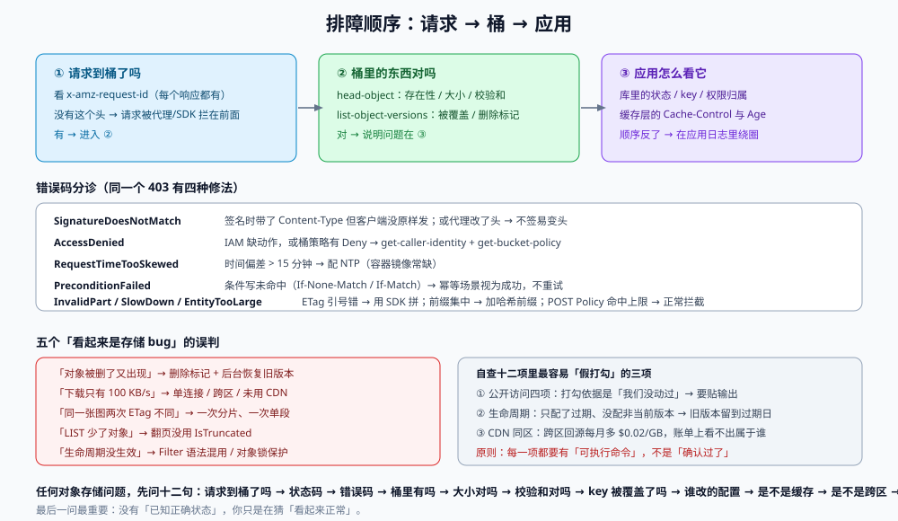

# 常见问题与分诊

对象存储的故障有一个特点：**错误信息通常指向「权限」或「签名」，而真实原因在别处**。`403` 可能是 IAM 少了 `s3:PutObject`、可能是桶策略有 `Deny`、可能是签名时带了没发的头、也可能只是客户端时间偏了 16 分钟。

这一页干两件事：给一张**从现象到页面的分诊表**，和一份**能贴进上线清单的自查十二项**。

::: tip 一句话定位
排障的顺序是：**先看「请求有没有到桶」（HTTP 状态与错误码）→ 再看「桶里的东西对不对」（`head-object`）→ 最后才看「应用怎么看它」（库里的状态）**。顺序反了，就会在应用日志里绕很久。
:::

本页判据族 `OSQ-A` ~ `OSQ-H`，共 8 条。定义表在第六节。



## 一、十四类现象的分诊表

| 现象 | 大概率先看 | 第一步命令 |
| --- | --- | --- |
| 上传 `403 SignatureDoesNotMatch` | [上传路径](../UploadPaths/index.md)「预签名锁住的四项」 | 对比签名时的 `SignedHeaders` 与实发请求头 |
| 上传 `403 AccessDenied`（签名有效） | [访问控制](../SecurityAccess/index.md)「最小权限」 | `aws sts get-caller-identity` + `get-bucket-policy` |
| 上传 `403 RequestTimeTooSkewed` | [上传路径](../UploadPaths/index.md)「失败矩阵」 | `date -u` 与服务器 `Date` 头对比 |
| 浏览器上传报 CORS | [上传路径](../UploadPaths/index.md)「CORS」 | `get-bucket-cors` 看 `ExposeHeaders` 与 `AllowedMethods` |
| 传大文件断在 99% | [上传路径](../UploadPaths/index.md)「续传」 | `list-parts --upload-id` 看已完成分片 |
| 上传成功但对象 0 字节 / 大小不对 | [完整性校验](../IntegrityChecksum/index.md) | `head-object --query ContentLength` |
| 分片上传后校验永远失败 | [完整性校验](../IntegrityChecksum/index.md)「ETag 的三种含义」 | 打印 ETag 与整文件 MD5 对比 |
| 覆盖写后读到旧内容 | [一致性](../ConsistencyModel/index.md)「跨缓存层」 | `curl -sI` 看 `Cache-Control` 与 `Age` |
| 删除了但链接还能打开 | [访问控制](../SecurityAccess/index.md) / [生命周期](../LifecycleCost/index.md) | `list-object-versions` 看删除标记与旧版本 |
| 列目录很慢 / 翻不完 | [键空间](../KeysLayout/index.md)「LIST 的真实语义」 | 检查是否用 `IsTruncated` 终止循环 |
| 同一个文件存了好几份 | [去重](../DedupCAS/index.md) | 盘点命令（`shasum` + `uniq -c`） |
| 账单涨了 3 倍但存储只涨 10% | [生命周期与分层成本](../LifecycleCost/index.md)「四维成本」 | CloudWatch `NumberOfRequests` 按类型拆分 |
| 冷层数据取回一次就花了半个月的钱 | [生命周期与分层成本](../LifecycleCost/index.md)「盈亏平衡」 | 算「取回 GB × 单价」与「省下的存储费」 |
| 迁移完校验对不上 | [实战](../Practice/index.md)「迁移校验」 | 用 `--checksum-mode ENABLED` 读回 `ChecksumSHA256` |

## 二、十二问：任何对象存储问题都能先问这十二句

1. **请求真的到桶了吗？** 看 `x-amz-request-id`（每个响应都有）。没有这个头，说明请求被代理/SDK 拦在前面。
2. **状态码是多少？** `403` 是授权/签名，`404` 是不存在，`412` 是条件写未命中，`503 SlowDown` 是限流。
3. **错误码的 `<Code>` 是什么？** `AccessDenied` / `SignatureDoesNotMatch` / `RequestTimeTooSkewed` / `PreconditionFailed` / `InvalidPart` 的修法完全不同。
4. **桶里到底有没有这个对象？** `head-object` 是最快的判定，不要先查数据库。
5. **对象大小对不对？** `ContentLength` 与本地 `stat` 对比，能立刻分辨「截断」与「内容错」。
6. **校验和是不是自己算的那份？** 有 `ChecksumSHA256` 就不用下载回来验。
7. **key 是不是被谁覆盖了？** 开版本控制的桶：`list-object-versions --prefix <key>`。
8. **是谁在什么时候改的配置？** CloudTrail 管理事件（默认 90 天）。
9. **是不是缓存？** 同一个 URL 用 `?v=$(date +%s)` 再请求一次。
10. **是不是跨区？** endpoint、CDN 区域、复制的目标区。
11. **是不是被限流？** `503 SlowDown` + 前缀是否高度集中。
12. **这件事的「已知正确状态」是什么？** 没有这一条，你只是在猜「看起来正常」。

## 三、上线自查十二项

贴进发布清单，逐项打勾（每项都对应一条判据）：

| # | 检查项 | 判据 |
| --- | --- | --- |
| 1 | Block Public Access 四项全开（或例外已审批） | `OSS-A` |
| 2 | 桶策略无 `Principal: "*"` 的 `Allow` | `OSS-B` |
| 3 | 上传入口只有两类（小文件 POST Policy / 大文件分片），共用 `commit` | `OSU-A`、`OSP-C` |
| 4 | 预签名过期 ≤ 15 分钟，且不签易变头 | `OSU-B`、`OSU-D` |
| 5 | `commit` 七步校验齐全，条件更新幂等 | `OSU-F`、`OSU-G`、`OSP-D` |
| 6 | 每个对象有独立 `sha256`，`head-object` 能读回校验和 | `OSI-A`、`OSI-C` |
| 7 | 同一 key 的覆盖写有前置条件（或 key 不可变） | `OSC-A`、`OSC-F` |
| 8 | 生命周期四条规则齐全（转层/过期/非当前版本/未完成分片） | `OSL-A`~`OSL-C`、`OSP-F` |
| 9 | 转冷层前算过盈亏平衡取回量 | `OSL-D` |
| 10 | 目录/附件下载走 CDN，且 CDN 与桶同区 | `OSP-A` |
| 11 | 库与桶有 `pending → active` 迁移与对账任务 | `OSC-G` |
| 12 | `S1`~`S10` 验收序列跑过并记录时间 | `OSP-H` |

::: danger 自查表最常见的三个「假打勾」
1. **第 1 项打勾了，但没人跑过 `get-public-access-block`**：打勾依据是「我们没动过」。要贴输出。
2. **第 8 项打勾了，但规则只配了「过期」没配「非当前版本」**：版本控制的桶只配过期，旧版本会一直留到过期日——而过期只删当前版本。
3. **第 10 项打勾了，但 CDN 不在同区**：回源跨区，每月多一笔 $0.02/GB 的跨区流量，账单上看不出属于谁。
:::

## 四、五个「看起来是存储 bug」的经典误判

| 抱怨 | 真实原因 | 判定 |
| --- | --- | --- |
| 「对象被删了又出现了」 | 版本控制下 `DELETE` 只加删除标记；某个后台任务在「恢复」旧版本 | `list-object-versions` 看版本链 |
| 「下载速度只有 100 KB/s」 | 单连接 + 跨区 + 未用 CDN；或客户端在 `Range` 小分片串行下载 | `curl -w '%{speed_download}'` 对比同区直连 |
| 「上传同一张图，两次 ETag 不同」 | 一次走了分片，一次走单段 | 看 ETag 是否带 `-N` 后缀 |
| 「LIST 少了几个对象」 | 翻页没用 `IsTruncated`；或用了 `StartAfter` 但排序假设错 | 用 `--max-items` + `NextToken` 复现 |
| 「生命周期规则没生效」 | `Filter` 与旧 `Prefix` 语法混用；或对象被对象锁保护 | `get-bucket-lifecycle-configuration` + `get-object-retention` |

## 五、术语表

| 术语 | 一句话解释 |
| --- | --- |
| **对象（Object）** | 一份字节 + 一个 key + 一组元数据，不可部分修改 |
| **桶（Bucket）** | 对象的命名空间容器，全局唯一名，绑定区域 |
| **前缀（Prefix）** | key 的字符串前缀，不是目录；分区按前缀划分 |
| **ETag** | 对象版本的标识符；单段上传时恰为 MD5，分片/加密时不是 |
| **预签名 URL** | 把「方法 + key + 过期 + 头部」提前签好的 bearer token |
| **POST Policy** | 表单上传的策略，可限制大小与类型（预签名 PUT 做不到） |
| **分片上传** | 把大对象切成 5 MiB~5 GiB 的分片并行传，可续传 |
| **内容寻址（CAS）** | key = hash(content)，同内容天然唯一 |
| **引用计数** | 去重后「有多少业务在引用这份内容」，删除的前提 |
| **存储类** | Standard / IA / Glacier IR / Deep Archive 等，价格与取回代价不同 |
| **最小存储期** | 冷层最短计费周期（30/90/180 天），提前删除按整期计费 |
| **对象锁（WORM）** | 保留期内不可删改；合规模式无人可解 |
| **强一致** | 单 key 的写后读、列举都读到最新（S3 自 2020-12-01） |
| **条件写** | `If-None-Match: *` / `If-Match`，用 `412` 表达「前提不成立」 |

## 六、本页判据定义表

| 判据 | 约定 | 定错的后果 | 如何验证 |
| --- | --- | --- | --- |
| `OSQ-A` | 排障文档按「请求 → 桶 → 应用」三层顺序组织 | 在应用日志里绕圈，浪费时间 | 排障文档一级标题为这三层 |
| `OSQ-B` | 每个已知错误码都有「原因 + 判别命令 + 修法」三列 | 同一个 `403` 反复出现、反复猜 | 错误码表覆盖 `AccessDenied`/`SignatureDoesNotMatch`/`RequestTimeTooSkewed`/`PreconditionFailed`/`InvalidPart`/`SlowDown` |
| `OSQ-C` | 上线自查表每一项都附「可执行命令」而非「确认过了」 | 假打勾，事故后追责无据 | 自查表每行有命令或脚本片段 |
| `OSQ-D` | 「删除/覆盖/迁移」三类高风险操作各有回滚步骤 | 误删无法恢复 | 三类操作各有独立小节与回滚命令 |
| `OSQ-E` | 术语表与正文用词一致（不混用「目录/前缀」「对象/文件」） | 沟通歧义，设计走偏 | 术语表中每个词在正文只以一种含义出现 |
| `OSQ-F` | 每个「看起来是 bug」的现象都有判定方法（命令 + 期望） | 误判为存储故障，反复提单 | 误判表每行有判定命令 |
| `OSQ-G` | 排障结论落库：现象 → 原因 → 修复 → 防复发判据 | 同一个坑踩三次 | 近三个月事故记录里同一现象不重复出现 |
| `OSQ-H` | 文档中的每条命令都在近 30 天内被跑过（或标注 `⏳ 未验证`） | 命令过期（CLI 参数变更）导致照做失败 | 抽 3 条命令实跑；或文档中有「最近验证日期」 |

## 七、如何验证这一页

```shell
# 1. 一条命令拿到「请求是否到桶」的铁证
aws s3api head-object --bucket "$BUCKET" --key "$KEY" --debug 2>&1 | grep -i 'x-amz-request-id' | head -1

# 2. 一条命令区分「权限」与「签名」
aws s3api get-object --bucket "$BUCKET" --key "$KEY" /dev/null 2>&1 | grep -o 'AccessDenied\|SignatureDoesNotMatch\|NoSuchKey'

# 3. 一条命令确认「是不是缓存」
curl -sI "https://cdn.example.com/$KEY" | grep -iE 'age|x-cache|cache-control'
```

预期：第 1 条打印 `x-amz-request-id`；第 2 条输出三者之一（据此分流到不同页面）；第 3 条能看到 `Age` 或 `X-Cache: Hit`，据此判断是否命中缓存。

## 参考资料

- Amazon S3《错误码列表》：<https://docs.aws.amazon.com/AmazonS3/latest/API/ErrorResponses.html>
- Amazon S3《排查 403 错误》：<https://docs.aws.amazon.com/AmazonS3/latest/userguide/troubleshoot-403-errors.html>
- Amazon S3《性能排查与 `503 SlowDown`》：<https://docs.aws.amazon.com/AmazonS3/latest/userguide/troubleshooting.html>
- 本专题其余九页（见[总览](../Overview/index.md)的专题导航）
