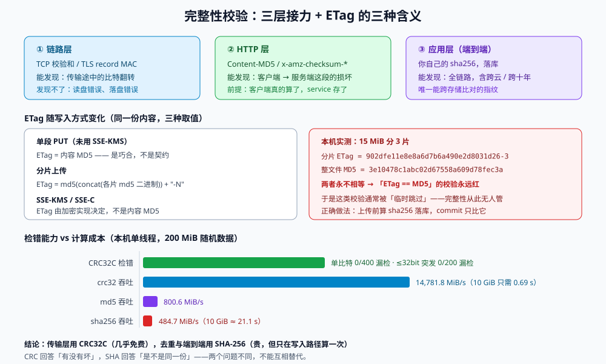

# 完整性校验：凭什么说「传上去的还是原来那份」

存储系统的第一性承诺不是「快」也不是「便宜」，而是**「你放进去的字节，拿出来一模一样」**。这条承诺由三段接力完成：网卡与 TCP 的校验、对象存储服务端的校验、以及**你自己那一份**。前两段你管不了，第三段不管就没有。

本页的核心是一句反直觉的话：**`ETag` 不是校验和**。它在最简单的场景下恰好等于 MD5，于是无数校验逻辑是照着这个巧合写的，然后在第一次分片上传时开始永远报警。

::: tip 一句话定位
完整性校验必须有一份**由写入方计算、独立于 ETag、能被第三方复算**的指纹；ETag 是缓存与并发控制的标识符，不是内容指纹。
:::

本页判据族 `OSI-A` ~ `OSI-H`，共 8 条。定义表在第七节。



## 一、校验的三层，各管一段

| 层 | 谁负责 | 能发现什么 | 发现不了什么 |
| --- | --- | --- | --- |
| **链路层** | TCP 校验和 / TLS record MAC | 传输途中的比特翻转 | 客户端读文件时的错误、服务端落盘错误 |
| **HTTP 层** | `Content-MD5`、`x-amz-checksum-*`（CRC32 / CRC32C / SHA-1 / SHA-256） | 客户端 → 服务端这一段的完整性问题 | 客户端「读到的内容」本身是不是用户以为的那份 |
| **应用层（端到端）** | 你自己的 `sha256` / BLAKE3，落在数据库 | 全链路：包括客户端读盘、加密前后、跨云迁移 | 恶意篡改（要用签名，不是校验和） |

关键差别在**「谁算的」**：`x-amz-checksum-crc32c` 是客户端算完放进请求头、服务端校验后**存下来**的，所以它其实是端到端的——**前提是客户端真的算了**。很多 SDK 默认「传输时算、但不存」，于是下载时你手上没有任何可比的指纹。

::: warning 一条能立刻用上的配置
`aws s3api put-object --checksum-algorithm CRC32C` 与 S3 的「附加校验和」功能会让对象带上 `x-amz-checksum-crc32c` 元数据；此后 `head-object` 可以读回它，`get-object` 可以要求服务端校验。
但这仍然只覆盖「上传那一刻」，**你库里那份 `sha256` 依然是唯一能跨云、跨存储、跨十年比对的东西**。
:::

## 二、ETag 的三种含义

`ETag`（实体标签）原本的语义是「这个资源的某个版本的标识符」，用于缓存与条件请求。对象存储把它借来实现三件事，但它的**取值规则随写入方式变化**：

| 写入方式 | ETag 的取值 | 能当 MD5 用吗 |
| --- | --- | --- |
| **单段 PUT**（未使用 SSE-KMS / SSE-C） | 内容的 MD5（32 位十六进制） | 能，但这是**巧合**，不是契约 |
| **分片上传** | `md5(concat(各分片 md5 的二进制)) + "-" + 分片数` | **不能**，格式就带 `-N` 后缀 |
| **SSE-KMS / SSE-C 加密** | 由加密实现决定，**不是**内容 MD5 | **不能**，换加密方式就变 |

本机实测（15 MiB 文件切成 3 个 5 MiB 分片）：

```text
分片 ETag  = 902dfe11e8e8a6d7b6a490e2d8031d26-3
整文件 MD5 = 3e10478c1abc02d67558a609d78fec3a
两者相等？ False
```

这个 36 字符的字符串看起来「像哈希」，于是最危险的事发生了：**校验代码里写着 `if etag != md5: raise`，而这个分支在上线后从来没绿过**，团队的做法通常是「临时跳过这段校验」——此时完整性就彻底没人管了。

::: danger 三个和 ETag 有关的静默失败
1. **分片上传后拿 ETag 当 MD5 存库**：100% 不一致。正确做法是客户端在**上传前**算 `sha256` 并存库，`commit` 时只比大小与这个 sha256。
2. **校验「分片 ETag 之和」**：有人用 `md5(所有分片 ETag 字符串拼接)` 试图复现服务端算法，忘了服务端拼的是**二进制** digest 而不是十六进制字符串，于是永远对不上。
3. **开了 SSE-KMS 后 ETag 变了**：前一天还能通过的校验，切换加密方式后全体失败，且错误只在「大文件」上出现（小文件仍然巧合相等）。
:::

## 三、CRC32C 够不够：一组可复现的读数

选校验算法时有两个变量：**检错能力**与**计算成本**。

检错能力（本机实测，表驱动 CRC32C，多项式 `0x82F63B78`）：

| 实验 | 样本 | 未检出 |
| --- | --- | --- |
| 单比特翻转（256 字节随机块，随机位置与比特位） | 400 次 | **0** |
| 短突发错误（1~4 字节随机改写，模拟连续破坏） | 200 次 | **0** |

CRC32C 的数学性质：**所有长度 ≤ 32 bit 的突发错误 100% 检出**，更长的突发错误检出率 1 − 2⁻³²。这就是为什么 S3 把它当默认的传输校验和（它比 CRC32 多了硬件指令支持，x86 的 `SSE4.2` 与 ARM 的 `CRC` 扩展都有）。

计算成本（本机 200 MiB 随机数据，单线程）：

| 算法 | 吞吐 | 10 GiB 耗时 |
| --- | --- | --- |
| `crc32`（zlib，硬件加速） | **14,781.8 MiB/s** | 0.69 s |
| `md5`（OpenSSL） | 800.6 MiB/s | 12.8 s |
| `sha256`（OpenSSL） | 484.7 MiB/s | **21.1 s** |

结论很直接：**传输层用 CRC32C（几乎免费），端到端去重用 SHA-256（贵，但只在写入路径算一次）**。

::: tip 为什么端到端还值得用 SHA-256
CRC32C 是**检错**码：它能发现随机损坏，但构造一个「CRC 相同、内容不同」的字符串只需要几秒钟的计算。而 SHA-256 是**抗碰撞**的，这才让它能当「去重键」与「内容地址」使用（见[去重](../DedupCAS/index.md)）。
换句话说：**CRC 回答「有没有坏」，SHA 回答「是不是同一份」**。两个问题不同，不要互相替代。
:::

## 四、分片上传怎么校验：两层，缺一不可

分片场景下，「整体校验」和「分片校验」是两个不同的问题：

| 层 | 校验对象 | 失败时的动作 |
| --- | --- | --- |
| **分片级** | 每个分片自身的 CRC32C（`UploadPart` 的 `x-amz-checksum-crc32c`） | 只重传这一片（这是分片上传最大的收益） |
| **对象级** | 客户端在上传前算好的整体 `sha256` | 整个对象作废，重传（或逐片比对找出坏片） |

正确顺序是：**先算整体 sha256 → 再按分片算 CRC32C → 每片带 CRC 上传 → `complete` → 下载回来抽验或全验整体 sha256**。

```python
# checksum_parts.py —— 生成「整体 sha256 + 每片 CRC32C」清单（只读本地文件）
import hashlib, os, zlib

PART = 8 * 1024 * 1024  # 与上传时的 partSize 必须一致

def manifest(path: str) -> dict:
    whole, parts = hashlib.sha256(), []
    with open(path, "rb") as f:
        idx = 0
        while chunk := f.read(PART):
            idx += 1
            whole.update(chunk)
            # CRC32C 需自行实现或用 google-crc32c；此处用 zlib.crc32 演示「每片独立校验」的形状
            parts.append({"part": idx, "size": len(chunk), "crc32": format(zlib.crc32(chunk) & 0xFFFFFFFF, "08x")})
    return {"sha256": whole.hexdigest(), "size": os.path.getsize(path), "parts": parts}

if __name__ == "__main__":
    import json, sys
    print(json.dumps(manifest(sys.argv[1]), ensure_ascii=False, indent=2))
```

::: danger 分片校验的两个反模式
1. **只校验分片，不校验整体**：分片各自都对，但 `CompleteMultipartUpload` 时把第 2、3 片顺序写反了——对象是坏的，每片校验都通过。整体 sha256 是唯一能发现「顺序错」的检查。
2. **`partSize` 与校验清单不一致**：上传用 8 MiB，清单按 5 MiB 算，整体的 SHA-256 其实一样（内容相同），但「每片 CRC32C」对不上，排障时会误判成「文件坏了」。清单里必须记录 `partSize`。
:::

## 五、校验失败之后：三条处置路径

校验不是「报警」，是**一个状态机**：

| 场景 | 判定依据 | 处置 |
| --- | --- | --- |
| 传输截断 | 库里的 `size` ≠ `HeadObject.ContentLength` | 标记 `pending` → 让客户端重传（保留 `uploadId` 续传） |
| 内容不符 | 库里 `sha256` ≠ 下载后重算的 `sha256` | 对象标记 `corrupted`，删对象 + 触发告警 + 追溯写入方 |
| 服务端 ETag 变化但内容未变 | ETag 因加密/分片方式变化 | **正常**，不改状态；校验逻辑不得依赖 ETag |

第三条是最容易把「正常」判成「故障」的地方：**上线一次加密方式变更**或**把单段改成 5 MiB 分片**，全库 ETag 都会变。如果你的巡检是「ETag 是否等于库里的 md5」，它会在部署当天给出一屏红色。

## 六、跨云/跨介质时，校验和是最硬的那份证据

迁移场景（本地 NFS → 对象存储、A 云 → B 云）里，源端与目的端的 ETag **几乎必然不同**（分片大小、加密实现、厂商算法都可能不一样）。此时唯一可比的只有你自己算的 `sha256`。

这带来一条实践要求：**`sha256` 必须在「第一次落地时」就存进数据库**，而不是迁移时临时算——因为迁移时源端可能已经算不动了（几百万个对象）。

| 迁移阶段 | 用什么比对 | 不能用的 |
| --- | --- | --- |
| 清单生成 | 源端 `sha256`（来自库）或源端重算 | 源端 ETag |
| 传输后抽验 | 目标端 `sha256`（下载后重算） | 目标端 ETag |
| 全量核对 | `size` + `sha256` 双列比对 | `size` 单独比对（同尺寸不同内容会被漏掉） |

## 七、本页判据定义表

| 判据 | 约定 | 定错的后果 | 如何验证 |
| --- | --- | --- | --- |
| `OSI-A` | 每个对象在数据库里有独立的 `sha256`（或 BLAKE3）字段，写入时计算 | 没有可跨存储比对的指纹，迁移无法验收 | `sha256sum file` 与库中字段逐字节相等 |
| `OSI-B` | **禁止**用 ETag 判断内容完整性；代码中不存在 `etag ==` 与 md5 比较的路径 | 分片/加密场景下校验永远失败或被跳过 | grep `ETag` 的用法，全部属于缓存/条件请求，无完整性判断 |
| `OSI-C` | 上传时指定 `x-amz-checksum-crc32c`（或 SHA-256），并在 `head-object` 能读回 | 传输层校验缺失，截断对象被当作成功 | `head-object --query ChecksumCRC32C` 非空 |
| `OSI-D` | 分片上传同时做**分片 CRC + 整体 SHA-256**，并记录 `partSize` | 分片顺序错误无法发现 | 故意交换两片顺序 `complete`，整体校验必须报错 |
| `OSI-E` | `commit` 阶段比对 `ContentLength` 与库中预期大小，0 字节直接拒绝 | 空对象、截断对象入库 | 上传 0 字节并 `commit`，返回 4xx |
| `OSI-F` | 校验失败进入明确状态（`pending` / `corrupted`），有重试上限与告警 | 坏对象被反复读取、被当作正常数据 | 破坏一个对象后读取，状态字段变化且告警触发 |
| `OSI-G` | 巡检不依赖 ETag 的取值，加密方式或分片大小变更不会引起误报 | 部署当天一屏红色，随后被静音 | 变更加密方式后跑巡检，报告应无变化 |
| `OSI-H` | 迁移/备份的核对口径是 `size + sha256` 双列，且抽样比例与判据成文 | 同尺寸不同内容的损坏被漏掉 | 迁移报告含两列，抽样 ≥ 1% 或全量 |

## 八、如何验证这一页

```shell
# 1. 看对象有没有服务端校验和（应为 CRC32C 或 SHA256 的 base64）
aws s3api head-object --bucket "$BUCKET" --key "$KEY" \
  --query '[ContentLength,ETag,ChecksumCRC32C]' --output text

# 2. 本地复算，与库里的 sha256 比对
shasum -a 256 ./local.bin

# 3. 下载回来再算一次（端到端验证，注意大文件会产生的流量费）
aws s3api get-object --bucket "$BUCKET" --key "$KEY" /tmp/roundtrip.bin --query 'ContentLength' --output text
shasum -a 256 /tmp/roundtrip.bin
```

预期：第 1 条的 `ContentLength` 与本地 `stat -f%z` 一致，`ChecksumCRC32C` 非空；第 2、3 条的哈希完全相同。若第 1 条第三个字段为 `None`，说明上传时没带校验和——这是需要补的判据 `OSI-C`。

## 参考资料

- Amazon S3《附加校验和（Additional checksums）》：<https://docs.aws.amazon.com/AmazonS3/latest/userguide/checking-object-integrity.html>
- Amazon S3《分片上传的 ETag 计算方式》：<https://docs.aws.amazon.com/AmazonS3/latest/userguide/checking-object-integrity.html#checking-object-integrity-multipart>
- RFC 3720 / RFC 3309（CRC32C 与多项式 0x1EDC6F41 的反射形式 0x82F63B78）
- RFC 6234（SHA-256）、RFC 1321（MD5，注意其碰撞已被实证）
- Google Cloud Storage《数据完整性与校验和》：<https://cloud.google.com/storage/docs/data-validation>
- 阿里云 OSS《CRC64 数据校验》：<https://help.aliyun.com/zh/oss/user-guide/data-verification>
