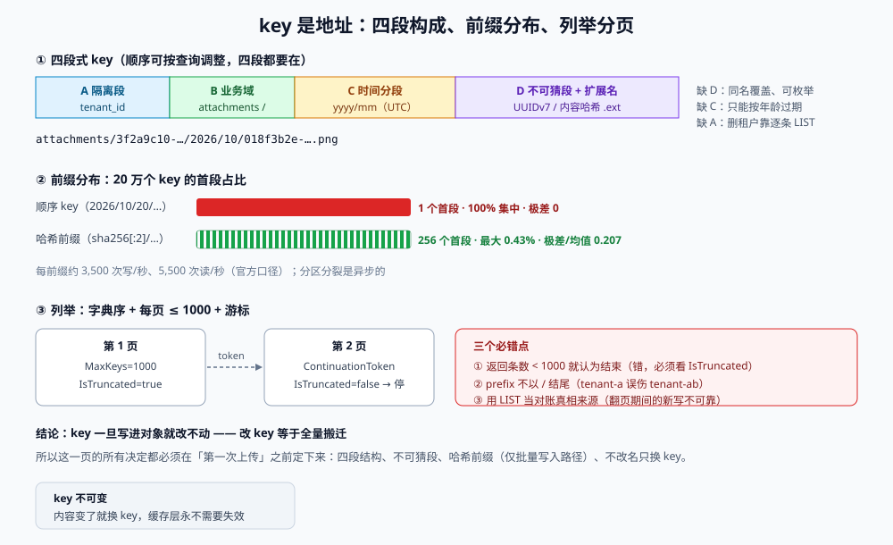

# 键空间与命名：key 是地址，不是路径

`key` 是对象存储里唯一一个**写进去就改不动**的决定。改一个 key 意味着「copy 一份新对象 + 删掉旧的」：1 万个对象就是 1 万次 PUT、1 万次 DELETE，还要处理中间态；1 亿个对象基本等于做一次迁移项目。

所以这一页讲的是「设计期只花一小时、但能省掉一次迁移」的东西：**key 里该有什么、不该有什么、前缀怎么摊、列举怎么翻、谁能猜出来**。

::: tip 一句话定位
`key` 是**地址**：它必须唯一地指向一份内容，必须不可猜，必须让相邻的 key 不要挤在同一个分区里；它**不是路径**，别指望它带目录语义。
:::

本页判据族 `OSK-A` ~ `OSK-H`，共 8 条。定义表在第六节。



## 一、key 的四个要素

一个能活过三年的 key，通常由四段组成（顺序可按查询需求调整，但**四段都要在**）：

```text
{tenant}/{业务域}/{yyyy}/{mm}/{不可猜ID}.{ext}
└── A ──┘ └── B ──┘ └─── C ───┘ └───── D ─────┘
```

| 段 | 作用 | 缺了它会怎样 |
| --- | --- | --- |
| **A 隔离段** | 多租户/多环境隔离，同时给桶策略与生命周期一个可匹配的前缀 | 一个桶里混着两个租户的数据，删租户只能靠逐条 LIST |
| **B 业务域** | 让「附件 / 导出 / 备份 / 日志」各有独立前缀 | 生命周期规则只能全桶一刀切 |
| **C 时间分段** | 让「按月归档/过期」变成前缀匹配，`2026/10/` 就是一个天然的清理单位 | 只能按对象年龄过期（能过期，但无法「按业务月」归档） |
| **D 唯一段 + 扩展名** | 不可猜 + 让浏览器/解码器知道类型 | 用原始文件名 → 同名覆盖、路径穿越、中文/emoji 编码问题 |

::: danger 三种「顺手」的 key，都会在半年内出事
1. **用原始文件名**：`attachments/report.pdf`。两个人各传一份 `report.pdf`，第二个直接覆盖第一个——**没有任何报错**。更糟的是文件名里可能带 `../`、空格、`#`、`?`，在预签名 URL 里变成另一个对象。
2. **用自增 ID 或时间戳当唯一段**：`attachments/1729400000.pdf`。可枚举，配合「桶策略写错」就是批量下载；而且同一毫秒的两次上传会撞。
3. **用 `用户ID/文件名` 当隔离**：用户 A 的 `订单.xlsx` 与用户 B 的 `订单.xlsx` 不冲突，但**用户 A 改名重传**就变成两份，回收要靠「按前缀 LIST + 比对」——这是把「删除」做成了批处理。
:::

## 二、前缀分布：为什么顺序 key 会把写入打热

对象存储按**前缀**做分区（partition），每个前缀大约能承受 **3,500 次写/秒、5,500 次读/秒**。分区会随负载自动分裂，但分裂是**异步**的：突发写入会先在同一个分区上撞墙，表现为 `503 SlowDown`。

本机实测（20 万个 key，两种命名方式，统计首段分布）：

| 命名方式 | 首段种类 | 最大单段占比 | 最小单段占比 | 极差 / 均值 |
| --- | --- | --- | --- | --- |
| 顺序 key：`2026/10/20/{序号}.bin` | **1** | **100%** | 100% | 0 |
| 哈希前缀：`{sha256(key)[:2]}/{原 key}` | **256** | **0.43%** | 0.35% | **0.207** |

顺序 key 的问题不是「一定出事」，而是**出事时你没有任何杠杆**：所有写入都落在 `2026/10/20/` 这一个前缀上，只能等分区分裂；而哈希前缀把同样的写入摊到 256 个首段，单段最多 0.43%，留了 200 倍余量。

::: warning 什么时候该加哈希前缀，什么时候不必
- **不必**：日均写入 < 100 次，或者写入天然分散（不同租户首段不同）。这时候加哈希前缀只是让 key 变丑、`list` 无法按业务前缀浏览。
- **必须**：批量导入、构建产物上传、日志/事件落盘、迁移工具——这些场景的写入速率是「一秒钟几千个」级别，且 key 高度连续。
- **折中**：只在**批量写入**的路径上加哈希段（`ingest/{hash2}/2026/10/20/…`），业务读路径仍用可读前缀。
:::

## 三、列举（LIST）的真实语义

`LIST` 是本专题里最容易被误用的 API。它的真实语义是：**按 key 的字节序（UTF-8 二进制序）返回，每页最多 1000 条，用游标继续**。

| 你以为 | 实际 |
| --- | --- |
| 按修改时间排序 | 按 **key 字典序**；时间只能靠 key 里的时间分段模拟 |
| 返回「目录下」的内容 | `prefix` 是字符串前缀；`delimiter=/` 把「下一层」折叠成 `CommonPrefixes` |
| 拿到「文件大小总和」 | 要自己累加 `Size`，且只覆盖**当前页** |
| 可以 `offset` 翻页 | 只有 `ContinuationToken` / `StartAfter`，没有 offset |
| 列举是免费的 | 按请求计费（$0.005/1000）；100 万对象 = **1,000 次请求**，串行往返 |

一个把「伪目录」列对的写法（`delimiter` 折叠 + 逐页累加）：

```python
# list_dir.py —— 只读，列出某个「目录」的直接子项与累计大小
import boto3

s3 = boto3.client("s3")

def list_dir(bucket: str, prefix: str) -> tuple[list[str], int]:
    dirs, total, token = [], 0, None
    while True:
        kw = {"Bucket": bucket, "Prefix": prefix, "Delimiter": "/", "MaxKeys": 1000}
        if token:
            kw["ContinuationToken"] = token
        resp = s3.list_objects_v2(**kw)
        dirs += [p["Prefix"] for p in resp.get("CommonPrefixes", [])]
        total += sum(o["Size"] for o in resp.get("Contents", []))
        if not resp.get("IsTruncated"):
            return dirs, total
        token = resp["NextContinuationToken"]
```

::: danger LIST 的三个坑
1. **`MaxKeys` 是上限不是保证**：服务端可以返回更少，必须用 `IsTruncated` 判断，不能「返回条数 < 1000 就认为结束」——这是最常见的截断 bug。
2. **列举期间有新写入**：LIST 是**当前时刻**的快照式枚举，翻页过程中新增的 key 可能出现在后面的页里，也可能不出现。**不要用 LIST 做「对账的真相来源」**，除非你在一个安静窗口里跑。
3. **`prefix` 写错一个字符就是全量扫描**：`prefix="attachments/tenant-a"` 会把 `tenant-ab` 一起匹配进来。前缀分隔符要写全（`attachments/tenant-a/`）。
:::

## 四、可猜性：key 是不是一个「能力令牌」

只要 key 能被推出来，**桶策略、签名、过期时间就全都白设**——尤其是「预签名 URL 挂在页面上」的场景：拿到一个 URL 的人会尝试把 ID 加一。

| key 形态 | 可猜性 | 需要的额外防护 |
| --- | --- | --- |
| `attachments/12345.pdf` | 极高（自增） | 只能靠桶策略 + 每次签名；一旦策略写宽就是全量泄漏 |
| `attachments/{uuid}.pdf` | 低（122 bit 随机） | 仍需「签名带过期 + 前缀归属校验」，防的是 URL 转贴 |
| `blobs/sha256/{hash}` | 无（内容决定），但**同内容可互推** | 内容寻址下「猜中 = 已知内容」，泄漏风险有限；但要防「枚举已知文件的哈希」 |

::: tip 一条实用规则
**「ID 可猜」和「URL 可转发」是两件事，要分别防。**
前者靠「不可猜段」解决；后者只能靠「短过期 + 绑定使用者（如一次性 token）+ 服务端鉴权」，因为签名 URL 本质是**持有即可用**的 bearer token。
:::

## 五、key 不可变：内容变了就换 key

这条是后面[一致性](../ConsistencyModel/index.md)与[去重](../DedupCAS/index.md)两页的地基：

| 做法 | 后果 |
| --- | --- |
| **覆盖同名 key**（`avatar/{userId}.png` 每次重传都覆盖） | 缓存层/CDN 需要主动失效；旧版本在版本控制下继续计费；无法判断「这份内容是什么时候的」 |
| **key 带内容哈希或版本号**（`avatar/{userId}/{sha256[:16]}.png`） | 天然不可变、天然可缓存（`max-age` 可以设一年）、旧版本可交给生命周期清理 |

覆盖写的唯一优势是「URL 稳定」，代价是「所有缓存层都要配合失效」。而**不可变 key + 一个稳定的间接层**（数据库里存「当前 key」）能同时拿到两者：URL 变、但业务通过接口拿最新 key，缓存永远不需要失效。

## 六、本页判据定义表

| 判据 | 约定 | 定错的后果 | 如何验证 |
| --- | --- | --- | --- |
| `OSK-A` | key 由四段构成：隔离段 / 业务域 / 时间分段 / 不可猜段 + 扩展名 | 同名覆盖、无法按业务批量清理 | 随机抽 20 个 key，都能按 `/` 切成四段且逐段有语义 |
| `OSK-B` | 唯一段来自 UUIDv4 / ULID / 内容哈希，**不使用原始文件名、自增 ID、纯时间戳** | 可枚举、并发撞 key | `aws s3api list-objects-v2 --prefix "$P" --query 'Contents[].Key'` 的输出里不存在连续序号 |
| `OSK-C` | 批量写入路径（导入 / 构建产物 / 日志）带 **2 位十六进制哈希前缀** | 单前缀写入打满，`503 SlowDown` | 抽样 1 万个 key 的首段，种类 ≥ 200 且最大段占比 < 2% |
| `OSK-D` | 所有 LIST 循环都以 `IsTruncated` 为终止条件 | 漏掉第 1000 条之后的对象（对账、清理全部错） | 代码审查：`while` 条件里出现 `IsTruncated` 或 `NextContinuationToken` |
| `OSK-E` | `prefix` 参数一律以 `/` 结尾（或精确到唯一段） | `tenant-a` 误伤 `tenant-ab` | grep 所有 `list_objects_v2` 调用，`Prefix` 值均以 `/` 结尾 |
| `OSK-F` | 同一份内容的 key **不可变**；内容更新产生新 key，业务侧通过间接层取最新 | 缓存失效困难、版本堆积 | 覆盖写只出现在「明确允许覆盖」的豁免清单里（如临时上传区） |
| `OSK-G` | 文档写明「**key 不含用户可控的原始文件名**」，且对上传文件名做白名单清洗 | 路径穿越（`../`）、异常字符导致签名错误 | 构造文件名 `../../etc/passwd` 与 `a#b?.png`，落库 key 仍为合法四段式 |
| `OSK-H` | 每个前缀在文档里登记「归属业务 + 生命周期规则 ID + 预计对象数」 | 前缀无主，规则遗漏，容量失控 | 前缀登记表的前缀集合 ⊇ 实际 `list` 到的首两段集合 |

## 七、如何验证这一页

```shell
# 1. 看某个前缀下「下一层」有哪些（delimiter 折叠，避免全量列出）
aws s3api list-objects-v2 --bucket "$BUCKET" --prefix "attachments/" --delimiter "/" \
  --query 'CommonPrefixes[].Prefix' --output text

# 2. 抽样 1000 个 key，检查是否含连续序号（可猜）
aws s3api list-objects-v2 --bucket "$BUCKET" --prefix "attachments/" --max-items 1000 \
  --query 'Contents[].Key' --output text | tr '\t' '\n' | sed 's/.*\///' | head -20

# 3. 统计首段分布（把结果喂给 awk，看是否有单段超过 2%）
aws s3api list-objects-v2 --bucket "$BUCKET" --prefix "" --max-items 10000 \
  --query 'Contents[].Key' --output text | tr '\t' '\n' | cut -d/ -f1 | sort | uniq -c | sort -rn | head
```

预期：第 1 条打印若干 `attachments/xxx/`；第 2 条看到的是 UUID/ULID 形态而非 `1.pdf`、`2.pdf`；第 3 条最大计数不超过抽样量的 2%（若是顺序 key，第一行会等于 10000）。

## 与「音视频交付工程」的分工（第 203 天补充）

本页讲键的设计原则：前缀打散、不可变、按业务分层。音视频在此之上多一条硬要求——**键里必须带内容版本段**，因为一个对象的生命周期由「转码版本」而不是「上传时间」决定。

| 原则 | 本页（通用键设计） | 视频侧为什么要加强 |
| --- | --- | --- |
| 不可变 | 同键不覆盖，改写走新键 | 重新转码若覆盖同名分片，旧清单会指向新分片 → 花屏 |
| 版本 | 可选 | **必需**：`/v/{asset_id}/{encode_version}/{rendition}/seg-00001.m4s` |
| 打散 | 哈希前缀避免热点 | 源文件按 `sha256[0:2]` 打散，同时天然去重 |

::: danger 版本段决定「能不能回滚」
没有版本段时，回滚只能靠「重新转码一遍覆盖回去」，而 CDN 上还缓存着旧清单与旧分片——新旧混在一起，播放器拿到「时长对不上」的流。带版本段之后，回滚只需把清单切回旧版本，分片天然隔离，旧版本保留一个缓存窗口即可。
:::

## 参考资料

- Amazon S3《列出对象》：<https://docs.aws.amazon.com/AmazonS3/latest/userguide/ListingKeysUsingAPIs.html>（`MaxKeys`、`IsTruncated`、`ContinuationToken`）
- Amazon S3《使用前缀组织对象》：<https://docs.aws.amazon.com/AmazonS3/latest/userguide/using-prefixes.html>
- Amazon S3《请求速率与性能指南》（每前缀 3,500 PUT / 5,500 GET）：<https://docs.aws.amazon.com/AmazonS3/latest/userguide/optimizing-performance.html>
- Amazon S3《对象键命名最佳实践》：<https://docs.aws.amazon.com/AmazonS3/latest/userguide/object-keys.html>
- RFC 4122（UUID）与 ULID 规范：<https://datatracker.ietf.org/doc/html/rfc4122>、<https://github.com/ulid/spec>
