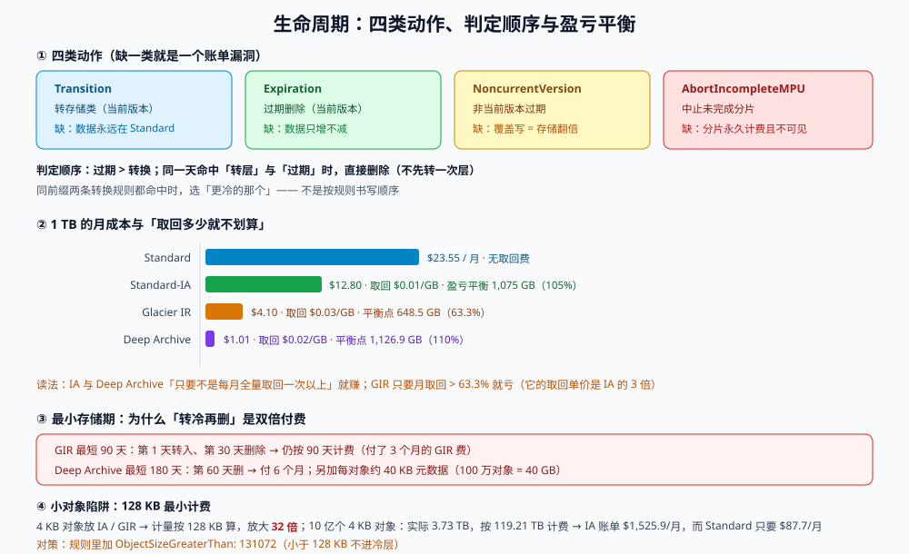

# 生命周期与分层成本：不配规则的桶只会涨

一个桶的生命周期由四件事构成：**什么时候变冷**、**什么时候删**、**旧版本留几个**、**没传完的分片怎么办**。四件事都可以用声明式规则表达，也可以在控制台里「先不配，以后再说」——而「以后」永远不会来，直到账单涨到有人问。

这一页把两件事放在一起讲，因为它们在工程上是同一个决策：**分层是为了省钱，而分层的每一个动作都要付一次请求费、可能触发最小存储期、可能让下一次读取变贵**。只谈「单价便宜 83%」的分层方案，通常会让账单变高。

::: tip 一句话定位
生命周期规则是**唯一一个「越早配越省事」的配置**：它对存量对象也生效，所以晚配一天只是多花一天的钱；但你**必须先把「最小存储期」和「取回费」算一遍**，否则规则会把数据搬到一个「更贵」的层。
:::

本页判据族 `OSL-A` ~ `OSL-H`，共 8 条。定义表在第七节。



## 一、四类动作与它们的判定顺序

| 动作 | 配置字段 | 作用于 | 常见误配 |
| --- | --- | --- | --- |
| **转换存储类** | `Transition.StorageClass` + `Days` | 当前版本 | 转到一个「取回很贵」的层，却没算读取频率 |
| **过期删除** | `Expiration.Days` / `Date` | 当前版本（删除标记也在这里） | 只删当前版本，旧版本永久保留 |
| **非当前版本过期** | `NoncurrentVersionExpiration.NoncurrentDays` | 历史版本 | 完全没配 → 版本无限堆积 |
| **中止未完成分片** | `AbortIncompleteMultipartUpload.DaysAfterInitiation` | 分片上传的中间态 | 完全没配 → 分片永久计费且不出现在 LIST |

**判定顺序**（同一对象命中多条规则时）：**过期 > 转换**，并且**同一天内不会「先转层再删」**——如果一个对象命中「第 30 天转 IA」和「第 30 天过期」，它当天就被删掉，不会先转一次层（省一次请求费）。

::: danger 生命周期规则的四个静默失效
1. **`Filter` 写成了 `Prefix` 的旧语法**：新旧两种 schema 不能混用，混用时整个配置报 `MalformedXML`，但如果是在控制台点的，可能只是「保存成功但规则没生效」。
2. **规则 A 转 IA、规则 B 转 GIR**：同一对象两条规则都命中时，S3 选**更冷的那个**——你以为按「规则顺序」，实际按「冷度」。
3. **`Days` 是「自对象创建起」，不是「自最后一次访问起」**（除非用 Intelligent-Tiering）。刚上传就被访问一百次的对象，第 30 天照样转冷。
4. **非当前版本过期只删版本，不删删除标记**：要彻底消失，还需要一条「过期删除标记」的规则（`Expiration.ExpiredObjectDeleteMarker`）。
:::

## 二、成本四维：把「单价」放回它该在的位置

先看 1 TB 数据在四个层里的月成本（us-east-1，2026-05 官方单价，只算存储）：

| 存储类 | 单价（$/GB-月） | 1 TB 月成本 | 取回费 | 最小存储期 | 最小计费对象 |
| --- | --- | --- | --- | --- | --- |
| Standard | 0.023 | **$23.55** | 无 | 无 | 无 |
| Standard-IA | 0.0125 | **$12.80** | $0.01/GB | 30 天 | 128 KB |
| Glacier Instant Retrieval | 0.004 | **$4.10** | $0.03/GB | 90 天 | 128 KB |
| Glacier Deep Archive | 0.00099 | **$1.01** | $0.02/GB | 180 天 | 40 KB 元数据 |

看起来「转到 GIR 每月省 $19.46」。但取回费会把省下的钱吃回去，**盈亏平衡点**是：

| 从 → 到 | 每月省下 | 取回单价 | 盈亏平衡的月取回量 | 占总量比例 |
| --- | --- | --- | --- | --- |
| Standard → Standard-IA | $10.75 | $0.01/GB | **1,075 GB** | 105%（不可能达到） |
| Standard → Glacier IR | $19.46 | $0.03/GB | **648.5 GB** | **63.3%** |
| Standard → Deep Archive | $22.54 | $0.02/GB | **1,126.9 GB** | 110%（不可能达到） |

读法：**IA 与 Deep Archive 只要「不是每月全量取回一次以上」，就划算；GIR 只要月取回超过 63.3% 就不划算**——这正是「GIR 便宜但取回贵」的反直觉之处（它的取回单价是 IA 的 3 倍）。

::: warning 还有三项常被忘掉的成本
1. **转换请求费**：GIR 的 PUT 是 $0.02/1000，Deep Archive 是 $0.05/1000。100 万个小对象转一次 GIR = **$20**，转 Deep Archive = **$50**；如果对象只有几 KB，转换费可能超过一年省下的存储费。
2. **128 KB 最小计费**：IA / One Zone-IA / GIR 按 128 KB 计费。**4 KB 的对象，计量放大 32 倍**。
3. **Deep Archive 的 40 KB 元数据**：每个对象额外约 40 KB 元数据计费，100 万个对象 = **40 GB** 的额外账单。
:::

## 三、最小存储期：为什么「转冷再删」是双倍付费

最小存储期的语义是：**对象在冷层停留不足 N 天就删除或转走，仍按 N 天计费**。

| 场景 | 算法 | 结果 |
| --- | --- | --- |
| 第 0 天传到 Standard，第 1 天转 GIR，第 30 天删除 | GIR 计费 90 天（虽然只待了 29 天）+ Standard 1 天 | 相当于付了 **3 个月**的 GIR 费用 |
| 第 0 天传到 Standard，第 1 天转 Deep Archive，第 60 天删 | DA 计费 180 天 + Standard 1 天 | 付了 **6 个月**的 DA 费用 |
| 第 0 天传到 Standard，第 95 天转 GIR，第 200 天删 | GIR 计费 105 天（≥ 90，正常） | 正常 |

所以「短期数据」（构建产物、临时导出、7 天就过期的分享链接）**不该转冷层**，正确做法是**直接设过期**，让它留在 Standard 里到期删除——Standard 没有最小存储期。

```json
{
  "Rules": [
    {
      "ID": "attachments-hot-to-ia",
      "Status": "Enabled",
      "Filter": { "Prefix": "attachments/" },
      "Transitions": [{ "Days": 30, "StorageClass": "STANDARD_IA" }],
      "Expiration": { "Days": 365 },
      "NoncurrentVersionExpiration": { "NoncurrentDays": 30 },
      "AbortIncompleteMultipartUpload": { "DaysAfterInitiation": 3 }
    },
    {
      "ID": "tmp-hard-expire",
      "Status": "Enabled",
      "Filter": { "Prefix": "tmp/" },
      "Expiration": { "Days": 7 }
    },
    {
      "ID": "logs-deep-archive",
      "Status": "Enabled",
      "Filter": { "Prefix": "logs/", "And": { "ObjectSizeGreaterThan": 131072 } },
      "Transitions": [{ "Days": 90, "StorageClass": "DEEP_ARCHIVE" }],
      "Expiration": { "Days": 2555 }
    }
  ]
}
```

第三条规则里的 `ObjectSizeGreaterThan: 131072` 是 **128 KB 过滤**：小于 128 KB 的对象不进冷层（因为最小计费会让它变贵）。这条过滤在「日志里混着小对象」的场景里能救命。

::: danger 版本控制 + 生命周期：最常见的「账单翻倍」组合
开了版本控制但没配 `NoncurrentVersionExpiration` 时：
- 每次覆盖写留下一个旧版本，每个版本都**按当前存储类计费**；
- `LIST` 只显示最新版本，所以「对象数没变」，但**存储量在涨**；
- 想让对象彻底消失，必须删**所有版本**（或让规则过期非当前版本 + 过期删除标记）。

自查命令（在真实桶上跑，只读）：

```shell
aws s3api list-object-versions --bucket "$BUCKET" --prefix "attachments/" --max-items 200 \
  --query 'length(Versions[?IsLatest==`false`])' --output text
```

若这个数接近 200（一页的上限），说明非当前版本在堆积。
:::

## 四、把「成本」拆成可核算的四行

一张能进预算表的成本模型，必须能**按前缀分摊**、能**逐月复算**。四个维度各给一个计算式：

| 维度 | 计算式 | 100 万对象 / 平均 200 KB 的算例 |
| --- | --- | --- |
| **存储** | `Σ(每层 GB-月 × 单价)` + 版本 + 未完成分片 | 100 万 × 200 KB ≈ 190.7 GB → Standard **$4.39/月** |
| **请求** | `PUT 次数/1000 × 单价 + GET 次数/1000 × 单价 + LIST 次数/1000 × 单价` | 每月 300 万 GET + 30 万 PUT → $1.20 + $1.50 = **$2.70/月** |
| **取回** | `取回 GB × 层单价` | 从 IA 取回 20% = 38.1 GB × $0.01 = **$0.38/月** |
| **出网** | `(出网 GB − 100) × 0.09` | 每月出网 500 GB → **$36.00/月** |

这个算例里，**出网占了账单的 83%**。这就是为什么「对象存储很便宜」这句话对「存起来不常读」的数据成立，对「当图床/CDN 源站」的数据不成立——后者必须配 CDN（S3 → CloudFront 回源免费），否则每 GB 出网比每 GB 存储贵了近 4 倍。

::: tip 单位成本：把账单变成一个可比的数
`单位成本 = 月账单 ÷ 月活跃文件数` 或 `÷ 月读取次数`。前者适合「存得多、读得少」（备份），后者适合「读得多」（图床）。
只报总额的预算表没法判断「是变贵了还是变大了」，单位成本可以。
:::

## 五、账单异常的六种形态与判别

| 现象 | 最可能原因 | 判别命令 |
| --- | --- | --- |
| 存储量涨幅 ≫ 对象数涨幅 | 版本堆积 / 大对象覆盖写 | `list-object-versions` 数非当前版本；`list-objects` 看 `Size` 分布 |
| 请求费突增 | 探测式健康检查 `HEAD`、`LIST` 轮询、SDK 重试 | CloudWatch `NumberOfRequests` 按 `RequestType` 拆分 |
| 出现「取回」费用 | 冷层被批量读取（重建缓存、导出、索引） | `BucketSizeBytes` 按 `StorageType` 看是否有冷层；查应用日志的 GET 次数 |
| 出现「跨区传输」费用 | 跨区复制、跨区读 | 检查 CRR 规则与 endpoint 配置 |
| 出网费用暴涨 | 直连下载没走 CDN、被爬 | `BytesDownloaded` + CDN 命中率 |
| 存储量只增不减，且无删除记录 | 生命周期规则没生效（`Filter` 写错 / 与另一条规则冲突） | `get-bucket-lifecycle-configuration` + 对象的 `LastModified` 分布 |

一条有用的判据：**「对象年龄分布」应该随时间呈现「右侧有墙」**。如果所有对象的年龄都从 0 一直拖到 3 年且没有断崖，说明过期规则没生效。

```shell
# 用 S3 Inventory 或一次抽样 LIST 看年龄分布（抽样 5,000 个对象）
aws s3api list-objects-v2 --bucket "$BUCKET" --max-items 5000 \
  --query 'Contents[].[Key,LastModified,Size,StorageClass]' --output json \
  | python3 -c 'import sys,json,collections,datetime as dt
rows=json.load(sys.stdin); now=dt.datetime.now(dt.timezone.utc)
b=collections.Counter()
for r in rows:
    age=(now-dt.datetime.fromisoformat(r[1].replace("Z","+00:00"))).days
    b[(age//90)*90]+=1
for k in sorted(b): print(f"{k:>4}d+ : {b[k]}")'
```

## 六、本页判据定义表

| 判据 | 约定 | 定错的后果 | 如何验证 |
| --- | --- | --- | --- |
| `OSL-A` | 每个桶至少一条 `Expiration` 或 `Transition` 规则，且 `Status=Enabled` | 数据只增不减，账单线性上涨 | `get-bucket-lifecycle-configuration` 返回非空且含 `Enabled` 规则 |
| `OSL-B` | 开启版本控制的桶**必须**配 `NoncurrentVersionExpiration` | 覆盖写悄悄翻倍存储 | 规则里存在该字段且 `NoncurrentDays` ≤ 90 |
| `OSL-C` | 每个桶配 `AbortIncompleteMultipartUpload`（≤ 7 天） | 未完成分片永久计费且不可见 | 规则存在；`list-multipart-uploads` 无 7 天以上残留 |
| `OSL-D` | 转冷层前算过**盈亏平衡取回量**，并写入容量文档 | 转到一个「取回更贵」的层，账单变高 | 文档里有「月取回量 / 盈亏平衡量」两个数 |
| `OSL-E` | 小于 128 KB 的对象**不进** IA / GIR（用 `ObjectSizeGreaterThan` 或前缀隔离） | 计量放大 32 倍 | 规则 `Filter` 含尺寸条件，或该前缀下对象均 > 128 KB |
| `OSL-F` | 生命周期规则之间无「同日双转」冲突；冲突时明确谁是权威 | 实际转到了比你预期更冷的层 | 规则清单里同一前缀的 `Transition.Days` 唯一 |
| `OSL-G` | 删除语义与版本策略一致：需要「彻底删除」时同时处理非当前版本与删除标记 | 用户以为删了，实际只加了标记 | 删除后 `list-object-versions` 无残留；`head-object` 返回 404 |
| `OSL-H` | 成本模型按「存储 / 请求 / 取回 / 出网」四行分摊到前缀，且给单位成本 | 无法解释账单涨幅来自哪一维 | 预算表四行齐全，且每行可复算出金额 |

## 七、如何验证这一页

```shell
# 1. 看规则是否真的存在（没有会报 NoSuchLifecycleConfiguration）
aws s3api get-bucket-lifecycle-configuration --bucket "$BUCKET" \
  --query 'Rules[].[ID,Status,Filter.Prefix,to_string(Transitions),to_string(Expiration)]' --output text

# 2. 看存量对象的年龄分布（判据 OSL-A 的「右侧有墙」）
aws s3api list-objects-v2 --bucket "$BUCKET" --max-items 1000 \
  --query 'Contents[].[LastModified,StorageClass,Size]' --output text | head -5

# 3. 看未完成分片
aws s3api list-multipart-uploads --bucket "$BUCKET" --query 'Uploads[].[Key,Initiated]' --output text | head

# 4. 看各存储类的实际用量（CloudWatch，需要 T+1 天数据）
aws cloudwatch get-metric-statistics --namespace AWS/S3 --metric-name BucketSizeBytes \
  --dimensions Name=BucketName,Value="$BUCKET" Name=StorageType,Value=StandardStorage \
  --start-time "$(date -u -v-2d +%FT%TZ)" --end-time "$(date -u +%FT%TZ)" \
  --period 86400 --statistics Average
```

预期：第 1 条至少一条 `Enabled`；第 2 条能看到 `LastModified` 分布（若全部集中在最近 30 天，说明有清理在跑；若拖到几年前且无断崖，说明 `OSL-A` 未满足）；第 3 条为空；第 4 条能读出 GB 数，用于与账单对账。

## 参考资料

- Amazon S3 用户指南《管理对象的生命周期》：<https://docs.aws.amazon.com/AmazonS3/latest/userguide/object-lifecycle-mgmt.html>
- Amazon S3 定价页（存储类 / 取回 / 最小存储期 / 请求）：<https://aws.amazon.com/s3/pricing/>
- Amazon S3《存储类对比与转换约束》：<https://aws.amazon.com/s3/storage-classes/>
- Amazon S3《未完成分片上传的中止》：<https://docs.aws.amazon.com/AmazonS3/latest/userguide/mpu-abort-incomplete-mpu-lifecycle-config.html>
- Amazon S3《版本控制与非当前版本过期》：<https://docs.aws.amazon.com/AmazonS3/latest/userguide/NoncurrentVersionExpiration.html>
- Amazon CloudWatch《S3 存储桶指标 `BucketSizeBytes` / `NumberOfObjects`》：<https://docs.aws.amazon.com/AmazonS3/latest/userguide/cloudwatch-monitoring.html>
