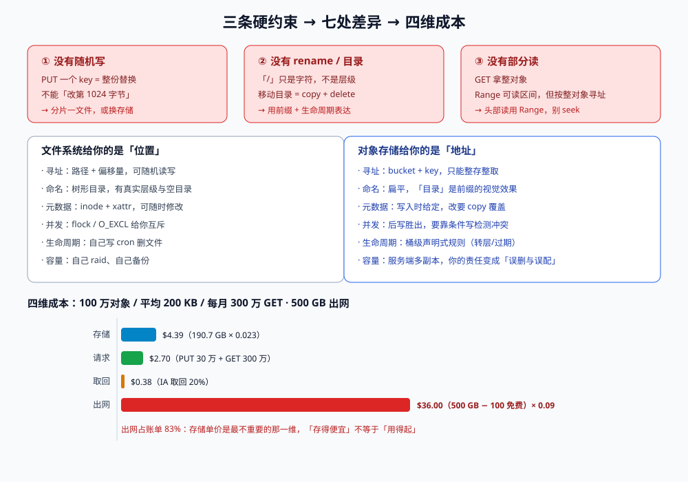

# 总览：三条硬约束与四维成本

对象存储难的地方不是「会不会用 API」，而是**大脑里默认的那个存储模型一直是错的**。

我们从文件系统长大，习惯了「打开一个文件、跳到第 N 字节、写 100 字节、关掉」；对象存储能做的只有「把一整份字节放到一个 key 上」和「把整个 key 拿回来」。这个差别不是性能差别，是**表达能力差别**——它砍掉了随机写、rename、目录、锁、部分读，全部代价都换成了「便宜、无限、HTTP 可达」。

::: tip 一句话定位
对象存储是一份**只追加、按 key 寻址、以整对象为单位**的字节容器；所有「感觉怪怪的」问题，都是因为它少了你以为它有的那个能力。
:::

本页判据族 `OSO-A` ~ `OSO-H`，共 8 条。定义表在第八节。



## 一、三个「没有」：对象模型的硬约束

先把话说死，后面所有页都不再重复：

| 没有 | 具体表现 | 你原本会怎么写（错的） | 正确写法 |
| --- | --- | --- | --- |
| **没有随机写** | 不能「改第 1024 字节」；PUT 一个 key 就是**整份替换** | 上传日志分片，追加写到同一个 key | 一个分片一个 key（`…/part-00042`），或改用支持追加的存储 |
| **没有 rename / 目录** | `a/b/c.txt` 里的 `/` 只是字符；「移动目录」= 逐个对象 copy + delete | `mv` 一个前缀当作归档 | 用 key 前缀 + 生命周期规则表达「归档」，或 copy 后批量 delete |
| **没有部分读** | GET 拿整对象（`Range` 可以拿字节区间，但服务端仍按整对象寻址） | 用 `seek()` 读文件头 512 字节 | 用 `Range: bytes=0-511`，且**不要**指望它比 GET 全量便宜多少（按请求计费，不按字节） |

::: danger 「没有」不等于「不能凑合」，凑合的方式会付两次钱
1. **把对象存储挂成 POSIX 文件系统**（s3fs / CSI 的对象存储驱动）：读一个小文件可能要 GET 整个对象，`ls` 一次等于 LIST 一次，`rename` 变成 copy+delete。写入路径上还会出现「编辑器保存时 truncate + write」导致的对象重写。可以跑，但**吞吐与延迟都不是这个存储设计的用途**。
2. **把「一个 key 当一个文件的一段」用**：例如 `logs/2026-10-20/segment-0`、`segment-1`……然后再靠 LIST 拼起来。一旦段数上千，读取变成 N 次 GET，延迟叠加。
3. **用 `Range` 实现「追加写」**：`Range` 是读侧能力，写侧不支持「只覆盖某区间」。所谓「支持部分写的对象存储」通常是另一个产品（块存储 / 支持 append 的日志存储）。
:::

## 二、七处差异：文件系统 vs 对象存储

这张表是本专题的「翻译表」，凡是拿不准的问题，先在这里对照一次：

| 维度 | 文件系统 | 对象存储 | 工程后果 |
| --- | --- | --- | --- |
| **寻址** | 路径 + 偏移量 | bucket + key（整对象） | 不能局部更新；每次写都是全量 |
| **命名空间** | 树形目录，有层级 | 扁平，「目录」是前缀的视觉效果 | 「目录大小」要靠 LIST 累加；「空目录」不存在 |
| **元数据** | inode + 扩展属性，可改 | 对象元数据在写入时**一次性**给定，改要 copy 覆盖 | 「给 100 万个对象加一个 tag」= 100 万次 copy |
| **一致性** | 本地强一致，靠锁 | 单 key 强一致、跨对象无事务 | 多对象「一起成功」要靠业务补偿 |
| **并发** | `flock` / `O_EXCL` | 后写胜出；要检测冲突用条件写 | 「先查再写」是竞态 |
| **生命周期** | 靠脚本 / cron 自己删 | 桶级规则声明式执行（转换、过期、非当前版本） | 不配规则 = 永不删除 = 账单只涨 |
| **容量与耐久** | 你自己 raid、自己备份 | 服务端多副本 / 纠删码，宣称 11 个 9 | 你的责任从「磁盘」上移到「误删与误配」 |

## 三、四维成本：账单不是「存储量 × 单价」

这是本专题最容易被低估的一节。对象存储的账单有四个**互相制约**的维度，压其中一个通常抬高另一个：

| 维度 | 计费单位 | 典型单价（us-east-1，2026-05） | 什么时候成为大头 |
| --- | --- | --- | --- |
| **存储** | GB-月 | Standard $0.023 / IA $0.0125 / GIR $0.004 / Deep Archive $0.00099 | 数据只增不减、版本堆积、未完成分片 |
| **请求** | 每 1,000 次 | PUT $0.005 / GET $0.0004（IA 与归档层更贵：GIR PUT $0.02、GET $0.01） | 小对象多、LIST 频繁、`HEAD` 探测、探测式健康检查 |
| **取回** | 每 GB | IA $0.01 / GIR $0.03 / DA $0.02（Flexible Bulk 免费） | 冷数据被「偶尔」读一次；批量导出；重建缓存 |
| **出网** | 每 GB | $0.09（前 100 GB/月免费），跨区约 $0.02 | 直连下载、跨区复制、跨云同步 |

四个维度里，**存储单价是最不重要的那个**：把 1 TB 从 Standard 挪到 Glacier IR，每月省 **$19.46**；但只要当月取回超过 **648.5 GB（63.3%）**，省下的钱就全交回去了。而如果这 1 TB 里有 100 万个小对象（每个 4 KB 左右），IA / GIR 的 **128 KB 最小计费**会把「实际 3.73 TB」按 **119.21 TB** 计费——账单 **$1,525.9/月**，而老老实实放 Standard 只要 **$87.7/月**。

::: danger 三个「看起来省钱」的操作，实测都是亏的
1. **把小文件转 IA 省单价**：4 KB 对象按 128 KB 计费，单价降 46% 但计量放大 32 倍 → 实际贵 **17.4 倍**（$1,525.9 vs $87.7，按 10 亿个 4 KB 对象算）。
2. **开启版本控制但不过期非当前版本**：每次覆盖都留一份，`PUT` 成本不变，存储线性上涨。官方把它列为「神秘账单」两大来源之一（另一个是未完成的分片上传）。
3. **把「归档」当「删除」**：Deep Archive 最小存储期 180 天，第 30 天删除仍按 180 天计费；再叠上取回费，「省下来的存储费」变成「提前删除费 + 取回费」。
:::

## 四、五种静默失败

这五种失败共同点：**API 返回 200，日志没有 ERROR，监控没有红线，但结果是错的**。

| 失败 | 表现 | 怎么在本地复现 | 对策 |
| --- | --- | --- | --- |
| **ETag 当哈希** | 分片上传后校验永远失败 | 15 MiB 分 3 片：分片法 ETag `902dfe11…-3`，整文件 MD5 `3e10478c…` | 用独立校验和（CRC32C / SHA-256），别用 ETag（[完整性校验](../IntegrityChecksum/index.md)） |
| **key 撞车** | 两个业务写了同一个 key，后写的覆盖前一个 | 用 `用户ID + 文件名` 作 key，两个同名文件立刻互相覆盖 | key 里带不可猜的随机段或内容哈希（[键空间](../KeysLayout/index.md)） |
| **删除标记** | 用户删了，链接还能打开（旧版本），存储还在计费 | 开版本控制后 `DELETE`，再 `GET` 旧版本 ID | 删除要删「所有版本」，或让生命周期过期非当前版本（[生命周期](../LifecycleCost/index.md)） |
| **缓存 stale** | 覆盖同名 key 后，CDN 还在发旧图 | 覆盖写 + 带 `Cache-Control: max-age=31536000` | 内容变了就换 key（内容寻址），或主动失效（[一致性](../ConsistencyModel/index.md)） |
| **静默截断** | 上传时客户端中断，服务端得到一个「短对象」 | `curl --limit-rate` 中途 Ctrl-C，看桶里对象大小 | 上传必须带 `Content-Length` 并在 `commit` 校验大小与校验和（[上传路径](../UploadPaths/index.md)） |

## 五、一次写入的完整生命周期

把「一个文件从产生到消失」拆成七步，每一步都有一个**只能在这一步做**的决定：

1. **产生**：内容在客户端。此时决定「要不要算校验和」——上传后就算不出来了（原文件可能已被删）。
2. **分配 key**：决定「能不能被猜」「前缀会不会热」。key 一旦写进对象，改它就是搬迁。
3. **授权**：决定「谁签的字」。预签名锁的是「方法 + key + 过期时间 + 若干头」，锁不住的见[上传路径](../UploadPaths/index.md)。
4. **传输**：决定「一次传完还是分片」。分片带来续传能力，也带来「分片 ETag ≠ 文件哈希」与「未完成分片计费」。
5. **校验**：决定「凭什么说传对了」。服务端校验和只在传输层，端到端校验要自己算。
6. **被使用**：决定「缓存多久」「谁能读」。这一步的错通常表现为「删了还能打开」。
7. **变冷 / 消失**：决定「什么时候转层、什么时候删、删几个版本」。不决定，就由账单替你决定。

## 六、什么时候**不该**用对象存储

一句反直觉但重要的判断：**需要「改一小块」或「低延迟随机读」的数据，不该放对象存储**。

| 场景 | 更合适的选择 | 判据 |
| --- | --- | --- |
| 数据库文件、需要 fsync 与随机写 | 块存储（云盘 / 本地 SSD） | 每秒钟有成千上万次小写 |
| 大量小文件、需要目录遍历 | 文件存储（NFS / NAS）或数据库 | 单目录十万级文件、需要 `readdir` |
| 需要「多对象一起成功」 | 支持事务的数据库 | 一个业务动作要改 3 个对象且不允许中间态 |
| 需要按行查询的日志 | 列存 / 日志系统（ClickHouse / Loki） | 查询是「按字段过滤 + 聚合」而不是「按 key 取整份」 |
| 需要低于 1 ms 的随机读 | 内存 / 本地 SSD / 块存储 | p99 要求 < 5 ms |

反过来，**大文件、一次写多次读、读放大可控、需要 HTTP 直链** 的场景，对象存储几乎总是最便宜且最省事的选择：静态资源、附件、备份、数据湖原始层、构建产物、模型权重。

## 七、本页判据定义表

| 判据 | 约定 | 定错的后果 | 如何验证 |
| --- | --- | --- | --- |
| `OSO-A` | 每个桶在文档里写明**用途与写入方**（谁能写、写什么前缀） | 多业务共用一个桶、前缀无主，改名/迁移时找不到负责人 | `docs/` 内每个桶名都能 grep 到「用途 + 写入方」两行 |
| `OSO-B` | 明确声明「**不做随机写**」：不存在向同一 key 追写的代码路径 | 追写实现退化为「读全量 + 拼接 + 覆盖写」，并发下丢数据 | 代码里搜 `putObject` 的调用点，每个都能说明「整份替换」 |
| `OSO-C` | 四维成本（存储/请求/取回/出网）在容量文档里都有估算值 | 只按存储单价做预算，上线后账单超 3 倍 | 预算表有四行，且每行给出计算式与单价出处 |
| `OSO-D` | 存在**独立于 ETag** 的校验和字段，并在 `commit` 时比对 | 分片上传后校验永远失败，或被静默跳过 | `sha256sum` 与库里存的 `checksum` 相等（[完整性校验](../IntegrityChecksum/index.md)） |
| `OSO-E` | key 里包含**不可猜段**（UUID / 内容哈希），不含用户可控的原始文件名 | 遍历枚举、同名覆盖 | `aws s3api list-objects-v2 --prefix` 无法从已知 ID 推出下一个 |
| `OSO-F` | 删除语义成文：删「当前版本」还是「所有版本」，是否有保留期 | 用户说删了、链接还能开、账单还在涨 | 删后再 `GET`（不带 versionId）返回 `404`，且 `list-object-versions` 无残留 |
| `OSO-G` | 每个桶都配了**至少一条**生命周期规则（过期或转层） | 版本与分片无限堆积，账单只涨 | `aws s3api get-bucket-lifecycle-configuration` 非空 |
| `OSO-H` | 文档写明「本桶不用于随机写/不挂载为 POSIX 文件系统」的理由与替代方案 | 用 s3fs 挂载做数据库目录，延迟与一致性双崩 | 部署清单里无对象存储挂载点；有则附性能读数与例外审批 |

## 八、如何验证这一页

三条命令，全部只读，不产生费用（`list` 是 GET 类请求，按 $0.0004/1000 计，基本可忽略）：

```shell
# 1. 桶的公开访问是否被关掉（四个字段都应为 true）
aws s3api get-public-access-block --bucket "$BUCKET" \
  --query 'PublicAccessBlockConfiguration.[BlockPublicAcls,IgnorePublicAcls,BlockPublicPolicy,RestrictPublicBuckets]'

# 2. 桶有没有生命周期规则（没有会返回 NoSuchLifecycleConfiguration）
aws s3api get-bucket-lifecycle-configuration --bucket "$BUCKET" \
  --query 'Rules[].[ID,Status,Filter.Prefix]' --output table

# 3. 桶的版本控制状态（Enabled / Suspended）
aws s3api get-bucket-versioning --bucket "$BUCKET"
```

预期输出：第 1 条打印 `true true true true`；第 2 条至少一行且 `Status=Enabled`；第 3 条为 `Enabled` 或空（空表示从未开启，需要显式记录「本桶不开版本控制，理由是……」，不能是「忘了」）。

::: tip 一条能省下整个下午的习惯
新建桶的第一件事不是传文件，而是把上面三条命令的输出**贴进该桶的 README**（或配置仓库里的 `buckets/<name>.md`）。半年后有人问「这个桶为什么不开版本控制」，答案在文件里，不在某个人的记忆里。
:::

## 与「数据湖与湖仓一体」专题的分工

| 问题 | 看哪里 |
| --- | --- |
| 键空间设计、校验和分层、去重、生命周期、预签名与访问控制 | **本页**（单对象视角） |
| 多文件怎么组成一张表、提交怎么原子、小文件怎么治理 | [湖仓专题 · 总览](../../../DB/Lakehouse/Overview/index.md)（多文件视角） |

一句话：**对象存储只保证「单对象 PUT 原子」，湖仓的表语义是把很多个单对象原子拼起来的那层努力**。所以本页讲的三条限制（每前缀请求上限、ETag 不等于 MD5、列目录昂贵）会直接决定写湖的形态：并发写要打散前缀、校验要算内容哈希、规划要靠元数据而不是列目录。

::: danger 本页特有的坑：给数据前缀配生命周期删除，会绕过表的引用检查
「30 天后删除 `data/` 前缀」这条规则看起来是省钱，实际上会删掉**仍被旧快照引用**的文件——时间旅行随机报 `FileNotFound`，而且没有规律（取决于谁在什么时候查了旧版本）。生命周期规则只适合清理元数据目录里的历史文件，且要在保留期之后；数据目录的删除必须由表格式的 `expire_snapshots` + `remove_orphan_files` 决定（顺序见湖仓专题的 `LHR-B`）。
:::

## 与「广告投放与实时竞价工程」的分工（第 210 天补充）

广告素材是对象存储里**最讲究「同一个 key 不能换内容」**的一类对象：

| 事项 | 本页（对象存储） | 广告专题 |
| --- | --- | --- |
| 管什么 | 字节怎么存、怎么取、怎么分层 | 素材该不该被投放、投给谁 |
| 关键约束 | 持久性、一致性、成本 | 审核状态、尺寸匹配、可关闭性 |
| 失败形态 | 读不到、读得慢、账单高 | 投了未审核素材、尺寸不符仍曝光 |
| 归属 | 本页第三、四节 | [广告投放与实时竞价工程](../../AdDelivery/index.md) |

本页特有的一个坑：**素材换版本时复用同一个对象 key**（`creative/123/banner.png` 直接覆盖）。CDN 与浏览器会继续用旧缓存，于是「审核通过的新素材」与「线上实际展示的旧素材」不是同一张图——一旦被监管抽查，你拿不出「用户看到的就是审核过的那一版」的证据。正确做法是**内容寻址**（key 里带内容哈希或版本号），换素材即换 key，旧 key 保留到投放结束再加保留期。

## 参考资料

- Amazon S3 用户指南《Amazon S3 的概念》：<https://docs.aws.amazon.com/AmazonS3/latest/userguide/UsingBucket.html>
- Amazon S3《请求速率与性能指南》：<https://docs.aws.amazon.com/AmazonS3/latest/userguide/optimizing-performance.html>
- Amazon S3 定价页与存储类对比：<https://aws.amazon.com/s3/pricing/>、<https://aws.amazon.com/s3/storage-classes/>
- Amazon S3《强一致性模型》：<https://docs.aws.amazon.com/AmazonS3/latest/userguide/Welcome.html#ConsistencyModel>
- Google Cloud Storage《请求预定义 ACL 与统一桶级访问》：<https://cloud.google.com/storage/docs/access-control>
- 阿里云 OSS《存储类型与转换规则》：<https://help.aliyun.com/zh/oss/user-guide/overview-53/>
