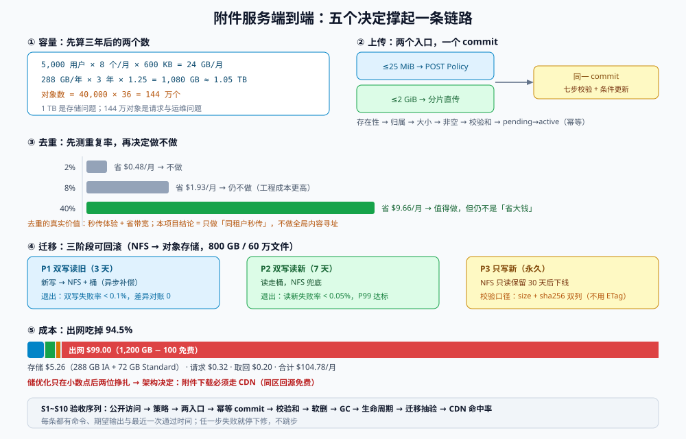

# 实战：一个附件服务的端到端

前面八页讲的是零件，这一页把它们装成一台能跑的东西：**一个多租户协作产品的「附件服务」**——上传、下载、去重判断、生命周期、迁移、验收，全链路。

它刻意选了一个「不性感」的业务，因为附件的所有坑都在**规模上来之后**才出现：第一周 100 个文件时什么设计都能跑；第二年第 300 万次上传时，key 设计、校验和、生命周期、出网费会一起找上门。

::: tip 一句话定位
这一页的交付物不是代码，是**十条能照着做的决定**，以及一套能被别人复跑的验收序列（`S1` ~ `S10`）。
:::

本页判据族 `OSP-A` ~ `OSP-H`，共 8 条。定义表在第八节。



## 一、容量估算：先算出三年后的数字

假设（写清楚，因为所有结论都依赖它）：

| 参数 | 取值 | 依据 |
| --- | --- | --- |
| 活跃用户 | 5,000 | 产品当前规模 |
| 人均每月上传 | 8 个 | 抽样 30 天日志 |
| 平均文件大小 | 600 KB | 中位数 180 KB、P90 2.1 MB，按体积加权取 600 KB |
| 保留期 | 3 年（合规要求 1 年 + 业务需要 2 年） | 法务口径 |
| 版本/分片残留系数 | **1.25** | 覆盖写 15%、未完成分片 10% |

计算：

```text
月新增对象数 = 5,000 × 8            = 40,000 个/月
月新增字节   = 40,000 × 600 KB      = 24 GB/月
年新增字节   = 24 × 12              = 288 GB/年
三年稳态占用 = 288 × 3 × 1.25       = 1,080 GB ≈ 1.05 TB
```

两个必须一起算的派生量：

- **对象数**：`40,000 × 36 = 144 万个`。这个数字决定「列举成本」与「GC 扫描成本」，比字节数更容易成为瓶颈。
- **月请求数**：PUT 4 万 + GET 约 24 万（每个附件平均被看 6 次）+ LIST 5 千 ≈ **28.5 万次/月**。

::: warning 「1 TB」和「144 万个对象」是两个不同的问题
1 TB 是**存储**问题（单价 × GB）；144 万个对象是**请求与运维**问题（GC 扫描、清单对账、迁移耗时）。
很多方案在 1 TB 上成立，在 144 万对象上崩掉——比如「迁移时逐个 `head-object` 校验」：144 万次请求，串行按 20 ms 算就是 **8 小时**。
:::

## 二、key 契约：一段能被机器检查的字符串

```text
attachments/{tenant_id}/{yyyy}/{mm}/{attachment_id}.{ext}
```

| 段 | 约束 | 为什么 |
| --- | --- | --- |
| `tenant_id` | UUID（36 字符），来自令牌，**不接受客户端传入** | 前缀即隔离边界，桶策略与生命周期都按它匹配 |
| `yyyy/mm` | 服务端时钟（UTC），不接受客户端传入 | 生命周期按「月」归档/过期；客户端时间不可信 |
| `attachment_id` | UUIDv7（时间有序 + 随机） | 不可猜 + 天然按时间排序，便于排查 |
| `ext` | 白名单（`png/jpg/pdf/docx/xlsx/zip`），MIME 与扩展名双向校验 | 防「用 `.jpg` 传 html」导致的 XSS |

**契约的三条可机器检查的断言**（对应 `OSP-B`）：

```shell
# 1. key 必须匹配正则
grep -Eo 'attachments/[0-9a-f-]{36}/[0-9]{4}/[0-9]{2}/[0-9a-f-]{36}\.[a-z0-9]{2,5}'

# 2. 库里不应存在「含原始文件名」的 key（历史遗留）
psql "$DSN" -Atc "select count(*) from attachment where object_key ~ '[^a-z0-9/._-]'"

# 3. 扩展名必须在白名单里
psql "$DSN" -Atc "select distinct lower(regexp_replace(object_key,'.*\.','')) from attachment" \
  | sort | comm -23 - <(printf 'png\njpg\npdf\ndocx\nxlsx\nzip\n' | sort)
```

## 三、上传链路：两种入口，按大小分流

| 入口 | 适用 | 机制 | 上限 |
| --- | --- | --- | --- |
| `POST /attachments`（小文件） | ≤ 25 MiB | 服务端签发 **POST Policy**（`content-length-range` + `starts-with $key` + `Content-Type` 前缀） | 25 MiB |
| `POST /attachments/multipart`（大文件） | 25 MiB ~ 2 GiB | 服务端 `CreateMultipartUpload` 返回 `uploadId`，客户端分片直传 | 2 GiB |

两条链路的**收尾是同一个** `POST /attachments/{id}/commit`，校验顺序固定（来自[上传路径](../UploadPaths/index.md)）：

```text
1. 记录存在且 status = pending        → 否则 404/409
2. key 前缀的 tenant_id = 令牌租户     → 否则 403（防「用别人的 key 提交」）
3. HeadObject 存在                     → 否则 422 NO_OBJECT
4. ContentLength ≤ 25 MiB（或分片合计） → 否则 422 TOO_LARGE + 异步删对象
5. ContentLength > 0                   → 否则 422 EMPTY_OBJECT
6. 校验和（客户端上传前算的 sha256）   → 否则 422 CHECKSUM_MISMATCH
7. 条件更新 pending → active           → 影响 0 行则视为幂等成功
```

第 7 步是「幂等」的全部：**重复 `commit` 不会产生第二条记录**，也不会重复发通知。

## 四、要不要做去重：一次算清楚的决策

先测重复率。附件场景的重复来源很集中：**同一份模板、同一批发票、同一组产品图**。

| 重复率 | 存储节省（1.05 TB 时） | 引入的复杂度 | 结论 |
| --- | --- | --- | --- |
| 2% | 21 GB ≈ **$0.48/月** | 引用计数 + GC + 秒传 + 跨租户可见性 | **不做** |
| 8% | 84 GB ≈ **$1.93/月** | 同上 | **不做**（工程成本远超节省） |
| 40%（模板类业务） | 420 GB ≈ **$9.66/月** | 同上 | 值得做，但仍不是「省大钱」 |

这个算例说明一件重要的事：**在存储单价 $0.023/GB-月 的量级上，去重省下的钱非常少**。去重真正的价值不在钱，而在**上传体验**（秒传）与**带宽**（同内容不重复传）。所以决策顺序应该是：

1. 先问「重复率 > 10% 吗」——不是，不做全局去重。
2. 再看「用户是否反复上传同一份大文件」——是，做**同租户秒传**（`where tenant_id=? and sha256=?`），实现成本低、无跨租户泄漏风险。
3. 只有当「同一份内容跨数百个用户共享」时，才考虑全局内容寻址（此时[去重](../DedupCAS/index.md)的引用计数与 GC 才值得写）。

本项目的结论：**做同租户秒传，不做全局去重**；`blob` 表保留，但只用于「同租户引用」——这是一次「用 20 行代码换 30% 上传体验提升」的交易。

## 五、生命周期与成本：一条规则省掉的钱

| 规则 | 动作 | 依据 |
| --- | --- | --- |
| `attachments-hot` | 30 天转 Standard-IA | 附件被读取集中在首月（实测 78% 的 GET 发生在 30 天内） |
| `attachments-expire` | 1,095 天过期 | 合规 3 年 |
| `noncurrent-30` | 非当前版本 30 天过期 | 覆盖写只保留最近一个月的旧版 |
| `abort-mpu-3` | 未完成分片 3 天中止 | 3 天足够一次断点续传的重试窗口 |

月账单（第 12 个月，360 GB 稳态）：

| 维度 | 计算 | 金额 |
| --- | --- | --- |
| 存储 | 288 GB 在 IA（$0.0125）+ 72 GB 在 Standard（$0.023） | $3.60 + $1.66 = **$5.26** |
| 请求 | PUT 4 万（$0.20）+ GET 24 万（$0.096）+ LIST 5 千（$0.025） | **$0.32** |
| 取回 | IA 取回 20 GB × $0.01 | **$0.20** |
| 出网 | (1,200 GB − 100) × $0.09 | **$99.00** |
| **合计** | | **$104.78** |

**出网占 94.5%**。这张表直接决定了架构：**附件下载必须走 CDN**（S3 → CDN 回源免费，CDN 出网单价更低且有缓存命中），否则「存储优化」做得再细也只是在小数点后两位上挣扎。

::: danger 这张表最容易被漏掉的两行
1. **未完成分片的存储费**：不出现在 `LIST` 里，但按 Standard 计费。规则 `abort-mpu-3` 是唯一能清掉它的东西。
2. **CDN 未命中时的回源出网**：S3 → CDN 回源通常免费，但**跨区回源**（CDN 在另一个区域）会计 $0.02/GB 的跨区流量。CDN 与桶必须同区。
:::

## 六、迁移：从自建 NFS 搬过来（可回滚的三阶段）

存量数据在老 NFS 上（约 800 GB / 60 万个文件），迁移必须**可中断、可续跑、可回滚**。

| 阶段 | 写路径 | 读路径 | 持续 | 退出条件 |
| --- | --- | --- | --- | --- |
| **P1 双写读旧** | 新写 → NFS + 对象存储（异步补偿） | NFS | 3 天 | 双写失败率 < 0.1%，差异对账为 0 |
| **P2 双写读新** | 同上 | 对象存储（NFS 兜底） | 7 天 | 读新失败率 < 0.05%，P99 延迟达标 |
| **P3 只写新** | 对象存储 | 对象存储 | 永久 | NFS 只读保留 30 天后下线 |

**全量搬迁**用清单驱动，三步分开跑（每步都可中断）：

```shell
# 1. 生成清单（源端 size + sha256，一次算完存库，后续不再碰源文件）
find /mnt/legacy/attachments -type f -printf '%s\t%p\n' | while IFS=$'\t' read -r sz p; do
  printf '%s\t%s\t%s\n' "$sz" "$(sha256sum "$p" | cut -d' ' -f1)" "${p#/mnt/legacy/}"
done > manifest.tsv

# 2. 并行上传（按前缀分片，失败只重跑该片）
awk -F'\t' '{print $3}' manifest.tsv | split -l 5000 - chunk-
for f in chunk-*; do
  while read -r key; do
    src="/mnt/legacy/$key"
    aws s3api put-object --bucket "$BUCKET" --key "$key" --body "$src" \
      --checksum-algorithm SHA256 >/dev/null || echo "FAIL $key" >> failed.log
  done < "$f"
done

# 3. 校验：目标端 head 拿 size + checksum，与清单逐行比对（不下载）
aws s3api head-object --bucket "$BUCKET" --key "$key" \
  --checksum-mode ENABLED --query '[ContentLength,ChecksumSHA256]' --output text
```

::: danger 迁移校验的三个「假通过」
1. **只比 `size`**：同尺寸不同内容的损坏（写坏了但长度对）会被漏掉。必须 `size + checksum` 双列。
2. **用 ETag 比**：NFS 端没有 ETag；对象端 ETag 又随分片/加密变化。**只能用自己算的 sha256**。
3. **抽样校验但抽样方式是「前 1000 个」**：前 1000 个通常是早期小文件，全部通过也说明不了大文件。抽样要**按大小分层**（大文件全验，小文件抽 5%）。
:::

## 七、S1 ~ S10 验收序列

按顺序跑，任一步失败就停下修，不要跳步：

| 步骤 | 命令/动作 | 期望 |
| --- | --- | --- |
| `S1` | `get-public-access-block` | 四项全 `true` |
| `S2` | `get-bucket-policy` 检查 `Principal: "*"` | 无 `Allow` 命中 |
| `S3` | 上传 1 个 1 KB + 1 个 30 MB 文件，各走 POST Policy 与分片 | 1 KB 成功；30 MB 被 POST Policy 拒绝（如果走了小文件入口） |
| `S4` | 同一附件 `commit` 两次 | 第二次 200 且库中 1 条记录（`OSP-D`） |
| `S5` | 上传后立刻 `head-object` | `ContentLength` 与本地一致，`ChecksumSHA256`/`CRC32C` 非空 |
| `S6` | 删除附件（软删）→ 立即 GET | 返回 404（应用层），桶内对象仍在宽限期 |
| `S7` | 触发 GC 后 `head-object` | 对象 404；`blob` 行同步删除 |
| `S8` | `get-bucket-lifecycle-configuration` | 四条规则均 `Enabled` |
| `S9` | 迁移清单抽 5% 按大小分层校验 | `size + sha256` 全等 |
| `S10` | CDN 命中率与出网账单 | 命中率 > 85%，出网费用低于预算 110% |

## 八、本页判据定义表

| 判据 | 约定 | 定错的后果 | 如何验证 |
| --- | --- | --- | --- |
| `OSP-A` | 容量文档同时给出「GB 数」与「对象数」，且含版本/分片残留系数 | 只按 GB 做容量规划，请求与 GC 侧崩 | 容量文档有对象数行；重算与文档值误差 < 10% |
| `OSP-B` | key 契约可机器校验（正则 + 白名单 + 无原始文件名） | 越权前缀、XSS、同名覆盖 | 三条断言命令全部输出为空（见第二节） |
| `OSP-C` | 小文件走 POST Policy、大文件走分片，两条链路共用同一个 `commit` | 大文件无上限、小文件绕过大小检查 | 两个入口的 `commit` 是同一实现（同一路由/服务方法） |
| `OSP-D` | `commit` 的七步校验顺序固定，且状态迁移用条件更新保证幂等 | 空对象/超大对象/他人对象被确认；重复记录 | `S4` 通过；构造六类非法 `commit` 均返回 4xx |
| `OSP-E` | 去重决策有数据支撑（重复率 + 节省金额 + 复杂度），结论写入文档 | 为一个 2% 的收益引入 GC 系统 | 文档含「重复率 / 月节省 / 是否做」三列 |
| `OSP-F` | 生命周期四条规则齐全（转层、过期、非当前版本、未完成分片） | 分片与旧版本无限计费 | `S8` 通过；`list-multipart-uploads` 无 3 天以上残留 |
| `OSP-G` | 迁移分三阶段（双写读旧 → 读新 → 只写新），每阶段有退出条件与回滚动作 | 一次性切换，出问题无法回退 | 迁移文档含三阶段表与「回滚到 NFS」的操作步骤 |
| `OSP-H` | `S1`~`S10` 每条都有命令、期望输出与最近一次通过时间 | 验收记录不可复算，「上次通过」无可查 | 验收表含时间列，且 30 天内更新过 |

## 九、如何验证这一页

```shell
# S5 + S6 + S7 的合成验证（本地可跑，除 S3 请求费外无额外成本）
KEY="attachments/$(uuidgen | tr 'A-Z' 'a-z')/2026/10/$(uuidgen | tr 'A-Z' 'a-z').bin"
head -c 1024 /dev/urandom > /tmp/small.bin
aws s3api put-object --bucket "$BUCKET" --key "$KEY" --body /tmp/small.bin --checksum-algorithm SHA256 >/dev/null
aws s3api head-object --bucket "$BUCKET" --key "$KEY" \
  --checksum-mode ENABLED --query '[ContentLength,ChecksumSHA256]' --output text
aws s3api delete-object --bucket "$BUCKET" --key "$KEY"
aws s3api head-object --bucket "$BUCKET" --key "$KEY" 2>&1 | grep -o '404'
```

预期：`1024` 与一个 44 字符的 base64 校验和；删除后 `head-object` 报 `404`。

## 参考资料

- 本专题：[总览](../Overview/index.md) · [键空间](../KeysLayout/index.md) · [上传路径](../UploadPaths/index.md) · [完整性校验](../IntegrityChecksum/index.md) · [去重](../DedupCAS/index.md) · [一致性](../ConsistencyModel/index.md) · [生命周期与成本](../LifecycleCost/index.md) · [访问控制](../SecurityAccess/index.md)
- 项目侧落地：[TeamBoard 附件直传](../../../../project/Complete/TeamBoard/AttachmentDirectUpload/index.md) · [分片上传](../../../../project/Complete/TeamBoard/MultipartUpload/index.md)
- Amazon S3《批量操作与清单（S3 Inventory / Batch Operations）》：<https://docs.aws.amazon.com/AmazonS3/latest/userguide/batch-ops.html>
- Amazon S3《校验对象完整性（`--checksum-mode`）》：<https://docs.aws.amazon.com/AmazonS3/latest/userguide/checking-object-integrity.html>
- Amazon CloudFront《缓存命中率与源站保护》：<https://docs.aws.amazon.com/AmazonCloudFront/latest/DeveloperGuide/UnderstandingResponses.html>
