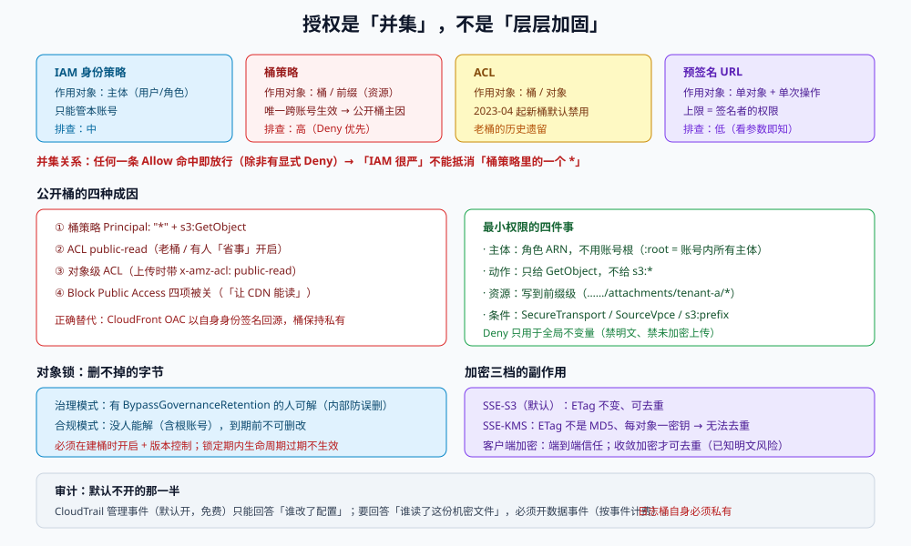

# 访问控制与合规：谁能读这份字节，凭什么

对象存储的安全事故有 95% 是同一种形状：**「本来只想让一个页面能显示图片，结果整个桶可以被列出来」**。它不是「配置太难」，而是「授权有四套机制，它们互相覆盖，而任何一套写宽了都能把另外三套作废」。

四套机制是：**身份策略（IAM）**、**桶策略（resource policy）**、**ACL**、**预签名 URL**。它们的关系不是「层层加固」，而是**并集**——除非显式 `Deny`。

::: tip 一句话定位
对象存储的授权是「**默认拒绝，除非某条策略显式允许**」；出事的桶，永远是某一条策略里多了一个 `*`，而不是少了某道锁。
:::

本页判据族 `OSS-A` ~ `OSS-H`，共 8 条。定义表在第七节。



## 一、四套机制的覆盖关系

| 机制 | 作用对象 | 谁管 | 能不能「放宽」 | 排查难度 |
| --- | --- | --- | --- | --- |
| **IAM 身份策略** | 用户 / 角色（主体） | 云账号管理员 | 能（给主体加 `s3:*`） | 中：要看主体的所有策略 |
| **桶策略** | 桶 / 桶内前缀（资源） | 桶所有者 | 能（`Principal: "*"` 就是公开） | **高**：跨账号也能授权，且 `Deny` 优先 |
| **ACL** | 桶 / 对象（资源） | 桶所有者 | 能（`public-read`） | 低：新桶默认禁用，老桶可能是历史遗留 |
| **预签名 URL** | 单个对象 + 单次操作 | 签名者 | 签名者的权限上限 | 低：看 URL 参数即可知范围与过期 |

关键结论：**桶策略是唯一一个「跨账号生效」的机制**，所以「桶被公开」几乎总是桶策略或 ACL 造成的；IAM 再严也没用，因为 `Principal: "*"` 允许的是「任何人」。

::: warning 2023-04 之后的新默认值
新建桶默认：**Block Public Access 四项全开**、**ACL 被禁用**（Object Ownership = `Bucket owner enforced`）、**默认 SSE-S3 加密**。
这意味着「新桶被公开」不会自己发生——一旦发生，就是有人主动改了配置。这条默认值让排查变简单：**先看「谁改过桶策略」的 CloudTrail 记录**，比读策略本身更快。
:::

## 二、公开桶的四种成因

| 成因 | 具体形态 | 判别命令 | 修法 |
| --- | --- | --- | --- |
| **桶策略 `Principal: "*"`** | `{"Effect":"Allow","Principal":"*","Action":"s3:GetObject","Resource":"arn:aws:s3:::b/*"}` | `get-bucket-policy` 里搜 `"*"` | 加 `Condition`（来源 VPC / Referer / 前缀）或改成 CloudFront OAC |
| **ACL `public-read`** | 老桶、或有人「为了省事」开了 ACL | `get-bucket-acl` 里 `AllUsers` 组 | 关掉 ACL（`Bucket owner enforced`）+ 删 ACL 授权 |
| **对象级 ACL** | 上传时带 `x-amz-acl: public-read` | `get-object-acl --key` | 上传代码里禁止设置 ACL |
| **Block Public Access 被关** | 有人为了「让 CDN 能读」把四项关了 | `get-public-access-block` 返回 `false` | 立刻打开四项；用 OAC 替代 |

::: danger 三个「为了让它能访问」而开的洞
1. **「CDN 回源要公开」**：错。用 Origin Access Control（OAC）让 CloudFront 以**自己的身份**签名回源，桶保持私有。开公开是历史上 S3 源站的旧做法。
2. **「内网访问不用鉴权」**：错。内网不等于可信；用桶策略的 `aws:SourceVpce` 条件限制 VPC 端点，而不是关掉鉴权。
3. **「先公开调试，上线再关」**：这句话的后半句从来没执行过。要调试就签一个 5 分钟的预签名 URL。
:::

## 三、最小权限：从「能读这个桶」到「能读这个前缀的这几类对象」

一条能被审计的桶策略，至少限制四件事：**主体**、**动作**、**资源前缀**、**条件**。

```json
{
  "Version": "2012-10-17",
  "Statement": [
    {
      "Sid": "TenantAReadOwnPrefixOnly",
      "Effect": "Allow",
      "Principal": { "AWS": "arn:aws:iam::123456789012:role/tenant-a-app" },
      "Action": ["s3:GetObject"],
      "Resource": "arn:aws:s3:::team-board-attachments/attachments/tenant-a/*",
      "Condition": {
        "Bool": { "aws:SecureTransport": "true" }
      }
    },
    {
      "Sid": "DenyInsecureTransport",
      "Effect": "Deny",
      "Principal": "*",
      "Action": "s3:*",
      "Resource": ["arn:aws:s3:::team-board-attachments", "arn:aws:s3:::team-board-attachments/*"],
      "Condition": { "Bool": { "aws:SecureTransport": "false" } }
    },
    {
      "Sid": "DenyUnencryptedUploads",
      "Effect": "Deny",
      "Principal": "*",
      "Action": "s3:PutObject",
      "Resource": "arn:aws:s3:::team-board-attachments/*",
      "Condition": { "StringNotEquals": { "s3:x-amz-server-side-encryption": "AES256" } }
    }
  ]
}
```

四条纪律：

1. **`Resource` 必须写到前缀级**，绝不写 `arn:aws:s3:::bucket/*`（除非这个桶真的只有一个租户）。
2. **`Deny` 只用于「全局不变量」**（禁明文传输、禁未加密上传、禁删除审计桶），不要用 `Deny` 做业务隔离——`Deny` 的优先级最高，写错一次就要跨账号排查。
3. **`Principal` 用角色 ARN，不用账号根**（`arn:aws:iam::123:root` 等于「这个账号里任何有权限的主体」）。
4. **每个 `Allow` 都配一个 `Condition`**：`aws:SecureTransport`、`aws:SourceVpce`、`s3:prefix`、`aws:PrincipalTag/tenant`。

## 四、对象锁：删不掉的字节

对象锁（Object Lock）是 WORM（Write Once Read Many）的实现，用于合规归档、审计日志、法律保留。它有两个模式：

| 模式 | 谁能缩短/解除 | 适用 |
| --- | --- | --- |
| **治理模式（Governance）** | 有 `s3:BypassGovernanceRetention` 权限的主体 | 内部防误删（自己有钥匙） |
| **合规模式（Compliance）** | **没有人**（包括根账号），到期前不可删、不可改 | 法规要求（SEC 17a-4、金融审计） |

三条必须写进文档的事实：

1. **对象锁必须在创建桶时开启**（`ObjectLockEnabledForBucket=true`），且**同时开启版本控制**；存量桶无法补开（只能新建桶 + 迁移）。
2. **锁定期内，生命周期规则的过期删除不会生效**：规则会「看起来执行了」，但对象仍在。这不是 bug，是设计——但很多人把它当「规则没生效」排查半天。
3. **合规模式一旦设置，无法撤销、无法缩短**：连「删除这个桶」都不行，只能等。上线前必须用治理模式跑够一个周期。

::: danger 一个不可逆的操作
在合规模式下给一个前缀设 7 年保留，然后再发现「这个前缀其实是临时文件」——你没有任何补救手段。**合规模式的第一次设置，必须在测试桶上演练过整个保留周期**（或至少确认桶里没有写错的规则）。
:::

## 五、加密三档与它们的副作用

| 方式 | 谁管密钥 | 对 ETag 的影响 | 对去重的影响 | 适用 |
| --- | --- | --- | --- | --- |
| **SSE-S3**（默认） | 服务商托管，桶级 | 不变（仍是内容 MD5） | 无影响 | 绝大多数场景的默认值 |
| **SSE-KMS** | KMS 托管，可审计、可跨账号授权 | **ETag 不再是 MD5** | 每对象一密钥 → **服务端无法去重** | 有审计/合规要求 |
| **SSE-C** | 客户端提供密钥 | ETag 不再是 MD5 | 无法去重 | 极少数强合规场景 |
| **客户端加密** | 客户端 | 与存储无关 | 收敛加密才可去重（有已知明文风险） | 端到端信任模型 |

KMS 的两个运维坑：

1. **KMS 权限是独立的**：`s3:GetObject` 有了但 `kms:Decrypt` 没有，会得到 `AccessDenied`（错误信息指向 KMS，不指向 S3），排障时容易只看桶策略。
2. **KMS 有请求配额与费用**：每 10,000 次请求约 $0.03，且默认配额（如 5,500 次/秒/区域）在高并发读下会限流（`ThrottlingException`）。大流量读路径用**桶级密钥 + 数据密钥缓存**（S3 Bucket Key）降低 KMS 调用量。

## 六、审计：默认不开的那部分

| 日志 | 默认状态 | 记什么 | 成本 |
| --- | --- | --- | --- |
| **CloudTrail 管理事件** | 开（每个账号） | `PutBucketPolicy`、`DeleteBucket` 等 | 免费（90 天事件历史） |
| **CloudTrail 数据事件（对象级）** | **默认不开** | `GetObject`、`PutObject`（含谁、从哪、哪个 key） | 按事件计费（约 $0.10/10 万事件） |
| **S3 服务器访问日志** | 默认不开 | 每个 HTTP 请求一行 | 存储 + 处理成本；**日志桶本身要私有** |
| **S3 Inventory** | 默认不开 | 每日/每周的对象清单（含加密、复制、锁状态） | 按对象数计费 |

一句话判断：**如果「谁在什么时候读了这份机密文件」是必须回答的问题，那数据事件就必须开**；只开管理事件只能回答「谁改了配置」。

## 七、本页判据定义表

| 判据 | 约定 | 定错的后果 | 如何验证 |
| --- | --- | --- | --- |
| `OSS-A` | 所有桶 `BlockPublicAccess` 四项为 `true`；例外需审批并写明理由 | 桶被公开、被批量下载 | `get-public-access-block` 四项均 `true` |
| `OSS-B` | 桶策略中不存在 `Principal: "*"` 且 `Action` 含 `s3:GetObject`/`s3:ListBucket` 的 `Allow` | 全量泄漏 | `get-bucket-policy` 里无该组合（`Deny` 语句除外） |
| `OSS-C` | 桶策略 `Resource` 写到前缀级，且主体用角色 ARN 而非账号根 | 跨租户越权 | 每条 `Allow` 的 `Resource` 含具体前缀；`Principal` 不含 `:root` |
| `OSS-D` | 每个 `Allow` 至少带一个 `Condition`（`SecureTransport` / `SourceVpce` / `s3:prefix`） | 授权范围失控 | 策略解析后 `Allow` 语句的 `Condition` 缺失数为 0 |
| `OSS-E` | 上传代码不设置对象 ACL（`x-amz-acl`），桶用 `Bucket owner enforced` | 对象级公开，桶策略看不到 | `get-bucket-ownership-controls` 为 `BucketOwnerEnforced`；代码无 `x-amz-acl` |
| `OSS-F` | 对象锁的桶在创建时开启（含版本控制），保留期有审批记录；合规模式先在测试桶演练 | 不可逆的锁定期 | `get-object-lock-configuration` 已配置；有演练记录链接 |
| `OSS-G` | 加密方式成文（SSE-S3/SSE-KMS/SSE-C），KMS 场景验证过 `kms:Decrypt` 权限 | 上传成功但读失败；或审计要求不满足 | 用只读角色 `get-object` 成功；`head-object` 显示 `ServerSideEncryption` |
| `OSS-H` | 机密桶开启 CloudTrail 数据事件；日志桶自身私有 | 「谁读过」无法回答 | `get-trail-status` 含该桶的 `DataResources`；日志桶 `BlockPublicAccess` 全开 |

## 八、如何验证这一页

```shell
# 1. 公开访问四开关（核心判据，一条命令看完）
aws s3api get-public-access-block --bucket "$BUCKET" \
  --query 'PublicAccessBlockConfiguration.[BlockPublicAcls,IgnorePublicAcls,BlockPublicPolicy,RestrictPublicBuckets]' \
  --output text

# 2. 桶策略里有没有 Principal: "*" 的 Allow
aws s3api get-bucket-policy --bucket "$BUCKET" --query Policy --output text \
  | python3 -c 'import sys,json
p=json.load(sys.stdin)
bad=[s for s in p["Statement"] if s.get("Effect")=="Allow" and s.get("Principal")=="*"]
print("UNSAFE" if bad else "OK", len(bad))'

# 3. 桶的所有者强制与 ACL 状态
aws s3api get-bucket-ownership-controls --bucket "$BUCKET" \
  --query 'OwnershipControls.Rules[].ObjectOwnership' --output text

# 4. 对象锁与默认加密
aws s3api get-object-lock-configuration --bucket "$BUCKET" 2>&1 | head -3
aws s3api get-bucket-encryption --bucket "$BUCKET" \
  --query 'ServerSideEncryptionConfiguration.Rules[].ApplyServerSideEncryptionByDefault.SSEAlgorithm' --output text
```

预期：第 1 条 `true true true true`；第 2 条 `OK 0`；第 3 条 `BucketOwnerEnforced`；第 4 条打印锁配置（未开启则报 `ObjectLockConfigurationNotFoundError`，需在文档中写明「本桶不涉合规保留」）与 `AES256` 或 `aws:kms`。

## 参考资料

- Amazon S3《阻止公开访问》：<https://docs.aws.amazon.com/AmazonS3/latest/userguide/access-control-block-public-access.html>
- Amazon S3《桶策略示例》：<https://docs.aws.amazon.com/AmazonS3/latest/userguide/example-bucket-policies.html>
- Amazon S3《对象锁》：<https://docs.aws.amazon.com/AmazonS3/latest/userguide/object-lock.html>
- Amazon S3《使用 KMS 的服务端加密与桶密钥》：<https://docs.aws.amazon.com/AmazonS3/latest/userguide/UsingKMSEncryption.html>
- AWS 公告《新桶默认阻止公开访问并禁用 ACL》（2023-04）：<https://aws.amazon.com/about-aws/whats-new/2023/04/amazon-s3-block-public-access-default/>
- Amazon CloudFront《Origin Access Control》：<https://docs.aws.amazon.com/AmazonCloudFront/latest/DeveloperGuide/private-content-restricting-access-to-s3.html>
- AWS 文档《CloudTrail 数据事件与 S3 对象级日志》：<https://docs.aws.amazon.com/AmazonS3/latest/userguide/cloudtrail-logging.html>
