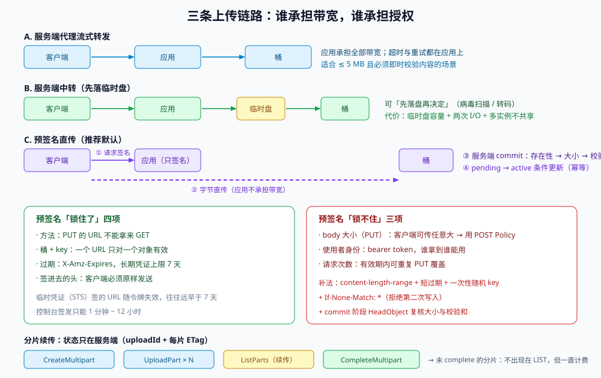

# 上传路径与预签名：字节从谁手里进桶

一次上传看起来只有「选文件 → 转圈 → 完成」三步，但服务端要在这三步里回答四个问题：**字节经过谁**、**谁授权**、**失败了从哪继续**、**怎么确认传完了**。这四个问题的答案组合起来，就是所谓的「上传链路」。

本页不重复讲本项目里那次直传的接口细节（那在[附件直传](../../../../project/Complete/TeamBoard/AttachmentDirectUpload/index.md)），而是讲**三条链路各自把风险留在了哪里**——因为选错链路的代价，通常要等到第一次「用户传了 2 GB 视频」或第一次「桶被刷」才显现。

::: tip 一句话定位
上传链路的选择，本质是选**谁承担带宽**与**谁承担授权**：带宽给客户端（直传）、授权给服务端（预签名），两者之间的每一寸缝隙都是一个要写死的契约。
:::

本页判据族 `OSU-A` ~ `OSU-H`，共 8 条。定义表在第七节。



## 一、三条链路与它们的分界线

| 链路 | 字节路径 | 优点 | 代价 | 适用 |
| --- | --- | --- | --- | --- |
| **A. 服务端代理流式转发** | 客户端 → 应用 → 桶 | 服务端能看到全部字节，可即时扫描、可即时转码 | 占用应用带宽与连接数；应用是瓶颈；超时/重试都落在应用上 | 小文件（< 5 MB）、必须即时校验内容的场景 |
| **B. 服务端中转（先落临时盘）** | 客户端 → 应用 → 临时盘 → 桶 | 可以「先落盘再决定」 | 临时盘容量与清理；两次 I/O；多实例下盘不共享 | 需要病毒扫描、格式转换的批量导入 |
| **C. 预签名直传** | 客户端 → 桶（应用只签发与确认） | 应用不承担带宽；可续传；天然支持大文件 | 授权范围必须自己锁死；回调可被伪造/重放 | 附件、图片、视频、导出包（绝大多数场景） |

**分界线**可以量化为一条不等式：`文件大小 × 并发上传数 ÷ 应用出口带宽 > 30%` 时，A/B 会开始影响正常请求的尾延迟，此时必须走 C。

::: warning 直传不是「更高级的方案」，它有明确的失效场景
- **必须即时拒绝非法内容**（例如「上传即检测到 EICAR 测试串就 400」）：直传时字节不经过你，只能在 `commit` 阶段发现，此时对象已经在桶里（要补一次删除 + 审计）。
- **客户端环境不可信**（内网老浏览器、代理会改写请求头）：预签名对**请求头**有要求，代理改一个 `Content-Type` 就会 `SignatureDoesNotMatch`。
- **需要按客户端 IP 限流**：直传的请求不经过你的网关，桶侧没有「按用户」的限流能力（只有桶级/账号级）。
:::

## 二、预签名到底锁住了什么

预签名（presigned URL）不是「发一个通行证」，而是「**把这次请求的规范串提前签好**」。SigV4 的规范串包含：HTTP 方法、规范化 URI（= key）、规范化查询串、规范化头（至少 `host`，可含你签进去的头）、签名时间与过期时间。

所以：

| 锁住了 | 说明 | 想改就得重签 |
| --- | --- | --- |
| **方法** | `PUT` 的 URL 不能拿来 `GET` | 是 |
| **桶 + key** | 一个 URL 只对一个对象有效 | 是 |
| **过期时间** | `X-Amz-Expires`，IAM 长期凭证签名时**上限 7 天** | 是（重签） |
| **签进去的头** | 若签名时把 `Content-Type`、`Content-MD5` 放进 `SignedHeaders`，客户端必须原样发送 | 是 |

| **锁不住** | 说明 | 补法 |
| --- | --- | --- |
| **body 的大小**（`PUT` 预签名） | 客户端可以传任意大的内容，你按存储与流量付费 | 改用 **POST Policy** 的 `content-length-range`，或 `commit` 阶段比对 `HeadObject` 的 `ContentLength` 并拒收 |
| **使用者身份** | 预签名是 bearer token，谁拿到谁能用 | 短过期（分钟级）+ 一次性 token + 服务端 `commit` 时校验归属 |
| **请求次数** | 一个 URL 在有效期内可以被重复 PUT（覆盖写） | 目标 key 使用**一次性随机段**，重复 PUT 只会覆盖同一份随机 key（配合 `If-None-Match: *` 可拒绝第二次） |

::: danger 四个必踩的预签名坑
1. **用 STS 临时凭证签了 7 天**：URL 会随临时凭证（通常 1 小时）一起失效，`X-Amz-Expires=604800` 只是「不超过」，不是「一定有」。
2. **签名时带了 `Content-Type`，客户端却传了 `application/octet-stream`**：报 `SignatureDoesNotMatch`，错误信息完全不提 Content-Type。要么别签这个头，要么在文档里写死必须一致。
3. **本机时间偏了 3 分钟**：SigV4 允许 15 分钟偏差，超过就 `RequestTimeTooSkewed`。容器里没配 NTP 的环境很常见。
4. **CORS 没配**：浏览器直传前会发 `OPTIONS` 预检，桶上没有 CORS 规则就直接失败，控制台只显示「CORS error」，看起来像签名问题。要在 CORS 里放行 `PUT`、`GET`，并把 `ETag` 放进 `ExposeHeaders`（否则前端读不到 ETag）。
:::

## 三、要限制大小与类型，用 POST Policy

`PUT` 预签名锁不住 body，这是设计使然。需要「只允许 25 MiB 以内的 jpg/png」时，正确工具是**基于策略的 POST 上传**：服务端生成一个 base64 的 policy（含条件），客户端把 policy 与签名一起 `multipart/form-data` 提交。

```json
{
  "expiration": "2026-10-20T12:00:00Z",
  "conditions": [
    { "bucket": "team-board-attachments" },
    ["starts-with", "$key", "attachments/t1/2026/10/"],
    ["content-length-range", 1, 26214400],
    ["starts-with", "$Content-Type", "image/"],
    { "x-amz-server-side-encryption": "AES256" }
  ]
}
```

要点：

1. `content-length-range` 是**服务端强制**的：超限直接 `400 EntityTooLarge`，不会产生对象，也不会计费。
2. `starts-with $key` 必须把租户前缀写死，否则客户端可以改 key 往别人的前缀里写。
3. policy 里出现的每一个 `$字段`，客户端表单里都必须有；反之表单里多出的字段必须在 policy 里有条件（否则 `PolicyConditionFailed`）。
4. policy 的 `expiration` 是**绝对时间**，不是「多少秒后」；生成时用 UTC。

::: tip 什么时候两种都要
大文件（> 100 MB）用**预签名 PUT + 分片**（policy 不适合分片流程）；小文件（图片、证件、头像）用 **POST Policy**。同一业务里两种并存是正常的，但要在接口文档里写清「哪个接口用哪种、超限时的错误码是什么」。
:::

## 四、断点续传：靠 `uploadId` 与分片 ETag，不靠文件哈希

分片上传的状态**只存在服务端**：`CreateMultipartUpload` 返回 `uploadId`，之后每次 `UploadPart` 带 `partNumber`，返回该分片的 ETag。续传 = 用 `ListParts` 问「已经收到哪几片」。

```shell
# 1. 发起分片上传，拿到 uploadId
UPLOAD_ID=$(aws s3api create-multipart-upload --bucket "$BUCKET" --key "$KEY" \
  --query UploadId --output text)

# 2. 传第 1 片（分片号从 1 开始，最小 5 MiB，最后一片可小于 5 MiB）
aws s3api upload-part --bucket "$BUCKET" --key "$KEY" --upload-id "$UPLOAD_ID" \
  --part-number 1 --body part-00001

# 3. 断线后问「已经有哪些片」（这就是续传的全部秘密）
aws s3api list-parts --bucket "$BUCKET" --key "$KEY" --upload-id "$UPLOAD_ID" \
  --query 'Parts[].[PartNumber,Size,ETag]' --output table

# 4. 全部传完后合并（必须按 PartNumber 升序，ETag 必须与上传时一致）
aws s3api complete-multipart-upload --bucket "$BUCKET" --key "$KEY" --upload-id "$UPLOAD_ID" \
  --multipart-upload '{"Parts":[{"PartNumber":1,"ETag":"\"…\""},{"PartNumber":2,"ETag":"\"…\""}]}'
```

三条纪律：

1. **分片大小在发起时就定死**（除最后一片），中途改大小会让已传分片作废。常见取值 8 / 16 / 32 MiB，理由见[分片上传](../../../../project/Complete/TeamBoard/MultipartUpload/index.md) 的「两侧夹出 partSize」。
2. **`complete` 的 ETag 必须与 `upload-part` 返回的一致**，多一个引号都会 `InvalidPart`。
3. **没 `complete` 的分片会一直计费**，且不出现在 `LIST` 里。必须配生命周期规则 `AbortIncompleteMultipartUpload`（见[生命周期](../LifecycleCost/index.md)）。

::: danger 分片上传的三个静默失败
1. **`CompleteMultipartUpload` 返回 200，但对象是错的**：极少数情况下（合并过程中源分片被删）会返回 200 并带 `<Error>` 内容体。客户端要检查响应体里有没有 `Error` 节点，不能只看 HTTP 状态码。
2. **重传分片用了新 `uploadId`**：等于两份未完成上传，一份永远不 `complete`，两份都在计费。
3. **把「分片 ETag」当成分片内容的 MD5 存库**：在 SSE-KMS 加密下，ETag 不是 MD5；用它做「文件完整性」校验会在换加密方式后全线失败。
:::

## 五、`commit` 为什么必须存在

直传链路里，**桶里的对象是「客户端说传完了」，不是「服务端确认过」**。所以必须有一个服务端侧的 `commit`：

| 步骤 | 干什么 | 不做的后果 |
| --- | --- | --- |
| 1 | `HeadObject` 拿 `ContentLength`、`ETag`、`ContentType` | 客户端可以 `commit` 一个根本没传的对象（`NoSuchKey` 才发现） |
| 2 | 比对**大小上限**（如 25 MiB） | 有人用预签名 URL 传了 2 GB，你按存储付费 |
| 3 | 比对**内容校验和**（`x-amz-checksum-crc32c` 或自定义 sha256） | 传输截断产生「合法的短对象」 |
| 4 | 校验**归属**（key 前缀里的租户/用户 = 当前登录者） | 用别人的 key `commit`，把数据挂到自己名下 |
| 5 | 落库并置状态（`pending` → `active`），**幂等** | 重复 `commit` 产生两条记录、两次通知 |

幂等的实现只有一条路：`commit` 用「附件 ID + 状态」做条件更新（`UPDATE … WHERE id=? AND status='pending'`），首次返回 `1` 行，重复返回 `0` 行且仍返回成功。

## 六、失败矩阵：上传失败的 6 种原因与判别

| 现象 | 最可能原因 | 判别命令/方法 | 修法 |
| --- | --- | --- | --- |
| `403 SignatureDoesNotMatch` | 签了 `Content-Type` 但客户端没原样发；或代理改了头 | 打印签名时的 `SignedHeaders`，与实发请求头对比 | 不签易变头；或客户端严格按签名头发送 |
| `403 RequestTimeTooSkewed` | 客户端/容器时间偏差 > 15 分钟 | `date -u` 与 `curl -sI https://s3.amazonaws.com` 的 `Date` 对比 | 配 NTP；容器基础镜像带 `chrony`/`systemd-timesyncd` |
| `403 AccessDenied`（签名有效） | 签发者 IAM 没有 `s3:PutObject`，或桶策略显式 Deny | `aws sts get-caller-identity` + `aws s3api get-bucket-policy` | 补最小权限（只给目标前缀） |
| `400 EntityTooLarge` | POST Policy 的 `content-length-range` 命中 | 看响应体 `<Code>` | 正常拦截，前端提示上限 |
| `400 InvalidPart` | `complete` 的 ETag 与分片不一致（引号/转义） | `list-parts` 的 ETag 与请求体逐字节对比 | 用 SDK 拼接，不手写 JSON |
| 上传成功但对象 0 字节 | 客户端没发 body（或 `Content-Length: 0`） | `head-object --query ContentLength` | `commit` 阶段拒绝 0 字节对象 |

## 七、本页判据定义表

| 判据 | 约定 | 定错的后果 | 如何验证 |
| --- | --- | --- | --- |
| `OSU-A` | 每条上传链路在文档里写明「入口 / 字节路径 / 授权方」，同一业务只有一个默认入口 | 两套链路并存、行为不一致，排障时各说各话 | 接口清单里每个上传接口都标注链路类型（A/B/C） |
| `OSU-B` | 预签名 URL 的过期时间 ≤ 15 分钟（上传）/ ≤ 60 分钟（下载），且有配置项可调 | 泄漏后长期可用；临时凭证场景下有效期不可控 | 抓一次响应，解析 `X-Amz-Expires` 并断言 ≤ 900 |
| `OSU-C` | 需要限制大小/类型时**必须用 POST Policy**，禁止只靠前端校验 | 任意大小文件进桶，按存储与流量付费 | 找到 `content-length-range` 条件；`PUT` 预签名接口不得用于「限制大小」 |
| `OSU-D` | 预签名签名头只包含**稳定头**（`host`、`content-length`、`content-md5`），不签 `Content-Type` 等易变头 | 代理/浏览器改写导致 `SignatureDoesNotMatch` | 代码里 `SignedHeaders` 的集合是白名单，非白名单头在签前被剔除 |
| `OSU-E` | 大文件走分片，`partSize` 在发起时确定并记录，`uploadId` 持久化以便续传 | 断线从头传；`uploadId` 丢失导致孤儿分片计费 | `list-parts` 能返回已传分片；`list-multipart-uploads` 无 24h 以上的残留 |
| `OSU-F` | 服务端 `commit` 依次校验：存在性 → 大小上限 → 校验和 → 归属 | 空对象、超大对象、他人对象被确认 | 构造四类非法 `commit`，全部返回 4xx 且库中无 `active` 记录 |
| `OSU-G` | `commit` 幂等：同一附件重复提交只产生一次状态迁移 | 重复记录、重复通知 | 连续两次 `commit`，第二次返回成功且 `select count(*)` 仍为 1 |
| `OSU-H` | 桶的 CORS 规则显式列出允许的 `Origin`/`Method`，并 `ExposeHeaders` 包含 `ETag` | 浏览器直传失败但服务端日志干净 | `aws s3api get-bucket-cors` 中 `ExposeHeaders` 含 `ETag`，`AllowedMethods` 含 `PUT` |

## 八、如何验证这一页

```shell
# 1. 签发一个 5 分钟的上传 URL（SDK 或 CLI），确认过期参数
aws s3 presign "s3://$BUCKET/$KEY" --expires-in 300 | grep -o 'X-Amz-Expires=[0-9]*'

# 2. 用同一个 URL 连传两次，确认第二次被条件写拒绝（需要目标 key 不存在）
curl -sS -X PUT --upload-file ./small.bin -H 'If-None-Match: *' "$URL" -o /dev/null -w '%{http_code}\n'
curl -sS -X PUT --upload-file ./small.bin -H 'If-None-Match: *' "$URL" -o /dev/null -w '%{http_code}\n'

# 3. 看有没有孤儿分片（一个小时前发起、至今未完成）
aws s3api list-multipart-uploads --bucket "$BUCKET" \
  --query 'Uploads[?Initiated<`2026-10-20T00:00:00Z`].[Key,UploadId,Initiated]' --output table
```

预期：第 1 条输出 `X-Amz-Expires=300`；第 2 条先 `200` 后 `412`（说明条件写生效）；第 3 条为空表（说明没有孤儿分片）。

## 与「音视频交付工程」的分工（第 203 天补充）

本页讲三种上传路径（单次 PUT / 分片 / 直传签名）的取舍与实现。音视频把「分片上传」用到了极限，并在[入库](../../MediaDelivery/Ingest/index.md)里补了三个视频特有的数：块大小的兑换、断点续传的收益、以及校验的代价。

| 维度 | 本页（通用） | 视频侧的具体读数（第 203 天实测） |
| --- | --- | --- |
| 块大小 | 5~32 MB 的通用建议 | 5/8/16/32 MB 对应 410/256/128/64 个请求（2 GB 文件） |
| 重传浪费 | 与失败率相关 | 每块失败 0.5% → 期望浪费 **0.5%（≈10.3 MB）**，与块大小无关 |
| 续传收益 | 定性描述 | 传到 90% 断网：无续传重传 **1843 MB**，有续传 **≤32 MB** |

::: danger 分片上传的 ETag 不是文件 MD5
S3 兼容接口返回的 `ETag` 形如 `<md5>-<块数>`，是「各块 MD5 再取 MD5」。用不同块大小上传同一文件，ETag 会不同——拿它做内容去重与秒传会直接失效。要自己算整文件 SHA-256 并单独存储。
:::

## 参考资料

- Amazon S3《使用预签名 URL 上传对象》：<https://docs.aws.amazon.com/AmazonS3/latest/userguide/PresignedUrlUploadObject.html>
- Amazon S3《基于 POST 的上传与策略条件》：<https://docs.aws.amazon.com/AmazonS3/latest/API/sigv4-HTTPPOSTConstructPolicy.html>
- Amazon S3《分片上传概览》：<https://docs.aws.amazon.com/AmazonS3/latest/userguide/mpuoverview.html>（5 MiB / 10,000 片 / `ListParts`）
- Amazon S3《CORS 配置》：<https://docs.aws.amazon.com/AmazonS3/latest/userguide/cors.html>
- AWS 文档《SigV4 签名过程与 `SignedHeaders`》：<https://docs.aws.amazon.com/IAM/latest/UserGuide/reference_sigv.html>
