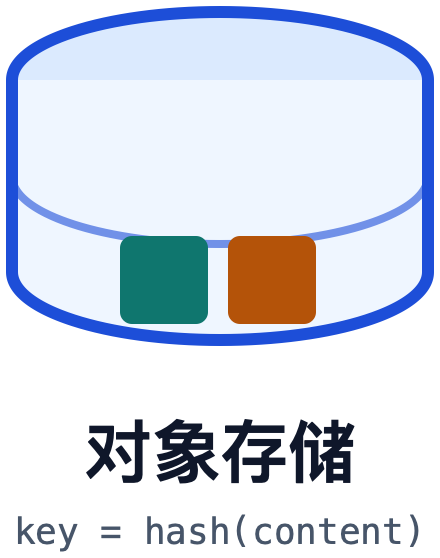
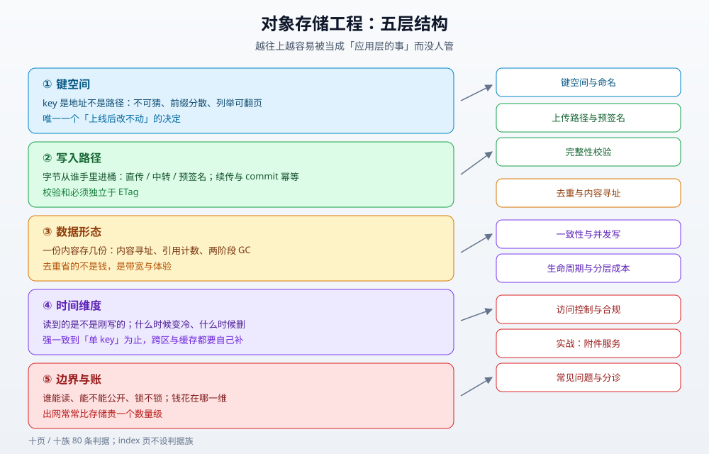

# 文件与对象存储工程

对象存储只有三个动词：**PUT、GET、LIST**。真正的工程难度不在前两个——SDK 一行代码就能传文件——而在三个动词背后那些**不会报错的假设**：你写的 key 会不会和别人的撞、传上去的字节还是不是你传的那份、删掉的那份三个月后是不是真的不在了、账单上多出来的那一块属于谁。

一句话定位：对象存储是**用「便宜、无限、只能整存整取」换掉了「随机写、rename、锁」** 的一种存储；本专题要讲的是这笔交易里所有会静默亏本的地方。

::: tip 一句话理解
文件系统给你的是**位置**（`/var/data/a.bin` 的第 1024 字节）；对象存储给你的是**地址**（`s3://bucket/key` 的整份内容）。
一旦你把它当文件系统用——改一段、重命名、加锁、列目录——每一条都会变成一次「看起来成功」的错。
:::

本专题十页共 **80 条判据**，每页 8 条、逐页独立前缀。`index.md` 不设判据族。

## 五层结构与十页的分工

对象存储的工程问题可以按「离字节的距离」分成五层，越往上越容易被当成「应用层的事」而没人管：

| 层 | 这一层在问什么 | 对应页面 |
| --- | --- | --- |
| **① 键空间** | key 怎么设计、能不能猜、前缀会不会把一个分区打热、列举怎么翻页 | [键空间与命名](./KeysLayout/index.md) |
| **② 写入路径** | 字节从谁手里到桶里、预签名锁住了什么、失败了怎么续、回调怎么幂等 | [上传路径与预签名](./UploadPaths/index.md) · [完整性校验](./IntegrityChecksum/index.md) |
| **③ 数据形态** | 一份内容存几份、相同字节要不要合并、引用怎么计数、垃圾怎么收 | [去重与内容寻址](./DedupCAS/index.md) |
| **④ 时间维度** | 读到的是不是刚写的、什么时候变冷、什么时候删、删了还能不能捞 | [一致性与并发写](./ConsistencyModel/index.md) · [生命周期与分层成本](./LifecycleCost/index.md) |
| **⑤ 边界与账** | 谁能读、能不能公开、锁不锁、迁到别家还算不算同一份数据、钱花在哪 | [访问控制与合规](./SecurityAccess/index.md) · [实战：附件服务](./Practice/index.md) · [常见问题](./FAQ/index.md) |

「总览」这一页只做一件事：把**三条硬约束**和**四维成本**讲清楚，后面九页都在解其中某一条的具体形态。

## 与相邻专题的分工

本专题刻意**不重复**讲「直传怎么签」「分片怎么续」——这两件事在本库的项目侧已经写得很细。分工如下：

| 相邻页面 | 那边负责什么 | 与本专题的边界 |
| --- | --- | --- |
| [TeamBoard 附件直传](../../../project/Complete/TeamBoard/AttachmentDirectUpload/index.md) | 一次直传的六步、`commit` 的幂等、`pending` 24h 过期、key 三段式 | 那边是**一个业务场景的落地**；本专题的[上传路径](./UploadPaths/index.md)讲「三条链路怎么选、预签名到底锁住了什么」 |
| [TeamBoard 分片上传](../../../project/Complete/TeamBoard/MultipartUpload/index.md) | 5 MiB 下限与 10,000 片上限夹出 `partSize`、`uploadId` 续传 | 那边是**参数怎么定**；本专题只补它没展开的部分：**分片 ETag 不是文件哈希**（[完整性校验](./IntegrityChecksum/index.md)）与**未完成分片的计费**（[生命周期](./LifecycleCost/index.md)） |
| [边缘 CDN · 原理](../../Ops/EdgeCDN/CDNPrinciple/index.md) | 缓存层级、回源、`Cache-Control`、刷新 | 那边管**边缘怎么缓存**；本专题管「回源拿到的是不是最新那份」与「302 到预签名 URL 会被缓存成什么」 |
| [分区归档 · 冷热分层](../../DB/PartitionArchival/HotColdTiering/index.md) | 库内分区、冷数据下沉、归档表 | 那边是**数据库内部的分层**；本专题是**对象级分层**（存储类、最小存储期、解冻） |
| [备份与容灾 · 策略](../../Ops/BackupDR/Strategy/index.md) | RPO/RTO、全量增量、保留策略 | 那边定**备多久、存几份**；本专题讲「备份落到对象存储后，**覆盖同名 key** 会让所有历史版本一起消失」 |
| [日志系统 · 保留](../../Ops/LogSystem/Retention/index.md) | 日志保留期、索引滚动、合规 | 那边是**日志该留多久**；本专题讲生命周期规则的**执行语义**（转换/过期/非当前版本）与冲突判定 |
| [云架构 · 安全](../../Ops/CloudArchitecture/Security/index.md) | 云账号、IAM、网络边界、加密 | 那边是**账号级安全**；本专题是**桶级与对象级**（桶策略、对象锁、公开桶的四种成因） |
| [Kubernetes · 存储](../../Ops/Kubernetes/Storage/index.md) | PV/PVC、StorageClass、CSI | 那边是**块/文件存储挂进 Pod**；对象存储**不该被当 POSIX 文件系统挂载**，理由见[总览](./Overview/index.md) |
| [时序数据库 · 存储](../../DB/TimeSeries/Storage/index.md) | 时序压缩、降采样、冷热 | 那边是**时序引擎内部**；本专题只讲「冷段导出成 Parquet 放对象存储」之后的账与取回代价 |
| [幂等与状态机](../../Backend/IdempotencyStateMachine/index.md) | 幂等键、状态机、补偿与对账 | 那边是**接口层幂等**；本专题的幂等发生在**字节层**（同 key 覆盖、内容寻址、`commit` 重复提交） |

## 专题导航

- [总览：三条硬约束与四维成本](./Overview/index.md)：对象模型的三个「没有」、与文件系统的七处差异、四维成本结构、五种静默失败
- [键空间与命名](./KeysLayout/index.md)：key 是地址不是路径、前缀分布与分区热、列举的字典序与分页、可猜性与不可变 key
- [上传路径与预签名](./UploadPaths/index.md)：三条链路的取舍、预签名锁住的四项与锁不住的、POST Policy 与 PUT 的差别、回调幂等
- [完整性校验](./IntegrityChecksum/index.md)：校验和该放在哪一层、ETag 的三种含义、CRC32C 与分片校验、端到端校验的收尾
- [去重与内容寻址](./DedupCAS/index.md)：内容寻址的 key 布局、引用计数与 GC、秒传的三条前提、删除与「逻辑删除」的边界
- [一致性与并发写](./ConsistencyModel/index.md)：强一致的范围与边界、条件写的两种用法、跨区复制的 RPO、缓存层的 stale
- [生命周期与分层成本](./LifecycleCost/index.md)：规则的四类动作与判定顺序、最小存储期与提前删除、版本与未完成分片、四维成本算例
- [访问控制与合规](./SecurityAccess/index.md)：桶策略/ACL/预签名三者的关系、公开桶的四种成因、对象锁与保留、加密三档
- [实战：一个附件服务的端到端](./Practice/index.md)：容量估算、key 契约、上传与校验、去重、生命周期、迁移切换、S1~S10 验收
- [常见问题与分诊](./FAQ/index.md)：十四类现象的分诊表、十二问排查、上线自查十二项、术语表

## 按症状找页面

| 你遇到的现象 | 大概率先看 |
| --- | --- |
| 上传成功但下载回来大小不对 / 内容损坏 | [完整性校验](./IntegrityChecksum/index.md) 的「ETag 不是校验和」 |
| 同一个文件两处 ETag 不同，怀疑没传上去 | [完整性校验](./IntegrityChecksum/index.md) 的「分片 ETag = md5(拼接)」 |
| 上传偶发 403，重试又好了 | [上传路径](./UploadPaths/index.md) 的「预签名锁住的四项」与 [FAQ](./FAQ/index.md) |
| 传大文件到 99% 断了要重传 | [上传路径](./UploadPaths/index.md) 的「续传要靠 uploadId + 分片 ETag」 |
| 列目录很慢，或者翻页翻不完 | [键空间](./KeysLayout/index.md) 的「列举是字典序 + 1000 条一页」 |
| 刚写完立刻读，偶尔读到旧内容 | [一致性](./ConsistencyModel/index.md) 的「强一致在这里结束」 |
| 删除后链接还能打开 | [访问控制](./SecurityAccess/index.md) 的「版本与删除标记」+ [生命周期](./LifecycleCost/index.md) |
| 账单比上月涨了 3 倍，存储量只涨了 10% | [生命周期与分层成本](./LifecycleCost/index.md) 的「四维成本」 |
| 冷数据放归档层反而更贵 | [生命周期与分层成本](./LifecycleCost/index.md) 的「最小存储期」 |
| 同一张图存了 6 份，容量白烧 | [去重与内容寻址](./DedupCAS/index.md) |
| 换云厂商，迁完发现校验过不了 | [实战](./Practice/index.md) 的「迁移校验」 |
| 桶被公开了，不知道谁开的 | [访问控制](./SecurityAccess/index.md) 的「公开桶四种成因」 |

## 全专题的判据纪律

| 页面 | 判据族 | 覆盖的约定 | 条数 |
| --- | --- | --- | --- |
| 总览 | `OSO-A` ~ `OSO-H` | 三条硬约束成文、四维成本齐全、静默失败有对策 | 8 |
| 键空间 | `OSK-A` ~ `OSK-H` | key 不可猜、前缀分散、列举可翻页、key 不可变 | 8 |
| 上传路径 | `OSU-A` ~ `OSU-H` | 链路有唯一入口、签名范围锁定、续传可恢复、回调幂等 | 8 |
| 完整性校验 | `OSI-A` ~ `OSI-H` | 校验和不依赖 ETag、分片单独校验、端到端可复算 | 8 |
| 去重与内容寻址 | `OSD-A` ~ `OSD-H` | 寻址键与内容绑定、引用计数一致、GC 不误删 | 8 |
| 一致性与并发写 | `OSC-A` ~ `OSC-H` | 覆盖写有前置条件、跨区 RPO 成文、缓存有失效路径 | 8 |
| 生命周期与分层 | `OSL-A` ~ `OSL-H` | 规则判定顺序固定、最小存储期算过、版本与分片有清理 | 8 |
| 访问控制与合规 | `OSS-A` ~ `OSS-H` | 默认私有、最小授权、锁与保留可验证、加密成文 | 8 |
| 实战 | `OSP-A` ~ `OSP-H` | 容量可算、契约可测、迁移可校验、验收有序列 | 8 |
| 常见问题 | `OSQ-A` ~ `OSQ-H` | 分诊可执行、排查有顺序、自查可机器判 | 8 |

::: warning 为什么判据必须写成「可验证」而不是「最佳实践」
「桶要安全」没法判对错；「桶策略里不存在 `Principal: "*"` 且 `BlockPublicAccess` 四项全开，`aws s3api get-public-access-block` 的四个字段都为 `true`」就能判。
本专题每页的「如何验证」区分两类命令：**本机可执行**（`curl` / `aws s3api` / `python3` / `sha256sum` / `grep`，脚本不入库）与**需要真实桶或账单**（要对象存储账号、要出账周期），后者写明前置条件，跑不了的标 `⏳` 并写原因，不把期望值抄进实测列。
:::

## 事实与口径速览（2026-10 核对）

| 事实 | 口径与出处 | 对本专题的意义 |
| --- | --- | --- |
| S3 自 **2020-12-01** 起对所有区域提供**强读后写**（PUT/DELETE 后紧跟的 GET 与 LIST 都强一致），不加价、不加延迟 | AWS 官方公告与文档 | 「对象存储最终一致」是**过期常识**；但强一致是**单 key** 的，不是跨对象事务（[一致性](./ConsistencyModel/index.md)） |
| 并发写同一 key 是**后写胜出**，需要冲突检测时用条件写：`If-None-Match: *`（不存在才写，已存在返回 `412`）、`If-Match`（版本没变才写） | AWS S3 文档（条件写） | 「先查再写」在对象存储上是**竞态**；[一致性](./ConsistencyModel/index.md) 给两种用法与各自的边界 |
| 预签名 URL 用 IAM 长期凭证签名时**上限 7 天（604800 s）**；控制台签发只能 1 分钟~12 小时；用 STS 临时凭证签的 URL 会**随凭证一起失效**（往往远早于 7 天） | AWS 文档《使用预签名 URL》 | 想「发一个长期下载链接」的做法在上限处就会失败，且临时凭证场景下**上限不是真实有效期**（[上传路径](./UploadPaths/index.md)） |
| 想限制**上传大小与类型**必须用 **POST Policy**（`content-length-range`、`starts-with $Content-Type`）；`PUT` 预签名锁不住 body 大小 | AWS 文档（基于浏览器的上传） | 只用 PUT 预签名 = 允许客户端传任意大的文件到你付钱的桶里（[上传路径](./UploadPaths/index.md)） |
| 2023-04 起新建桶**默认开启 Block Public Access 且禁用 ACL**（Object Ownership = Bucket owner enforced），默认 SSE-S3 加密 | AWS 公告 | 「桶被公开」在新桶上不会自己发生，一旦发生就是**有人主动改的**（[访问控制](./SecurityAccess/index.md)） |
| 分区吞吐：每个前缀约 **3,500 PUT/COPY/POST/DELETE** 与 **5,500 GET/HEAD** 每秒，前缀数量无上限 | AWS 文档（请求速率与性能） | 顺序前缀（`2026/10/20/…`）会把写入压到一个分区；哈希前缀把首段摊到 256 个（[键空间](./KeysLayout/index.md)） |
| 单价（us-east-1，2026-05-12 官方数据）：Standard **$0.023/GB-月**、Standard-IA **$0.0125**、Glacier IR **$0.004**、Deep Archive **$0.00099**；取回费 IA $0.01/GB、GIR $0.03/GB、DA $0.02/GB | AWS S3 定价页（2026-05 核对） | 存储单价差 23 倍，但**取回费与最小存储期**能把便宜吃回去（[生命周期与分层成本](./LifecycleCost/index.md)） |
| 最小计费对象：IA / One Zone-IA / Glacier IR 按 **128 KB** 计费；Glacier Flexible / Deep Archive 每对象额外约 **40 KB** 元数据 | AWS 定价页 | 4 KB 小对象放 IA，账单按 128 KB 算，**放大 32 倍**（[生命周期与分层成本](./LifecycleCost/index.md)） |
| 最小存储期：IA **30 天**、Glacier IR / Flexible **90 天**、Deep Archive **180 天**，提前删除按**整期**计费 | AWS 定价页 | 「转冷再删」在 90 天内是**双倍付费**（[生命周期与分层成本](./LifecycleCost/index.md)） |
| 出网流量 **$0.09/GB**（每月前 100 GB 免费），跨区复制约 **$0.02/GB**；S3 → CloudFront 回源免费 | AWS 定价页 | 出网经常比存储贵一个数量级；「存得便宜」不等于「用得起」（[生命周期与分层成本](./LifecycleCost/index.md)） |

::: danger 三条会静默失效的坑（本专题反复出现）
1. **ETag 被当成文件哈希**：单段上传且未用 KMS 加密时 ETag 恰好是 MD5，于是很多人写成「ETag == MD5 就校验通过」。换成分片上传，ETag 变成 `md5(拼接各分片 md5)-分片数`——本机实测 15 MiB 分 3 片：分片法得 `902dfe11…-3`，整文件 MD5 是 `3e10478c…`，**两者永不相等**，校验逻辑会在「文件其实没问题」时持续报警。
2. **删除不是删除**：开了版本控制的桶，`DELETE` 只是插一个删除标记；对象锁期间连「删版本」也会被拒。用户说「删掉」，系统说「已删除」，账单说「还在计费」——三句话同时为真。
3. **冷层不是更便宜的层**：把 1 TB 转进 Glacier IR 每月省 $19.46，但每月取回超过 **648.5 GB（63.3%）** 就不划算了；再叠上 90 天最小存储期，短命数据转冷是**净亏**。
:::

## 学习路径

1. 先读[总览](./Overview/index.md)，把「三个没有」和「四维成本」记住——后面九页都在解其中某一条。
2. 接着读[键空间](./KeysLayout/index.md)：它是唯一一个**上线后改不动**的决定（key 一旦写进去，改它等于全量搬迁）。
3. [上传路径](./UploadPaths/index.md) + [完整性校验](./IntegrityChecksum/index.md) 必须成对读：一个讲字节怎么进去，一个讲怎么证明进去的是原样。
4. 有重复内容（图片、附件、构建产物）的业务读[去重](./DedupCAS/index.md)；有多端并发写同一 key 的业务读[一致性](./ConsistencyModel/index.md)。
5. [生命周期与分层成本](./LifecycleCost/index.md) 是所有桶都必须配的一页——**不配规则的桶，账单只会涨**。
6. 最后用[实战](./Practice/index.md) 走一遍端到端，用[常见问题](./FAQ/index.md) 的自查表收口。

## 与「批量数据交换工程」的分工（第 208 天补充）

本页管**字节怎么存**：分片上传、预签名 URL、生命周期、一致性模型。[批量数据交换工程](../BulkDataExchange/index.md) 借用其中两件事——上传通道与下载凭证——但关注点完全不同：那边问「这个文件里的数据能不能用、重跑会不会翻倍、导出的那份是不是静止画面」。

| 问题 | 本页回答 | 专题回答 |
| --- | --- | --- |
| 大文件怎么传 | 分片、断点续传、合并 | 传上来之后解压多大、多少个行、压缩比是否异常 |
| 下载链接怎么给 | 预签名 URL 的签名与 TTL | TTL 该多长、是否一次性、下载行为是否进审计 |
| 文件放多久 | 生命周期规则、转低频/归档 | 原始文件要留到能重跑为止（口径见专题 FAQ 的 `BDQ-G`） |

::: danger 存储侧最常见的一个误判
**「上传成功」只证明字节到了，不证明内容可用**。对象存储返回 200 与 ETag，说明对象完整落盘；但那个 20 MB 的 zip 解压后可能是 20 GB（本机实测压缩比 **1,023:1**），也可能是一份 GBK 编码、带 BOM、列顺序错了的文件。所以「上传完成」与「数据可用」之间必须有一个**准入段**，它属于交换链路，不属于存储。
:::

## 参考资料

- Amazon S3 用户指南《Amazon S3 强一致性》：<https://docs.aws.amazon.com/AmazonS3/latest/userguide/Welcome.html#ConsistencyModel>（2026-10 查阅）
- Amazon S3《使用预签名 URL 下载和上传对象》：<https://docs.aws.amazon.com/AmazonS3/latest/userguide/using-presigned-url.html>（7 天上限、控制台 12 小时、`s3:signatureAge` 条件键）
- Amazon S3《基于浏览器的上传（POST Policy）》：<https://docs.aws.amazon.com/AmazonS3/latest/userguide/PresignedUrlUploadObject.html>
- Amazon S3 定价页：<https://aws.amazon.com/s3/pricing/>（2026-05-12 数据，us-east-1；存储类、请求、取回、最小存储期）
- Amazon S3《请求速率与性能指南》：<https://docs.aws.amazon.com/AmazonS3/latest/userguide/optimizing-performance.html>（每前缀 3,500 PUT / 5,500 GET）
- Amazon S3《对象锁》：<https://docs.aws.amazon.com/AmazonS3/latest/userguide/object-lock.html>（合规模式、治理模式、保留期）
- AWS 博客《Amazon S3 新增条件写》：<https://aws.amazon.com/about-aws/whats-new/2024/08/amazon-s3-conditional-writes/>（`If-None-Match` / `If-Match`）
- 内容寻址与 CAS 的经典表述：`git` 的对象模型（`blob` 用 `sha1/sha256` 作键）、Docker Registry 的 `digest`（`sha256:…`）
