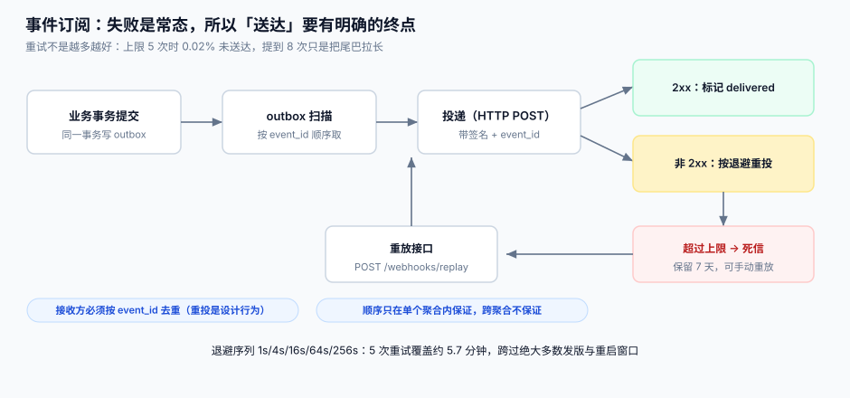

# 事件订阅与重投

webhook 是开放平台里**唯一一条「平台主动发起」的链路**，也是唯一一条平台无法看到结果好坏（除了 HTTP 状态码）的链路。它的设计目标不是「不失败」，而是**失败之后双方都知道该做什么**。

本页判据族 `OPE-A` ~ `OPE-H`，共 8 条。定义表在第七节。

## 一、订阅模型：三张表

```text
subscription   一个 endpoint 订阅了哪些事件类型（以及它自己的签名密钥）
event          平台上发生的事实（只追加，不可改）
delivery       某条 event 投给某个 subscription 的一次尝试（含第几次、状态、响应码）
```

```sql
CREATE TABLE subscription (
  sub_id       TEXT PRIMARY KEY,
  app_id       TEXT NOT NULL,
  endpoint     TEXT NOT NULL,            -- https://... 必须是 https
  event_types  TEXT NOT NULL,            -- 空格分隔：order.paid refund.created ...
  secret       TEXT NOT NULL,            -- 每个 endpoint 独立密钥
  status       TEXT NOT NULL DEFAULT 'active',  -- active | paused | disabled
  failure_streak INTEGER NOT NULL DEFAULT 0
);
CREATE TABLE event (
  event_id   TEXT PRIMARY KEY,           -- ulid，单调递增便于排序
  type       TEXT NOT NULL,
  aggregate  TEXT NOT NULL,              -- 例如 order:O20261031001
  payload    TEXT NOT NULL,              -- 仅放「变更后的事实」，不放内部字段
  ts         INTEGER NOT NULL
);
CREATE TABLE delivery (
  delivery_id TEXT PRIMARY KEY,
  event_id    TEXT NOT NULL,
  sub_id      TEXT NOT NULL,
  attempt     INTEGER NOT NULL,
  status      TEXT NOT NULL,             -- pending | delivered | failed | dead
  http_status INTEGER,
  next_at     INTEGER,
  UNIQUE(event_id, sub_id, attempt)
);
```

**`secret` 挂在 subscription 上而不是 app 上**，是因为一个应用可能配多个 endpoint（生产 + 灰度）。用同一个密钥，任一 endpoint 泄漏就等于全部泄漏。

## 二、投递状态机



| 状态 | 含义 | 谁会让它离开这个状态 |
| --- | --- | --- |
| `pending` | 待投递（`next_at` 到点才取） | 投递器 |
| `delivered` | 收到 2xx | —（终态） |
| `failed` | 本次失败，还有重试机会 | 投递器（下一轮） |
| `dead` | 超过上限，进死信 | 人工重放 / 时间到期清理 |

**`dead` 不是终点**：保留 7 天，期间可以调 `POST /webhooks/replay` 重放。这条设计救过很多次「对方加班修完 bug 回来发现事件已经没了」。

## 三、为什么必须走 outbox

::: danger 三种「直接在业务代码里发 HTTP」的失效姿势
1. **业务提交前发**：发成功了但事务回滚 → 对方拿到了一个不存在的订单。
2. **业务提交后发**：事务提交了，进程被 kill → 事件永久丢失，且**没有任何痕迹**。
3. **提交后发 + 失败重试三次**：进程重启后重试队列丢了 → 同上，只是多打了三条日志。
:::

正确做法是**同一个本地事务写业务表和 `event` 表**，再由独立的投递器扫表：

```python
with db.transaction():
    db.execute("UPDATE orders SET status='PAID' WHERE id=?", (oid,))
    db.execute("INSERT INTO event(event_id,type,aggregate,payload,ts) VALUES(?,?,?,?,?)",
               (ulid(), "order.paid", f"order:{oid}", json.dumps(evt), now()))
# 事务提交 = 事件一定会被投递；事务回滚 = 事件根本不存在
```

这就是 outbox 的全部价值：**把「发消息」变成「写一行数据」**，从而获得数据库的原子性。它与[订单中心的 outbox 章节](../../../../project/Complete/EventOrderHub/OrderFlow/index.md)是同一套模式，区别只在这里的下游是**外部 HTTP**。

## 四、退避：重试不是越多越好

本机读数（Python 3.13.12，20,000 个事件，每次投递独立 20% 失败率）：

| 重试上限 | 平均投递次数/事件 | 未送达比例 |
| --- | --- | --- |
| 5 次 | 1.25 | **0.02%** |
| 8 次 | 1.25 | 0.00% |
| 20 次 | 1.25 | 0.00% |

**读法**：平均次数恒定在 1.25（= 1 / 0.8，符合几何分布），说明**重试数量几乎不影响总请求量**，只影响尾巴。上限从 5 提到 8，未送达从 0.02% 降到「测不出来」；再往上加没有意义，只是把失败事件的存活时间从 6 分钟拉到一个小时。

推荐的退避序列（5 次，合计约 5.7 分钟）：

```text
attempt 1  立即
attempt 2  +1s
attempt 3  +4s
attempt 4  +16s
attempt 5  +64s        （第 5 次失败后进死信；1+4+16+64 = 85s）
```

如果需要覆盖「对方发版重启」这种分钟级窗口，把第 5 次放到 +256s，总跨度约 5.7 分钟。**不要加随机抖动以外的复杂度**：抖动的唯一作用是避免所有接收方在同一秒被同时重试（惊群）。

## 五、顺序：只在单个聚合内保证

这是最容易被误解的一条，必须在文档里加粗：

| 场景 | 是否保证顺序 | 说明 |
| --- | --- | --- |
| 同一订单的 `order.paid` → `order.shipped` | ✅ | 同一 `aggregate` 串行投递 |
| 订单 A 与订单 B 的事件 | ❌ | 并发投递，可能乱序到达 |
| 同一订单的事件重投 | ❌ | 重投会插到新事件后面 |

「同一聚合串行」的实现方式很朴素：投递器按 `aggregate` 取模分片，每个分片单线程。跨分片并发，分片内串行。

::: warning 接收方的对应义务
既然跨聚合不保证顺序，接收方就**不能用「收到 shipped 就认为 paid 一定处理过」**这种假设。正确做法是：每条事件自带完整快照（`status`、`paid_at`、`shipped_at`），接收方按 `event_id` 去重后**按时间戳覆盖**，而不是「增量累加」。
:::

## 六、接收方的五条义务

把这段直接抄进对接文档，能省掉一半的联调时间：

1. **验签**：用 subscription 的 `secret` 对「时间戳 + 请求体」做 HMAC，不一致直接 401。
2. **去重**：按 `event_id` 去重，**至少保留 7 天**（重投窗口）。
3. **快速返回**：10 秒内返回 2xx，业务处理放异步队列。超时按失败处理并重投。
4. **幂等**：同一 `event_id` 处理两次的结果必须与一次相同。
5. **不要在回调里做重活**：调用下游超时会被判失败，然后你就收到了重复事件。

## 七、判据族

| 编号 | 看什么现象 | 判成什么 | 不满足时改哪里 |
| --- | --- | --- | --- |
| `OPE-A` | 事件是否与业务写在同一个本地事务 | 分两次写即会丢事件 | 改 outbox，同事务插入 `event` |
| `OPE-B` | 每条事件是否带全局唯一 `event_id` | 无则接收方无法去重 | `event` 表主键即 `event_id` |
| `OPE-C` | `secret` 是否按 subscription 独立 | 全应用共用一个即扩大泄漏面 | `subscription.secret` 独立签发 |
| `OPE-D` | 退避是否带抖动 | 无抖动即会在整分钟惊群 | `delay * (0.8 + random()*0.4)` |
| `OPE-E` | 重试上限是否有明确值并写进文档 | 无上限即会永久重试 | 5 次（约 5.7 分钟）后进死信 |
| `OPE-F` | 死信是否可重放、保留多久 | 不可重放即一次故障=永久丢数据 | 保留 7 天 + `POST /webhooks/replay` |
| `OPE-G` | 连续失败是否会自动 `disabled` 订阅 | 不自动停即会一直打一个坏 endpoint | `failure_streak` ≥ 100 时置 `paused` 并发通知 |
| `OPE-H` | 文档是否写明「顺序保证范围」 | 不写明即必然有「先收到发货后收到付款」的工单 | 显式写「仅单聚合内有序」 |

## 八、验证方式

```shell
# 1. 起一个会失败两次再成功的接收端（模拟对方发版）
python3 recv.py --fail-first 2 --port 9099 &
# 2. 触发一次业务事件
curl -s -X POST http://127.0.0.1:8080/v1/orders -d '{"sku":"A1","qty":1}' -H "Authorization: Bearer $TOK"

# 3. 看投递记录：应有 attempt 1(failed) / 2(failed) / 3(delivered)
sqlite3 open.db "SELECT attempt,status,http_status FROM delivery ORDER BY attempt;"
# 期望：1|failed|500  2|failed|500  3|delivered|200

# 4. 重放测试：把一条 delivery 手工置为 dead 后重放
curl -s -X POST http://127.0.0.1:8080/webhooks/replay -d '{"event_id":"01J..."}'
# 期望：新增一条 attempt=1 的 delivery，且接收端收到重复 event_id（去重逻辑生效）
```

**结果读法**：如果第 3 步只有一条 attempt=1 的记录，说明重试没有被调度（`next_at` 没写或扫描器没跑）；如果第 4 步接收端把同一 `event_id` 处理了两遍业务，说明去重义务没有落实。

## 参考资料

- Standard Webhooks 规范（签名与重试的业界共识）：https://www.standardwebhooks.com/
- Stripe · Webhooks 最佳实践（去重与顺序）：https://docs.stripe.com/webhooks
- RFC 2104 · HMAC：https://www.rfc-editor.org/rfc/rfc2104
- RFC 9110 · 幂等方法定义：https://www.rfc-editor.org/rfc/rfc9110#name-idempotent-methods
