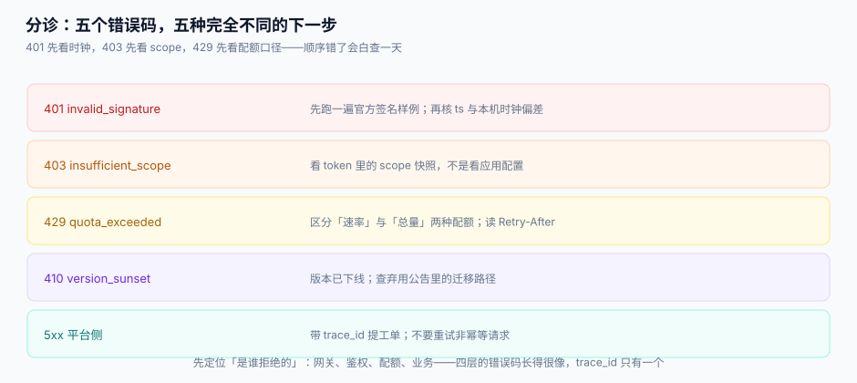

# 常见问题与分诊

开放平台的问题有一个共同特征：**报错信息看起来都一样**（401、403、429、500），但归属四个不同的层。这一页先把「是谁拒绝的」分清，再谈具体怎么改。

本页判据族 `OPF-A` ~ `OPF-H`，共 8 条。定义表在第六节。

## 一、分诊表：先定位是谁拒绝的



| 现象 | 先跑什么 | 翻哪页 | 最常见的真因 |
| --- | --- | --- | --- |
| `401 invalid_signature` | 官方签名样例跑一遍，打印中间串 | [应用与凭证](../AppCredential/index.md) | body 被反序列化后重序列化；URL 编码空格成了 `+` |
| `401 timestamp_out_of_window` | `date -u +%s` 与服务端对比 | [应用与凭证](../AppCredential/index.md) | 容器时区错、NTP 没同步 |
| `409 duplicate_nonce` | 看重试逻辑是否复用同一个 nonce | [应用与凭证](../AppCredential/index.md) | 重试时整个请求原样重放（应该换 nonce） |
| `401 invalid_token` | 解 base64 看 `exp` 与 `cred_version` | [授权与令牌](../GrantToken/index.md) | 平台轮换了密钥但客户还在用旧令牌 |
| `403 insufficient_scope` | 打印 token 里的 scope 快照 | [授权与令牌](../GrantToken/index.md) | 客户改了控制台配置，但令牌是改之前签发的 |
| `429 quota_exceeded` | 看 `X-Quota-Scope` 是 `rate` 还是 `total` | [配额与用量](../QuotaUsage/index.md) | 把月度额度当成速率，写了一个永远超不过的并发 |
| `410 version_sunset` | 查弃用公告的迁移路径 | [版本与弃用](../VersionLifecycle/index.md) | 客户没看 `Sunset` 头 |
| webhook 收不到 | 查 `delivery` 表最后一条的状态与 `http_status` | [事件订阅](../EventWebhook/index.md) | 对方 10 秒超时，被判失败后重投，业务处理了两遍 |
| webhook 收到重复 | 按 `event_id` 去重了吗 | [事件订阅](../EventWebhook/index.md) | 重投是设计行为，不是异常 |
| 账单对不上 | 用量明细 vs 账单行，按 `usage_id` 下钻 | [配额与用量](../QuotaUsage/index.md) | 计量包含被拒请求，或明细取整不守恒 |
| 客户说「昨天还好好的」 | `SELECT api_version, count(*)` 按天看 | [版本与弃用](../VersionLifecycle/index.md) | 平台改了一个默认值（分页 20→50） |

::: tip 一条 30 秒的通用定位法
打开响应，先看三个东西：**HTTP 状态码**（哪一层）、**`trace_id`**（能不能串起来）、**`type` 字段**（具体子码）。三个都在，问题就在客户侧；缺任何一个，问题在平台侧的可观测性。
:::

## 二、十二个高频问题

**1. 为什么客户总是签名失败，而我们用 Postman 能通？**

因为 Postman 帮你做了 URL 编码。真正的手写客户端常在这三处不一致：空格编码（`%20` vs `+`）、query 是否按字典序、body 是否用原始字节。给一个能打印签名串的开关，比来回贴代码快十倍。

**2. 令牌该用 JWT 还是不透明串？**

对外开放默认不透明串，理由是**撤销**：密钥泄漏时必须能立刻失效，而 JWT 的「立刻」是「最多一小时后」。要本地校验就把 TTL 压到 5~15 分钟并维护 `jti` 黑名单。

**3. 配额到底按秒、按分钟还是按月？**

三个都要，但语义不同：按秒是保护（防瞬时打爆），按分钟是体验（客户能看懂），按月是合同（商务口径）。对外只承诺「按月」和「按秒」两个数，中间层不暴露。

**4. 客户说「我买了 100 万次，为什么 429」？**

因为限流粒度是速率。查 `X-Quota-Scope`：如果是 `rate:50/s`，说明超的是速率不是总量。这也是为什么 429 必须带 scope。

**5. webhook 一定要重试吗？能不能只发一次？**

可以「只发一次」，但要在文档里写清「丢了不补」。绝大多数客户会选重试 + 去重，因为补数据比去重贵得多。

**6. 事件顺序能不能保证？**

只能保证**同一聚合内**（同一订单）有序。跨聚合并发投递，收到 `shipped` 时 `paid` 可能还没到。接收方要按快照覆盖，不要做增量累加。

**7. 版本能不能直接改成向后兼容的样子，不升版本号？**

能，但有三类不算兼容：加必填、改语义、改默认值。判断标准不是「字段名变了没」，而是「老客户端不改代码会不会出错」。

**8. 密钥轮换要不要停机？**

不要。双密钥并存（`active` + `rotating`），旧密钥只验签不签发，客户可以观察 24 小时再删。停机轮换是运维事故的常见起点。

**9. 沙箱环境和生产怎么隔离？**

同构但独立：独立数据库、独立配额、独立 webhook 目标（禁止指向生产域名）、可一键重置。共用一套配额是最常见的错误——测试把生产额度打光。

**10. 用量表要不要按天分区？**

要。这张表是**只追加 + 按月聚合**的形态，单表过亿后 `GROUP BY` 会拖垮出账作业。按天分区还能让「重算某一天」变成一次分区操作。

**11. 客户要求「按行数计费」，怎么和「按次计费」共存？**

统一成 `units` 字段：按次计费的接口 `units=1`，按行数计费的写实际行数。合同里写「100 万 units」，文档给出换算表。**不要**建两套计量表。

**12. 下线一个版本，最少的动作是什么？**

三件：公告（含迁移链接）、`Sunset` 头、以及到期后返回 `410` 而不是删路由。删路由会让客户以为 URL 写错，多花一天排查。

## 三、上线前二十项自查

| # | 检查项 | 通过标准 |
| --- | --- | --- |
| 1 | 密钥只在创建时展示一次 | 之后接口只返回掩码 |
| 2 | 存在 `rotating` 状态 | 轮换不需要停机 |
| 3 | 令牌存哈希不存明文 | 拖库不可用 |
| 4 | 令牌带 `cred_version` | 轮换后旧令牌立即失效 |
| 5 | 验签在反序列化之前 | 原始 body 参与签名 |
| 6 | 时间窗口与 nonce TTL 匹配 | TTL ≥ 2×窗口 |
| 7 | 签名比较是常量时间 | 用 `compare_digest` |
| 8 | 401 / 403 / 429 三个码分开 | 子码可自助排障 |
| 9 | 429 带 `Retry-After` 与配额头 | 客户可主动减速 |
| 10 | 限流粒度 = 计费粒度 | 都是 `app_id` |
| 11 | `usage` 有 `(app_id, request_id)` 唯一键 | 重试不重复计费 |
| 12 | 被拒请求不计费 | 计量在放行之后 |
| 13 | 账期留 24 小时迟到窗口 | 月初出账不缺量 |
| 14 | 账单明细之和 = 账单金额 | 最大余数法 |
| 15 | 事件与业务同事务 | outbox 模式 |
| 16 | 退避有上限且有总时长 | 5 次 / 约 5.7 分钟 |
| 17 | 死信可重放 | 保留 ≥ 7 天 |
| 18 | 弃用有三件套头 | `Deprecation` / `Sunset` / `Link` |
| 19 | 下线返回 410 | 不是 404 |
| 20 | `trace_id` 贯穿四段 | 调用 → 用量 → 账单 → 工单 |

## 四、十条最佳实践

1. **先做计量，再做限流**。没有用量数据，配额数字只能拍脑袋。
2. **每个错误码只对应一个动作**。`400` 什么都表示，等于什么都不表示。
3. **给客户一个能自己跑的验证脚本**，比写十页排障文档有效。
4. **所有对外字段都当合同**，哪怕文档里写的是「临时字段」。
5. **配额、账单、文档三处的数字必须同源**，改一处要同时改三处。
6. **重试是客户端的事，去重是服务端的事**，两边都不要替对方操心。
7. **越权风险最高的不是读，是「管理类」写**。管理类 scope 单独拆、单独审计。
8. **沙箱要能重置**，否则测试数据会慢慢长成第二个生产库。
9. **下线前先看付费租户数**，不要只看调用量占比。
10. **把「我们什么时候会改这个接口」写进 SLA**，比承诺「永不改」可信。

## 五、术语表

| 术语 | 含义 |
| --- | --- |
| `app_id` | 应用标识，配额与计费的粒度 |
| `app_secret` | 应用密钥，仅服务端持有，用于签名 |
| scope | 授权范围，签发时固化进令牌 |
| PKCE | 授权码换取令牌时的一次性校验，防 code 截获 |
| 客户端凭证 | `client_credentials`，机器对机器，无用户 |
| `cred_version` | 密钥版本号，令牌与之比对以实现即时失效 |
| nonce | 一次性随机串，配合时间窗口防重放 |
| 令牌桶 | 限流算法，容量=突发、速率=持续 |
| 滑动窗口 | 限流算法，任意窗口内严格不超 |
| `Retry-After` | 429/503 响应头，告诉客户端等多久 |
| outbox | 与业务同事务写事件表，再由投递器扫描 |
| 死信 | 超过重试上限的事件，保留待人工重放 |
| `Sunset` | 响应头，标明某版本彻底不可用的时间 |
| `Deprecation` | 响应头，标明某版本开始不推荐使用的时间 |
| units | 计费单位数量，按次为 1，按行数为实际行数 |

## 六、判据族

| 编号 | 看什么现象 | 判成什么 | 不满足时改哪里 |
| --- | --- | --- | --- |
| `OPF-A` | 每个错误码是否只有一种归因 | 一个码多种原因即无法分诊 | 拆子码，写进文档 |
| `OPF-B` | 响应是否都带 `trace_id` | 缺即无法串日志 | 网关生成并回传 |
| `OPF-C` | 分诊表是否覆盖「客户侧/平台侧」两侧 | 只写客户侧即会甩锅 | 每行标注归属 |
| `OPF-D` | 是否有可自助运行的验证脚本 | 无则排障全靠贴代码 | 提供 `verify.sh` |
| `OPF-E` | 自查清单是否可勾选、有通过标准 | 只有条目没有标准即无法验收 | 每条给判定条件 |
| `OPF-F` | 术语表是否与文档用词一致 | 不一致会导致「同一个词两种意思」 | 以术语表为准统一 |
| `OPF-G` | 429 与 5xx 的重试建议是否分开 | 混在一起即会重试非幂等请求 | 分别给策略 |
| `OPF-H` | 工单模板是否要求 `trace_id` + `app_id` + 时间窗 | 缺一则首次响应必然来回 | 模板加三个必填 |

## 七、验证方式

```shell
# 用五个错误场景各打一次，确认分诊表可用
for c in bad-sign old-token no-scope over-quota sunset; do
  printf '%-10s -> ' "$c"; python3 probe.py --case "$c" 2>/dev/null | jq -r '.type'
done
# 期望：五种不同的 type，且都能在分诊表里查到对应行

# 确认 trace_id 贯穿
sqlite3 open.db "SELECT trace_id FROM usage ORDER BY id DESC LIMIT 1;" | tee /tmp/tid
curl -s -H "X-Trace-Id: $(cat /tmp/tid)" http://127.0.0.1:8080/admin/trace | jq '.stages'
# 期望：返回 stages 含 auth / quota / biz / usage 四段
```

**结果读法**：如果五种场景返回同一个 `type`，说明错误码收敛过度——分诊表只能是摆设。

## 参考资料

- RFC 9457 · Problem Details（`type` / `title` / `detail` 三段式）：https://www.rfc-editor.org/rfc/rfc9457
- OWASP · API Security Top 10：https://owasp.org/API-Security/editions/2023/en/0x00-header/
- Stripe · 错误码设计：https://docs.stripe.com/error-codes
