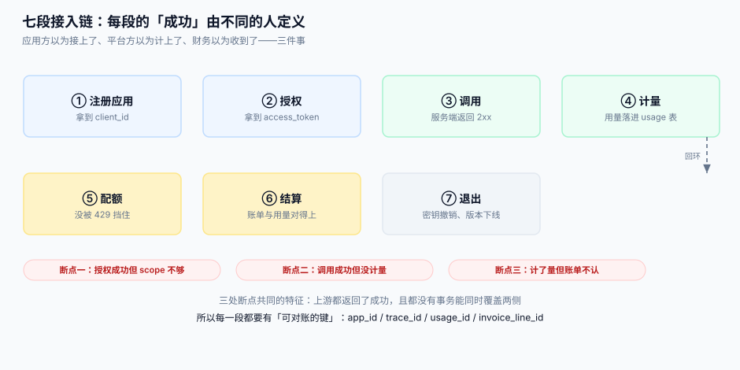

# 总览：七段链与四条边界

开放平台的本体是一条**七段链**。每一段都有自己的成功定义，而段与段之间**没有事务**——这是它和「内部接口」最本质的区别。

本页判据族 `OPO-A` ~ `OPO-H`，共 8 条。定义表在第七节。

## 一、七段接入链



| 段 | 做什么 | 这一段「成功」的定义 | 失败时谁先知道 |
| --- | --- | --- | --- |
| ① 注册应用 | 分配 `app_id`、密钥、回调地址 | 应用状态为 `active` 且密钥可查 | 集成方（拿不到凭证） |
| ② 授权 | 换 `access_token`、下发 scope | 令牌签名有效、scope 覆盖本次要调的接口 | 集成方（401/403） |
| ③ 调用 | 验签、鉴权、进业务 | 业务返回 2xx 且带 `trace_id` | 集成方（5xx 或空响应） |
| ④ 计量 | 记录这次调用消耗了什么 | 用量行落库，`usage_id` 可反查 | **只有平台自己** |
| ⑤ 配额 | 判断要不要 429 | 拒绝时给 `Retry-After` 与配额来源 | 集成方（429） |
| ⑥ 结算 | 用量聚合成账单行 | 账单金额 = 用量 × 单价，且能逐条下钻 | 财务（对不上账） |
| ⑦ 退出 | 撤销密钥、下线版本、导出数据 | 撤销后 5 分钟内旧令牌全部失效 | 集成方（突然 401） |

**为什么必须按段切**：① 到 ③ 是一个 HTTP 请求内的事，可以放在同一个进程里；④ 到 ⑥ 是**事后**的事，必须异步；⑦ 是**跨年**的事。三段的时间尺度差了六个数量级，硬塞进一个模块的结果是「发版时不敢动任何一段」。

**三处断点**是这张图的重点：

1. **授权成功但 scope 不够**——令牌是真的，`aud` 也对，就是没有 `order.write`。
2. **调用成功但没计量**——业务 2xx 了，但计量写在了业务的 `try` 块外面，抛异常时被跳过。
3. **计了量但账单不认**——用量记的是「请求数」，账单按「成功请求数 × 阶梯单价」算，分子分母不是一个东西。

这三处断点的共同特征是：**上游全部返回成功**，且没有任何一个事务能同时覆盖两侧。所以每一段都必须留一个**可对账的键**：

```text
app_id      ← ① 分配，贯穿 ②~⑦
trace_id    ← ③ 生成，回传给调用方，进日志与工单
usage_id    ← ④ 生成，是 ⑤ 与 ⑥ 的唯一连接点
invoice_line_id ← ⑥ 生成，财务侧的对账锚点
```

## 二、三类消费者，三种完全不同的诉求

| 消费者 | 典型场景 | 最在意 | 最容易被忽略的诉求 |
| --- | --- | --- | --- |
| **自助集成方**（ISV） | 第三方 ERP、插件市场 | 文档能不能一次跑通 | 沙箱环境与可回放的示例 |
| **企业直连**（大客户） | 定制对接、私有协议 | SLA、专线、发票 | 变更提前量与指定联系人 |
| **内部团队** | 公司内其他 BU 走开放网关 | 别重复造轮子 | 免配额（但仍要计量） |

**这张表决定的第一件事是配额策略**：自助集成方要的是「防滥用」（按秒限速），企业直连要的是「合同额度」（按月总量），内部团队要的是「不挡但可观测」。三者用同一套限流器，必然有一方被误伤。

## 三、四条边界

### 边界一：开放平台 ≠ API 网关

网关做的是**流量的通行与治理**：路由、TLS 终结、熔断、黑白名单。开放平台做的是**身份的合同与账目**：这个 `app_id` 是谁、能调什么、调了多少、该付多少。

一个常见的错误是把配额全塞进网关插件里。结果是：网关按 IP 限流，而客户是按 `app_id` 买的套餐——**限流粒度与计费粒度不一致**，客户投诉「我买了 100 万次，为什么被限流」，你只能答「因为你走了同一个出口 IP」。

### 边界二：开放平台 ≠ 多租户 SaaS

多租户解决「一个实例装多个客户」，隔离的是**数据**。开放平台在租户之上还有一层**应用**：

```text
tenant（客户）  1 ── n  app（应用）  1 ── n  credential（密钥）
                                     1 ── n  subscription（webhook 订阅）
```

一个客户可以建多个应用（生产 / 测试 / 不同业务线），配额与账单挂在**应用**上，合同与发票挂在**租户**上。把两者合成一张表，会出现「测试应用的调用量算进了生产账单」。

### 边界三：给外部看的权限（scope）≠ 内部 RBAC

内部 RBAC 的判定在服务端、可随时改。scope 一旦发出去就**固化在令牌里**，改配置不会改已签发的令牌。

所以 scope 必须满足两条：**粒度够粗**（能数得清，别超过 30 个）、**语义稳定**（`order.read` 十年不变）。用 `order.read.v2.beta` 这种名字，等于给自己埋了一个每年都要拆一次的雷。

### 边界四：webhook 是「推」不是「发通知」

站内信发失败，用户第二天登录还能看到。webhook 发失败，对方的库存就永远少扣一次。

两者的区别在于**接收方有义务**：站内信的接收方是浏览器，不需要你做任何事；webhook 的接收方是别人的服务器，它必须实现「验签 + 去重 + 快速返回 2xx + 异步处理」。这条义务不写进文档，对方就会在回调里同步跑 30 秒的报表。

## 四、六个「以为不会发生」

::: danger 上线前必须逐条确认
1. **以为密钥不会泄漏**——所以没做轮换，密钥写死在客户代码里三年。正确做法：双密钥并存 + 自助轮换 + 旧密钥定时失效（见[应用与凭证](../AppCredential/index.md)）。
2. **以为调用方会遵守 `Retry-After`**——所以 429 不带这个头，对方按固定 100ms 重试，把限流器打成筛子。
3. **以为用量不会重复**——所以计量表没有唯一键，网关重试一次就多算一次钱。
4. **以为对方会去重**——webhook 重投是**设计行为**，不是异常；文档里不写 `event_id`，对方就会重复发货。
5. **以为版本可以随时改**——字段加个必填，等于让所有集成方同时宕机。破坏性变更必须有弃用窗口（见[版本与弃用](../VersionLifecycle/index.md)）。
6. **以为下线就是删代码**——没导出数据、没保留 30 天只读、没给 `410 Gone`，客户的历史对账直接断在那一刻。
:::

## 五、最小接入三步（先跑通，再谈治理）

```shell
# 1. 造一个应用（真实平台是控制台，这里给等价的 SQL）
sqlite3 open.db "INSERT INTO app(app_id, tenant_id, name, status) VALUES('app_7f3a91','t_2210','demo','active');"

# 2. 用密钥签一次请求（签名串五段，见下一页）
python3 sign.py --app app_7f3a91 --method POST --path /v1/orders --body '{"sku":"A1","qty":1}'

# 3. 看这次调用有没有被记上
sqlite3 open.db "SELECT app_id, path, status, units, ts FROM usage ORDER BY id DESC LIMIT 3;"
```

三步里**第 3 步最重要**：如果一次成功调用没有在 `usage` 表留下痕迹，那么这个平台还不算「开放平台」，只是一个「加了鉴权的内部接口」。

## 六、什么时候**不该**做开放平台

- 集成方只有 1~3 个、且都是自己人：给他们发个长期令牌 + 一份 Postman 集合就够了。
- 没有计费诉求、也不打算对外：内部网关 + 服务目录更省事。
- 组织里没有人为「配额」和「账单」的一致性负责：这两件事一旦上线，每天都会有人来问「为什么对不上」。

## 七、判据族

| 编号 | 看什么现象 | 判成什么 | 不满足时改哪里 |
| --- | --- | --- | --- |
| `OPO-A` | 任取一次成功调用，能否从 `trace_id` 反查到 `usage_id` 与账单行 | 三键贯通才算「可对账」 | 在 ③ 生成 `trace_id` 并写进 ④ 的用量行 |
| `OPO-B` | 配额粒度与计费粒度是否同一个键 | 不同键即为设计缺陷 | 统一到 `app_id`，IP 只做粗粒度保护 |
| `OPO-C` | scope 数量是否 < 30 且名字里无版本号 | 超出即难治理 | 收敛成语义稳定的粗粒度 |
| `OPO-D` | 撤销密钥后旧令牌多久失效 | > 5 分钟不可接受 | 加令牌版本号或缩短 TTL |
| `OPO-E` | 429 响应是否带 `Retry-After` 与配额来源 | 缺一即不可运维 | 头里补 `X-Quota-Limit` / `X-Quota-Remaining` |
| `OPO-F` | webhook 事件是否带唯一 `event_id` | 无则接收方无法去重 | 事件表主键即 `event_id` |
| `OPO-G` | 版本下线是否走公告 → 410 → 归档三步 | 直接删代码即违约 | 按[版本与弃用](../VersionLifecycle/index.md)补齐 |
| `OPO-H` | 平台侧是否有「谁在拒绝」的四层归因 | 只有 500 一种错误即不可分诊 | 网关/鉴权/配额/业务四层各给独立错误码 |

## 八、验证方式

```shell
# 造 3 次调用，其中 1 次故意让 body 被篡改
python3 call.py --app app_7f3a91 --tamper-body
# 期望：这一次返回 401，且 usage 表里没有它的行（验签失败不计费）

sqlite3 open.db "SELECT count(*) FROM usage WHERE app_id='app_7f3a91';"
# 期望：2（两次成功），而不是 3
```

**结果读法**：如果计数是 3，说明计量写在了验签之前——一个被拒绝的请求被收了钱，这是开放平台最容易被投诉的一类错误。

## 参考资料

- RFC 6750 · 错误响应与 `WWW-Authenticate`：https://www.rfc-editor.org/rfc/rfc6750#section-3
- RFC 9457 · Problem Details：https://www.rfc-editor.org/rfc/rfc9457
- OWASP · API Security Top 10（API4:2023 Unrestricted Resource Consumption）：https://owasp.org/API-Security/editions/2023/en/0x11-t10/
