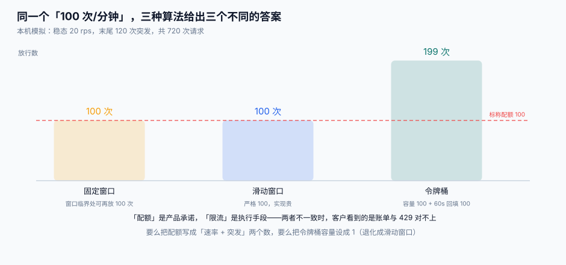

# 配额、限流与用量

客户看到的「配额」是一个数，平台内部却有**三个数**：合同额度、执行速率、实际用量。三个数一旦不是同一个口径，客户投诉的每一句话都成立。

本页判据族 `OPQ-A` ~ `OPQ-H`，共 8 条。定义表在第七节。

## 一、配额是三层，不是一层

| 层 | 例子 | 谁定 | 超了会怎样 | 时间尺度 |
| --- | --- | --- | --- | --- |
| **合同额度** | 100 万次/月 | 商务 | 不拦，超额计费 / 或停止服务 | 月 |
| **执行速率** | 50 次/秒 | 平台工程 | 429 | 秒 |
| **突发容量** | 200 次瞬时 | 平台工程 | 429 | 毫秒 |

合同额度是**产品承诺**，执行速率是**保护手段**。两者必须能互相解释：

```text
100 万次/月 ÷ 30 天 ÷ 86400 秒 ≈ 0.39 次/秒   ← 平均
若客户集中在 60 秒内打完：1,000,000 ÷ 60 ≈ 16,667 次/秒  ← 峰值
```

**这组数字说明什么**：月度额度**不能**换算成速率上限。按平均值限流，客户一个批量任务都跑不了；按峰值放行，等于不限流。所以「月度额度」与「速率上限」必须是**两个独立的配置项**，并且都写进合同。

## 二、同一个「100 次/分钟」，三种算法三个答案



本机模拟（Python 3.13.12，纯内存计数，非压测）：配额 100 次/分钟，两段流量。

**场景 A：稳态 20 rps + 末尾 120 次突发，共 720 次请求**

| 算法 | 放行 | 为什么 |
| --- | --- | --- |
| 固定窗口 | **100** | 窗口内计数到 100 即拒 |
| 滑动窗口（日志） | **100** | 任意 60 秒内不超过 100 |
| 令牌桶（容量 100，回填 100/60 每秒） | **199** | 容量 100 + 60 秒回填约 100 |

**场景 B：窗口临界双突发（59.50~59.90 打 100 次，60.10~60.50 再打 100 次，跨度 1.00 秒）**

| 算法 | 放行 | 为什么 |
| --- | --- | --- |
| 固定窗口 | **200** | 两次落在不同窗口，各 100 |
| 滑动窗口 | **100** | 1 秒内第 101 次起全部拒绝 |

**读法**：固定窗口的 200 次是「一秒内放行了标称一分钟的量」——这不是 bug，是算法定义。而令牌桶的 199 次说明：**桶容量就是突发上限**，容量设成 100 等于告诉客户「你可以瞬间打 100 次」。

::: danger 三条必须写进文档的口径
1. **「100 次/分钟」到底指固定窗口还是滑动窗口？** 不写清，客户按 60 秒均值写重试逻辑，会遇到「刚过整点就 429」。
2. **令牌桶的容量是不是配额？** 不是。容量是突发，速率是持续，两者要分开配。
3. **429 的计数是否包含被拒的请求？** 多数实现不计，但有的网关会。客户按「被拒也计数」做退避，会越退越久。
:::

## 三、429 是一次产品交互，不是一次报错

```http
HTTP/1.1 429 Too Many Requests
Content-Type: application/problem+json
Retry-After: 2
X-Quota-Limit: 100
X-Quota-Remaining: 0
X-Quota-Reset: 1790000060
X-Quota-Scope: rate:50/s

{"type":"https://open.example.com/problems/quota-exceeded",
 "title":"Rate limit exceeded","status":429,
 "detail":"app_7f3a91 在 1s 内调用 78 次，超过 50 次/秒的速率上限",
 "trace_id":"a1b2c3d4"}
```

六个字段各有用途，缺一个都会让客户多写一段猜测代码：

| 字段 | 客户拿它做什么 |
| --- | --- |
| `Retry-After` | 决定睡多久（秒数或 HTTP 日期） |
| `X-Quota-Limit` | 知道自己买的是多少 |
| `X-Quota-Remaining` | 做本地令牌桶，主动减速 |
| `X-Quota-Reset` | 算下一个窗口从什么时候开始 |
| `X-Quota-Scope` | 区分是「速率超」还是「月度额度超」 |
| `trace_id` | 提工单时不用描述现场 |

::: warning 两个反直觉的细节
1. **`Retry-After` 要给「实际需要等的秒数」，不是固定 1 秒。** 令牌桶已经空了、回填速率 50/s，那么等 1 秒能拿到 50 个额度；如果客户一次要发 200 个请求，正确的值是 4 秒。
2. **多维度限流要返回「最先被触发的那一个」。** 同时命中「秒级 50」和「月额度 0」时，返回秒级会让客户以为等 1 秒就能继续，实际永远不行。
:::

## 四、用量记账：一个请求只计一次

限流看「现在」，计量看「刚才」。两者的关系是：**被 429 拒绝的请求不计费**，因为没消耗资源。但**验签失败的请求也不计费**，因为没进业务。

```sql
CREATE TABLE usage (
  usage_id   TEXT PRIMARY KEY,       -- ulid，可排序
  app_id     TEXT NOT NULL,
  tenant_id  TEXT NOT NULL,
  request_id TEXT NOT NULL,          -- 幂等键：网关重试不重复计
  path       TEXT NOT NULL,
  method     TEXT NOT NULL,
  status     INTEGER NOT NULL,
  units      INTEGER NOT NULL,       -- 计费单位：调用次数 / 行数 / 字节
  ts         INTEGER NOT NULL,       -- 事件时间（不是入库时间）
  UNIQUE(app_id, request_id)         -- ← 这一行决定了会不会多收钱
);
CREATE INDEX idx_usage_agg ON usage(app_id, ts);
```

四件事必须一起做对：

| 要点 | 做法 | 不做会怎样 |
| --- | --- | --- |
| **幂等** | `UNIQUE(app_id, request_id)`，冲突即忽略 | 网关重试一次，账单多一行 |
| **事件时间** | 用请求的 `ts`，不是 `now()` | 跨天补数时用量落在错误的账期 |
| **迟到数据的窗口** | 账期结束 + 24 小时才冻结 | 每月 1 号出账永远少最后一小时的量 |
| **不可变** | 只追加不更新，冲正写负行 | 客户无法用「用量明细」解释账单 |

**`units` 是最容易被忽略的字段**。按「调用次数」计费的接口，`units` 恒为 1；按「处理行数」计费的（如批量导入），`units` 是本次处理行数——此时「100 万次/月」的合同要怎么解释？正确做法是合同写「100 万 units」，并在文档里给出换算示例。

## 五、从用量到账单：三段算术

```text
① 汇总：按 app_id + 账期 group by，units 求和（含负行冲正）
② 套价：阶梯单价（前 10 万 0.01 元/次，超出部分 0.008 元/次）
③ 取整：按「分」四舍五入，且保证「明细之和 = 账单金额」
```

第 ③ 步是账单争议的高发区：10,000 条明细各自取整，与总额取整往往差几分。正确做法是**最大余数法**——先按分向下取整，再把剩下的几分按小数部分从大到小分配，保证守恒。

## 六、判据族

| 编号 | 看什么现象 | 判成什么 | 不满足时改哪里 |
| --- | --- | --- | --- |
| `OPQ-A` | 「月度额度」与「速率上限」是否两个独立配置 | 合为一个即无法同时满足批量与稳态 | 拆成 `quota_total` / `rate_limit` / `burst` |
| `OPQ-B` | 文档是否写明窗口类型（固定/滑动/令牌桶） | 未写明即必然有投诉 | 文档 + 429 头里都标 `X-Quota-Scope` |
| `OPQ-C` | `usage` 表是否有 `(app_id, request_id)` 唯一键 | 无即会重复计费 | 加唯一索引，写入用 `INSERT OR IGNORE` |
| `OPQ-D` | 被 429 / 401 的请求是否计费 | 计费即不合理 | 计量只写在业务放行之后 |
| `OPQ-E` | 用量时间戳是否用事件时间 | 用入库时间会导致跨账期错位 | 写入 `ts` 字段而非 `now()` |
| `OPQ-F` | 账期冻结是否留迟到窗口 | 无窗口则每月出账必少 | 冻结时间 = 账期结束 + 24h |
| `OPQ-G` | 账单明细之和是否等于账单金额 | 不等即客户必然对不上 | 最大余数法分配 |
| `OPQ-H` | 冲正是否以负行实现而非改原行 | 改原行即失去审计 | 追加 `units < 0` 的行，带 `reason` |

## 七、验证方式

```shell
# 1. 打 120 次，看第 101 次是否 429 且带 Retry-After
for i in $(seq 1 120); do
  curl -s -o /dev/null -w "%{http_code} " http://127.0.0.1:8080/v1/ping
done; echo
# 期望：100 个 200，随后 20 个 429

curl -s -D - -o /dev/null http://127.0.0.1:8080/v1/ping | grep -i 'retry-after\|x-quota'
# 期望：Retry-After 与 X-Quota-Remaining: 0 同时存在

# 2. 验证不重复计费：同 request_id 打两次
sqlite3 open.db "SELECT count(*) FROM usage WHERE request_id='req-fixed-001';"
# 期望：1（即使客户端重试了 3 次）
```

**结果读法**：如果第 1 步返回 120 个 200，说明限流器没生效或被放在了业务之后；如果第 2 步是 3，说明唯一键没建或写入用了 `INSERT OR REPLACE`。

## 参考资料

- RFC 9110 · 429 Too Many Requests 与 `Retry-After`：https://www.rfc-editor.org/rfc/rfc9110#name-429-too-many-requests
- RFC 6585 · 429 的定义：https://www.rfc-editor.org/rfc/rfc6585
- RFC 9457 · Problem Details：https://www.rfc-editor.org/rfc/rfc9457
- OWASP · API4:2023 Unrestricted Resource Consumption：https://owasp.org/API-Security/editions/2023/en/0x11-t10/
