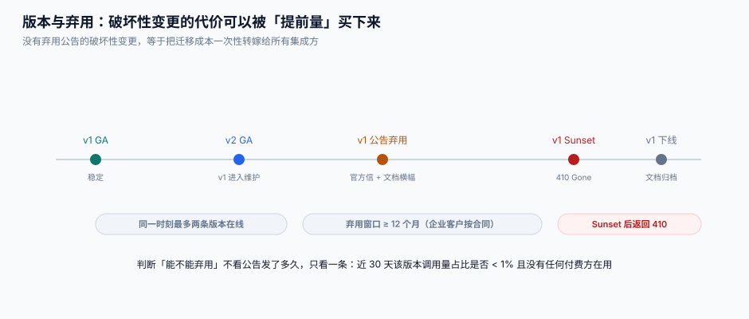

# 版本与弃用

对外开放的接口一旦发出去，**字段就成了合同条款**。这一页讲怎么给这份合同加条款、怎么删条款，以及为什么「删一个字段」的成本比「加十个字段」高一个数量级。

本页判据族 `OPV-A` ~ `OPV-H`，共 8 条。定义表在第八节。

## 一、三种定版方式

| 方式 | 示例 | 优点 | 代价 |
| --- | --- | --- | --- |
| URL 路径 | `POST /v1/orders` | 一眼看得出、网关好路由、缓存好分 | URL 里带版本，语义上不优雅 |
| 请求头 | `Stripe-Version: 2026-10-31` | 同一 URL 可按客户定版 | 调试时要记得带；CDN 缓存键要加 header |
| 媒体类型 | `Accept: application/vnd.acme.v2+json` | 符合内容协商 | 客户最容易漏写 |

**大版本走 URL，小差异走请求头**，是本库推荐的做法：

```text
/v1/orders                    ← 大版本（破坏性变更才升）
Stripe-Version: 2026-06-30    ← 同一大版本内的行为差异（可选、按客户固化）
```

::: tip 为什么「按客户固化版本」值得做
Stripe 的做法是：客户第一次调用时把当时的版本号记在账户上，之后不主动升就一直用老行为。这样平台可以**持续推进**（新客户拿新行为），而老客户**不被惊动**。代价是同一份代码要能同时表达 N 个历史行为——所以这种能力只适合「字段默认值、错误码文案」这类小差异，不适合「数据结构变了」。
:::

## 二、变更分三类，只有一类需要升版本

| 类别 | 例子 | 要不要升大版本 | 要不要公告 |
| --- | --- | --- | --- |
| **兼容新增** | 新增可选字段、新增枚举值（客户需容忍未知值）、新增可选参数 | ❌ | 发 changelog 即可 |
| **行为调整** | 默认分页大小从 20 变 50、错误码文案变化 | ❌（但要用版本头固化） | ✅ 提前 30 天 |
| **破坏性变更** | 删字段、改字段类型、加必填参数、改错误码含义、改鉴权方式 | ✅ | ✅ 提前 ≥ 12 个月 |

**「新增枚举值」是最有争议的一类**。严格来说它是兼容的（老客户端不认识就忽略），但前提是客户端**真的**做了「未知值兜底」。现实里大量客户端用 `switch` 穷举，遇到新枚举直接抛异常。所以：

> 新增枚举值前，先在文档里明确写「本字段未来可能返回新值，客户端必须容忍未知值」，并把这句话放进对接 checklist。写了这句，新增枚举才算兼容变更。

## 三、弃用的四个阶段



| 阶段 | 平台要做的 | 集成方看到的 |
| --- | --- | --- |
| ① GA | 文档、SDK、示例齐全 | 正常 |
| ② 公告弃用 | 官方邮件 + 文档横幅 + 控制台提示 + changelog | 响应头出现 `Deprecation`、`Sunset` |
| ③ 只读/降级 | 停止新接入、限流收紧、文档冻结 | 部分能力不可用 |
| ④ Sunset | 返回 `410 Gone`，附迁移文档链接 | 调用失败，但知道去哪 |

```http
HTTP/1.1 200 OK
Deprecation: Sun, 01 Nov 2026 00:00:00 GMT
Sunset: Tue, 01 Dec 2026 00:00:00 GMT
Link: <https://open.example.com/docs/migrate/v1-to-v2>; rel="successor-version"
```

三个头解决三件事：**什么时候开始不用**、**什么时候彻底不能用**、**该换成什么**。缺 `Link` 的话，客户知道要迁移但不知道迁到哪，只能提工单。

## 四、什么时候**可以**下线

判据不是「公告发了 12 个月」，而是三个数字同时满足：

| 观测 | 阈值 | 数据从哪来 |
| --- | --- | --- |
| 近 30 天该版本调用量占比 | < 1% | 用量表按 `api_version` 分组 |
| 仍在调用该版本的**付费**租户数 | 0（或已逐个书面确认） | 账单 + 租户表 |
| 该版本的未关闭工单数 | 0 | 工单系统按 `version` 标签 |

```sql
SELECT api_version,
       count(*) AS calls,
       count(DISTINCT tenant_id) AS tenants,
       round(100.0 * count(*) / sum(count(*)) OVER (), 2) AS pct
FROM usage
WHERE ts >= strftime('%s','now') - 30*86400
GROUP BY api_version ORDER BY calls DESC;
```

**为什么必须看「付费租户数」而不只是「调用量」**：一个每天调 3 次的大客户，占比 0.01%，但它一停业务就停。用占比一刀切，会切掉最不该切的那一个。

## 五、双版本共存的实现：适配层，不是 if-else

```python
# 差的做法：业务代码里到处 if version == "v1"
def to_dict(order, version):
    d = {"id": order.id, "amount": order.amount}
    if version == "v1":
        d["total"] = order.amount          # v1 叫 total
    else:
        d["amount_due"] = order.amount     # v2 改名叫 amount_due
    return d

# 好的做法：先归一，再按版本渲染（唯一一处版本分支）
@dataclass
class OrderView:                           # 内部唯一表示
    id: str
    amount_cents: int
    currency: str

RENDERERS = {
    "v1": lambda v: {"id": v.id, "total": v.amount_cents / 100},
    "v2": lambda v: {"id": v.id, "amount_due": {"cents": v.amount_cents, "currency": v.currency}},
}

def render(view: OrderView, version: str) -> dict:
    return RENDERERS[version](view)        # 版本分支只在这里
```

**判断标准很简单**：`grep -c 'v1' src/` 的数量应该**随时间下降**，而不是随版本增加而上升。如果 v3 上线后代码里出现了三处 `if version`，说明适配层没建起来。

## 六、破坏性变更清单（照着自查）

::: danger 这七件事都算破坏性变更
1. **加必填参数**——老客户端不传就报错。
2. **删字段**——老客户端读不到就 `KeyError`。
3. **改字段类型**（`string` → `object`，或金额从元变分）——静默算错钱。
4. **改字段语义**（`status` 从「支付状态」变成「履约状态」）——最难发现，因为类型没变。
5. **改错误码含义**（把「余额不足」从 `40001` 改成 `40002` 复用）——客户的重试逻辑全乱。
6. **改默认值**（分页大小、排序方向、是否包含已删除）——客户看到的列表突然变了。
7. **改鉴权方式**（从 API Key 改成 OAuth）——所有集成方必须改代码。
:::

反过来，**这五件事是兼容的**：加可选字段、加可选参数、加新接口、加新的 webhook 事件类型、放宽校验（原来拒绝的现在接受）。

## 七、判据族

| 编号 | 看什么现象 | 判成什么 | 不满足时改哪里 |
| --- | --- | --- | --- |
| `OPV-A` | 是否存在版本号与「按客户固化」两层机制 | 只有一层即无法既推进又不惊动老客户 | 大版本进 URL，小差异进版本头 |
| `OPV-B` | 弃用响应是否带 `Deprecation` + `Sunset` + `Link` 三个头 | 缺 `Link` 即客户不知迁到哪 | 三个头一起加 |
| `OPV-C` | 下线判据是否包含「付费租户数」 | 只看调用量占比即会切掉大客户 | 三条判据并列 |
| `OPV-D` | 版本分支是否集中在渲染层 | 散落业务代码即无法维护第三个版本 | 归一化中间表示 + 单一 renderer |
| `OPV-E` | 文档是否声明「未知枚举值必须容忍」 | 未声明则新增枚举不算兼容 | 写进对接 checklist |
| `OPV-F` | 公告期是否 ≥ 12 个月（企业客户按合同） | 短于合同期即违约 | 按最长合同期定 |
| `OPV-G` | Sunset 后是否返回 `410` 而非 `404` | 404 会被客户当「路径写错」 | 返回 410 + 迁移链接 |
| `OPV-H` | 是否存在 `api_version` 维度的用量统计 | 无则无法给出下线证据 | `usage` 表加列并进账单分组 |

## 八、验证方式

```shell
# 1. 调 v1，检查三个弃用头是否齐全
curl -s -D - -o /dev/null -H "Authorization: Bearer $TOK" http://127.0.0.1:8080/v1/orders | grep -i 'deprecation\|sunset\|link'
# 期望：三个头都在，且 Link 指向 /docs/migrate/v1-to-v2

# 2. Sunset 之后的行为
curl -s -o /dev/null -w '%{http_code}\n' http://127.0.0.1:8080/v1/orders
# 期望：410（不是 404，也不是 200）

# 3. 占比统计（下线证据）
sqlite3 open.db "SELECT api_version, count(*) FROM usage WHERE ts >= strftime('%s','now')-2592000 GROUP BY 1;"
# 期望：v1 占比 < 1%，且 v1 的付费租户数为 0
```

**结果读法**：第 2 步返回 404，说明路由把整个前缀删了——客户会以为是自己的 URL 写错了，而不是版本下线了。

## 参考资料

- RFC 8594 · The Sunset HTTP Header Field：https://www.rfc-editor.org/rfc/rfc8594
- RFC 9745 · The Deprecation HTTP Response Header Field：https://www.rfc-editor.org/rfc/rfc9745
- Stripe · API 版本与升级：https://docs.stripe.com/api/versioning
- Google Cloud · API 版本化与弃用政策：https://cloud.google.com/apis/design/versioning
