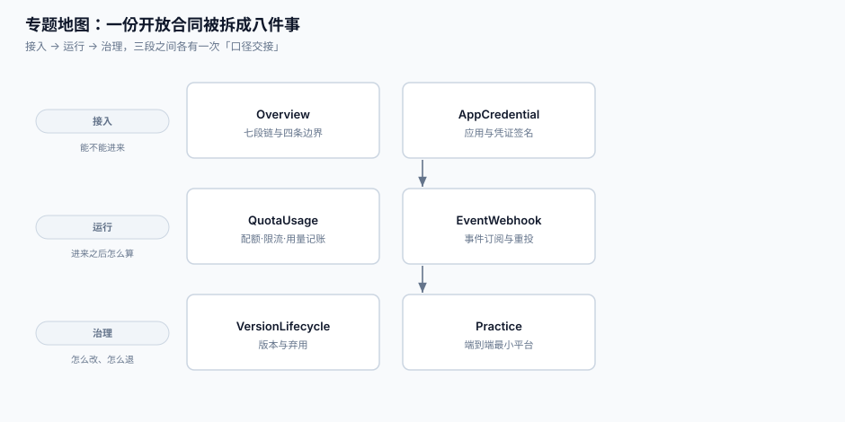

# 开放平台与 API 产品化工程

开放平台不是「把内部接口暴露到公网」，而是**把一次调用变成一份可计费、可限流、可追责、可退出的合同**。本专题讲这份合同怎么签、怎么履约、怎么终止。

::: tip 一句话理解
内部接口的成功标准只有一个：**返回 200**。开放接口的成功标准有五个：**对方拿到了、平台认得出是谁、用量记上了、配额没超、账单对得上**。这五件事分别由五段代码负责，而它们之间**没有任何一个事务能同时覆盖**——这就是开放平台的全部难度。
:::

## 与相邻专题的分工

| 专题 | 它回答的问题 | 本专题的回答 |
| --- | --- | --- |
| [网关深度实践](../GatewayDeep/index.md) | 流量怎么进机房、路由、熔断、插件 | 进来之后**这次调用算谁的、算多少** |
| [多租户 SaaS 架构](../MultiTenantSaaS/index.md) | 一个实例怎么装下多个租户、数据怎么隔离 | 租户之上还有一层**应用（app）**：一个租户可以有很多个应用 |
| [订阅计费与周期账单](../SubscriptionBilling/index.md) | 按月/按年怎么出账、折算与催收 | 用量怎么变成账单上的一行（**计量口径**在本专题） |
| [消息通知与触达](../NotificationDelivery/index.md) | 站内信/短信/推送怎么发、频控与退订 | 事件怎么**推给外部系统**并保证它不丢（方向相反：一个往里，一个往外） |
| [幂等与状态机](../IdempotencyStateMachine/IdempotencyKey/index.md) | 一个请求只生效一次 | 一个**重放**的请求该不该生效、以及 webhook 重投时的去重 |
| [契约演进](../ContractEvolution/index.md) | 内部服务之间怎么改字段不炸 | 对**外部**已经发出去的版本怎么弃用、怎么给提前量 |
| [认证与授权](../Auth/index.md) | 用户登录、角色与权限判定 | 第三方应用代表谁、能做什么（scope 是**给外部看的权限**） |
| [客服工单与 SLA](../SupportTicket/index.md) | 内部工单怎么分派、SLA 怎么计时 | 外部集成方报障时，**怎么用一个 trace_id 定位到他那一跳** |

> 一句话记住边界：**网关管「能不能进来」，本专题管「进来之后怎么算账、怎么退出」。**

## 九页导航

| 页 | 讲什么 | 读完能做什么 |
| --- | --- | --- |
| [总览：七段链与四条边界](./Overview/index.md) | 七段接入链、三类消费者、四条边界 | 判断自己的平台现在缺哪一段 |
| [应用与凭证签名](./AppCredential/index.md) | app_id/secret、签名串、密钥轮换、防重放 | 写出一套两端都能对上的签名协议 |
| [授权与令牌](./GrantToken/index.md) | 四种授权模式、scope 设计、令牌生命周期与撤销 | 选对模式，并让 scope 能被审计 |
| [配额、限流与用量](./QuotaUsage/index.md) | 配额三层、三种算法、429 语义、用量记账 | 让「配额」「限流」「账单」三个数字一致 |
| [事件订阅与重投](./EventWebhook/index.md) | 订阅模型、签名、退避、死信与重放 | 做一个接收方敢接的 webhook |
| [版本与弃用](./VersionLifecycle/index.md) | 版本策略、弃用流程、破坏性变更、兼容承诺 | 把「改不动」变成「改得有节奏」 |
| [实战：一套能跑起来的最小开放平台](./Practice/index.md) | 端到端六步 + 判据 `OPP` | 在本机跑出注册→调用→计量→限流→出账 |
| [常见问题与分诊](./FAQ/index.md) | 五个错误码的分诊、二十项自查 | 三分钟内定位是谁拒绝的 |

## 事实与规格速览（2026-10 口径）

| 事项 | 口径 | 出处 |
| --- | --- | --- |
| 授权框架 | OAuth 2.0（RFC 6749）+ Bearer（RFC 6750）；OAuth 2.1 仍在草案 | IETF RFC |
| 令牌撤销 / 自省 | RFC 7009 / RFC 7662 | IETF RFC |
| 授权服务器元数据 | RFC 8414（`/.well-known/oauth-authorization-server`） | IETF RFC |
| 强制 PKCE | OAuth 2.1 草案对**所有**客户端要求 PKCE；隐式模式与密码模式被移除 | draft-ietf-oauth-v2-1 |
| 绑定发送方 | mTLS（RFC 8705）与 DPoP（RFC 9449）是两条主流路线 | IETF RFC |
| 错误响应 | `application/problem+json`（RFC 9457）比自定义 JSON 更好对接 | IETF RFC |
| 下线信号 | `Sunset` 与 `Deprecation` 响应头（RFC 8594 / RFC 9745） | IETF RFC |
| 签名串五段 | `method\nurl\ntimestamp\nnonce\nbody\n` 是国内主流实现（微信支付 APIv3 同构） | 各开放平台文档 |

::: info 版本组织说明
本专题**不建版本目录**。三条理由：① 换代的是**产品条款**（配额怎么算、弃用给多久），不是判据——八族判据在 OAuth 1.0a → 2.0 → 2.1 之间一字未变；② 旧协议不与新协议**长期并存**（隐式模式被移除而不是被并行维护）；③ 版本差异已经收敛进 [版本与弃用](./VersionLifecycle/index.md) 的表格，不需要第二条内容线。库内必须按大版本目录组织的先例是 [`Spring5`/`Spring6`](../Java/Frame/Spring/index.md)、SpringBoot `v2`/`v3`、`Vue2`/`Vue3`——它们的共同点是**两套写法要同时教、同时维护**。
:::

## 判据纪律

沿用全库写法：**每页 8 条，编号形如 `OPO-A`**，逐页前缀唯一，可被 `utils/audit` 下的判据类巡检机械核对。每条判据回答三件事：**看什么现象、判成什么、不满足时改哪里**。

| 页 | 判据族 | 这一族管什么 | 条数 |
| --- | --- | --- | --- |
| 总览 | `OPO` | 七段链的接缝、消费者分类、边界 | 8 |
| 应用与凭证 | `OPC` | 密钥生命周期、签名串、防重放 | 8 |
| 授权与令牌 | `OPA` | 模式选择、scope、令牌撤销 | 8 |
| 配额与用量 | `OPQ` | 配额口径、限流执行、用量记账 | 8 |
| 事件订阅 | `OPE` | 订阅契约、重投、死信、去重 | 8 |
| 版本与弃用 | `OPV` | 版本并存、公告、下线判据 | 8 |
| 实战 | `OPP` | 最小平台的可运行证据 | 8 |
| 常见问题 | `OPF` | 分诊路径与自查清单 | 8 |

## 阅读顺序

1. **第一次做开放平台**：总览 → 应用与凭证 → 授权与令牌 → 配额与用量 → 实战。
2. **已经在运营、要收拾烂摊子**：先读 [常见问题与分诊](./FAQ/index.md) 的分诊表，再按错误码跳到对应页。
3. **只是要接别人的平台**（你是调用方）：应用与凭证的「验签五步」+ 事件订阅的「接收方义务」两节即可。

## 参考资料

- RFC 6749 · The OAuth 2.0 Authorization Framework：https://www.rfc-editor.org/rfc/rfc6749
- RFC 6750 · Bearer Token Usage：https://www.rfc-editor.org/rfc/rfc6750
- RFC 7009 · Token Revocation：https://www.rfc-editor.org/rfc/rfc7009
- RFC 7662 · Token Introspection：https://www.rfc-editor.org/rfc/rfc7662
- RFC 8414 · Authorization Server Metadata：https://www.rfc-editor.org/rfc/rfc8414
- RFC 9449 · OAuth 2.0 Demonstrating Proof of Possession (DPoP)：https://www.rfc-editor.org/rfc/rfc9449
- RFC 9457 · Problem Details for HTTP APIs：https://www.rfc-editor.org/rfc/rfc9457
- RFC 8594 · The Sunset HTTP Header Field：https://www.rfc-editor.org/rfc/rfc8594
- OWASP · API Security Top 10：https://owasp.org/API-Security/editions/2023/en/0x00-header/
- 微信支付 · APIv3 签名与验签：https://pay.weixin.qq.com/doc/v3/merchant/4012365334
