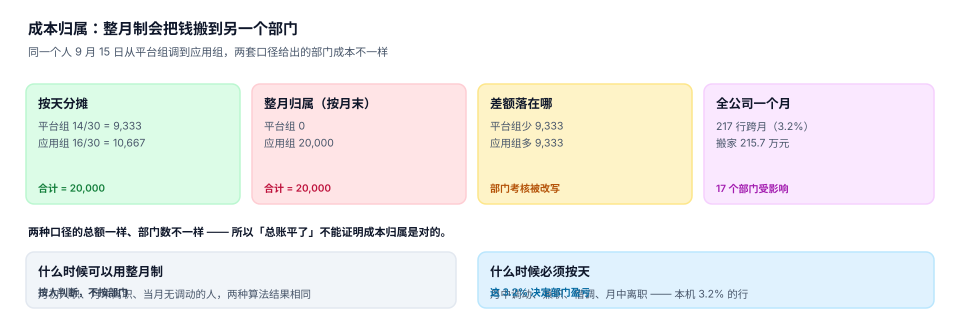

# 成本归属：按天分摊与整月归属

人力成本是大多数公司最大的一笔费用。它每个月都要按部门、按成本中心切一次，切完给财务、给业务负责人、给董事会。而切法只有两种：**按天分摊**与**整月归属**（记到月末所在部门）。

两种切法的公司总额完全一样，部门数字可以差出**两百多万**。更麻烦的是：两种切法都不会报错。

::: tip 一句话理解
成本归属的问题不是「算错钱」，是**把钱算给了错的人**。总额守恒只能证明没丢钱，证明不了归属正确。
:::

## 一、同一笔钱，两种切法



假设某员工月薪 20,000，9 月 15 日从平台组调到应用组：

| 切法 | 平台组 | 应用组 | 合计 | 依据 |
| --- | --- | --- | --- | --- |
| 按天分摊 | 9,333（14/30） | 10,667（16/30） | 20,000 | 在哪个组待了几天 |
| 整月归属（按月末） | 0 | 20,000 | 20,000 | 月末在哪个组 |

差额 9,333 从平台组搬到了应用组。对这个月的部门考核来说，这是「凭空多出九千块成本」和「凭空少掉九千块」。

本机 2026 年 9 月（6,874 条在册任职）的读数：

| 指标 | 读数 | 说明 |
| --- | --- | --- |
| 跨月/中途任职行 | **217（3.2%）** | 当月不是整月在某一个组织 |
| 整月制相对按天的偏差 | **−2,156,673 元** | 整月制把 215.7 万元在部门间搬家 |
| 占当月人力成本 | **1.57%** | 单月 1.57%，全年累计约 19% |

::: warning 1.57% 不算小
如果把 1.57% 当作「误差」放过，那么一个部门的年度成本会有近 19% 的金额在部门之间来回搬。对毛利只有 5% 的业务线来说，这个量级足以改变「这条线该不该继续投」的结论。
:::

## 二、什么时候可以整月、什么时候必须按天

| 场景 | 整月制是否可用 | 原因 |
| --- | --- | --- |
| 月初入职、月末离职、当月无调动 | 可用 | 两种算法结果相同 |
| 月中调动 | **必须按天** | 两个部门各承担一部分 |
| 月中入职 / 月中离职 | **必须按天** | 否则新部门承担了没上班的那些天 |
| 兼岗（两个组织各一半工时） | **必须按工时或约定比例** | 整月制无法表达 |
| 借调（成本仍记原组织） | 整月记原组织 | 借调不是成本转移 |

一个实用的判定规则：**只要这个人在当月有过一次归属变更，就必须按天**。本机这样的人占 3.2%——比例不高，但他们恰好是组织调整最频繁的那批岗位（管理层、项目制岗位），成本金额也最高。

## 三、成本中心要按日期挂载

组织 ≠ 成本中心。一个组织可能对应多个成本中心（按项目分），一个成本中心也可能跨组织。所以映射表必须带时间：

```sql
CREATE TABLE cost_center(
  org_id     INTEGER NOT NULL REFERENCES org(org_id),
  cc_code    TEXT NOT NULL,
  ratio      NUMERIC NOT NULL DEFAULT 1.0,   -- 该组织成本落到这个成本中心的比例
  valid_from TEXT NOT NULL,
  valid_to   TEXT NOT NULL,
  PRIMARY KEY (org_id, cc_code, valid_from),
  CHECK (valid_from < valid_to),
  CHECK (ratio > 0 AND ratio <= 1)
);
```

`ratio` 是必须的：一个 30 人的共享服务中心，可能有 40% 的成本摊给电商、35% 摊给线下、25% 留作公共。没有它，共享服务中心的成本只能整块记在某一个业务线上，而那个业务线的负责人每个月都要去吵一次。

### 分摊守恒

任何分摊都必须满足两条守恒式，且能被一条 SQL 验证：

```text
① 同一成本中心：Σ(分摊入) = Σ(该成本中心应承担)
② 公司级：Σ(部门成本) = Σ(员工成本)
```

第 ② 条最容易做错的地方是**跨期**：9 月的工资 10 月才发，如果按发放月记账，9 月的部门成本是空的；如果按归属月记账，10 月的现金流又对不上。正确做法是**归属期与支付期分列**：

| 列 | 含义 | 用途 |
| --- | --- | --- |
| `period` | 成本归属月（按任职日期算） | 部门成本报表 |
| `paid_at` | 实际发放日 | 现金流、银行对账 |

## 四、跨期追溯：补录改了历史怎么办

如果 9 月的成本已经结账，10 月补录了一条 9 月 20 日的调动，按天分摊的结果就变了。这时候有三种处理：

| 处理 | 做法 | 适用 | 风险 |
| --- | --- | --- | --- |
| 不回改，差异进当期 | 9 月不动，10 月补一笔调整 | 已对外披露的月份 | 部门看到「莫名其妙的一笔」 |
| 回改并重出报表 | 重算 9 月，出新版本 | 未结账月份 | 两个版本的 9 月同时存在 |
| 只在新期间生效 | 补录的调动从下月起算 | 金额很小 | 与事实不符 |

推荐第一种，并强制附**调整原因**：差异金额、影响部门、原始单号。这样部门负责人看到的不是「一笔糊涂账」，而是「上月漏记的一条调动，已在 10 月补」。

::: danger 三个成本归属坑
1. **用组织当前的成本中心算历史**。组织在 4 月换了成本中心，1~3 月的报表如果 JOIN 当前映射，会全部记到新成本中心。必须按 `valid_from <= 归属日` 取。
2. **按任职条数分摊而不按人头**。兼岗的人有两条任职，按条数分会让他承担双份成本。正确做法是先按人聚合，再按约定比例拆。
3. **只校验总额守恒**。总额守恒在「两个人成本互换」时仍然成立。必须同时校验**部门级**守恒，并对每次归属变更留一条可解释的记录。
:::

## 五、与其它专题的分工

| 问题 | 该读哪一册 | 分工 |
| --- | --- | --- |
| 这个月发多少钱、扣多少税 | [薪酬核算](../../Payroll/Overview/index.md) | 那册算金额，本页只负责把金额分到部门 |
| 部门预算是多少、超没超 | [全面预算](../../Budgeting/Overview/index.md) | 那册判授权与占用，本页提供实际发生额 |
| 产品成本怎么归集 | [成本核算](../../CostAccounting/Overview/index.md) | 那册判成本对象与分摊，本页只提供人工成本这一项 |
| 分录怎么记 | [复式记账](../../Ledger/DoubleEntry/index.md) | 那册判借贷平衡，本页判金额归属 |

## 六、判据

本页判据族 `OGC-A` ~ `OGC-H`，共 8 条：

| 编号 | 判据 | 怎么判 |
| --- | --- | --- |
| `OGC-A` | 成本中心按日期挂载，历史按归属日取 | 映射表有 `valid_from/valid_to` |
| `OGC-B` | 当月有归属变更的人按天分摊 | 存在按天计算的分摊逻辑 |
| `OGC-C` | 分摊有比例列，且比例之和可校验 | `ratio` 存在，Σratio 有检查 |
| `OGC-D` | 归属期与支付期分列 | `period` 与 `paid_at` 都在 |
| `OGC-E` | 部门级守恒与公司级守恒都校验 | 两条等式各有查询 |
| `OGC-F` | 补录导致的跨期差异走调整分录并附原因 | 调整记录有单号与说明 |
| `OGC-G` | 兼岗按人聚合后分摊，不按任职条数 | 分摊前 `DISTINCT emp_id` |
| `OGC-H` | 部门成本报表可按任意时点/区间重算 | 报表带 `as_of` 参数 |

## 七、验证方式

```shell
python3 - <<'PY'
MONTH = 20000
# 9/15 从平台组调到应用组
days = {'平台组': 14, '应用组': 16}
alloc = {k: round(MONTH * v / 30) for k, v in days.items()}
whole = {'平台组': 0, '应用组': MONTH}
print("按天:", alloc, "合计", sum(alloc.values()))
print("整月:", whole, "合计", sum(whole.values()))
print("搬家金额:", whole['应用组'] - alloc['应用组'], "元")
PY
```

预期输出：`按天: {'平台组': 9333, '应用组': 10667} 合计 20000`、`整月: {'平台组': 0, '应用组': 20000} 合计 20000`、`搬家金额: 9333 元`。

两个合计都是 20,000——这正是「总额守恒」的假安全感：钱没丢，但 9,333 元记到了不该记的部门。

```shell
grep -o 'OGC-[A-H]' docs/Backend/OrgPeople/CostAllocation/index.md | sort -u | wc -l
python3 utils/audit/judgeidcheck.py --root . | tail -1
```

预期输出：`8` 与 `E=0`。

## 参考资料

- [总览：七段链与三个「在哪个部门」](../Overview/index.md)
- [岗位与编制：占编的四种口径](../Position/index.md)
- [成本核算：守恒式与月末结账](../../CostAccounting/Overview/index.md)
- [薪酬核算：应发、实发与公司成本](../../Payroll/Overview/index.md)
- 财政部《企业产品成本核算制度（试行）》（成本归集与分摊的一般要求）：<https://www.mof.gov.cn/>
