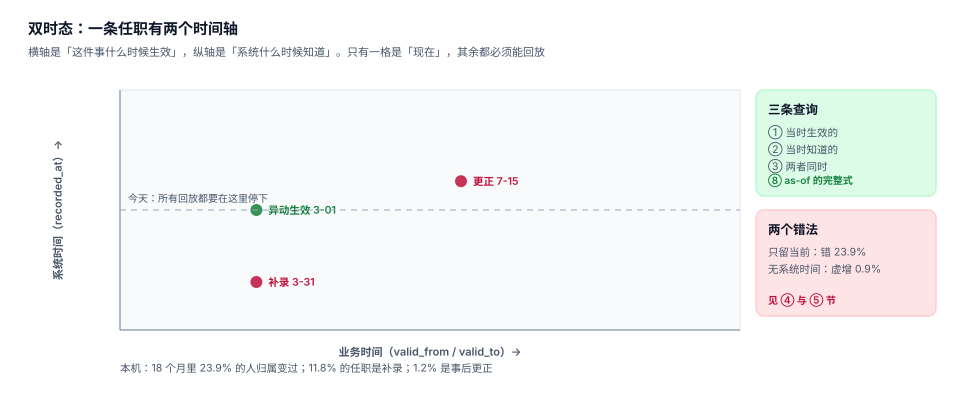

# 任职与生效日期：双时态怎么写

一条任职记录最重要的不是「在哪个部门」，而是「从哪天到哪天」。而真正把这件事做对的系统，还要再回答一个问题：**「这个答案是什么时候开始成立的」**。

因为异动经常补录。员工 3 月 1 日就调了部门，HR 3 月 31 日才在系统里录入。那么在 3 月 20 日那天，系统应该认为他在新部门还是老部门？两种答案都对，取决于你问的是哪个问题：

- 「3 月 20 日他实际在哪个部门」→ 新部门（业务时间已生效）
- 「3 月 20 日系统里认为他在哪个部门」→ 老部门（那时还没录）

这两个问题必须能分别回答。只存一套时间的系统，只能回答其中一个，而它会**默默地把另一个答案也给了你**。

::: tip 一句话理解
一条任职有两条时间轴：**业务时间**（这件事什么时候生效）与**系统时间**（系统什么时候知道）。前者决定事实，后者决定当时的报表长什么样。
:::

## 一、双时态的二维图



| 时态 | 列 | 语义 | 谁关心 |
| --- | --- | --- | --- |
| 业务时间（valid time） | `valid_from` / `valid_to` | 这段任职在现实中何时有效 | 业务、审计、报表 |
| 系统时间（transaction time） | `recorded_at` / `superseded_by` | 这一行何时进入系统、何时被取代 | 对账、追溯、监管 |

只有两者同时存在，才能回答四类问题：

| 问题 | 查询条件 |
| --- | --- |
| 现在他在哪 | `valid_from <= today < valid_to AND superseded_by IS NULL` |
| 去年 6 月他在哪（按今天的认知） | `valid_from <= d < valid_to AND superseded_by IS NULL` |
| 去年 6 月他在哪（按当时系统里的认知） | 上面 + `recorded_at <= d` |
| 哪一次更正改了他的历史 | `recorded_at > d AND valid_from <= d < valid_to` |

## 二、三个读数说明「少了系统时间会怎样」

本机 8,000 人 / 15,845 条任职，时间跨度 2022-01-01 至 2026-10-31，其中 **11.8% 是补录**（业务时间已过 30 天才录入）、**1.2% 是更正**（录错部门，60 天后作废重写）：

| 场景 | 读数 | 含义 |
| --- | --- | --- |
| 只留当前归属，被问「18 个月前他在哪」 | 错 **23.9%** | 5,276 个可比人里 1,261 人归属已变，系统只能拿今天顶上 |
| 有业务时间、没有系统时间 | 历史时点人数虚增 **0.9%** | 12 个历史时点累计 49,748 → 50,179 |
| 不回放 `recorded_at` 直接出历史报表 | **0.86%** 的在册记录被改写 | 56,477 条里 486 条是事后才更正/补录的 |

三个数字都不大，但性质完全不同：

- **23.9%** 是「根本答不了」，只是系统假装答了；
- **0.9%** 是「多算了人」，因为补录的行被算进了当时；
- **0.86%** 是「答案被后来的更正改了」，而报表看起来毫无异常。

::: danger 最常见的三个写法错误
1. **`UPDATE assignment SET org_id = ? WHERE emp_id = ?`**。这一句就把历史抹掉了。正确做法是「关闭旧行 + 插入新行」，且旧行保留。
2. **用 `updated_at` 当 `recorded_at`**。`updated_at` 会被「改了个备注」这类无关操作刷新，而 `recorded_at` 必须只在插入时写一次，此后不变。
3. **更正时直接改原行的 `org_id`**。这会让「当时系统里认为他在 A」这个事实消失。正确做法是：原行写 `superseded_by`，新行写新的 `recorded_at`。
:::

## 三、半开区间：为什么必须是 `[from, to)`

同一天交接时，闭区间会把一个人算进两个部门。本机用 340 个采样日对比两种写法：

| 写法 | 同日双命中 | 累计多算 |
| --- | --- | --- |
| 闭区间 `from <= d <= to` | **50.95 人/日** | **17,322 人日** |
| 半开区间 `from <= d < to` | **0** | 0 |

50.95 人/日 听起来不大（约占 6,852 人的 0.74%），但它是**系统性偏差**：每个调动的交接日都会多算一次，一年下来就是一万七千多人日。落在报表上，就是「部门人数合计比花名册多」这个永远解释不清的差额。

```sql
-- 正确：半开区间
SELECT org_id FROM assignment
 WHERE emp_id = ? AND valid_from <= ? AND valid_to > ? AND superseded_by IS NULL;

-- 错误：闭区间（交接日双命中）
SELECT org_id FROM assignment
 WHERE emp_id = ? AND valid_from <= ? AND valid_to >= ? AND superseded_by IS NULL;
```

### 闭区间唯一合理的用法

只有一种场景适合闭区间：**展示**。给业务方看的「任职期间」写成 `2024-03-01 ~ 2024-06-30` 更符合直觉，但存储与判定必须用半开区间，展示时再减一天。

## 四、同日并列：`ORDER BY` 必须完整

当同一个人在同一天有两条生效的任职（比如上午办调动、下午办兼岗），`ORDER BY valid_from DESC LIMIT 1` 返回哪一条**没有保证**：

```shell
# 同一个查询，两种索引下返回不同结果
无 emp_id 索引   → org = 222
有 (emp_id, valid_from DESC) 索引 → org = 111
```

这不是数据库的 bug，是「排序键不唯一」的必然结果。修法是加一个稳定的 tie-break：

```sql
SELECT org_id FROM assignment
 WHERE emp_id = ? AND valid_from <= ? AND valid_to > ? AND superseded_by IS NULL
 ORDER BY valid_from DESC, id DESC
 LIMIT 1;
```

更彻底的做法是**不允许同一天出现两条 primary**：用触发器拦住区间重叠（见[实战](../Practice/index.md)的 `T1`），把「并列」变成「写入失败」，而不是「读取时随缘」。

## 五、表结构与索引

```sql
CREATE TABLE assignment(
  asg_id        INTEGER PRIMARY KEY,
  emp_id        INTEGER NOT NULL REFERENCES employee(emp_id),
  pos_id        INTEGER NOT NULL REFERENCES position(pos_id),
  org_id        INTEGER NOT NULL REFERENCES org(org_id),
  kind          TEXT NOT NULL CHECK (kind IN ('primary','concurrent')),
  valid_from    TEXT NOT NULL,
  valid_to      TEXT NOT NULL,
  recorded_at   TEXT NOT NULL,
  superseded_by INTEGER REFERENCES assignment(asg_id),
  CHECK (valid_from < valid_to),
  CHECK (superseded_by IS NULL OR superseded_by <> asg_id)
);

CREATE INDEX ix_asg_emp ON assignment(emp_id, valid_from);
CREATE INDEX ix_asg_org ON assignment(org_id, valid_from);
```

两个索引各有分工：`ix_asg_emp` 服务「这个人当时在哪」（点查，本机 0.0059 ms）；`ix_asg_org` 服务「这个部门当时有哪些人」（范围扫）。没有 `ix_asg_emp` 时同一个查询要全表扫，本机 0.555 ms——**94 倍**，在批量报表里就是「跑不完」。

::: warning `CHECK (valid_from < valid_to)` 不是可选项
区间倒置（`from > to`）的行在 `valid_from <= d AND valid_to > d` 下永远为假，于是它既不出现在任何时点，也不报错——一条「幽灵任职」。这条 CHECK 是唯一能拦住它的东西。
:::

## 六、判据

本页判据族 `OGE-A` ~ `OGE-H`，共 8 条：

| 编号 | 判据 | 怎么判 |
| --- | --- | --- |
| `OGE-A` | 任职同时有业务时间与系统时间两组列 | `valid_from/valid_to` 与 `recorded_at` 都在 |
| `OGE-B` | 有效期一律半开区间，判定不写 `BETWEEN` | 查询用 `>= from AND < to` |
| `OGE-C` | `recorded_at` 只在插入时写，之后不变 | 无 `UPDATE ... SET recorded_at` 路径 |
| `OGE-D` | 更正走 `superseded_by`，原行可查 | 作废列存在且被查询排除 |
| `OGE-E` | 同日并列有稳定 tie-break | `ORDER BY` 含 `id` 或唯一列 |
| `OGE-F` | `CHECK (valid_from < valid_to)` 存在 | 区间倒置插入失败 |
| `OGE-G` | `(emp_id, valid_from)` 与 `(org_id, valid_from)` 两个索引都在 | 单点与范围查询都走索引 |
| `OGE-H` | 主岗不许区间重叠，由数据库拦住 | 触发器 `T1` 生效 |

## 七、验证方式

```shell
python3 - <<'PY'
import sqlite3
con = sqlite3.connect(":memory:")
con.executescript("""
CREATE TABLE a(emp INT, org TEXT, vf TEXT, vt TEXT, rec TEXT, sup INT);
INSERT INTO a VALUES
 (1,'A','2025-01-01','2025-07-01','2025-01-01',NULL),
 (1,'B','2025-07-01','2026-01-01','2025-08-05',NULL),
 (1,'C','2025-07-01','2026-01-01','2025-08-05',NULL);
""")
d = '2025-07-01'
print("半开:", [r[0] for r in con.execute(
  "SELECT org FROM a WHERE emp=1 AND vf<=? AND vt>? ORDER BY vf DESC, rowid DESC", (d,d))])
print("闭区间条数:", con.execute(
  "SELECT count(*) FROM a WHERE emp=1 AND vf<=? AND vt>=?", (d,d)).fetchone()[0])
print("当时可见:", [r[0] for r in con.execute(
  "SELECT org FROM a WHERE emp=1 AND vf<=? AND vt>? AND rec<=?", (d,d,d))])
PY
```

预期输出：`半开: ['C', 'B']`、`闭区间条数: 3`、`当时可见: []`。

第一行暴露了「同日并列」：两条都生效，`ORDER BY vf DESC, rowid DESC` 取到 C。没有 `rowid` 兜底时，取到 B 还是 C 取决于执行计划。第三行说明补录（8 月 5 日）的行在 7 月 1 日不可见。

```shell
python3 - <<'PY'
import sqlite3
con = sqlite3.connect(":memory:")
con.execute("CREATE TABLE t(vf TEXT, vt TEXT, CHECK (vf < vt))")
try:
    con.execute("INSERT INTO t VALUES ('2026-06-30','2026-01-01')")
    print("未被拦住")
except sqlite3.IntegrityError as e:
    print("被拒:", e)
PY
```

预期输出：`被拒: CHECK constraint failed: vf < vt`。

## 参考资料

- [总览：七段链与三个「在哪个部门」](../Overview/index.md)
- [异动：一次原子替换，不是两次更新](../Transfer/index.md)
- [时点查询与快照：索引、快照与重建](../TimeTravel/index.md)
- SQL:2011 时态表（应用时间与系统时间）：<https://www.iso.org/standard/53681.html>
- PostgreSQL 范围类型与 `EXCLUDE` 排他约束：<https://www.postgresql.org/docs/current/rangetypes.html>
- Richard Snodgrass《Developing Time-Oriented Database Applications in SQL》
