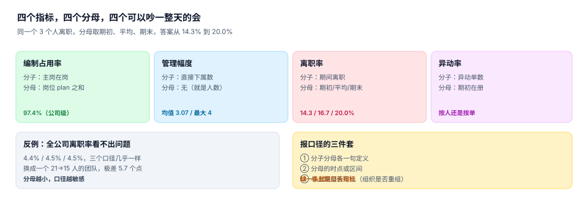

# 度量与数据质量：四个指标四个分母

组织数据的报表有四张脸：编制占用率、管理幅度、离职率、异动率。四个指标都会在管理会上被引用，四个都至少有两套算法，而**两套算法都有人坚持**。

分歧不在于谁算错了，而在于分母。分母选谁，取决于你想回答「这个月发生了什么」还是「现在处在什么状态」——这两件事需要不同的分母。

::: tip 一句话理解
指标不是算出来的，是**约定出来的**。约定里必须写清三件事：分子是什么、分母是什么、两次比较之间组织有没有变。
:::

## 一、四个指标与它们的分母



| 指标 | 分子 | 可选分母 | 本机读数 |
| --- | --- | --- | --- |
| 编制占用率 | 主岗在岗数 | 岗位 `plan` 之和 | 97.4%（含兼岗 100.1%） |
| 管理幅度 | 直接下属数 | 无（本身就是人数） | 均值 3.07 / 最大 4 |
| 离职率 | 期间离职人数 | 期初 / 平均 / 期末在册 | 14.3% / 16.7% / 20.0%（同一部门） |
| 异动率 | 期间异动单数 | 期初在册（人或单） | 按人还是按单，差一倍 |

### 离职率：同一个 3 人离职，三个答案

取本机一个从 21 人缩到 15 人的团队，期间离职 3 人：

| 分母 | 算式 | 读数 |
| --- | --- | --- |
| 期初在册 | 3 / 21 | **14.3%** |
| 平均在册 | 3 / ((21+15)/2) | **16.7%** |
| 期末在册 | 3 / 15 | **20.0%** |

极差 5.7 个百分点。同一批人、同一个月，三个数字都能自圆其说：

- 期初法回答「**这批人里走了多少**」——适合看稳定性；
- 平均法回答「**这一年的人力流失强度**」——年度报表常用；
- 期末法回答「**现在这个团队还剩多少**」——招聘规划的输入。

全公司口径下三个数字几乎一样（4.4% / 4.5% / 4.5%），因为 6,838 人的基数太大。**这正是危险之处：公司级指标看起来「口径不重要」，到了 20 人的团队就变成 5.7 个点的争议。**

::: danger 离职率的三个坑
1. **分子含内部调动**。调部门不是离职。判断依据是「是否离开公司主体」，不是「是否离开这个组织」。
2. **分母含已提离职未到期的人**。这些人还在册、还占编，但已经确定要走；放进分母会低估离职率，剔出分母会高估。必须选一个并写进定义。
3. **跨组织重组后直接同比**。组织从 21 人拆成两个 10 人组，离职率会突然翻倍——分子没变，分母被切开了。重组月份必须标注「口径不可比」。
:::

## 二、编制占用率：均值会骗人

本机 405 个叶子组织、计划 7,033 个编制、主岗在岗 6,852 人，占用率 97.4%。这个数字看起来健康，但它由两组方向相反的偏差抵消而成：

| 分组 | 组织数 | 计划 | 实到 | 偏差 |
| --- | --- | --- | --- | --- |
| 超编 | 138 | 2,177 | 2,394 | +217 |
| 缺口 | 191 | 3,668 | 3,270 | −398 |
| 刚好占满 | 76 | 1,188 | 1,188 | 0 |

一正一负相抵，公司级占用率 97.4%，看起来健康。所以「编制占用率」这个指标必须**同时给分布**：超编组织数、缺口组织数、以及缺口最大的 10 个组织。只报一个百分比的编制报表，在管理者眼里等于没有信息。

## 三、管理幅度与层级

| 指标 | 定义 | 健康区间 | 本机 |
| --- | --- | --- | --- |
| 平均管理幅度 | 下属数 / 有下属的人数 | 5~8 | 3.07（造数偏平） |
| 最大管理幅度 | 单点最大值 | ≤ 15 | 4 |
| 层级数 | 根到最深叶子的边数 | 4~6 | 7 |
| 一线占比 | 叶子组织人数 / 总人数 | 60%~80% | 未统计 |

管理幅度低于 3 通常意味着层级过多（一个主管只管两个人），高于 12 意味着主管变成瓶颈。这两个阈值都不是绝对标准，但**必须有一个阈值**，否则「组织是否臃肿」这个问题永远只能靠感觉回答。

## 四、异动率：按人还是按单

| 口径 | 分子 | 分母 | 差别 |
| --- | --- | --- | --- |
| 按人 | 期间有异动的人数 | 期初在册 | 一个人调两次算一次 |
| 按单 | 期间异动单数 | 期初在册 | 一个人调两次算两次 |

两者的差额就是「多次异动的人」。这批人通常是要么在被重点培养（轮岗），要么在被反复救火（组织不稳），两种解释的管理含义完全相反——所以异动率必须和「异动人数的分布」一起看，只看单数会得出错误结论。

## 五、数据质量的六个检查

组织数据的质量问题有固定形态，可以用六条检查覆盖：

| 检查 | 判据 | 本机读数 |
| --- | --- | --- |
| 孤儿任职 | `assignment.org_id` 找不到组织 | 0 |
| 区间倒置 | `valid_from >= valid_to` | 0（CHECK 拦住） |
| 主岗重叠 | 同一人两条 primary 相交 | 0（触发器拦住） |
| 汇报环 | 上溯回到自己 | 238 人（3.0%，注入造成） |
| 无人组织 | 有编制但 0 人在岗 | 见缺口组织 3,668 计划 / 3,270 实到 |
| 无主人员 | 在册但无任何任职 | 0 |

前三条是「硬错误」，后三条是「软异常」。**软异常不该被当成错误修掉**：一个长期空编的组织可能是故意留的（等一个候选人），一个环可能是历史遗留正在清理。它们需要被登记、被解释，而不是被自动修复。

## 六、判据

本页判据族 `OGS-A` ~ `OGS-H`，共 8 条：

| 编号 | 判据 | 怎么判 |
| --- | --- | --- |
| `OGS-A` | 每个指标有分子、分母、时点三段定义 | 指标字典里三项齐全 |
| `OGS-B` | 离职率分母口径唯一，且写进报表字段名 | 如 `turnover_avg_den` |
| `OGS-C` | 编制占用率必须同时给分布（超编/缺口组织数） | 报表含两个计数 |
| `OGS-D` | 重组月份标注「口径不可比」 | 报表有可比性标记 |
| `OGS-E` | 异动率区分按人与按单 | 两个口径都可得 |
| `OGS-F` | 软异常被登记而不是被自动修复 | 存在异常台账 |
| `OGS-G` | 人数类指标声明是否含兼岗 | 字段名或注释写明 |
| `OGS-H` | 指标可按同一口径重算历史（双时态支撑） | 同一报表可跑任意月份 |

## 七、验证方式

```shell
python3 - <<'PY'
h0, h1, leave = 21, 15, 3
print("期初法=%.1f%% 平均法=%.1f%% 期末法=%.1f%%" % (
    leave * 100 / h0, leave * 200 / (h0 + h1), leave * 100 / h1))
print("极差=%.1f 点" % (leave * 100 / h1 - leave * 100 / h0))

plan = {'超编组': 2177, '缺口组': 3668, '刚好组': 1188}
actual = {'超编组': 2394, '缺口组': 3270, '刚好组': 1188}
print("公司级占用率=%.1f%%" % (sum(actual.values()) * 100 / sum(plan.values())))
print("分组偏差:", {k: actual[k] - plan[k] for k in plan})
PY
```

预期输出：

```text
期初法=14.3% 平均法=16.7% 期末法=20.0%
极差=5.7 点
公司级占用率=97.4%
分组偏差: {'超编组': 217, '缺口组': -398, '刚好组': 0}
```

注意最后一行：三组偏差是 +217 / −398 / 0，加总 −181，落在 7,033 上就是 −2.6 个百分点。**公司级占用率 97.4% 之所以看起来健康，是因为 217 和 398 互相抵消了**——这就是「均值掩盖分布」的最小可复现例子。

```shell
grep -o 'OGS-[A-H]' docs/Backend/OrgPeople/Metrics/index.md | sort -u | wc -l
python3 utils/audit/judgeidcheck.py --root . | tail -1
```

预期输出：`8` 与 `E=0`。

## 参考资料

- [时点查询与快照：索引、快照与重建](../TimeTravel/index.md)
- [岗位与编制：占编的四种口径](../Position/index.md)
- [数据质量：规则命中率与口径治理](../../../DB/DataGovernance/DataQuality/index.md)
- CIPD《Labour Turnover：Measurement and Reporting》（离职率口径的行业讨论）：<https://www.cipd.org/>
- Jack Stack 管理幅度研究综述（Span of Control 的经验区间）：<https://www.shrm.org/>
