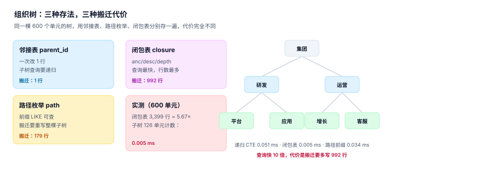

# 组织单元：三种存法与搬迁代价

组织树是那种「看起来不用设计」的结构：一个 `parent_id` 就够了。它确实够用到第一次组织调整为止——一次「把平台组从研发中心挪到技术中台」，就会把三种存法的差别全部暴露出来：有的写法改一行，有的写法要重写一百多行，有的写法要重算近千行。

而比搬迁更贵的是**改名**。组织改名后，历史报表应该显示当时的名字还是现在的名字？这个问题没有唯一答案，但必须有唯一选择，且写在文档里。

::: tip 一句话理解
组织树的设计不是选「哪种查询最快」，而是选「**哪种变更最不痛**」——因为组织一年要调整好几次，查询天天有但都很快。
:::

## 一、组织长什么样



本机造了一棵 600 个单元的组织树，形态如下：

| 指标 | 读数 | 说明 |
| --- | --- | --- |
| 单元数 | 600 | 含一个虚拟根「集团」 |
| 最大层级 | 7 层 | 根 → 部门 → 中心 → 组 → 小组 → 团队 → 小队 |
| 叶子数 | 405 | 真正挂人的组织 |
| 平均管理幅度 | 3.07 | 每个节点的直接子节点数 |
| 最大管理幅度 | 4 | 交叉验证：幅度超过 12 的组织通常需要再分层 |

层级分布：`{1: 1, 2: 4, 3: 13, 4: 37, 5: 122, 6: 368, 7: 55}`。这个形状（底部宽、上部窄）是典型的**金字塔 + 长尾**，也解释了为什么「按层级做报表」在真实公司里几乎不可用：7 层里只有 55 个单元在第 7 层，但报表口径一换（比如「事业群」），这 55 个单元就要重新归属。

## 二、三种存法与它们的搬迁代价

| 存法 | 结构 | 查子树 | 查祖先 | 搬迁（改父节点） | 适合 |
| --- | --- | --- | --- | --- | --- |
| 邻接表 | `id, parent_id` | 递归 CTE | 递归 CTE | **改 1 行** | 改动频繁、查询简单 |
| 路径枚举 | `id, path = '/1/7/23/'` | `LIKE '前缀%'` | 拆字符串 | 重写整棵子树 | 层级固定、读多写少 |
| 闭包表 | `anc, desc, depth` | 一次 JOIN | 一次 JOIN | **重算子树的所有祖先对** | 查询极多、写入可批 |

本机实测（600 单元、子树 126 单元）：

```shell
# 子树计数：三种写法的耗时（300 次平均）
递归 CTE   0.051 ms
闭包表     0.005 ms     ← 快 10 倍
路径前缀   0.034 ms
```

搬迁一个含 179 个单元的子树（把「平台中心」整体挪到另一个部门下）：

| 存法 | 需要改动的行数 | 操作 |
| --- | --- | --- |
| 邻接表 | **1** | `UPDATE org SET parent_id = ? WHERE id = 179` |
| 路径枚举 | **179** | 重写整棵子树的 `path` 前缀 |
| 闭包表 | **992** | 删除旧祖先对、插入新祖先对 |

### 怎么选

给出的建议不是「闭包表最好」，而是按变更频率分档：

- **一年调整超过 20 次**：用邻接表 + 递归 CTE。0.051 ms 的查询代价远小于每次搬迁重算 992 行的风险。
- **调整很少、报表极多**：用闭包表。3,399 行（5.67 倍膨胀）换来 10 倍查询速度，构建耗时只有 4.9 ms。
- **路径枚举只在一种情况下更优**：需要「按前缀做权限过滤」时（`path LIKE '/1/7/%'` 直接当 where 条件）。但它的搬迁代价（179 行）与索引膨胀（21 字符的深路径）要提前认账。

::: warning 三种存法可以共存，但要有个「主」
常见做法是邻接表当主表（唯一写入口），闭包表当派生索引（触发器或定时重建）。这样搬迁只写一处，查询走派生表。**反过来做**（闭包表当主、邻接表派生）就会出现「两份树打架」，而打架时你无法判断哪一份是对的。
:::

## 三、组织改名：历史报表显示哪个名字

这是组织模型里最容易被忽略、也最容易被业务方追问的一件事。

| 方案 | 历史报表显示 | 代价 | 适用 |
| --- | --- | --- | --- |
| 只存当前名字 | **今天的名字** | 零成本 | 内部看板，无审计要求 |
| 名称版本化 | 当时的名字 | 每次改名插一行 | 审计、对外披露、劳动争议 |
| 名字 + 曾用名表 | 当时的名字 + 可查现名 | 一张附表 | 需要「按新名查历史」 |

推荐第三种：`org_name(org_id, name, valid_from, valid_to)` 保存名称版本，同时 `org.name` 保留当前名供列表页使用。历史报表 JOIN 名称版本表，取 `valid_from <= as_of` 的那一行。

```sql
CREATE TABLE org(
  org_id     INTEGER PRIMARY KEY,
  parent_id  INTEGER REFERENCES org(org_id),
  name       TEXT NOT NULL,              -- 当前名，仅供列表与搜索
  path       TEXT NOT NULL,
  level      INTEGER NOT NULL,
  valid_from TEXT NOT NULL,
  valid_to   TEXT,                       -- NULL 表示仍存续
  CHECK (valid_to IS NULL OR valid_from < valid_to)
);

CREATE TABLE org_name(
  org_id     INTEGER NOT NULL REFERENCES org(org_id),
  name       TEXT NOT NULL,
  valid_from TEXT NOT NULL,
  valid_to   TEXT NOT NULL,
  PRIMARY KEY (org_id, valid_from)
);
```

::: danger 三个必须写进 DDL 的约束
1. **`CHECK (valid_from < valid_to)`**。没有它，区间倒置的组织会永远查不出来（`valid_from <= d AND valid_to > d` 恒假）。
2. **组织不许成为自己的祖先**。用触发器沿 `parent_id` 上溯，遇到自己就 `RAISE(ABORT)`；否则一次误操作会把整棵子树从报表里抹掉。
3. **`path` 必须以 `/` 结尾**。`/1/7` 作为前缀会匹配到 `/1/70`，这种「前缀撞号」在组织编码不补零时几乎必然发生（本机库位码未补零时多走 18.8% 的路径，同一个坑）。
:::

## 四、撤销、合并与虚拟根

组织不会只有「新建」和「改名」，还有三种消失方式：

| 方式 | 落库写法 | 历史怎么查 | 常见错法 |
| --- | --- | --- | --- |
| 撤销 | `valid_to = 撤销日`，不物理删 | 撤销前有效 | 直接 `DELETE` → 历史任职成孤儿 |
| 合并 | 旧组织 `valid_to`，新组织 `valid_from`，任职批量迁移 | 两条记录都在 | 只改 `assignment.org_id` → 历史归属被改写 |
| 拆分 | 旧组织保持，新增子组织，部分任职迁出 | 迁移日前后分别查 | 直接改父节点 → 旧报表的子树统计变了 |

**虚拟根**（`org_id = 1`，名为「集团」）是必要的：它让「全公司」这个口径有地方落，也让递归查询有唯一终点。没有虚拟根时，多棵树（集团本部和几家并购来的子公司）会让「所有人」这个查询变成 `UNION`。

## 五、判据

本页判据族 `OGM-A` ~ `OGM-H`，共 8 条：

| 编号 | 判据 | 怎么判 |
| --- | --- | --- |
| `OGM-A` | 有唯一虚拟根，所有组织都可达根 | 从任意 `org_id` 上溯必到 `1` |
| `OGM-B` | 组织不许成为自己的祖先 | 触发器或递归查询结果为 0 |
| `OGM-C` | `path` 以 `/` 结尾，且父子路径可拼接 | `child.path = parent.path + child.id + '/'` |
| `OGM-D` | 搬迁只需改一处（主表），派生结构可重建 | 有明确的主/派生声明 |
| `OGM-E` | 组织有 `valid_from/valid_to`，撤销不物理删 | 撤销后历史任职仍可 JOIN 到组织 |
| `OGM-F` | 名称版本化，历史报表可取「当时的名字」 | 存在 `org_name` 且报表 JOIN 它 |
| `OGM-G` | 组织编码补零或定长，前缀查询不撞号 | `path LIKE 'prefix%'` 无越界命中 |
| `OGM-H` | 合并/拆分不改历史 `assignment.org_id` | 迁移用「关闭旧行 + 开新行」 |

## 六、验证方式

```shell
python3 - <<'PY'
import sqlite3
con = sqlite3.connect(":memory:")
con.execute("CREATE TABLE org(id INT PRIMARY KEY, parent INT, path TEXT)")
rows = [(1,None,'/1/'),(7,1,'/1/7/'),(23,7,'/1/7/23/'),(70,7,'/1/7/70/')]
con.executemany("INSERT INTO org VALUES(?,?,?)", rows)

# 1) 子树计数：递归 CTE
n = con.execute("""WITH RECURSIVE t(id) AS (
  SELECT 7 UNION ALL SELECT o.id FROM org o JOIN t ON o.parent=t.id)
  SELECT count(*) FROM t""").fetchone()[0]
print("子树单元数 =", n)

# 2) 路径前缀（注意 70 会不会被 7 吞掉）
hit = con.execute("SELECT count(*) FROM org WHERE path LIKE ?", ('/1/7' + '%',)).fetchone()[0]
print("前缀命中 =", hit, "（含根自身则为 4）")

# 3) 路径拼接一致性
bad = con.execute("""SELECT count(*) FROM org c JOIN org p ON p.id=c.parent
  WHERE c.path <> p.path || c.id || '/'""").fetchone()[0]
print("路径不一致 =", bad)
PY
```

预期输出：`子树单元数 = 3`、`前缀命中 = 4 （含根自身则为 4）`、`路径不一致 = 0`。

第 2 行的 4 是刻意留的：`/1/7` 这条前缀同时命中 `/1/7/`、`/1/7/23/`、`/1/7/70/` 与自身。若把 `7` 写成 `70` 而不补斜杠，`LIKE '/1/7%'` 就会把 70 一起算进 7 的子树——这就是「前缀撞号」。

```shell
python3 utils/audit/svgrefcheck.py --root . | tail -1
grep -o 'OGM-[A-H]' docs/Backend/OrgPeople/OrgModel/index.md | sort -u | wc -l
```

预期输出：第一条 `E=0`，第二条 `8`。

## 与「图数据与关系计算工程」专题的分工

| 问题 | 本页 | 专题 |
| --- | --- | --- |
| 组织与任职的双时态建模、汇报关系语义 | 回答 | 不重复 |
| 树形存储结构的选择与索引 | 给出结论 | 给实测与索引顺序 |
| 子树查询、移动子树、闭包重建 | 不回答 | 回答 |

::: danger 本页特有的一个坑
组织树用闭包表时，只建 `PRIMARY KEY (anc, desc)` 是不够的。「查某人的三级以内下级」会先扫出整棵子树再按 `depth` 过滤——实测 1.945 ms，比递归还慢 33 倍；补 `(anc, depth)` 索引后 0.007 ms。**闭包表「快」的前提是索引顺序与查询谓词匹配**，否则它只是一个更占空间的邻接表。
:::

## 参考资料

- [岗位与编制：占编的四种口径](../Position/index.md)
- [任职与生效日期：双时态怎么写](../Employment/index.md)
- PostgreSQL 递归查询（`WITH RECURSIVE` 的语义与终止条件）：<https://www.postgresql.org/docs/current/queries-with.html>
- MySQL 8.0 递归 CTE：<https://dev.mysql.com/doc/refman/8.0/en/with.html>
- Joe Celko《Trees and Hierarchies in SQL for Smarties》（邻接表 / 路径 / 嵌套集 / 闭包表的系统对比）
