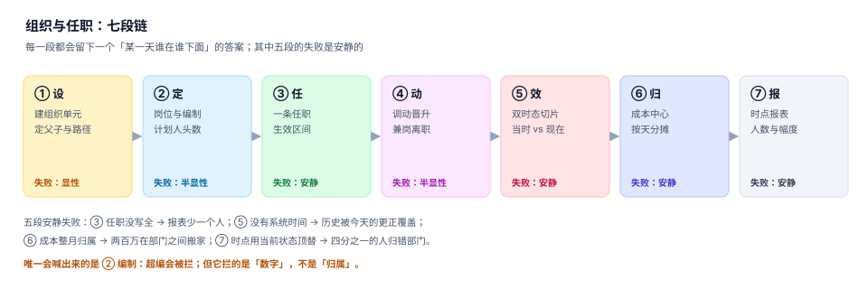

# 总览：七段链与三个「在哪个部门」

「组织架构」这四个字在大多数系统里是一张树形图，在大多数数据库里是一列 `dept_id`。这两种表示都能回答「现在」，都回答不了「当时」。

而组织数据的全部价值恰好落在「当时」：调薪要按当时的职级、绩效要按当时的部门、审计要按当时的汇报线、人力成本要按当时的成本中心。**一旦只保留现在，等于每天都在销毁证据**，而且是无声地销毁——没有报错，没有告警，只有半年后某个报表对不上。

::: tip 一句话理解
组织数据的正确性问题，本质是**时间问题**：不是「谁在哪个部门」，而是「哪一天、谁、在哪个部门、系统什么时候知道的」。
:::

## 一、七段链：每一段的产物与失败方式



| 段 | 关键动作 | 产物 | 失败形态 | 失败是否安静 |
| --- | --- | --- | --- | --- |
| ① 设 | 建单元、定父子、算路径 | `org(id, parent_id, path)` | 父子写反 → 子树消失 | 显性 |
| ② 定 | 岗位、编制、成本中心 | `position(org_id, plan)` | 超编无人拦 | 半显性 |
| ③ 任 | 一条任职 + 生效区间 | `assignment(valid_from, valid_to)` | 漏一条 → 少一个人 | **安静** |
| ④ 动 | 关闭旧区间、打开新区间 | 异动单 | 先开后关 → 当天两人 | 半显性 |
| ⑤ 效 | 区分「生效」与「录入」 | `recorded_at` | 更正覆盖历史 | **安静** |
| ⑥ 归 | 成本中心按日期挂载 | `cost_center(valid_*)` | 整月归属把钱搬走 | **安静** |
| ⑦ 报 | 时点人数、幅度、离职率 | 视图 / 快照 | 口径一换就变脸 | **安静** |

七段中只有第 ① 段会自己喊出来：父子关系写错，页面上的树立刻少一截。第 ② 段只在有人主动校验时才会拦。剩下四段的失败**不会产生任何异常**，只会让某个数字在半年后对不上，而那时已经没有人记得当时的真相。

## 二、三个「在哪个部门」，必须分开存

| 问题 | 依赖的表 | 更新方式 | 常见错误 |
| --- | --- | --- | --- |
| 他在哪个组织 | `assignment` | 追加新行 + 关闭旧行 | `UPDATE employee.dept_id` |
| 他算谁的成本 | `cost_center`（按组织 + 日期） | 新版本行 | 读组织当前的成本中心 |
| 他向谁汇报 | `report_line`（按人 + 日期） | 新版本行 | `employee.manager_id` 单列 |

三者经常一致，但**不能互相推导**：一个人可以挂在研发中心（组织），成本记到某个项目（成本中心），虚线汇报给销售 VP（汇报线）。把三者压成一列 `dept_id`，就等于宣布「公司的组织形态只有一种」，这在矩阵制公司里第一天就会出错。

本机数据里三者的分离度：600 个组织单元、405 个叶子、7 层；8,000 名员工里有 190 人同时挂在两个组织（兼岗，2.7% 的重复计数）；6,785 人有明确上级，其中 238 人（3.0%）落在汇报环上。

## 三、最小可用模型：五列决定一切

一张能回答「当时」的任职表，只需要五列：

```sql
CREATE TABLE assignment(
  id          INTEGER PRIMARY KEY,
  emp_id      INTEGER NOT NULL,
  org_id      INTEGER NOT NULL,
  valid_from  TEXT NOT NULL,   -- 业务时间：什么时候生效
  valid_to    TEXT NOT NULL,   -- 业务时间：什么时候失效（不含）
  recorded_at TEXT NOT NULL,   -- 系统时间：这一行什么时候被写进来
  superseded_by INTEGER        -- 被哪一行取代（更正而不是覆盖）
);
```

五列各自承担一件事，缺一列就少一种能力：

| 列 | 少了它会怎样 |
| --- | --- |
| `valid_from` / `valid_to` | 无法回答「当时」，只能回答「现在」 |
| 半开区间的写法 | 交接日会被两个部门同时算一次（本机多算 17,322 人日） |
| `recorded_at` | 补录与更正会被当成「当时就是那样」（本机 0.86% 的历史记录被改写） |
| `superseded_by` | 更正只能覆盖，原始判断永久丢失 |

::: danger 三个必踩的坑
1. **用 `BETWEEN` 判有效期**。`day BETWEEN valid_from AND valid_to` 在交接日会同时命中旧行与新行。正确写法是 `valid_from <= day AND valid_to > day`（半开区间）。
2. **用 `updated_at` 冒充 `recorded_at`**。`updated_at` 会被任何一次无关的字段修改刷新，它记录的是「最后一次碰过」，不是「这一行是什么时候代表真相的」。
3. **用 `ORDER BY valid_from DESC LIMIT 1` 取当前行**。当两行 `valid_from` 相同时，返回哪一条取决于索引与存储顺序——本机同一个查询在两种索引下分别返回了组织 222 与组织 111。
:::

## 四、五条不变式

这五条不需要读代码就能验证，每一条都能被一条 SQL 证伪：

| 不变式 | 查询要点 | 违反说明什么 |
| --- | --- | --- |
| 主岗不重叠 | 同一人两条 `primary` 区间相交 | 转移写成「先开后关」 |
| 任职有组织 | `assignment.org_id` 能连到 `org` | 组织被删但任职还在 |
| 汇报线无环 | 上溯 30 层不回到自己 | 反向指针 / 历史遗留 |
| 占编不超计划 | `primary` 数 ≤ `position.plan` | 编制形同虚设 |
| 归属有生效日 | `valid_from < valid_to` | 区间倒置，永远无效 |

## 五、判据

本页判据族 `OGO-A` ~ `OGO-H`，共 8 条，逐条可判定：

| 编号 | 判据 | 怎么判 |
| --- | --- | --- |
| `OGO-A` | 组织、任职、成本中心、汇报线四者分表，可各自带时间 | 四张表都在，且都有 `valid_from/valid_to` |
| `OGO-B` | 有效期一律半开区间，查询用 `>= from AND < to` | 全库无 `BETWEEN … AND … valid_to` 写法 |
| `OGO-C` | 每条任职都有 `recorded_at`，且不等于 `updated_at` 语义 | 两列都在，注释写明区别 |
| `OGO-D` | 更正走 `superseded_by`，不覆盖原行 | 存在作废列，且原行可查 |
| `OGO-E` | 五条不变式各有可执行查询，结果均为 0 | 见本页第四节 |
| `OGO-F` | 「当前状态」是视图或按 `valid_to` 过滤的结果，不是独立字段 | 没有 `employee.dept_id` 这种冗余列 |
| `OGO-G` | 兼岗与主岗用 `kind` 区分，统计时先声明口径 | `kind IN ('primary','concurrent')` |
| `OGO-H` | 每个报表都标注「时点」或「区间」，不接受无时间的数字 | 报表字段带 `as_of` 或 `period` |

## 六、验证方式

先造一张最小的双时态表，验证半开区间与「补录可见性」两件事：

```shell
python3 - <<'PY'
import sqlite3
con = sqlite3.connect(":memory:")
con.executescript("""
CREATE TABLE assignment(emp INT, org TEXT, vf TEXT, vt TEXT, rec TEXT);
INSERT INTO assignment VALUES
 (1,'A','2026-01-01','2026-07-01','2026-01-01'),
 (1,'B','2026-07-01','2027-01-01','2026-08-05');   -- 8 月才补录
""")
d = '2026-07-01'
half = con.execute("SELECT org FROM assignment WHERE emp=1 AND vf<=? AND vt>?", (d,d)).fetchall()
closed = con.execute("SELECT org FROM assignment WHERE emp=1 AND vf<=? AND vt>=?", (d,d)).fetchall()
print("半开区间:", half, "闭区间:", closed)
seen = con.execute("SELECT org FROM assignment WHERE emp=1 AND vf<=? AND vt>? AND rec<=?", (d,d,d)).fetchall()
print("当时可见:", seen)
PY
```

预期输出：`半开区间: [('B',)]`、`闭区间: [('A',), ('B',)]`、`当时可见: []`。

三行分别说明三件事：半开区间在交接日只算新部门；闭区间会把同一天算两次；而 8 月 5 日才补录的那一行，在 7 月 1 日这个「当时」根本还不该可见——它属于「事后才知道」，不属于「当时就这样」。

```shell
# 判据 8 条齐不齐
grep -o 'OGO-[A-H]' docs/Backend/OrgPeople/Overview/index.md | sort -u | wc -l

# 全库判据不撞号
python3 utils/audit/judgeidcheck.py --root . | tail -1
```

预期输出：第一条 `8`，第二条 `E=0`。

## 与「培训与资质认证」专题的分工（第 240 天补充）

组织归属正确的人，照样可能没有上岗资质；反过来，有证的人也可能被并到了一个不需要该证的岗位。两册的分工是：

| 问题 | 本册（组织与任职） | 培训与资质册 |
| --- | --- | --- |
| 这个人属于哪个部门 | **判**：`org_unit` + 任职区间 | 不判，只读 `position_id` |
| 这个岗位该会什么 | 不判 | **判**：`position_req` 矩阵（带版本与生效日） |
| 他有没有这项资质 | 不判（只保证「当时在哪个岗位」） | **判**：`cert` 半开区间 + 状态 |
| 编制够不够 | **判**：编制四口径 | 不判 |

延伸阅读：[岗位资质矩阵](../../TrainingQualification/Matrix/index.md)、[上岗准入：判定点在哪里](../../TrainingQualification/AccessGate/index.md)、[证书与有效期](../../TrainingQualification/Certificate/index.md)。

::: danger 一个只在本页成立的坑
**用「当前任职」去解释历史资质**。`OrgPeople` 的时点查询能还原「2026-03 他在 10 号岗位」，但如果资质判定用的是「今天的 `position_id`」，同一个人会被按今天的矩阵重新判一次——这是用组织的时间轴去改写资质的时间轴，两册的 `as_of` 必须一起传。
:::

## 与「学籍、选课与排课工程」专题的分工（第 250 天补充）

两册都是双时态，但**变的是不同的东西**：

| 问题 | 本册（组织与任职） | 学籍专题 |
| --- | --- | --- |
| 变的是什么 | 部门、岗位、汇报线 | 学籍状态、专业、方案版本 |
| 区间表 | `employment`（任职区间） | `student_status`（在籍区间） |
| 当前值怎么取 | `end_date IS NULL` 的那一条 | 同左，`to_date IS NULL` |
| 历史怎么答 | 传 `as_of` 还原当时岗位 | 传 `as_of` 还原当时专业与方案 |

**一个只在本页成立的坑**：用「当前班级」解释历史排名。转专业的学生在 2023 年按**原专业**排的名，2024 年按**新专业**排——同一门课的成绩没动，名次会跳。若报表用「今天的 `major_id`」回算四年前的排名，等于把两个专业的人塞进一张榜。班级/专业排名必须与学籍区间一起传 `as_of`，否则历史上每一次转专业都会改写一遍过去。

→ 教务侧的完整链路见[学籍、选课与排课工程](../../AcademicAffairs/index.md)。

## 与「招聘与人才获取工程」专题的分工（第 253 天补充）

两册共同管一个人，但管的是**两个不同身份的两段人生**。招聘册的尽头是一条 `offer.status = 'accepted'`，本册的开头是一条 `employment.start_date`；中间那道门是「入职当天」，跨过去才换 ID。

| 问题 | 本册（组织与任职） | 招聘与人才获取册 |
| --- | --- | --- |
| 这个人是谁 | **判**：`employee_no`（164 个，按人去重后） | **判**：`candidate_id`（2,400 个），未入职前只存在于此 |
| 他在哪个部门 | **判**：`org_unit` + 任职区间 `as_of` | 不判，只带 `position_id` 做需求归属 |
| 编制够不够 | **判**：编制四口径（在编/占用/冻结/缺口） | **判**：`hc_total` / `hc_filled` / `hc_inflight` 三水位 |
| 岗位从哪来 | **判**：岗位主数据是唯一权威 | 只读 `position_id`，**不建岗位** |
| 任职从哪天起算 | **判**：`employment.start_date`，由入职手续敲定 | 只给 `offer.start_date`（**期望**报到日），不写任职 |

两个册子都存「人」，但**没有一行数据是共享写入的**。招聘册全程只读岗位主数据；本册从不读 `candidate_id`，入职时由 `Handoff` 环节把 `candidate_id` 转成 `employee_no` 并落一条来源渠道字段（内推 / 平台 / 猎头…），此后两边只靠 `employee_no` 对齐。

::: danger 一个只在本页成立的坑
**把 `offer.status = 'accepted'` 当成「已在编」。** 本机读数是 171 人接受、159 人实际到岗——中间 12 人（7.02%）里 9 人爽约、3 人背调不通过。若用「已接受」初始化 `employment`，本册会凭空多出 12 条任职记录，且它们的 `start_date` 全都落在过去，编制立刻被虚占；更糟的是这 12 条幽灵任职会进入花名册、进入算薪范围、进入组织人数统计，而反向修正时已经分不清「哪 12 条是真的迟到了」还是「哪 12 条根本没来」。

正确做法是**只以入职手续的完成为写入触发点**（`Handoff` 的 T+0 五条验收），`hc_inflight`（在途）留在招聘册，永远不跨册成本册的在编。
:::

延伸阅读：[需求与编制三水位](../../Recruiting/Requisition/index.md)、[Offer 与超发](../../Recruiting/Offer/index.md)、[入职交接：四断点](../../Recruiting/Handoff/index.md)。

## 参考资料

- [组织单元：三种存法与搬迁代价](../OrgModel/index.md)
- [任职与生效日期：双时态怎么写](../Employment/index.md)
- SQL:2011 时态表标准（应用时间与系统时间的双时间轴）：<https://www.iso.org/standard/53681.html>
- PostgreSQL `daterange` 与排他约束（用数据库拦住「区间重叠」）：<https://www.postgresql.org/docs/current/rangetypes.html>
- Martin Fowler《Temporal Patterns》：<https://martinfowler.com/eaaDev/timeNarrative.html>
