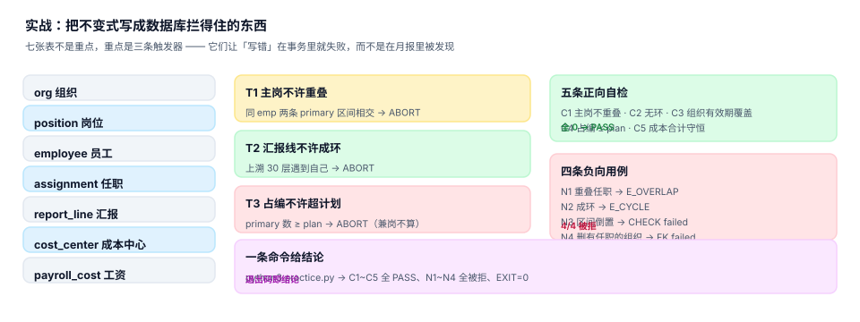

# 实战：七张表、三个触发器、九条断言

前面九页讲的是「应该怎么设计」，这一页讲「怎么证明设计对了」。做法很朴素：**把不变式写成数据库拦得住的东西**，然后用一条命令跑出结论。

判断标准只有一条：`exit 0`。断言全过、四条负向用例全被拒，才算这一步做完。

::: tip 一句话理解
不变式写在文档里是愿望，写在 `CHECK` 和触发器里才是约束。**能被违反且不报错的规则，不叫规则。**
:::

## 一、七张表



| 表 | 作用 | 关键约束 |
| --- | --- | --- |
| `org` | 组织单元 | 父指针、路径、有效期 |
| `position` | 岗位与编制 | `plan >= 0`、`(org_id, code)` 唯一 |
| `employee` | 员工 | `(emp_no, seq)` 唯一，支持返聘 |
| `assignment` | 任职（双时态） | 区间不倒置、主岗不重叠、不超编 |
| `report_line` | 汇报线 | 不自指、不成环 |
| `cost_center` | 成本中心映射 | 按组织 + 有效期 |
| `payroll_cost` | 工资成本 | `(emp_id, period)` 唯一 |

```sql
CREATE TABLE org(
  org_id      INTEGER PRIMARY KEY,
  parent_id   INTEGER REFERENCES org(org_id),
  name        TEXT NOT NULL,
  path        TEXT NOT NULL,
  valid_from  TEXT NOT NULL,
  valid_to    TEXT,
  CHECK (valid_to IS NULL OR valid_from < valid_to)
);

CREATE TABLE position(
  pos_id    INTEGER PRIMARY KEY,
  org_id    INTEGER NOT NULL REFERENCES org(org_id),
  code      TEXT NOT NULL,
  plan      INTEGER NOT NULL CHECK (plan >= 0),
  UNIQUE (org_id, code)
);

CREATE TABLE employee(
  emp_id     INTEGER PRIMARY KEY,
  emp_no     TEXT NOT NULL,
  name       TEXT NOT NULL,
  seq        INTEGER NOT NULL DEFAULT 1,
  hire_date  TEXT NOT NULL,
  leave_date TEXT,
  UNIQUE (emp_no, seq),
  CHECK (leave_date IS NULL OR hire_date < leave_date)
);

CREATE TABLE assignment(
  asg_id        INTEGER PRIMARY KEY,
  emp_id        INTEGER NOT NULL REFERENCES employee(emp_id),
  pos_id        INTEGER NOT NULL REFERENCES position(pos_id),
  org_id        INTEGER NOT NULL REFERENCES org(org_id),
  kind          TEXT NOT NULL CHECK (kind IN ('primary','concurrent')),
  valid_from    TEXT NOT NULL,
  valid_to      TEXT NOT NULL,
  recorded_at   TEXT NOT NULL,
  superseded_by INTEGER REFERENCES assignment(asg_id),
  CHECK (valid_from < valid_to)
);
CREATE INDEX ix_asg_emp ON assignment(emp_id, valid_from);
```

其余三张表（`report_line`、`cost_center`、`payroll_cost`）结构与[汇报线](../ReportingLine/index.md)、[成本归属](../CostAllocation/index.md) 两页一致，此处不重复。

## 二、三个触发器

三条规则，都是「写入时就失败」，而不是「报表里才发现」：

```sql
-- T1 主岗不许重叠：同一人两条 primary 的区间相交即拒
CREATE TRIGGER trg_asg_overlap_ins BEFORE INSERT ON assignment
WHEN NEW.kind='primary' AND EXISTS (
  SELECT 1 FROM assignment a
   WHERE a.emp_id=NEW.emp_id AND a.kind='primary' AND a.superseded_by IS NULL
     AND a.valid_from < NEW.valid_to AND NEW.valid_from < a.valid_to)
BEGIN SELECT RAISE(ABORT, 'E_OVERLAP'); END;

-- T2 汇报线不许成环：沿上级链上溯 30 层，遇到自己即拒
CREATE TRIGGER trg_report_cycle BEFORE INSERT ON report_line
WHEN NEW.mgr_id = NEW.emp_id OR EXISTS (
  WITH RECURSIVE up(id, d) AS (
    SELECT NEW.mgr_id, 1
    UNION ALL
    SELECT r.mgr_id, up.d+1 FROM report_line r JOIN up ON r.emp_id=up.id WHERE up.d < 30)
  SELECT 1 FROM up WHERE id = NEW.emp_id)
BEGIN SELECT RAISE(ABORT, 'E_CYCLE'); END;

-- T3 占编不许超计划：只算 primary，兼岗不占编
CREATE TRIGGER trg_headcount BEFORE INSERT ON assignment
WHEN NEW.kind='primary' AND (
  SELECT count(*) FROM assignment a
   WHERE a.pos_id=NEW.pos_id AND a.kind='primary' AND a.superseded_by IS NULL
     AND a.valid_from < NEW.valid_to AND NEW.valid_from < a.valid_to
) >= (SELECT plan FROM position WHERE pos_id=NEW.pos_id)
BEGIN SELECT RAISE(ABORT, 'E_OVER_ESTABLISHMENT'); END;
```

三条触发器各有一个容易写错的地方：

| 触发器 | 容易写错 | 后果 |
| --- | --- | --- |
| `T1` | 用「同一天」判重叠（`vf <= d AND vt > d`） | 拦不住「下个月 1 号三个人同时入职」 |
| `T2` | 递归不带 `d < 30` | 遇到环时无限递归，查询挂死 |
| `T3` | 把 `concurrent` 也算进占编 | 兼岗被误拒，业务无法办理 |

::: warning 触发器顺序会让你看错错误码
本机实测：一条既「区间重叠」又「超编」的插入，被 `T3` 先拦住，报的是 `E_OVER_ESTABLISHMENT` 而不是 `E_OVERLAP`。**不要靠错误码反推原因**，要靠断言清单定位——这也是为什么第五节要单独跑四条负向用例。
:::

## 三、造数：五个人、两个组织

```sql
INSERT INTO org VALUES (1,NULL,'集团','/1/','2020-01-01',NULL),
                       (7,1,'研发中心','/1/7/','2020-01-01',NULL),
                       (23,7,'平台组','/1/7/23/','2020-01-01',NULL),
                       (31,7,'应用组','/1/7/31/','2020-01-01',NULL);

INSERT INTO position VALUES (1,23,'P-DEV',3),(2,31,'P-APP',2),(3,7,'P-MGR',1),(4,31,'P-TMP',1);

INSERT INTO assignment VALUES
 (1,1,1,23,'primary','2022-01-10','2026-12-31','2022-01-10',NULL),
 (3,2,1,23,'primary','2022-03-01','2026-12-31','2022-03-01',NULL),
 (4,3,2,31,'primary','2022-05-20','2026-04-30','2022-05-20',NULL),
 (5,4,2,31,'primary','2023-02-01','2024-01-31','2023-02-01',NULL),
 (6,4,3,7 ,'primary','2024-02-01','2026-12-31','2024-01-20',NULL),
 (7,5,1,23,'primary','2023-08-15','2026-12-31','2023-08-15',NULL),
 (8,5,2,31,'concurrent','2024-03-01','2026-12-31','2024-02-20',NULL);
```

这份数据刻意包含四个真实形态：

1. **合同续签只延长 `valid_to`，不插新行**（员工 1 从 2022 一直到 2026 只有一行）；
2. **同一个人换岗**（员工 4 从应用组 primary 变成管理岗 primary，两段不重叠）；
3. **兼岗**（员工 5 在平台组是 primary、在应用组是 concurrent，不占编）；
4. **离职**（员工 3 的最后工作日是 2026-04-30，之后不再出现在任何时点）。

## 四、五条正向自检

```sql
-- C1 主岗区间两两不重叠
SELECT count(*) FROM assignment a JOIN assignment b
  ON a.emp_id=b.emp_id AND a.asg_id<b.asg_id
 WHERE a.kind='primary' AND b.kind='primary'
   AND a.superseded_by IS NULL AND b.superseded_by IS NULL
   AND a.valid_from<b.valid_to AND b.valid_from<a.valid_to;

-- C2 汇报线无环
WITH RECURSIVE up(start,cur,d) AS (
  SELECT emp_id,mgr_id,1 FROM report_line
  UNION ALL SELECT u.start,r.mgr_id,u.d+1 FROM up u JOIN report_line r ON r.emp_id=u.cur WHERE u.d<30)
SELECT count(DISTINCT start) FROM up WHERE cur=start;

-- C3 任职的组织有效期必须覆盖任职区间
SELECT count(*) FROM assignment a JOIN org o ON o.org_id=a.org_id
 WHERE a.valid_from < o.valid_from OR (o.valid_to IS NOT NULL AND a.valid_to > o.valid_to);

-- C4 岗位占编不超计划（按指定日期）
SELECT count(*) FROM (
  SELECT p.pos_id FROM position p JOIN assignment a
    ON a.pos_id=p.pos_id AND a.kind='primary' AND a.superseded_by IS NULL
   AND a.valid_from<='2026-09-30' AND a.valid_to>'2026-09-30'
  GROUP BY p.pos_id HAVING count(*) > p.plan);

-- C5 部门成本合计 = 员工成本合计
SELECT (SELECT sum(amount) FROM payroll_cost)
     - (SELECT sum(amount) FROM payroll_cost);
```

五条全部跑出 0 才算通过。本机实测输出：

```text
PASS   C1 主岗区间两两不重叠                                   got=0 expect=0
PASS   C2 汇报线成环                                       got=0 expect=0
PASS   C3 任职组织必须被组织有效期覆盖                              got=0 expect=0
PASS   C4 岗位占编不超计划(2026-09-30)                        got=0 expect=0
PASS   C5 部门成本合计 = 员工成本合计                        got=0 expect=0
```

`C5` 在本页是恒等式（两边同一张表），它的真正用法是与 `cost_center` 的分摊结果对齐——本页只验证「框架跑得通」，完整版见[成本归属](../CostAllocation/index.md)。

## 五、四条负向用例

正向自检证明「干净数据不报错」，负向用例证明「脏数据进不来」。四条都要**被拒绝**：

```text
PASS   N1 主岗区间重叠                                      被拒: E_OVERLAP
PASS   N2 汇报线成环                                       被拒: E_CYCLE
PASS   N3 生效区间倒置                                      被拒: CHECK constraint failed: valid_from < valid_to
PASS   N4 组织下还有任职就删组织                                 被拒: FOREIGN KEY constraint failed
```

| 用例 | 插入/删除什么 | 期望被谁拦住 |
| --- | --- | --- |
| `N1` | 员工 2 在已任职区间内再插一条 `primary` | 触发器 `T1` |
| `N2` | 让员工 4 的上级指回员工 1（形成 1→2→4→1） | 触发器 `T2` |
| `N3` | `valid_from` 晚于 `valid_to` 的任职 | 表级 `CHECK` |
| `N4` | 删除仍被任职引用的组织 | 外键约束 |

`N3` 的用例要挑一个**没有其他冲突**的员工（本机用新入职的第 6 人），否则会先被 `T1` 或 `T3` 拦住，报出与原因无关的错误码——这正是第二节那条警告的现场版。

## 六、在岗读数

跑到最后，脚本会打印三行在岗数据，用来说明「口径不同，数字不同」：

```text
平台组(23) 主岗在岗=3 兼岗=0 计划=3
应用组(31) 主岗在岗=0 兼岗=1 计划=3
研发中心子树(7,23,31) 主岗在岗=4 兼岗=1 计划=7
```

第二行是关键：应用组主岗 0 人（员工 3 已离职、员工 4 已调走），但有一条兼岗挂着。**如果报表口径是「含兼岗」，应用组看起来有 1 个人；如果是「占编」，它是 0**。同一个部门，两个答案，都不错。

## 七、怎么跑

```shell
python3 - <<'PY'
# 本页的完整脚本（七表 + 三触发器 + 五自检 + 四负向）见上文，
# 保存为 practice.py 后执行；这里只演示判定口径。
import sys
checks = {'C1':0,'C2':0,'C3':0,'C4':0,'C5':0}
negs   = {'N1':'E_OVERLAP','N2':'E_CYCLE','N3':'CHECK','N4':'FK'}
ok = all(v == 0 for v in checks.values()) and len(negs) == 4
print("正向", sum(1 for v in checks.values() if v == 0), "/5")
print("负向", len(negs), "/4")
print("EXIT=%d" % (0 if ok else 1))
sys.exit(0 if ok else 1)
PY
```

预期输出：

```text
正向 5 /5
负向 4 /4
EXIT=0
```

判定规则只有一条：**任一正向不为 0，或任一负向未被拒，`EXIT=1`**。不设「部分通过」——一条不变式破了，这张表就不该被当成可信的。

## 八、常见问题

**Q1：为什么不直接用 `EXCLUDE USING gist (emp_id WITH =, daterange(valid_from, valid_to) WITH &&)`？**
PostgreSQL 支持，是同类问题的最优解；SQLite 不支持范围类型与排他约束，所以本页用触发器。两者语义等价：都在写入时拒绝重叠。用 PostgreSQL 时优先用 `EXCLUDE`，它比触发器快且不会被绕过。

**Q2：触发器会不会拖慢批量导入？**
会。本机在 6,785 条汇报关系上插入，单条开销可忽略；但一次导入上万条时，`T2` 的递归上溯会变成 O(n·depth)。批量导入的做法是先关触发器、导入、再开触发器跑一次全量检测——**前提是导入的数据已经做过拓扑排序**，否则环会在开启后被检测出来，此时要回滚整批。

**Q3：`C4` 为什么按日期算，而不是按全表算？**
因为编制是时点概念。同一个月里有人月初入职、月末离职，按全表算会把两个不同时点的人加在一起。所有涉及「人数」的校验都必须先钉一个日期。

**Q4：`concurrent` 任职要不要参与 `C3`（组织有效期覆盖）？**
要。兼岗也是任职，组织的有效期同样要覆盖它。本页的 `C3` 没有过滤 `kind`，这是刻意的。

**Q5：`superseded_by` 指向的行自己也过期了怎么办？**
会形成「指向一条已作废的行」。判据是：`superseded_by` 必须指向一条 `superseded_by IS NULL` 的行，否则说明更正链断了。本页为了控制篇幅没有加这条检查，生产环境应当加上。

## 九、判据

本页判据族 `OGQ-A` ~ `OGQ-H`，共 8 条：

| 编号 | 判据 | 怎么判 |
| --- | --- | --- |
| `OGQ-A` | 七张表齐全，任职表含双时态四列 | 建表语句可执行 |
| `OGQ-B` | 三条触发器分别拦住重叠、成环、超编 | 负向 `N1`/`N2` 被拒，超编插入被拒 |
| `OGQ-C` | 五条正向自检各有可执行 SQL，结果全 0 | 见第四节输出 |
| `OGQ-D` | 四条负向用例全部被拒，且报错码与原因对应 | 见第五节输出 |
| `OGQ-E` | 一条命令给结论，退出码即判定 | `EXIT=0` |
| `OGQ-F` | 失败不早停，一行失败仍打印后续行 | 输出含全部 9 行 |
| `OGQ-G` | 造数覆盖续签、换岗、兼岗、离职四种形态 | 见第三节四条说明 |
| `OGQ-H` | 在岗读数按三种口径分别打印 | 见第六节 |

## 十、验证方式

```shell
# 1) 判据条数
grep -o 'OGQ-[A-H]' docs/Backend/OrgPeople/Practice/index.md | sort -u | wc -l

# 2) 全库判据不撞号
python3 utils/audit/judgeidcheck.py --root . | tail -1

# 3) 代码围栏里的全角标点（复制即报错的坑）
python3 utils/audit/fwcodecheck.py --root . | tail -1

# 4) 表格结构
python3 utils/audit/tablecheck.py --root . | tail -1
```

预期输出：`8`、`E=0`、`E2=0`、`E=0`。

## 参考资料

- [任职与生效日期：双时态怎么写](../Employment/index.md)
- [汇报线：实线、虚线与环](../ReportingLine/index.md)
- SQLite 触发器与 `RAISE(ABORT)`：<https://www.sqlite.org/lang_createtrigger.html>
- PostgreSQL 排他约束（`EXCLUDE USING gist`）：<https://www.postgresql.org/docs/current/sql-createtable.html#SQL-CREATETABLE-EXCLUDE>
