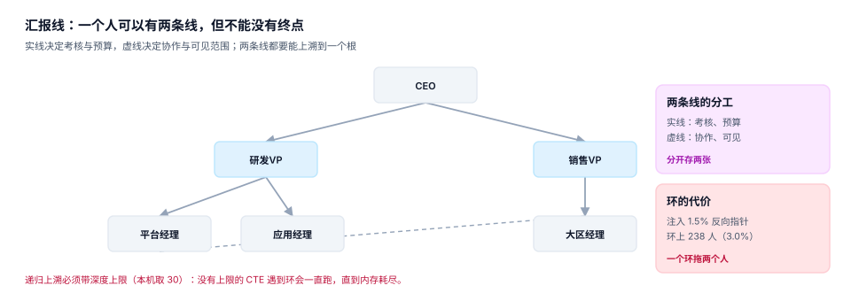

# 汇报线：实线、虚线与环

组织树回答「谁在哪个部门」，汇报线回答「谁听谁的」。这两件事在大多数公司**不重合**：一个技术专家可以挂在平台组，却虚线汇报给 CTO；一个项目经理的实线在交付部，虚线在三四个项目上。

把它们压成一列 `manager_id` 会带来两个后果：一是矩阵制的公司第一天就表达不了；二是任何一次「双向确认」（A 说 B 是我上级、B 说 A 是我上级）都会把递归查询变成死循环。

::: tip 一句话理解
实线决定**考核与预算**，虚线决定**协作与可见范围**。两条线分开存、都能上溯到根、都不能成环。
:::

## 一、两条线，两种用途



| 类型 | 语义 | 影响什么 | 一条还是多条 |
| --- | --- | --- | --- |
| `solid` | 行政上级 | 绩效、调薪、审批、编制归属 | 至多一条 |
| `dotted` | 业务/项目上级 | 协作、可见范围、项目工时 | 可以多条 |

两条线都要带时间，理由与任职完全一样：组织调整后，历史审批链必须还能还原「当时谁批的」。

```sql
CREATE TABLE report_line(
  emp_id     INTEGER NOT NULL REFERENCES employee(emp_id),
  mgr_id     INTEGER NOT NULL REFERENCES employee(emp_id),
  kind       TEXT NOT NULL CHECK (kind IN ('solid','dotted')),
  valid_from TEXT NOT NULL,
  valid_to   TEXT NOT NULL,
  PRIMARY KEY (emp_id, kind, valid_from),
  CHECK (emp_id <> mgr_id),
  CHECK (valid_from < valid_to)
);
```

主键 `(emp_id, kind, valid_from)` 表达了一件重要的事：**同一个人在同一种线上，同一时刻只能有一条**。想把「换上级」写成插入新行，就必须给不同的 `valid_from`；想表达「同一天两个上级」，在 `solid` 上就会被主键挡住。

::: warning 为什么不直接放 `employee.manager_id`
因为它只能表达「现在」，而且改一次就丢一次历史。审批流最常被审计追问的一句话是「这笔单子当时是谁批的」——答案依赖的是**当时的汇报线**，不是今天的。
:::

## 二、环：一个环至少拖两个人

汇报线在数据库里是一张有向图，正常情况是一棵（或多棵）树。出现环的原因通常有三类：

| 原因 | 场景 | 检测难度 |
| --- | --- | --- |
| 双向确认 | A 填 B 是上级，B 也填 A 是上级 | 容易，一眼看出 |
| 三角闭合 | A→B→C→A，三个人各自看都合理 | 难，要上溯才看得见 |
| 历史遗留 | 组织撤销后上级指针没清，指回了下级 | 难，跨了多次调整 |

本机在 6,785 条有效汇报关系里注入 120 个反向指针（占 1.8%），结果是 **238 人（3.0%）落在环上**——一个环至少套住两个人，所以环上人数几乎是注入数的两倍。

### 检测必须带深度上限

```sql
WITH RECURSIVE up(start, cur, d) AS (
  SELECT emp_id, mgr_id, 1 FROM report_line WHERE kind = 'solid'
  UNION ALL
  SELECT u.start, r.mgr_id, u.d + 1
    FROM up u JOIN report_line r ON r.emp_id = u.cur AND r.kind = 'solid'
   WHERE u.d < 30                       -- 没有这一行，遇到环会一直跑
)
SELECT DISTINCT start FROM up WHERE cur = start;
```

没有 `u.d < 30` 时，遇到环的查询不会返回错误，它会**一直算下去**，直到内存或超时。这类故障在监控上表现为「查询变慢」，而不是「报错」，所以经常被当成容量问题排查很久。

上限取多少？本机组织最大 7 层，汇报链通常比组织层级再深 1~2 层，取 **30** 有足够余量。上限太小会误判（合法的长链被截断后 `cur` 不为空，但也不会等于 `start`，所以不会误报环，只会漏检更深的环）。

### 写入时拦，而不是查询时查

```sql
CREATE TRIGGER trg_report_cycle BEFORE INSERT ON report_line
WHEN NEW.mgr_id = NEW.emp_id OR EXISTS (
  WITH RECURSIVE up(id, d) AS (
    SELECT NEW.mgr_id, 1
    UNION ALL
    SELECT r.mgr_id, up.d + 1 FROM report_line r JOIN up ON r.emp_id = up.id WHERE up.d < 30)
  SELECT 1 FROM up WHERE id = NEW.emp_id)
BEGIN SELECT RAISE(ABORT, 'E_CYCLE'); END;
```

写入时拦的好处是：环永远进不了库，报表不必每次带递归检测。代价是插入变慢（本机在 6,785 条规模下可忽略），以及**批量导入要做拓扑排序**——一次性导入上千条汇报关系时，顺序不对会被自己的触发器挡住。

## 三、管理幅度与层级深度

汇报线除了「谁听谁的」，还产出一个指标：**管理幅度**（直接下属数）。

| 指标 | 本机读数 | 说明 |
| --- | --- | --- |
| 平均管理幅度 | 3.07 | 600 个组织、405 个叶子 |
| 最大管理幅度 | 4 | 造数上限；真实公司常见 8~15 |
| 有明确上级的人 | 6,785 / 8,000 | 其余是虚拟根或数据缺失 |
| 环上人数 | 238（3.0%） | 注入 120 个反向指针造成 |

管理幅度不是越大越好也不是越小越好，它有一个可算的边界：一个主管的有效管理幅度约 5~8 人（取决于工作标准化程度）。超过之后，一对一沟通时间会挤占业务时间；低于 3 则说明层级过多。

::: danger 三个汇报线坑
1. **用组织树推汇报线**。组织树的父节点是部门，不是人。「研发中心负责人」这个人在组织树里没有位置，只有汇报线才有。
2. **虚线也当实线算审批**。虚线通常不承担审批权；把它当实线会让一个项目上的虚线上级拥有调薪审批权，这是权限事故。
3. **离职后不清指针**。某人离职后，他的下属仍在指向他，于是递归上溯会走到一个「已离职的人」，再往上断掉。离职时必须把 `valid_to` 关掉，并给下属重挂上级。
:::

## 四、判据

本页判据族 `OGR-A` ~ `OGR-H`，共 8 条：

| 编号 | 判据 | 怎么判 |
| --- | --- | --- |
| `OGR-A` | 实线与虚线分开存（`kind`），不共用一个字段 | 存在 `kind IN ('solid','dotted')` |
| `OGR-B` | 汇报线带生效区间，不只存当前上级 | 有 `valid_from/valid_to` |
| `OGR-C` | 同一人同一线同一时刻至多一条 | 主键或唯一约束覆盖 |
| `OGR-D` | 不许自指（`emp_id <> mgr_id`） | CHECK 约束存在 |
| `OGR-E` | 递归上溯带深度上限 | CTE 里有 `d < N` |
| `OGR-F` | 环在写入时被拒，不只靠事后检测 | 触发器 `T2` 生效 |
| `OGR-G` | 离职时关闭汇报线并给下属重挂上级 | 有离职流程步骤 |
| `OGR-H` | 管理幅度与层级深度可按组织统计 | 存在对应视图或查询 |

## 五、验证方式

```shell
python3 - <<'PY'
import sqlite3
con = sqlite3.connect(":memory:")
con.executescript("""
CREATE TABLE r(emp INT, mgr INT, kind TEXT);
INSERT INTO r VALUES (2,1,'solid'),(3,2,'solid'),(4,3,'solid'),(1,4,'solid');
""")
cyc = con.execute("""WITH RECURSIVE up(start,cur,d) AS (
  SELECT emp,mgr,1 FROM r
  UNION ALL SELECT u.start,x.mgr,u.d+1 FROM up u JOIN r x ON x.emp=u.cur WHERE u.d<30)
  SELECT count(DISTINCT start) FROM up WHERE cur=start""").fetchone()[0]
print("环上人数 =", cyc)

deep = con.execute("""WITH RECURSIVE up(e,d) AS (
  SELECT emp,1 FROM r
  UNION ALL SELECT u.e,x.mgr,u.d+1 FROM up u JOIN r x ON x.emp=u.e WHERE u.d<30)
  SELECT max(d) FROM up""").fetchone()[0]
print("递归触顶 =", deep, "（等于 30 说明有环把路径拖满了）")
PY
```

预期输出：`环上人数 = 4`、`递归触顶 = 31 （等于 30 说明有环把路径拖满了）`。

第二行是「怎么发现环」的另一种判据：正常树的递归深度不会接近上限，**一旦 max(d) 顶到上限+1，就说明有环**。这个判据比逐点检测便宜得多，适合放进日常巡检。

```shell
grep -o 'OGR-[A-H]' docs/Backend/OrgPeople/ReportingLine/index.md | sort -u | wc -l
```

预期输出：`8`。

## 参考资料

- [异动：一次原子替换，不是两次更新](../Transfer/index.md)
- [组织单元：三种存法与搬迁代价](../OrgModel/index.md)
- SQLite 递归 CTE 与终止条件：<https://www.sqlite.org/lang_with.html>
- PostgreSQL 环检测（`CYCLE` 子句）：<https://www.postgresql.org/docs/current/queries-with.html#QUERIES-WITH-CYCLE>
