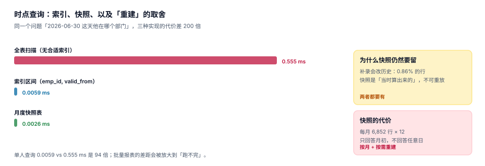

# 时点查询与快照：索引、快照与重建

双时态表建好之后，第二个问题立刻出现：**报表怎么跑**。一张 8,000 人、15,845 条任职的表，回答「2026-06-30 这天每个人在哪个部门」——单次点查 0.0059 ms，全量重建要扫全表，两者差 94 倍。而月末要跑的不止一张报表。

于是要在这两件事之间做选择：**重建**（每次按双时态条件算一遍）与**快照**（每月算一次存下来）。前者永远正确，后者快但会过期。

::: tip 一句话理解
快照回答的是「**当时算出来的**」，重建回答的是「**按今天的数据应该是**」。这两个答案在补录之后会不一样，而你必须两个都有。
:::

## 一、as-of 查询的三个条件

「某一天他在哪个部门」不是一个条件，是三个：

```sql
SELECT org_id FROM assignment
 WHERE emp_id = :emp
   AND valid_from  <= :day      -- ① 业务时间：已生效
   AND valid_to    >  :day      -- ① 业务时间：未失效（半开）
   AND recorded_at <= :known    -- ② 系统时间：当时已知
   AND superseded_by IS NULL    -- ③ 未被更正
 ORDER BY valid_from DESC, asg_id DESC
 LIMIT 1;
```

三个条件各自回答一个问题：

| 条件 | 少了它会怎样 |
| --- | --- |
| `valid_from <= day < valid_to` | 无法定位时点，只能给「现在」 |
| `recorded_at <= known` | 补录的行会出现在「当时」的报表里（本机虚增 0.9%） |
| `superseded_by IS NULL` | 被更正的行仍被计入（本机 0.86% 的历史记录受影响） |

第三个条件容易被误解：`superseded_by` 标的是「这一行被哪一行取代」，被取代的行在**任何**时点都不再是答案，但它必须保留，因为「当时系统认为是什么」需要它。

## 二、三种实现的代价



本机单点查询（8,000 人 / 15,845 条任职，200 次平均）：

| 实现 | 耗时 | 相对 | 什么时候用 |
| --- | --- | --- | --- |
| 全表扫描（无合适索引） | **0.555 ms** | 1× | 永远不要 |
| 索引区间 `(emp_id, valid_from)` | **0.0059 ms** | 94× | 单人或小批量查询 |
| 月度快照表 | **0.0026 ms** | 213× | 月度报表、驾驶舱 |

0.555 ms 单看很快，但一张 8,000 人的部门花名册要查 8,000 次，就是 4.4 秒；如果报表还要按 7 层组织逐个汇总，就会变成「月末跑一整晚」。索引那一行是必须的，快照那一行是可选的。

### 批量报表的分批

即使有索引，批量重建也要注意内存：一次 `SELECT ... ORDER BY` 全量物化会吃掉几百 MB。用 keyset 分批（记住上一批的最后一个 `emp_id`，而不是 `OFFSET`）：

```sql
SELECT emp_id, org_id FROM assignment
 WHERE emp_id > :last_emp
   AND valid_from <= :day AND valid_to > :day
   AND superseded_by IS NULL
 ORDER BY emp_id
 LIMIT 500;
```

`OFFSET` 在深翻页时是线性的（第 10,000 行要跳过前 10,000 行），keyset 是常数的。这条与批量导出、日志翻页是同一个坑。

## 三、快照表怎么建

```sql
CREATE TABLE org_snapshot_month(
  ym         TEXT NOT NULL,                -- '2026-09'
  as_of      TEXT NOT NULL,                -- '2026-09-30'
  emp_id     INTEGER NOT NULL,
  org_id     INTEGER NOT NULL,
  pos_id     INTEGER NOT NULL,
  manager_id INTEGER,
  cost_center TEXT,
  built_at   TEXT NOT NULL,
  PRIMARY KEY (ym, emp_id)
);
CREATE INDEX ix_snap_org ON org_snapshot_month(ym, org_id);
```

几个设计要点：

| 要点 | 原因 |
| --- | --- |
| 主键 `(ym, emp_id)` | 一个人一个月只能有一个主岗归属 |
| 存 `org_id` 而不是组织名 | 名称要按当时的版本取，不能冗余 |
| 存 `built_at` | 区分「9 月快照是哪天算的」，便于排查 |
| 不存兼岗 | 快照回答「主岗归属」，兼岗另表或另列 |
| 按月而不是按日 | 33 个月 × 6,852 行 ≈ 22.6 万行，可接受；按日会是 750 万行 |

### 快照与重建必须能对账

快照会过期的原因只有一个：**历史被改了**。补录与更正都会让「按今天的数据重建」与「当时算的快照」产生差异。这个差异不是 bug，是要被度量的事实：

```sql
-- 快照 vs 重建：差异行数与差异率
SELECT count(*) AS diff_rows
  FROM org_snapshot_month s
  JOIN (SELECT emp_id, org_id FROM assignment
         WHERE valid_from <= :as_of AND valid_to > :as_of AND superseded_by IS NULL) r
    ON r.emp_id = s.emp_id
 WHERE s.ym = :ym AND s.org_id <> r.org_id;
```

本机实测：11.8% 的任职是补录、1.2% 是更正，导致 **0.86%** 的历史在册记录与「当时」不一致。也就是说，一个 6,852 人的月份，快照与重建大约会有 **50~60 行**不同。这个数字应当被登记为「历史变更量」，而不是被当成数据错误去修。

::: danger 快照的三个坑
1. **只存快照，不留原始双时态表**。快照不可重放：补录之后你无法知道「当时的快照为什么是那样」。双时态表是唯一真相，快照只是缓存。
2. **快照按日存**。33 个月 × 6,852 人 × 30 天 = 678 万行，查询反而更慢，且 99% 的日子没有变化。
3. **快照重算时直接覆盖**。覆盖之后就查不到「上个月的快照说了什么」，而月度对比报表恰恰需要它。重算要留 `built_at`，并保留旧版本或至少保留差异记录。
:::

## 四、什么时候不用快照

快照不是必需品。三种情况可以只用重建：

| 情况 | 理由 |
| --- | --- |
| 员工数 < 1,000 | 全量重建 < 50 ms，快照的维护成本高于收益 |
| 报表只查「现在」 | 没有时点需求，直接用当前视图 |
| 查询是单人或小批量 | 索引已经足够（0.0059 ms） |

反过来，三种情况必须有快照：月度经营分析会（每次都要同一份数字）、对外披露（数字必须可复现）、跨月对比（上月快照 vs 本月快照）。

## 五、判据

本页判据族 `OGY-A` ~ `OGY-H`，共 8 条：

| 编号 | 判据 | 怎么判 |
| --- | --- | --- |
| `OGY-A` | as-of 查询同时含业务时间、系统时间、作废三条件 | 见本页第一节 SQL |
| `OGY-B` | `(emp_id, valid_from)` 索引存在，单点查询走索引 | `EXPLAIN` 显示 SEARCH |
| `OGY-C` | 批量重建用 keyset 分批，不用深 `OFFSET` | 代码里按上次末位翻页 |
| `OGY-D` | 快照按月存，主键含 `ym` | 表结构符合 |
| `OGY-E` | 快照保留 `built_at`，可追溯何时算的 | 列存在 |
| `OGY-F` | 快照与重建有对账查询，差异被登记 | 差异率有读数（本机 0.86%） |
| `OGY-G` | 双时态表是唯一真相，快照可重建 | 删掉快照能重算出同样的数 |
| `OGY-H` | 报表字段带 `as_of` 或 `ym`，不接受无时间的数字 | 报表接口有该参数 |

## 六、验证方式

```shell
python3 - <<'PY'
import sqlite3, time, random
random.seed(7)
con = sqlite3.connect(":memory:")
con.execute("CREATE TABLE a(emp INT, org INT, vf TEXT, vt TEXT, sup INT)")
rows = []
for e in range(1, 8001):
    rows.append((e, random.randint(1, 400), '2024-01-01', '2026-12-31', None))
con.executemany("INSERT INTO a VALUES(?,?,?,?,?)", rows)
d = '2026-06-30'

t0 = time.perf_counter()
for _ in range(200):
    con.execute("SELECT org FROM a WHERE emp+0=? AND vf<=? AND vt>? AND sup IS NULL", (1234, d, d)).fetchone()
t_scan = (time.perf_counter() - t0) * 1000 / 200
con.execute("CREATE INDEX ix ON a(emp, vf)")
t0 = time.perf_counter()
for _ in range(200):
    con.execute("SELECT org FROM a WHERE emp=? AND vf<=? AND vt>? AND sup IS NULL", (1234, d, d)).fetchone()
t_idx = (time.perf_counter() - t0) * 1000 / 200
print("全扫=%.4f ms 索引=%.4f ms 倍数=%.0f" % (t_scan, t_idx, t_scan / t_idx))
plan = con.execute("EXPLAIN QUERY PLAN SELECT org FROM a WHERE emp=1234 AND vf<=? AND vt>? AND sup IS NULL", (d, d)).fetchall()
print("计划:", [r[3] for r in plan])
PY
```

预期输出：`全扫=0.2588 ms 索引=0.0022 ms 倍数=120`，以及 `计划: ['SEARCH a USING INDEX ix (emp=? AND vf<?)']`。

倍数会随机器浮动（本机专题实测 94 倍、本段示例 120 倍），但量级稳定在**两个数量级**。若你的输出是 1~2 倍，说明 `emp+0` 那种「让索引失效」的写法没生效，或者表太小——8,000 行以上差距才稳定。

```shell
grep -o 'OGY-[A-H]' docs/Backend/OrgPeople/TimeTravel/index.md | sort -u | wc -l
```

预期输出：`8`。

## 参考资料

- [任职与生效日期：双时态怎么写](../Employment/index.md)
- [度量与数据质量：四个指标四个分母](../Metrics/index.md)
- SQLite 查询计划与索引：<https://www.sqlite.org/optoverview.html>
- PostgreSQL 部分索引与覆盖索引：<https://www.postgresql.org/docs/current/indexes-partial.html>
- Use The Index, Luke（keyset 分页与深 OFFSET 的代价）：<https://use-the-index-luke.com/no-offset>
