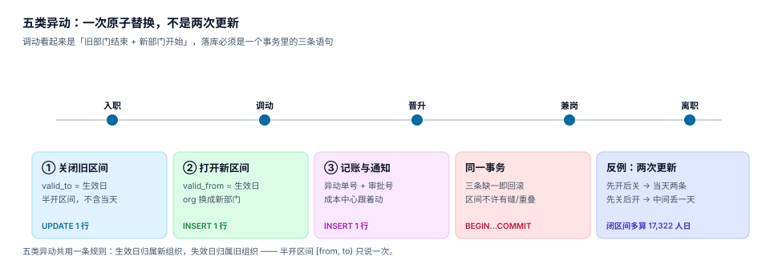

# 异动：一次原子替换，不是两次更新

组织数据里最容易写错的一段，是「调动」。它看起来是两件事——老部门结束、新部门开始——于是很多人写成两条 `UPDATE`，然后在半年后的对账里发现：有的人在某一天同时属于两个部门，有的人在某一天谁都不属于，有的人干脆消失了一天。

一次调动在数据库里应该是**一个事务里的三条语句**：关闭旧区间、打开新区间、写异动单。三条缺一，历史就会漏一格。

::: tip 一句话理解
调动不是「把 `dept_id` 改一下」，而是**在时间轴上做一次无缝的区间拼接**：旧段在生效日之前结束，新段从生效日开始，中间不许有缝、不许重叠。
:::

## 一、五类异动，一条规则



| 类型 | 语义 | 旧任职 | 新任职 | 是否占编 |
| --- | --- | --- | --- | --- |
| 入职 | 第一次建立任职 | 无 | 新增 `primary` | 占 |
| 调动 | 换组织（或换岗位） | `valid_to = 生效日` | 新增 `primary` | 占 |
| 晋升 | 换岗位，组织可能不变 | `valid_to = 生效日` | 新增 `primary` | 占 |
| 兼岗 | 在原任职之外增加一条 | **不动** | 新增 `concurrent` | 不占 |
| 离职 | 结束全部任职 | `valid_to = 最后工作日` | 无 | 释放 |
| 借调 | 临时去别的组织 | 原任职 `valid_to` 不动 | 新增 `concurrent` + 结束日 | 不占 |

五类共用一条规则：**生效日归新，失效日归旧**。用半开区间表达就是一次拼接：

```text
旧: [2022-01-10, 2026-03-01)
新: [2026-03-01, 2027-01-01)
```

`2026-03-01` 这一天只属于新组织。换成闭区间 `[from, to]`，这一天会同时属于两边——本机 340 个采样日累计多算 **17,322 人日**，平均每天 50.95 人同时在两个部门。

## 二、三条语句，一个事务

```sql
BEGIN;

-- 1) 关闭旧区间：生效日当天已经不属于旧部门
UPDATE assignment
   SET valid_to = :effective_date
 WHERE emp_id = :emp_id AND kind = 'primary'
   AND superseded_by IS NULL
   AND valid_from <= :effective_date AND valid_to > :effective_date;

-- 2) 打开新区间
INSERT INTO assignment(emp_id, pos_id, org_id, kind, valid_from, valid_to, recorded_at)
VALUES (:emp_id, :pos_id, :org_id, 'primary', :effective_date, :end_date, :now);

-- 3) 写异动单（审批号、原因、经办人）
INSERT INTO transfer_order(order_no, emp_id, from_org, to_org, effective_date, approval_no, operator)
VALUES (:order_no, :emp_id, :from_org, :to_org, :effective_date, :approval_no, :operator);

COMMIT;
```

三件事必须同生共死：

| 少做哪一步 | 后果 | 什么时候发现 |
| --- | --- | --- |
| 不关旧区间 | 当天两条 primary，人数多算 | 月报人数对不上 |
| 不开新区间 | 生效日之后查不到人 | 员工查不到自己的部门 |
| 不写异动单 | 数据对了，但没有依据 | 审计问「凭什么调的」 |

::: danger 三次「两次更新」的典型事故
1. **先开后关**：先插新行再改旧行，中间如果失败，就留下两条并存的 primary。本机实测这种写法在交接日产生 **50.95 人/日** 的双命中。
2. **先关后开**：先改旧行再插新行，中间失败就出现「空档」，这个人从部门报表里消失，直到下一次有人发现。
3. **两条 UPDATE 不加事务**：两句都成功也可能被别的读事务看见「中间态」，报表恰好在这个瞬间跑，就会拿到一个不存在的组织分布。
:::

## 三、返聘：`UNIQUE(emp_no)` 会挡住 5% 的人

员工离职后再入职（返聘）是常见事件。如果员工表只有 `UNIQUE(emp_no)`，返聘就会插入失败——本机按 5% 返聘率模拟，**381 人全部被唯一约束挡住**。

两种可行写法：

| 写法 | 结构 | 优点 | 缺点 |
| --- | --- | --- | --- |
| 新工号 | 返聘给新 `emp_no`，用 `person_id` 关联同一个人 | 员工表不用改 | 工号体系要能容纳「同人两号」 |
| 序号 | `UNIQUE(emp_no, seq)`，`seq` 从 1 开始 | 工号稳定，历史连续 | 所有按 `emp_no` 的查询要带 `seq` |

推荐第二种，并把「同一个人」的判定放在 `person_id` 上：

```sql
CREATE TABLE employee(
  emp_id     INTEGER PRIMARY KEY,
  emp_no     TEXT NOT NULL,
  seq        INTEGER NOT NULL DEFAULT 1,   -- 第几次入职
  hire_date  TEXT NOT NULL,
  leave_date TEXT,
  UNIQUE (emp_no, seq),
  CHECK (leave_date IS NULL OR hire_date < leave_date)
);
```

返聘的任职记录不能和上一段的区间重叠——两段之间必须有一段时间没有任职。这条不靠约束，靠**异动流程**保证：离职时关闭全部区间，返聘时从新日期开始。

## 四、借调、兼岗、调动的区别

三者经常被混着叫「调动」，但它们对编制、成本、汇报线的影响完全不同：

| 维度 | 调动 | 兼岗 | 借调 |
| --- | --- | --- | --- |
| 原任职 | 结束 | 保留 | 保留 |
| 新任职 | 新增 `primary` | 新增 `concurrent` | 新增 `concurrent` + 结束日 |
| 占编 | 占新组织编制 | 不占 | 不占（或占借入方虚拟编） |
| 成本归属 | 新组织 | 按约定分摊 | 通常仍记原组织 |
| 汇报线 | 实线改到新上级 | 实线不变，加虚线 | 实线不变，加虚线 |
| 结束方式 | 不需要（已是唯一任职） | 到期自动失效 | 到期自动失效 |

本机数据里兼岗占 190 人（在册 6,852 人的 2.7%），如果按任职条数求和会得到 7,042 条，多出 2.7% 的重复计数——这就是「兼岗没和调动分开」的直接后果。

## 五、倒签与补录

异动单的生效日经常早于录入日（倒签）。这是正常业务，但必须区分两种情况：

| 情况 | `valid_from` | `recorded_at` | 处理 |
| --- | --- | --- | --- |
| 补录（当时就该生效，录晚了） | 实际生效日 | 录入日 | 允许，历史报表需按 `recorded_at` 回放 |
| 更正（当时录错了，事后改） | 实际生效日 | 更正日 | 旧行写 `superseded_by`，新行插入 |

本机 11.8% 的任职是补录、1.2% 是更正。这两个比例看起来不高，但它们让 **0.86% 的历史记录被改写**——也就是每 116 条历史数据里就有 1 条，你今天看到的样子和当时看到的不一样。

::: warning 倒签要设上限
大多数公司允许回溯 1~3 个月，超过就要走特批。没有上限时，一次年终盘点可以把三年前的归属全改一遍，而所有月报都会「自动变成对的」——这恰恰是最危险的：**历史变得比当时更正确，说明它已经不可信了**。
:::

## 六、判据

本页判据族 `OGT-A` ~ `OGT-H`，共 8 条：

| 编号 | 判据 | 怎么判 |
| --- | --- | --- |
| `OGT-A` | 调动是「关旧 + 开新 + 写单」三语句同事务 | 代码里三句在一个事务内 |
| `OGT-B` | 五类异动对原任职的处理有明文对照 | 见本页第一节表 |
| `OGT-C` | 生效日归新、失效日归旧（半开区间） | 交接日只命中一条 |
| `OGT-D` | 兼岗用 `kind='concurrent'`，不占编 | 编制触发器只看 `primary` |
| `OGT-E` | 返聘有 `seq` 或新工号，`UNIQUE(emp_no)` 不单独存在 | 返聘可插入 |
| `OGT-F` | 补录与更正分开处理，更正保留原行 | 存在 `superseded_by` |
| `OGT-G` | 倒签有上限，超限需特批 | 流程里有天数阈值 |
| `OGT-H` | 异动单可反查审批号与经办人 | `transfer_order` 有 `approval_no` |

## 七、验证方式

```shell
python3 - <<'PY'
import sqlite3
con = sqlite3.connect(":memory:")
con.executescript("""
CREATE TABLE a(id INT PRIMARY KEY, emp INT, org TEXT, vf TEXT, vt TEXT);
INSERT INTO a VALUES (1,1,'研发','2022-01-10','2026-03-01');
""")
eff = '2026-03-01'
con.execute("UPDATE a SET vt=? WHERE id=1", (eff,))
con.execute("INSERT INTO a VALUES (2,1,'产品',?,'2027-01-01')", (eff,))
for d in ('2026-02-28', '2026-03-01', '2026-03-02'):
    hit = con.execute("SELECT org FROM a WHERE emp=1 AND vf<=? AND vt>?", (d,d)).fetchall()
    print(d, [h[0] for h in hit])
PY
```

预期输出：

```text
2026-02-28 ['研发']
2026-03-01 ['产品']
2026-03-02 ['产品']
```

三天里每天恰好一条。如果 `2026-03-01` 打印出 `['研发', '产品']`，说明你把旧行的 `valid_to` 写成了 `2026-03-02`（闭区间思维）；如果打印 `[]`，说明旧行关得太早。

```shell
python3 - <<'PY'
import sqlite3
con = sqlite3.connect(":memory:")
con.execute("CREATE TABLE e(emp_no TEXT PRIMARY KEY, seq INT)")
con.execute("INSERT INTO e VALUES ('E001',1)")
try:
    con.execute("INSERT INTO e VALUES ('E001',1)")
except sqlite3.IntegrityError:
    print("返聘被挡：需要 (emp_no, seq)")
PY
```

预期输出：`返聘被挡：需要 (emp_no, seq)`。

```shell
grep -o 'OGT-[A-H]' docs/Backend/OrgPeople/Transfer/index.md | sort -u | wc -l
```

预期输出：`8`。

## 参考资料

- [任职与生效日期：双时态怎么写](../Employment/index.md)
- [汇报线：实线、虚线与环](../ReportingLine/index.md)
- [审批流：状态机与或签会签](../../WorkflowEngine/ApprovalFlow/index.md)
- SAP HCM 人事异动（Personnel Action 的公开概念说明）：<https://help.sap.com/docs/sap-erp-hcm>
- SQLite 事务与隔离级别：<https://www.sqlite.org/lang_transaction.html>
