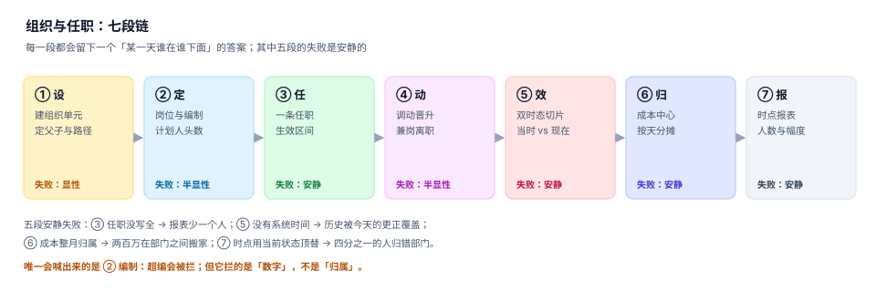

# 组织与任职异动工程

任何一家超过 200 人的公司，都会在某一天遇到同一个问题：财务要「去年 6 月的部门人力成本」，HR 要「当时那个部门的负责人是谁」，法务要「这个员工 2024 年挂在哪个主体下」。三个部门问的是同一件事——**某一天，谁在哪个组织、向谁汇报、算谁的成本**——却往往得到三个不同的答案。

原因不是数据错了，而是数据只记了「现在」。一个人去年在 A 部门、今年在 B 部门，库里只剩一行 `dept = B`；一次填错的调动在两周后被更正，更正直接覆盖了原值；一个部门改了名字，历史报表里的旧名字跟着一起消失了。

::: tip 一句话理解
组织不是一个名字，是**同一批人在不同日期上的不同归属**。每一次归属变化都要能在某一天被原样回答，而答案必须区分「当时生效的」与「后来才改的」。
:::

## 一、这个专题讲什么

从「新员工入职填一张表」到「董事会看到某个时点的人数与人工成本」，要走七段。每一段都有自己的产物，也都有自己的失败方式：

| 段 | 这一段在做什么 | 产物 | 失败是否安静 |
| --- | --- | --- | --- |
| ① 设 | 建组织单元，定父子关系与路径 | `org` | 显性（父子写错会立刻查不到） |
| ② 定 | 定岗位与编制（计划人头数） | `position.plan` | 半显性（超编会被拦） |
| ③ 任 | 一条任职记录，带生效区间 | `assignment` | **安静**（漏一条只是「少一个人」） |
| ④ 动 | 调动、晋升、兼岗、借调、离职 | 异动单 + 区间替换 | 半显性（唯一键拦得住重复） |
| ⑤ 效 | 双时态切片：当时生效 vs 当时知道 | `valid_*` + `recorded_at` | **安静**（回放错只是「数字对不上」） |
| ⑥ 归 | 成本中心挂载与按天分摊 | `cost_center` | **安静**（整月归属把钱搬走） |
| ⑦ 报 | 时点报表、人数、幅度、离职率 | 快照 / 视图 | **安静**（口径一换就变脸） |

七段里**四段的失败是安静的**。它们的共同形态是：系统一切正常，报表按时出炉，只有「某一天某人在哪个部门」这个答案悄悄错了一格。本机实测最能说明问题的一组读数——18 个月里 **23.9%** 的人归属变过，而只留当前状态的系统，被问到「去年这一天他在哪」时只能拿今天顶上，于是**每四个人里就有一个归错部门**。

## 二、三个「在哪个部门」，只有一个能当主键

| 说法 | 判据 | 典型错法 | 后果 |
| --- | --- | --- | --- |
| 人挂在哪个组织 | 有一条覆盖该日期的任职 | 用「当前部门」字段 | 历史报表全错，且不可回溯 |
| 人算谁的成本 | 成本中心映射在**该日期**有效 | 用组织当前挂的成本中心 | 部门盈亏被改写，总账却是平的 |
| 人向谁汇报 | 汇报线在该日期有效 | 用 `employee.manager_id` | 组织调整后历史审批链断裂 |

三者的共同前提是同一个：**任何一条归属都必须带时间**。本专题判的就是这件事——让「某一天、某个人、某个组织」这个三元组在任何时刻都能被重新算出来，且算出来的和当初看到的一致。

## 三、与其它专题的分工

库里写「人」和「组织」的册子不少，问的问题完全不同。先看这张表再决定读哪一册：

| 你关心的问题 | 该读哪一册 | 为什么不是本册 |
| --- | --- | --- |
| 「这个请求是谁发的、能不能做」 | [认证与授权](../Auth/Authorization/index.md) | 那册判**令牌与权限**，本册判**这个人在哪个组织** |
| 「这个月发多少钱、个税怎么扣」 | [薪酬核算](../Payroll/Overview/index.md) | 那册判**金额计算**，本册判**这笔钱算哪个部门** |
| 「部门预算批多少、超没超」 | [全面预算](../Budgeting/Overview/index.md) | 那册判**授权与占用**，本册判**归属到哪个责任中心** |
| 「产品成本怎么归集、差异怎么分」 | [成本核算](../CostAccounting/Overview/index.md) | 那册判**成本对象与分摊**，本册只提供**人工成本与人头** |
| 「合并报表里内部交易怎么抵」 | [合并报表](../Consolidation/Overview/index.md) | 那册判**主体间抵销**，本册判**人在哪个主体下** |
| 「资产在谁名下、折旧怎么算」 | [资产台账](../FixedAsset/Overview/index.md) | 那册判**账与实**，本册判**使用人归属** |
| 「组织编码、名称、层级怎么定标准」 | [主数据与标准](../../DB/DataGovernance/StandardsMasterData/index.md) | 那册判**标准怎么定**，本册判**实例怎么随日期变** |
| 「调动要不要审批、审批流怎么走」 | [审批流](../WorkflowEngine/ApprovalFlow/index.md) | 那册判**流程引擎**，本册判**审批通过后怎么落库** |
| 「多租户下组织树怎么隔离」 | [多租户上下文](../MultiTenantSaaS/TenantContext/index.md) | 那册判**租户边界**，本册判**租户内的组织与任职** |
| 「工单/工单里的人是谁」 | [生产执行](../Manufacturing/Overview/index.md) | 那册判**工单与报工**，本册判**报工的人属于哪个班组** |
| 「资金头寸、现金流预测」 | [资金管理](../Treasury/Overview/index.md) | 那册判**钱的时间**，本册判**人的归属** |
| 「离职后个人数据怎么删」 | [隐私工程](../../Others/PrivacyEngineering/index.md) | 那册判**留存与删除义务**，本册判**离职这一事件怎么落库** |

::: info 为什么不并入「薪酬核算」
两册都会出现「部门」和「人」，但判据一条不重合：薪酬判「**该发多少、扣多少、什么时候发**」，本册判「**这笔钱算哪个部门、那一天的部门长是谁**」。

一组最直观的反例：工资一分不差地发到了每个人卡上（薪酬全绿），同时部门人力成本报表把 215.7 万元记到了错误的部门（归属全错）。前者是金额问题，后者是时间与归属问题。
:::

## 四、为什么不建版本目录

本专题**不设 `V1/V2` 之类的版本目录**，理由有三条：

1. **换代的是载体，不是判据**。从纸质花名册到 Excel 到 HR SaaS，判据一直是「某一天谁在哪个组织」；载体换了，`valid_from < day <= valid_to` 的判断一字未改。
2. **并存的差异是「组织形态」，不是代际**。事业部制、矩阵制、项目制会同时存在于一家公司，它们不是新旧关系，而是同一张表上的不同 `kind`。
3. **真正需要版本目录的是「同一份代码两套写法」**。本专题的写法只有一套：双时态 + 半开区间。若未来出现「按周生效」这类根本不同的时间粒度，再建 `Weekly/` 目录，旧内容保留并标注状态。

作为对照，库内已有的版本化先例见 [Spring 5](../Java/Frame/Spring/Spring5/index.md) 与 [Vue 2](../../Frontend/Frame/Vue/Vue2/index.md)——那里换的是框架大版本，两套写法必须并存。

## 五、专题目录

- [总览：七段链与三个「在哪个部门」](./Overview/index.md)
- [组织单元：三种存法与搬迁代价](./OrgModel/index.md)
- [岗位与编制：占编的四种口径](./Position/index.md)
- [任职与生效日期：双时态怎么写](./Employment/index.md)
- [异动：一次原子替换，不是两次更新](./Transfer/index.md)
- [汇报线：实线、虚线与环](./ReportingLine/index.md)
- [成本归属：按天分摊与整月归属](./CostAllocation/index.md)
- [时点查询与快照：索引、快照与重建](./TimeTravel/index.md)
- [度量与数据质量：四个指标四个分母](./Metrics/index.md)
- [实战：七张表、三个触发器、九条断言](./Practice/index.md)

## 六、本专题的十章与十个判据族

| 章 | 章节 | 判据族 | 条数 |
| --- | --- | --- | --- |
| 1 | [总览：七段链与三个「在哪个部门」](Overview/index.md) | `OGO-A` ~ `OGO-H` | 8 |
| 2 | [组织单元：三种存法与搬迁代价](OrgModel/index.md) | `OGM-A` ~ `OGM-H` | 8 |
| 3 | [岗位与编制：占编的四种口径](Position/index.md) | `OGP-A` ~ `OGP-H` | 8 |
| 4 | [任职与生效日期：双时态怎么写](Employment/index.md) | `OGE-A` ~ `OGE-H` | 8 |
| 5 | [异动：一次原子替换，不是两次更新](Transfer/index.md) | `OGT-A` ~ `OGT-H` | 8 |
| 6 | [汇报线：实线、虚线与环](ReportingLine/index.md) | `OGR-A` ~ `OGR-H` | 8 |
| 7 | [成本归属：按天分摊与整月归属](CostAllocation/index.md) | `OGC-A` ~ `OGC-H` | 8 |
| 8 | [时点查询与快照：索引、快照与重建](TimeTravel/index.md) | `OGY-A` ~ `OGY-H` | 8 |
| 9 | [度量与数据质量：四个指标四个分母](Metrics/index.md) | `OGS-A` ~ `OGS-H` | 8 |
| 10 | [实战：七张表、三个触发器、九条断言](Practice/index.md) | `OGQ-A` ~ `OGQ-H` | 8 |

十章共 80 条判据，每章 8 条，均可逐条判定。

## 七、读这一册之前

::: warning 先确认你的问题属于哪一类
如果你的问题是「这个人现在在哪个部门」，任何一张带 `dept_id` 的员工表都能回答，不需要本册。

只有当问题里出现**时间**——「去年 6 月」「调整前」「他离职那天」——本册才开始有用。而一旦问题带时间，`UPDATE employee SET dept_id = ?` 这种写法就永久性地毁掉了答案。

本册所有页面的示例都可以在本机用 SQLite 跑通，数据规模与读数见各页「验证方式」。实测环境：Python 3.13.12 + SQLite 3.50.4，种子 `20261102`，8,000 名员工 / 600 个组织单元 / 15,845 条任职（2022-01-01 至 2026-10-31）。
:::

## 参考资料

- [总览：七段链与三个「在哪个部门」](./Overview/index.md)
- [实战：七张表、三个触发器、九条断言](./Practice/index.md)
- SQL:2011 标准中的时态表（`PERIOD FOR SYSTEM_TIME`、`application_time_period`）：<https://www.iso.org/standard/53681.html>
- PostgreSQL 范围类型与时态约束（`daterange`、`EXCLUDE USING gist`）：<https://www.postgresql.org/docs/current/rangetypes.html>
- Martin Fowler《Temporal Patterns》（双时态与生效 dating 的经典表述）：<https://martinfowler.com/eaaDev/timeNarrative.html>
