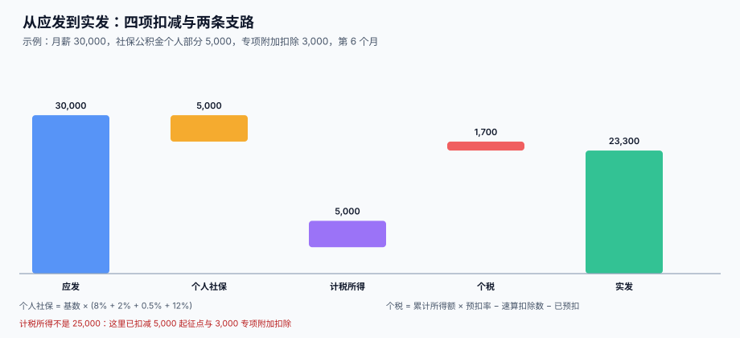

# 应发、扣款与计薪天数

<p style="text-align:center;"></p>

一个员工这个月「应该拿多少」，取决于三个数：**他的工资标准**、**他这个月实际提供了多少劳动**、**折算规则**。前两个数是事实，第三个是规则——而规则里最容易被随手改掉的一个数字，是 21.75。

::: tip 一句话理解
**21.75 是「折算日工资」的分母，不是「每月应出勤天数」。** 把它当成应出勤天数去乘，全勤的人反而会被少发 689.66 元。
:::

本页判据族 `PYG-A` ~ `PYG-H`，共 8 条，定义在最后一节。

## 一、应发的六个组成部分

| 组成 | 英文 / 常用名 | 计入应发 | 计入社保基数 | 计入个税 | 说明 |
| --- | --- | --- | --- | --- | --- |
| 基本工资 | Base | 是 | 是 | 是 | 合同约定，按月固定 |
| 岗位 / 绩效工资 | Allowance / Bonus | 是 | 是 | 是 | 多数地区计入基数 |
| 津贴补贴 | Allowance | 是 | 视项目 | 是 | 交通、通讯、餐补；差旅费实报实销的不算 |
| 加班费 | Overtime | 是 | 是 | 是 | 按 150% / 200% / 300% 分档 |
| 缺勤扣款 | Absence deduction | **负项** | 减少基数 | 减少 | 与加班费不能相互抵冲后再算 |
| 补发 / 追溯 | Retro pay | 是 | 是 | 是 | 归属期见 [补发与追溯](../RetroPay/index.md) |

::: danger 三个常见写法错误
1. **把「实报实销」的差旅费计入应发**：它既不该进社保基数，也不该进个税，进一次就多缴两头。
2. **先算「应发 + 加班 − 缺勤」再分摊**：加班费与缺勤扣款必须分项落库，否则年度汇算时无法解释任何一行。
3. **用「应发合计」直接乘社保比例**：基数有上下限，且部分补贴不计入基数，见 [社保公积金](../SocialInsurance/index.md)。
:::

## 二、21.75 是怎么来的，以及它不干什么

```text
月计薪天数 = (365 − 104) ÷ 12 = 21.75
日工资     = 月工资收入 ÷ 21.75
小时工资   = 日工资 ÷ 8
```

这里的 104 是全年休息日（52 周 × 2 天）。**法定节假日是计薪的**，所以不扣除——这就是 21.75 与 20.83 的区别：

| 数字 | 算法 | 用途 | 不能用来做什么 |
| --- | --- | --- | --- |
| 21.75 | (365 − 104) ÷ 12 | 折算**日工资、小时工资** | 不能当「这个月应出勤几天」 |
| 20.83 | (365 − 104 − 11) ÷ 12 | 折算**制度工作时间**（考勤、工时统计） | 不能用来算钱 |
| 当月工作日 | 逐月不同（20~23 天） | 排班、考勤应出勤 | 不能当折算分母（每月变，无法跨月比较） |



## 三、本机读数：三种分母的日薪

月薪 20,000，同一个人的日薪在不同分母下是三个数：

| 月份 | 日历天数 | 当月工作日 | 日薪（当月工作日） | 日薪（21.75） |
| --- | --- | --- | --- | --- |
| 2026-10 | 31 | 22 | 909.09 | 919.54 |
| 2026-11 | 30 | 21 | 952.38 | 919.54 |
| 2026-12 | 31 | 23 | 869.57 | 919.54 |
| 2027-02 | 28 | 20 | **1,000.00** | 919.54 |

同一份工资，2 月的日薪比 12 月高 **15.0%**。这就是为什么折算必须固定分母：**日薪不该随月份波动**，否则 2 月请一天假比 12 月请一天假贵 130 元，而员工完全无法理解。

## 四、缺勤扣款：正算法与反算法差 689.66

两种写法在数学上「看起来」等价，实际不等价：

```text
正算法：应发 = 月薪 ÷ 21.75 × 实际计薪天数
反算法：应发 = 月薪 − 月薪 ÷ 21.75 × 缺勤天数
```

月薪 20,000、应出勤 21 天、缺勤 1 天：

| 写法 | 计算 | 结果 | 与应发 20,000 的差 |
| --- | --- | --- | --- |
| 正算法（出勤 20 天） | 919.54 × 20 | 18,390.80 | −1,609.20 |
| 反算法（缺勤 1 天） | 20,000 − 919.54 | 19,080.46 | −919.54 |
| 两者之差 | — | **689.66** | 就是「21.75 − 21」那 0.75 天 |

更要命的是**全勤**：如果不管有没有缺勤都跑正算法，21 天的月份会算出 19,310.34，比应发少 689.66；23 天的月份会算出 21,149.43，比应发多 1,149.43。

本站立场：

1. **全勤一律给全额**，折算只在「有缺勤或入离职当月」时启用。
2. **缺勤用反算法**（扣减法），因为它保证「不出勤 = 只扣该扣的那一份」，且全勤时自然退化为全额。
3. **加班费单独用 21.75 折算**，不与缺勤扣款相互抵冲，两项各落一行。

## 五、加班费与假期折算

小时工资 = 20,000 ÷ 21.75 ÷ 8 = **114.94**。

| 场景 | 倍数 | 每小时 | 8 小时 |
| --- | --- | --- | --- |
| 工作日延时 | 150% | 172.41 | 1,379.28 |
| 休息日（不能补休） | 200% | 229.88 | 1,839.04 |
| 法定节假日 | 300% | 344.82 | 2,758.56 |

::: warning 用「当月工作日」折算小时工资会怎样
按 21 天折算的小时工资是 119.05，比 114.94 高 4.11 元。一个工作日加班 8 小时，两种口径差 **49.32** 元；一个 50 人的团队全年 2,000 小时加班，差 **9,864** 元。金额不大，但它是**系统性偏高**，且每次审计都会被问「这个 119.05 是怎么来的」——而正确答案是「不该有它」。
:::

## 六、离职当月与未休年假

离职当月的两种折算（应出勤 21 天，月薪 20,000）：

| 实际出勤 | 21.75 口径 | 当月工作日口径 | 差 |
| --- | --- | --- | --- |
| 10 天 | 9,195.40 | 9,523.81 | 328.41 |
| 15 天 | 13,793.10 | 14,285.71 | 492.61 |
| 20 天 | 18,390.80 | 19,047.62 | 656.81 |

未休年假的 300% 补偿是另一个易错点：它**不是**「3 倍工资」，而是「正常工资 + 200% 补偿」。5 天未休、月薪 20,000：

```text
300% 合计     = 919.54 × 5 × 3 = 13,793.10
其中额外补偿 = 919.54 × 5 × 2 =  9,195.40
```

离职当月已经发过工资的部分，「正常工资」那一倍已经在应发里，**只补 200%**；如果整笔按 300% 另发一次，就多发了一倍工资。

## 七、四舍五入：见分进角的 276.69

应发算到分没有歧义，但社保的单位部分在部分城市按「见分进角」处理（两位小数向上取到 0.1 元）。1000 人、基数 6,000~40,000 的随机样本：

| 口径 | 单位部分合计 | 与四舍五入到分的差 |
| --- | --- | --- |
| 逐项四舍五入到分 | 9,130,323.61 | — |
| 逐项见分进角 | 9,130,600.30 | **+276.69** |

差异不在「逐人」而在「逐项」：同一个人六项分别取整再相加，与先加再取整，结果不同。**取整规则必须写在配置里，而不是散落在六行代码的 `round()` 里。**

## 八、判据清单

| 编号 | 判据 | 怎么验 |
| --- | --- | --- |
| `PYG-A` | 折算日工资与小时工资的分母是唯一常量（21.75 / 8） | 全库只有一处 `21.75` 定义，配置项名为 `monthly_pay_days` |
| `PYG-B` | 全勤时不做折算，应发等于工资标准 | 无缺勤记录的月份，应发 = 标准工资 |
| `PYG-C` | 缺勤用反算法，且扣款额单独落一行 | `pay_gross_item` 存在 `item_code='ABSENCE'` 的负数行 |
| `PYG-D` | 加班费与缺勤扣款分项，不相互抵冲 | 两行独立存在，`amount` 一正一负 |
| `PYG-E` | 应发合计 = 各明细项之和（逐人逐月） | 差额查询恒为 0 |
| `PYG-F` | 离职当月按 21.75 折算，不按当月工作日 | 折算字段引用同一个常量 |
| `PYG-G` | 未休年假只补 200%，正常工资那 100% 已在应发 | 年假补偿行的 `item_code` 与应发工资行分开 |
| `PYG-H` | 取整口径可配置，且逐项与合计的顺序固定 | 配置项 `rounding_mode` 存在，六项共用 |

## 验证方式

```shell
# 1) 分母唯一：全专题应只有 1 处定义 21.75
grep -rn "21\.75" docs/Backend/Payroll --include="*.md" | grep -c "monthly_pay_days"
# 期望：1（其余是解释性文字，不带配置项名）

# 2) 应发合计与明细一致：应输出 0 行差额
sqlite3 /tmp/pay.db "SELECT s.emp_id, s.period, s.gross - SUM(i.amount)
  FROM pay_slip s JOIN pay_gross_item i ON i.slip_id = s.id
  GROUP BY s.id HAVING ABS(s.gross - SUM(i.amount)) > 0.001;"
# 期望：无输出

# 3) 缺勤扣款必须是独立的负数行
sqlite3 /tmp/pay.db "SELECT count(*) FROM pay_gross_item WHERE item_code='ABSENCE' AND amount > 0;"
# 期望：0
```

## 参考资料

- [个税累计预扣与年度重置](../IIT/index.md)：应发算完之后的下一个扣减
- [社保公积金基数与比例](../SocialInsurance/index.md)：应发里哪些项目进基数
- [离职结算与年终奖](../Settlement/index.md)：离职当月与年假补偿的合并结算
- 人力资源和社会保障部：关于职工全年月平均工作时间和工资折算问题的通知（劳社部发〔2008〕3 号）：<https://www.mohrss.gov.cn/>
- 中华人民共和国劳动法（第四十四条 加班工资倍数）：<https://www.gov.cn/>
