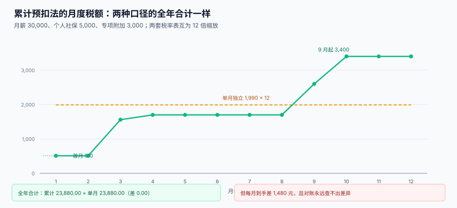

# 个税累计预扣与年度重置

<p style="text-align:center;"></p>

工资个税是薪酬系统里唯一一个**必须记住过去**的数字——「过去」指的是从 1 月到今天的累计数。这个月该扣多少，取决于这个人从 1 月到今天一共挣了多少、一共扣了多少、一共交了多少税。少记一个数，后面每个月都错；多记一年，第二年 1 月会莫名其妙多扣 2,890 元。

::: tip 一句话理解
**累计预扣法算的不是「这个月的税」，而是「到今天为止一共该交多少，减去已经交了多少」。** 所以系统里必须存三个数：累计应纳税所得额、累计已预扣税额、本期应预扣税额——少存一个，重算就不可复现。
:::

本页判据族 `PYT-A` ~ `PYT-H`，共 8 条，定义在最后一节。

## 一、公式与依据

依据《个人所得税扣缴申报管理办法（试行）》（国家税务总局公告 2018 年第 61 号）第六条：

```text
累计预扣预缴应纳税所得额
  = 累计收入 − 累计免税收入 − 累计减除费用 − 累计专项扣除
    − 累计专项附加扣除 − 累计依法确定的其他扣除

本期应预扣预缴税额
  = (累计预扣预缴应纳税所得额 × 预扣率 − 速算扣除数)
    − 累计减免税额 − 累计已预扣预缴税额
```

三条必须背下来的细则：

1. **累计减除费用 = 5,000 × 纳税人当年截至本月在本单位的任职受雇月份数**，不是「自然月序号」。
2. **余额为负值时，暂不退税**，留待次年综合所得年度汇算清缴多退少补。
3. **专项附加扣除由纳税人提供信息，扣缴义务人不得拒绝**——所以它是「外部输入」，不是系统算出来的。

## 二、预扣率表一（累计口径）

| 级数 | 累计预扣预缴应纳税所得额 | 预扣率 | 速算扣除数 |
| --- | --- | --- | --- |
| 1 | 不超过 36,000 元 | 3% | 0 |
| 2 | 36,000 ~ 144,000 元 | 10% | 2,520 |
| 3 | 144,000 ~ 300,000 元 | 20% | 16,920 |
| 4 | 300,000 ~ 420,000 元 | 25% | 31,920 |
| 5 | 420,000 ~ 660,000 元 | 30% | 52,920 |
| 6 | 660,000 ~ 960,000 元 | 35% | 85,920 |
| 7 | 超过 960,000 元 | 45% | 181,920 |

## 三、一个反直觉的事实：两套表其实是同一套表

2019 年之前，工资个税是「按月独立」：每月减 5,000（当时是 3,500 起征点加其他扣除），找**月度税率表**，算完就完。现在改成「累计」：每月把全年累计额找**年度税率表**。

把两张表并排看，你会发现**年度表的每一档恰好是月度表的 12 倍**：

| 档 | 月度表上限 | 年度表上限 | 比值 |
| --- | --- | --- | --- |
| 1 | 3,000 | 36,000 | 12 |
| 2 | 12,000 | 144,000 | 12 |
| 3 | 25,000 | 300,000 | 12 |
| 4 | 35,000 | 420,000 | 12 |
| 5 | 55,000 | 660,000 | 12 |
| 6 | 80,000 | 960,000 | 12 |

所以：**如果一个人全年收入不变、扣除不变，两种口径算出来的全年税额完全相同**。本机读数（三组参数，各跑 12 个月）：

| 月薪 | 社保 | 专项附加 | 累计预扣全年 | 单月独立全年 | 差 |
| --- | --- | --- | --- | --- | --- |
| 20,000 | 4,000 | 2,000 | 8,280.00 | 8,280.00 | 0.00 |
| 30,000 | 5,000 | 3,000 | 23,880.00 | 23,880.00 | 0.00 |
| 60,000 | 8,000 | 2,000 | 109,080.00 | 109,080.00 | 0.00 |

::: danger 这才是最危险的地方
**总额一样，所以对账永远查不出差异。** 如果你用错了表（该用累计用了单月），年度总额分毫不差，审计对不上任何一笔；但员工每月的到手金额完全不同：

| 月份 | 累计预扣（正确） | 单月独立（错误） | 差 |
| --- | --- | --- | --- |
| 1 | 510.00 | 1,990.00 | −1,480.00 |
| 3 | 1,560.00 | 1,990.00 | −430.00 |
| 6 | 1,700.00 | 1,990.00 | −290.00 |
| 9 | 2,600.00 | 1,990.00 | +610.00 |
| 12 | 3,400.00 | 1,990.00 | +1,410.00 |

前 4 个月每月多给 1,480 元、最后 3 个月每月多扣 1,410 元——员工会觉得「公司年底开始扣我的钱」，而 HR 拿不出任何一条错误记录，因为**确实一条都没有**。
:::



## 四、年度重置：12 月到 1 月的那一次归零

累计额是「当年 1 月 1 日起算」的。次年 1 月，累计收入、累计扣除、累计已预扣**全部清零**。

忘了清零会怎样？月薪 30,000 的例子：

| 场景 | 次年 1 月应扣个税 |
| --- | --- |
| 正确（累计额清零） | 510.00 |
| 未清零（继续累加第 13 个月） | **3,400.00** |
| 差 | **2,890.00** |

代码上这件事只有一行，但它有三种常见漏法：

1. **用上一条记录而不是本年第一条记录**算累计起点——跨年时把去年 12 月接了进来。
2. **累计减除费用按 `month(now)` 算**：1 月就是 5,000，看起来对，但如果 3 月补发 1 月的工资，`month(now)=3` 就会多扣 10,000。
3. **补发跨年时没换归属年度**，见 [补发与追溯](../RetroPay/index.md)。

::: warning 正确写法：累计的起点是「归属年度」
累计区间不是「近 12 个月」，而是 `[当年 1 月, 本期归属月]`。所以每一条个税记录都必须带 `tax_year` 与 `period`，重算时按 `tax_year` 分组，而不是按「上一条」。
:::

## 五、年中入职：5,000 × 任职月数，不是自然月

6 月入职、月薪 30,000、个人社保 5,000、无专项附加，算到 12 月共 7 个任职月：

| 口径 | 累计减除费用 | 累计应纳税所得额 | 累计应纳 |
| --- | --- | --- | --- |
| 按**任职月数**（正确） | 5,000 × 7 = 35,000 | 140,000 | 11,480.00 |
| 按**自然月序号**（错误） | 5,000 × 12 = 60,000 | 115,000 | 8,980.00 |

差额 **2,500.00**：错的那一版**少预扣**了 2,500 元，年终汇算时这个人要补税。补税金额超过 400 元且年收入超过 12 万，就必须办汇算——于是「公司算错了」变成「员工自己去补税」。

::: danger 这条规则的三个变体
1. **年中首次取得工资的纳税人**可按任职月数一次扣除多个月的减除费用（国家税务总局公告 2020 年第 13 号），所以首月就能扣 5,000 × 1，不需要往前追。
2. **同一年内在两家公司任职**：两家各自按「在本单位任职月数」扣，汇算时合并，可能出现两边都扣满 60,000 的情形——这不是 bug，是汇算要解决的。
3. **离职后再入职同一家公司**：累计区间要接着算还是重开？按「同一纳税年度、同一扣缴义务人」延续，不能重开，否则重复享受 5,000。
:::

## 六、负数不退税

12 月工资为 0（例如 11 月底离职），累计减除费用仍按 12 个月计，累计应纳税所得额下降，本期应预扣税额算出来是负数。

61 号公告的口径是「**余额为负值时，暂不退税**」。实现上只有一句：

```sql
-- 本期应预扣税额：负数归零，但要把「待退额」单独记下来
SELECT MAX(0, cumulative_tax_due - cumulative_tax_paid) AS current_tax,
       MIN(0, cumulative_tax_due - cumulative_tax_paid) AS refund_pending
FROM  pay_iit
WHERE emp_id = :emp_id AND tax_year = :year AND period = :period;
```

`refund_pending` 不是给人看的，是给次年汇算对账用的：把它丢掉，就等于放弃了「这个人多交了钱」的证据。

## 七、要存的三个数与表结构

```sql
CREATE TABLE pay_iit (
  id                INTEGER PRIMARY KEY,
  emp_id            TEXT    NOT NULL,
  tax_year          INTEGER NOT NULL,        -- 归属年度，累计区间的分组键
  period            TEXT    NOT NULL,        -- 归属月，如 2026-11
  cum_income        NUMERIC NOT NULL,        -- 累计收入
  cum_deduct        NUMERIC NOT NULL,        -- 累计减除费用（5000 × 任职月数）
  cum_special       NUMERIC NOT NULL,        -- 累计专项扣除（个人社保公积金）
  cum_extra         NUMERIC NOT NULL,        -- 累计专项附加扣除
  cum_taxable       NUMERIC NOT NULL,        -- 累计应纳税所得额
  cum_tax_due       NUMERIC NOT NULL,        -- 累计应预扣税额
  cum_tax_paid      NUMERIC NOT NULL,        -- 上期累计已预扣税额
  current_tax       NUMERIC NOT NULL,        -- 本期应预扣税额（>= 0）
  refund_pending    NUMERIC NOT NULL DEFAULT 0,
  calc_version      TEXT    NOT NULL,        -- 算法版本，重算时用于回溯
  UNIQUE (emp_id, period)
);
```

`UNIQUE (emp_id, period)` 有双重作用：一是防重复出账，二是让重算可以用 `INSERT ... ON CONFLICT DO UPDATE` 覆盖同一期——**重算幂等**，不需要先删后插。

## 八、判据清单

| 编号 | 判据 | 怎么验 |
| --- | --- | --- |
| `PYT-A` | 累计区间以 `tax_year` 为界，跨年自动重置 | 次年 1 月的 `cum_income` 等于当月收入 |
| `PYT-B` | 累计减除费用 = 5,000 × 任职月数，不是自然月序号 | 6 月入职者 12 月的 `cum_deduct` = 35,000 |
| `PYT-C` | 累计应纳税所得额与累计收入、各项扣除可互相重算 | 差额查询恒为 0 |
| `PYT-D` | 本期应预扣税额 = 累计应纳 − 累计已纳，且负数归零 | `current_tax >= 0` 恒成立 |
| `PYT-E` | 负数部分落到 `refund_pending`，不丢 | 该字段可为正，且与累计差额一致 |
| `PYT-F` | 同一人同一期只有一条记录，重算覆盖不新增 | `UNIQUE (emp_id, period)` |
| `PYT-G` | 税率表是配置项，不写在代码分支里 | 表 `tax_bracket` 存在，`effective_from/to` 齐全 |
| `PYT-H` | 年终奖单独计税带到期日（2027-12-31），不硬编码为永久 | 配置项 `bonus_separate_until` 存在 |

## 验证方式

```shell
# 1) 累计口径自洽：应输出 0 行
sqlite3 /tmp/pay.db "SELECT emp_id, period FROM pay_iit
  WHERE ABS(cum_taxable - (cum_income - cum_deduct - cum_special - cum_extra)) > 0.001;"
# 期望：无输出

# 2) 本期税额不为负
sqlite3 /tmp/pay.db "SELECT count(*) FROM pay_iit WHERE current_tax < 0;"
# 期望：0

# 3) 次年 1 月自动重置：应收敛到首月税额
sqlite3 /tmp/pay.db "SELECT period, current_tax FROM pay_iit WHERE emp_id='E0001' AND tax_year=2027 ORDER BY period LIMIT 1;"
# 期望：2027-01|510.0（与本年第 1 个月同值）
```

## 参考资料

- [应发、扣款与计薪天数](../GrossToNet/index.md)：`cum_income` 从哪来
- [社保公积金基数与比例](../SocialInsurance/index.md)：`cum_special` 从哪来
- [离职结算与年终奖](../Settlement/index.md)：年终奖单独计税与盲区
- 国家税务总局：个人所得税扣缴申报管理办法（试行）（2018 年第 61 号）：<https://www.gov.cn/gongbao/content/2019/content_5386991.htm>
- 国家税务总局：关于完善调整部分纳税人个人所得税预扣预缴方法的公告（2020 年第 13 号）：<https://www.chinatax.gov.cn/>
