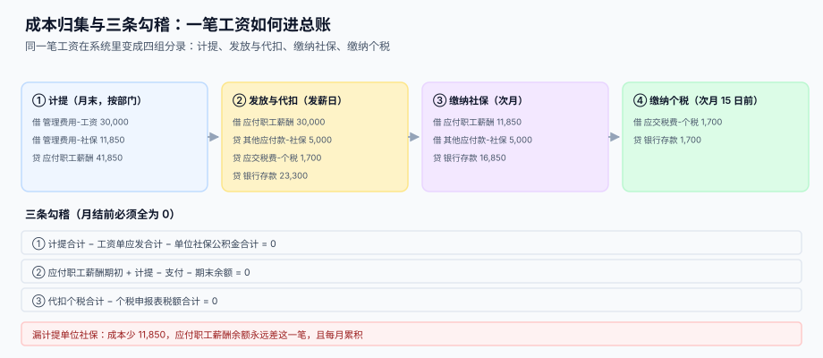

# 成本归集与总账勾稽

<p style="text-align:center;"></p>

工资单算完，钱发出去，这件事在财务侧才走了一半。剩下的一半是**把它变成能进报表的分录**：计提多少、代扣多少、缴纳多少、余额对不对。这一段是七段链里唯一「前面错了这里才发现」的地方——也是唯一能兜住前六段错误的地方。

::: tip 一句话理解
**一笔工资在总账里不是一笔分录，是四组：计提、发放与代扣、缴纳社保、缴纳个税。** 四组分录各自平衡，合起来还要与工资单勾得上。
:::

本页判据族 `PYL-A` ~ `PYL-H`，共 8 条，定义在最后一节。

## 一、四组分录

以月薪 30,000、个人社保公积金 5,000、个税 1,700、单位社保公积金 11,850 为例：



| 组 | 时点 | 借贷 | 金额 |
| --- | --- | --- | --- |
| ① 计提 | 月末 | 借 管理费用-工资 / 社保；贷 应付职工薪酬 | 41,850 |
| ② 发放与代扣 | 发薪日 | 借 应付职工薪酬；贷 其他应付款、应交税费、银行存款 | 30,000 |
| ③ 缴纳社保 | 次月 | 借 应付职工薪酬（单位）、其他应付款（个人）；贷 银行存款 | 16,850 |
| ④ 缴纳个税 | 次月 15 日前 | 借 应交税费；贷 银行存款 | 1,700 |

四组之间的关系：

```text
计提合计 41,850 = 应发 30,000 + 单位社保公积金 11,850
发放 30,000    = 个人社保 5,000 + 个税 1,700 + 实发 23,300
缴纳社保 16,850 = 单位 11,850 + 个人 5,000
```

::: danger 三个会让余额永远对不上的写法
1. **只计提应发，不计提单位部分**：成本每月少 11,850，一年少 142,200，且「应付职工薪酬」贷方余额会一直比实际应付多——因为发放时按 30,000 借，计提只有 30,000，看起来平，但缴纳社保时那 11,850 无处可去，只能挂在「其他应付款」，越挂越多。
2. **代扣的个人社保直接冲减费用**：借 管理费用 −5,000。费用被冲少，成本口径崩了，且个税的 `cum_special` 无法与账面核对。
3. **个税按「申报表金额」入账但按「计算金额」发放**：两者差一分钱，应交税费余额就永远差一分，年复一年。
:::

## 二、成本中心分摊

工资要按「谁受益谁承担」分摊到部门、项目、成本中心。三种常见分摊基数：

| 基数 | 适用 | 优点 | 风险 |
| --- | --- | --- | --- |
| 人头（按部门直接归属） | 绝大多数职能岗 | 简单、可解释 | 跨部门借调时失真 |
| 工时分摊 | 研发、生产 | 与产出相关 | 工时填报质量决定一切 |
| 项目直接归属 | 项目制 | 最准 | 一人多项目时要拆 |

分摊必须满足**守恒**：各部门分摊额之和 = 应发合计 + 单位社保公积金合计。这条不是「最好满足」，是硬约束——差额哪怕 0.01，成本报表与总账就对不上。

```sql
-- 分摊守恒：差额必须为 0
SELECT p.period, SUM(a.amount) - (SUM(s.gross) + SUM(si.amt_company)) AS diff
FROM   pay_alloc a
JOIN   pay_slip s  ON s.period = a.period
JOIN   pay_si_item si ON si.slip_id = s.id
WHERE  a.period = :period
GROUP  BY p.period;
```

::: warning 按比例分摊时的尾差
把一个部门的工资按 30%、70% 拆到两个项目，两笔都四舍五入到分，合计会比原额多或少 0.01。正确做法是「最大余数法」：先按比例取整，把差额补给余数最大的那一笔。见 [多币种的取整与分摊](../../MultiCurrency/Rounding/index.md)。
:::

## 三、三条勾稽与月结顺序

月结不是「点一下关账」，而是一个有顺序的序列。顺序错了，勾稽永远不平：

```text
① 算薪完成（pay_slip 全部 DRAFT → CONFIRMED）
② 出计提凭证（41,850）
③ 出代发批次并拿到回执（PYP 那一段）
④ 出代扣凭证（30,000 拆分）
⑤ 缴纳社保、缴纳个税（次月）
⑥ 跑三条勾稽，全部为 0
⑦ 关账（period 状态 CLOSED，之后只允许红冲）
```

三条勾稽：

```sql
-- ① 计提 = 应发 + 单位部分
SELECT :period AS period,
       (SELECT COALESCE(SUM(amount),0) FROM gl_voucher WHERE period=:period AND src='PAYROLL_ACCRUAL')
     - (SELECT COALESCE(SUM(gross),0) FROM pay_slip WHERE period=:period)
     - (SELECT COALESCE(SUM(amt_company),0) FROM pay_si_item WHERE period=:period) AS diff1;

-- ② 应付职工薪酬：期初 + 计提 − 支付 = 期末
SELECT opening + accrued - paid - closing AS diff2 FROM payable_balance WHERE period=:period;

-- ③ 代扣个税 = 申报表税额
SELECT (SELECT COALESCE(SUM(current_tax),0) FROM pay_iit WHERE period=:period)
     - (SELECT COALESCE(SUM(tax_amount),0) FROM tax_filing WHERE period=:period) AS diff3;
```

## 四、本机读数：漏计提单位部分的累积效应

| 月份 | 正确余额 | 漏计提后的余额 | 累计差 |
| --- | --- | --- | --- |
| 1 | 0.00 | 0.00 | 0.00 |
| 2 | 0.00 | 11,850.00 | 11,850.00 |
| 6 | 0.00 | 59,250.00 | 59,250.00 |
| 12 | 0.00 | 142,200.00 | **142,200.00** |

「应付职工薪酬」的正确状态是**每月月末归零**（计提与支付同额，下一月再计提）。它一旦有余额，只有三种可能：有未发的工资、有未缴的社保、算错了。所以这条余额本身就是最好的巡检项。

## 五、判据清单

| 编号 | 判据 | 怎么验 |
| --- | --- | --- |
| `PYL-A` | 四组分录齐全，缺任一组则月结不许关 | 凭证类型集合包含四种 |
| `PYL-B` | 计提合计 = 应发 + 单位社保公积金 | 勾稽 ① 为 0 |
| `PYL-C` | 应付职工薪酬期初 + 计提 − 支付 − 期末 = 0 | 勾稽 ② 为 0 |
| `PYL-D` | 代扣个税 = 个税申报表税额 | 勾稽 ③ 为 0 |
| `PYL-E` | 分摊合计守恒（差额 = 0，用最大余数法消尾差） | 分摊查询 diff = 0 |
| `PYL-F` | 关账后只允许红冲，不允许改数 | `period.status='CLOSED'` 时写操作被拒 |
| `PYL-G` | 每条凭证可追溯到 `slip_id` + `item_code` | 凭证行有 `src_id` |
| `PYL-H` | 单位部分单独设科目，不并入「管理费用-工资」 | 科目编码不同 |

## 验证方式

```shell
# 1) 四类凭证齐全：应输出 4
sqlite3 /tmp/pay.db "SELECT count(DISTINCT voucher_type) FROM gl_voucher WHERE period='2026-11';"
# 期望：4

# 2) 勾稽 ① 为 0
sqlite3 /tmp/pay.db "SELECT
  (SELECT SUM(amount) FROM gl_voucher WHERE period='2026-11' AND voucher_type='ACCRUAL')
- (SELECT SUM(gross) FROM pay_slip WHERE period='2026-11')
- (SELECT SUM(amt_company) FROM pay_si_item WHERE period='2026-11');"
# 期望：0.0

# 3) 应付职工薪酬月末归零
sqlite3 /tmp/pay.db "SELECT opening + accrued - paid - closing FROM payable_balance WHERE period='2026-11';"
# 期望：0.0
```

## 参考资料

- [复式记账与分录](../../Ledger/DoubleEntry/index.md)：借贷两腿的基本规则
- [与总账的勾稽与月结](../../FixedAsset/Ledger/index.md)：另一类月结勾稽的写法（固定资产侧）
- [容量与成本](../../../Ops/CapacityCost/Overview/index.md)：人工成本如何进入单位成本
- [多币种的取整与分摊](../../MultiCurrency/Rounding/index.md)：最大余数法消尾差
- 财政部：企业会计准则第 9 号——职工薪酬：<https://www.mof.gov.cn/>
