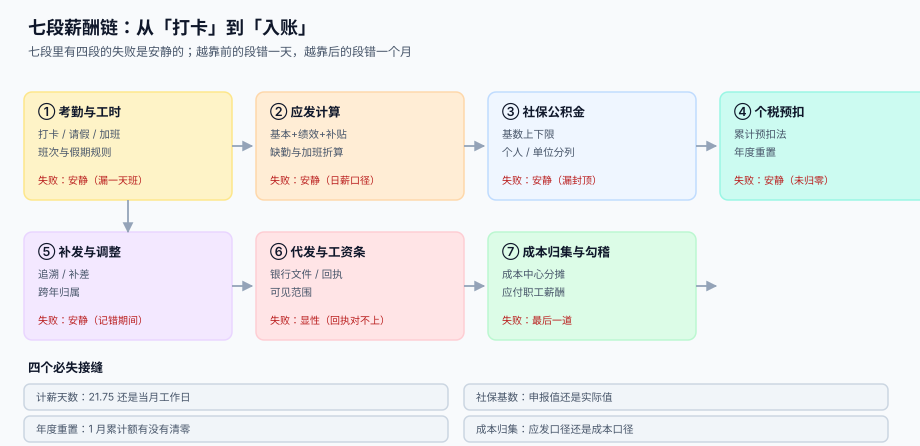

# 总览：七段薪酬链与三个「发多少」

<p style="text-align:center;"></p>

「这个人一个月多少钱」有四个答案：**合同上写 30,000**、**应发 30,000**、**打到他卡里 23,300**、**公司为此花了 41,850**。四个数都正确，但它们不是同一个东西。薪酬系统的绝大多数争议，都来自两个人拿着其中两个不同的数在讨论同一件事。

::: tip 一句话理解
**薪酬不是维护「一个工资数」，而是同时维护三本互相对得上的账：应发明细、扣缴明细、成本分录。** 三本账各自闭合，任何一本少一格，另外两本就会在某个没人核对的日子里分叉。
:::

本页判据族 `PYO-A` ~ `PYO-H`，共 8 条，定义在最后一节。

## 一、三个口径与三条等式


| 口径 | 存在哪 | 回答什么 | 公式 | 典型失效 |
| --- | --- | --- | --- | --- |
| 应发（Gross） | `pay_gross_item` 汇总 | 这个月他挣了多少 | Σ 基本 + 绩效 + 补贴 − 缺勤 + 加班 | 日薪口径选错，全年都错 |
| 实发（Net） | `pay_slip` | 打到他卡里多少 | 应发 − 个人社保公积金 − 个税 − 其他扣款 | 个税用了实发基数 |
| 成本（CTC） | `gl_voucher` | 公司为他付出多少 | 应发 + 单位社保公积金 | 漏掉单位部分，成本少算 28% |

三条等式，缺一条就是三本账分叉：

```text
应发：Σ 应发明细项 = 应发合计                      （逐人逐月恒等）
实发：应发 − 个人社保公积金 − 个税 − 其他扣款 = 实发（逐人逐月恒等）
成本：应发合计 + 单位社保公积金 = 人工成本合计      （逐月恒等）
```

本机读数（月薪 30,000、个人社保公积金 5,000、专项附加扣除 3,000、第 6 个月）：

| 口径 | 金额 | 占成本 |
| --- | --- | --- |
| 应发 | 30,000.00 | 71.7% |
| 实发 | 23,300.00 | **55.7%** |
| 公司成本（含单位社保公积金 11,850.00） | 41,850.00 | 100% |

::: danger 把三个口径合成一个字段的三个后果
1. **只存实发**：算不出个税申报表要的「收入额」和「专项扣除」，年度汇算时无法解释任何一笔。
2. **只存应发**：工资条打不出来，员工只知道总额，看不到社保和个税各扣了多少，争议全部涌向 HR。
3. **用实发反推成本**：单位部分是 39.5% 的额外支出，反推必错，且成本中心的分摊基数会跟着一起错。
:::

## 二、七段链：哪几段的失败是安静的



| 段 | 谁在做 | 交给下一段的东西 | 这一段独有的失败 | 谁来发现 |
| --- | --- | --- | --- | --- |
| ① 考勤与工时 | 考勤机 / 员工自助 | 考勤日汇总 | 漏一天班、请假类型错 | 员工自己（**很少有人当月核对**） |
| ② 应发计算 | 薪酬专员 | 应发明细 | 日薪口径（21.75 还是当月工作日） | 年底总账与预算对比（**没人看**） |
| ③ 社保公积金 | 社保专员 | 缴费明细 | 基数漏做上下限 | 社保对账单（**季度才对一次**） |
| ④ 个税预扣 | 系统 | 个税明细 | 1 月未归零、年中入职月数 | 次年汇算（**已经过了一年**） |
| ⑤ 补发与调整 | 薪酬专员 | 调整单 | 记错归属期 | 预算执行率异常（**没人看**） |
| ⑥ 代发与工资条 | 系统 + 银行 | 代发批次、回执 | 重号、金额合计不符 | 银行回执（显性） |
| ⑦ 成本归集与勾稽 | 财务 | 凭证、余额 | 单位部分没进成本 | 月结勾稽（最后一道） |

七段里有**五段的失败是安静的**。安静的失败有一个共同特征：**它不产生异常，只产生偏差**——数字变小了、变大了，但没有任何一条规则被违反。第 ④ 段最典型：12 月多扣的那 2,890 元，在系统里是一个完全合法的税额。

## 三、四个必失接缝

七段之间有四个接缝，它们不是流程节点，而是**口径断点**——上一段的产物在这一段被重新解释，解释错了没人拦。

| 接缝 | 断在哪 | 本机读数 | 本册哪一页管 |
| --- | --- | --- | --- |
| 计薪天数 | 日薪用 21.75 还是当月工作日 | 月薪 20,000 缺勤 5 天，21 天月差 **164.20**、23 天月差 **−249.88** | [应发与计薪天数](../GrossToNet/index.md) |
| 累计额归零 | 次年 1 月的累计应纳税所得额有没有清零 | 该 510.00 却扣 3,400.00，多扣 **2,890.00** | [个税累计预扣](../IIT/index.md) |
| 基数上下限 | 社保按申报值还是按封顶值 | 45,000 漏封顶，个人每月多缴 **2,025.00**，全年 **24,300.00** | [社保公积金](../SocialInsurance/index.md) |
| 成本口径 | 进成本的是应发还是应发 + 单位部分 | 漏单位部分，成本少算 **28.3%** | [成本归集与勾稽](../Ledger/index.md) |

## 四、本册的工程立场

三句话，后面每页都会回到它们：

1. **明细只追加，汇总才算出来。** 应发、社保、个税都是明细表，`pay_slip` 里的三个合计字段是「出账那一刻的快照」，不是可以随手改的余额（见 [应发、扣款与计薪天数](../GrossToNet/index.md)）。
2. **个税是「累计」的函数，不是「本月」的函数。** 存下来的不该只是「本月扣多少」，而是「累计应纳税所得额、累计已预扣、本期应扣」三个数——少存一个，重算就不可复现（见 [个税累计预扣](../IIT/index.md)）。
3. **所有勾稽都写成 SQL，不写成流程。** 流程会被跳过，SQL 不会——月结前跑三条查询，任何一条不为 0 就不许关账（见 [成本归集与总账勾稽](../Ledger/index.md)）。

## 五、判据清单

| 编号 | 判据 | 怎么验 |
| --- | --- | --- |
| `PYO-A` | 七段各有产物表，且段与段之间不共用一张表 | 七张表都在，`pay_gross_item` 不含个税字段 |
| `PYO-B` | 三个口径分列在三处，不合并成一个字段 | `pay_slip` 只有快照字段，净值由减法得出 |
| `PYO-C` | 每人每月只有一张工资单，且重算不新增行 | `(emp_id, period)` 唯一 |
| `PYO-D` | 明细只追加，出账后不在原行上改数 | 调整必须走 `pay_adjust`，不能 `UPDATE pay_slip` |
| `PYO-E` | 四个接缝各有对应的表与判据页 | 四张表存在，且各页判据族非空 |
| `PYO-F` | 每个失败模式都能追到「哪个人、哪一期、哪一项」 | 任取一条异常，能定位到 `emp_id` + `period` + `item_code` |
| `PYO-G` | 本册不回答「企业所得税税前扣除」，且明确指向别处 | 正文不出现税前扣除计算，只出现个人所得税 |
| `PYO-H` | 「失败是否安静」的标注与实际代码一致 | 五段安静段均无异常抛出点 |

## 验证方式

```shell
# 1) 七段产物表齐全：应输出 7
sqlite3 /tmp/pay.db "SELECT count(*) FROM sqlite_master WHERE type='table' AND name IN
  ('attendance_day','pay_gross_item','pay_si_item','pay_iit','pay_adjust','pay_batch','gl_voucher');"
# 期望：7

# 2) 工资单里没有可随手改的「余额」字段（净额必须由减法得出）：应输出 0
sqlite3 /tmp/pay.db "SELECT count(*) FROM pragma_table_info('pay_slip') WHERE name IN ('net_balance','remain_amount');"
# 期望：0

# 3) 每人每月唯一：重复插入应报错
sqlite3 /tmp/pay.db "INSERT INTO pay_slip(emp_id,period,gross) VALUES('E0001','2026-11',30000);"
# 期望：UNIQUE constraint failed: pay_slip.emp_id, pay_slip.period
```

## 与「合并报表」专题的分工

薪酬册判**三本账各自闭合**（应发 / 实发 / 公司成本），合并册判**这笔人工成本在集团内部有没有被记两遍**。

| 你关心的问题 | 该读哪一册 | 为什么 |
| --- | --- | --- |
| 这个人这个月发多少、公司成本多少 | 本册 | 21.75 折算、累计预扣、社保基数 |
| 母公司派人到子公司，工资谁承担 | [合并报表与内部抵销](../../Consolidation/Intercompany/index.md) | 内部人工结算属内部交易 |
| 合并层的人工成本为什么小于单体之和 | 合并册 | 内部借调结算被抵销 |
| 股份支付在合并层怎么处理 | 合并册 | 母公司授予子公司员工的，按权益结算处理 |
| 少数股东损益里的人员工资 | 本册给公司成本 | 合并层按主体归属拆分 |

::: danger 本页特有的一处坑：内部借调的人工成本被算两次
母公司发工资、向子公司收「人力服务费」。母公司账上：人工成本 + 其他业务收入；子公司账上：管理费用。合并时若不抵销，集团人工成本多出一份、其他业务收入多出一份。

正确做法是把「人力服务费」按内部服务抵销，并把母公司为该员工承担的成本保留在集团口径里——**抵的是结算，不是成本**。这两件事在分录上只差一个科目，但在管理报表上会得出完全相反的结论。
:::

## 与「全面预算」专题的分工

| 你关心的问题 | 该读哪一册 | 为什么不是本页 |
| --- | --- | --- |
| 「应发/实发/公司成本各是多少」 | 本页 | 判**三本账各自竖直** |
| 「人工成本的预算额度够不够」 | [全面预算与经营分析](../../Budgeting/Overview/index.md) | 那册判**额度授权**，本页判**金额计算** |
| 「编制变了预算要不要跟着改」 | [编制与基线](../../Budgeting/PlanningCycle/index.md) | 那册判**驱动因子复算**（人数 × 单价） |
| 「人工成本怎么分到部门」 | [分摊与内部转移定价](../../Budgeting/Allocation/index.md) | 那册判**分摊守恒**，本页只管总额 |

::: warning 一页一坑：人工预算与薪酬计提的口径差 8.65%
人工预算最常见的写法是「编制人数 × 平均薪酬 × 12」，而薪酬计提的「公司成本」包含单位缴纳的社保公积金——两者口径不同，差额正好等于社保比例。

本机读数：总编制 2,913 人，用去年平均薪酬 18,500 复算 646,686,000，按本年 20,100 算是 702,615,600，**差 8.65%**。这 8.65% 全部来自「单价没更新」，而它看起来完全像「人员增加了」。

编制驱动的预算必须把「量」与「单价」两个假设分开存（见[编制与基线](../../Budgeting/PlanningCycle/index.md)的 `planning_assumption` 表），否则每年都会被同一个差额误导一次。
:::

## 与「培训与资质认证」专题的分工（第 240 天补充）

学时能影响钱（脱产培训、外训报销、无证停工的工资处理），但「能不能上岗」与「发多少钱」是两条独立的判定：

| 问题 | 本册（薪酬） | 培训与资质册 |
| --- | --- | --- |
| 这个月应发多少 | **判**：三段式与累计预扣 | 不判 |
| 培训期间的工资怎么算 | **判**：按出勤/假别归集 | 只提供学时与签到证据 |
| 无证能不能上岗 | 不判 | **判**：准入判定点 |
| 无证停工扣不扣钱 | **判**（本册的出勤规则） | 只回答「为什么停工」 |

延伸阅读：[岗位资质矩阵](../../TrainingQualification/Matrix/index.md)、[上岗准入：判定点在哪里](../../TrainingQualification/AccessGate/index.md)、[证书与有效期](../../TrainingQualification/Certificate/index.md)。

::: danger 一个只在本页成立的坑
**用学时直接折算加班或补贴**。学时是「在场累计」，跨天按天记；加班是「超出标准工时」，按班次记。把 24 学时的三天课当成三天加班，会把周末与工作日混在一起——两边的时间口径不同，不能互相换算。
:::

## 与「费用报销与差旅费控」专题的分工（第 241 天补充）

| 你关心的问题 | 该读哪一册 | 边界 |
| --- | --- | --- |
| 「发给个人的钱怎么代扣个税」 | 本册「累计预扣」 | 判**工资薪金**口径 |
| 「报销款要不要交个税」 | [票据与查验](../../ExpenseReimbursement/Receipt/index.md) | 判**凭证是否合规**：凭证不合规的补贴要并入工资 |
| 「个人抬头的票能不能报」 | [稽查与合规](../../ExpenseReimbursement/Audit/index.md) | 判**可报但不可扣**，且需并入工资代扣 |
| 「离职未清借款怎么处理」 | [借款与核销](../../ExpenseReimbursement/Advance/index.md) | 判**离职闸门**，代扣需书面同意 |

一页一坑：**「报销」与「补贴」在税务上是两件事**。同样一笔 300 元，凭合规发票报销不缴个税；按定额包干发放、无票或抬头为个人，就属于「与任职受雇有关的所得」，要并入工资薪金代扣个税。本机读数里抬头为个人的单据占 1.79%，这类单子在报销侧只是「不可抵」，在薪酬侧才是「要补税」。

## 参考资料

- [应发、扣款与计薪天数](../GrossToNet/index.md)：日薪与小时工资的唯一口径
- [个税累计预扣与年度重置](../IIT/index.md)：那条「累计」公式的三个存值
- [成本归集与总账勾稽](../Ledger/index.md)：三条勾稽查询
- [复式记账与分录](../../Ledger/DoubleEntry/index.md)：工资三段分录的两腿
- 国家税务总局：个人所得税扣缴申报管理办法（2018 年第 61 号）：<https://www.gov.cn/gongbao/content/2019/content_5386991.htm>
