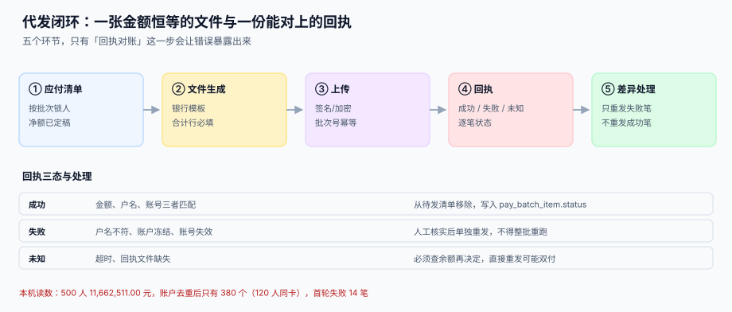

# 银行代发、工资条与可见范围

<p style="text-align:center;"></p>

前面六段算得再对，最后一步发不出去也是白算。代发这一段有两个特殊性：**它是唯一一个错误会立刻被发现的地方**（银行会把文件退回来），**也是唯一一个错误会造成真实资金损失的地方**（多付的钱很难追回）。

::: tip 一句话理解
**代发不是「点一下转账」，而是「一张金额恒等的文件 + 一份能逐笔对上的回执」。** 文件的合计行与应付总额必须相等，回执的每一笔必须落到「成功 / 失败 / 未知」三态之一——「未知」不是「成功」，也不是「失败」。
:::

本页判据族 `PYP-A` ~ `PYP-H`，共 8 条，定义在最后一节。

## 一、五个环节



| 环节 | 产物 | 失败方式 | 谁能发现 |
| --- | --- | --- | --- |
| ① 应付清单 | `pay_batch`（锁人、定净额） | 批次生成后还有人在算工资 | 合计对不上 |
| ② 文件生成 | 银行模板文件 | 金额单位（元/分）、编码、合计行 | 银行拒收（显性） |
| ③ 上传 | 批次号 + 签名 | 重复上传（幂等键缺失） | 银行双付（**资金损失**） |
| ④ 回执 | 逐笔状态 | 回执缺行、状态「未知」当成功 | 对账时才发现 |
| ⑤ 差异处理 | 重发批次 | 整批重跑，把成功的也重发 | **双倍支付** |

## 二、本机读数：500 人的一次代发

| 指标 | 读数 |
| --- | --- |
| 人数 | 500 |
| 应付合计 | 11,662,511.00 |
| 账户去重后 | 380 个 |
| **同卡人数** | **120 人（24%）** |
| 首轮失败 | 14 笔（3.0%） |
| 失败金额 | 326,750.00 |

两个数值得单独说：

1. **120 人同卡**：同一张银行卡挂了两个人。这在工厂、门店、家族企业里非常常见。它不是错误，但它是**反洗钱与个税申报的高风险信号**，且会导致「一个人收到两份工资」的对账困难。系统应当在文件生成前给出提示，而不是拦住。
2. **14 笔失败、326,750 元**：如果重发时不过滤成功清单、而是整批重跑，这 500 人会被发两次，多付的正是这 326,750（失败的那 14 笔重复发）+ 486 人的已成功金额——**整批重跑一次，代价是 1,166 万**。

## 三、文件契约

不同银行的模板不同，但有五项是所有模板都有的：

| 项 | 常见写法 | 出错后果 |
| --- | --- | --- |
| 金额单位 | 元（两位小数）/ 分（整数） | 差 100 倍，必被拒或**多发 100 倍** |
| 编码 | GBK（多数国内银行）/ UTF-8 | 姓名乱码，户名不符被退 |
| 合计行 | 记录数 + 金额合计 | 缺失则银行无法校验，整批退回 |
| 户名 | 与开户名完全一致（含全半角、生僻字） | 户名不符，单笔失败 |
| 批次号 | 唯一，且与上传幂等 | 重复上传，双付 |

```text
# 一个最小可用的代发文件（示意，字段顺序以银行模板为准）
H|20261105|B20261105001|500|11662511.00
D|E0001|张三|6222020000000001|23300.00|工资
D|E0002|李四|6222020000000002|18420.50|工资
...
T|500|11662511.00
```

::: danger 四个会真丢钱的坑
1. **金额以「分」为单位却按「元」写**：23,300.00 写成 2330000，多付 100 倍。
2. **重发不按成功清单过滤**：整批重跑 = 双倍支付。正确做法是「成功笔标记 `PAID`，重发只取 `FAILED` 与 `UNKNOWN`」。
3. **把「未知」当成功**：超时的笔可能已经到账。正确做法是先查账户余额与流水，再决定是否重发。
4. **批次号用时间戳到秒**：两次点击在同一秒内，批次号相同，银行侧幂等失效。
:::

## 四、回执对账的三条 SQL

```sql
-- ① 文件合计与批次应付是否相等（出文件前必须为 0）
SELECT b.id, b.total_amount - SUM(i.amount) AS diff
FROM   pay_batch b JOIN pay_batch_item i ON i.batch_id = b.id
GROUP  BY b.id HAVING ABS(diff) > 0.001;

-- ② 回执缺行：文件里有、回执里没有
SELECT i.id, i.emp_id, i.amount
FROM   pay_batch_item i LEFT JOIN pay_receipt r ON r.item_id = i.id
WHERE  i.batch_id = :batch AND r.id IS NULL;

-- ③ 回执金额与文件金额不一致（银行改了数，最危险）
SELECT i.emp_id, i.amount AS file_amt, r.amount AS receipt_amt
FROM   pay_batch_item i JOIN pay_receipt r ON r.item_id = i.id
WHERE  ABS(i.amount - r.amount) > 0.001;
```

第三条如果不为 0，说明**银行侧发生了金额调整**（例如扣了手续费），必须以回执为准反写工资单，否则账面与银行永远差那几块钱。

## 五、工资条的可见范围

工资条是薪酬系统里**信息密度最高、权限最容易做错**的页面。一条工资条包含：姓名、工号、部门、应发明细、社保明细、个税、实发、银行卡后四位。

| 角色 | 应可见 | 常见越权 |
| --- | --- | --- |
| 员工本人 | 自己的全部字段 | — |
| 直属上级 | 下属的**应发合计**（不含明细、不含银行卡） | 看到下属的个税与社保明细 |
| HR 专员 | 所辖部门的全部字段 | 跨部门可见 |
| 财务 | 全员**合计**（不含个人明细） | 导出全员明细 |
| 系统管理员 | 无业务数据 | 能看到明文工资 |

本机读数：一个 120 人的部门，用「工号前缀相同即为同部门」当权限判据，**120 人全部可见，越权 119 人（100%）**。这不是极端情况——把「组织归属」错写成「工号前缀」是真实发生过的实现。

```sql
-- 正确做法：可见范围由「关系表」决定，不由字符串推断
SELECT s.*
FROM   pay_slip s
WHERE  s.emp_id = :viewer                       -- 本人
   OR  EXISTS (SELECT 1 FROM org_relation r     -- 或：是本人的直属上级
               WHERE r.leader_id = :viewer AND r.member_id = s.emp_id
                 AND r.effective_to IS NULL)
   OR  EXISTS (SELECT 1 FROM role_scope g      -- 或：角色覆盖该部门
               WHERE g.user_id = :viewer AND g.dept_id = s.dept_id
                 AND g.can_view_detail = 1);
```

## 六、表结构

```sql
CREATE TABLE pay_batch (
  id            INTEGER PRIMARY KEY,
  batch_no      TEXT    NOT NULL UNIQUE,   -- 幂等键：重复上传不双付
  period        TEXT    NOT NULL,
  total_count   INTEGER NOT NULL,
  total_amount  NUMERIC NOT NULL,
  status        TEXT    NOT NULL,          -- DRAFT / SENT / PARTIAL / DONE
  bank_code     TEXT    NOT NULL,
  created_at    TEXT    NOT NULL
);

CREATE TABLE pay_batch_item (
  id        INTEGER PRIMARY KEY,
  batch_id  INTEGER NOT NULL,
  emp_id    TEXT    NOT NULL,
  acct_no   TEXT    NOT NULL,
  acct_name TEXT    NOT NULL,
  amount    NUMERIC NOT NULL,
  status    TEXT    NOT NULL DEFAULT 'PENDING',  -- PENDING / PAID / FAILED / UNKNOWN
  fail_code TEXT,
  UNIQUE (batch_id, emp_id)
);

CREATE TABLE pay_receipt (
  id         INTEGER PRIMARY KEY,
  batch_id   INTEGER NOT NULL,
  item_id    INTEGER NOT NULL UNIQUE,      -- 一笔只允许一条回执
  amount     NUMERIC NOT NULL,
  status     TEXT    NOT NULL,
  received_at TEXT   NOT NULL
);
```

`pay_receipt.item_id UNIQUE` 是关键：它挡住「同一笔收到两条回执」这种会导致重复对账的情况。

## 七、判据清单

| 编号 | 判据 | 怎么验 |
| --- | --- | --- |
| `PYP-A` | 文件合计 = 批次应付合计（逐批） | 差额查询恒为 0 |
| `PYP-B` | 每人每批只有一条明细 | `UNIQUE (batch_id, emp_id)` |
| `PYP-C` | 批次号唯一，重复上传被挡 | `batch_no` UNIQUE |
| `PYP-D` | 回执一笔一条，不重复 | `pay_receipt.item_id` UNIQUE |
| `PYP-E` | 重发只取 `FAILED` / `UNKNOWN`，不取 `PAID` | 重发查询条件不含 `PAID` |
| `PYP-F` | 回执金额与文件金额不一致时必须阻断对账 | 差异查询非空则流程停 |
| `PYP-G` | 工资条可见范围由关系表决定，不由工号/姓名推断 | 权限 SQL 只引用 `org_relation` / `role_scope` |
| `PYP-H` | 同卡多人必须提示但不拦截 | 存在 `dup_acct_flag` 且不阻断生成 |

## 验证方式

```shell
# 1) 文件与批次合计一致：应输出空
sqlite3 /tmp/pay.db "SELECT b.batch_no, b.total_amount - SUM(i.amount) d
  FROM pay_batch b JOIN pay_batch_item i ON i.batch_id=b.id
  GROUP BY b.id HAVING ABS(d) > 0.001;"
# 期望：无输出

# 2) 重复批次号被挡
sqlite3 /tmp/pay.db "INSERT INTO pay_batch(batch_no,period,total_count,total_amount,status,bank_code,created_at)
  VALUES('B20261105001','2026-11',1,23300,'DRAFT','ICBC','2026-11-05');"
# 期望：UNIQUE constraint failed: pay_batch.batch_no

# 3) 回执不能一笔两条
sqlite3 /tmp/pay.db "SELECT item_id, count(*) c FROM pay_receipt GROUP BY item_id HAVING c > 1;"
# 期望：无输出
```

## 参考资料

- [成本归集与总账勾稽](../Ledger/index.md)：代发之后的记账动作
- [消息通知与触达](../../NotificationDelivery/Delivery/index.md)：工资条推送的七段链
- [认证与授权](../../Auth/Authorization/index.md)：角色与权限模型
- [批量数据交换的行级校验](../../BulkDataExchange/RowValidation/index.md)：代发文件的逐行校验思路
- 中国人民银行：人民币银行结算账户管理办法：<https://www.gov.cn/>
