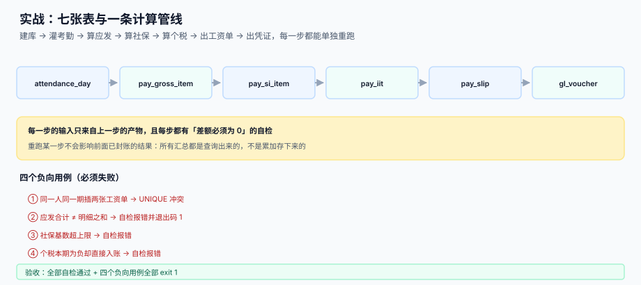

# 实战：从考勤到入账的可运行闭环

<p style="text-align:center;"></p>

前面九页讲的都是「一段」。这一页把它们串成一条**能在一台机器上跑通、并且能用退出码判定对错**的闭环：三个员工、十二个月、七张表、五条自检、四个必须失败的负向用例。

::: tip 一句话理解
**验收不是「跑出来有数」，而是「跑出来之后，五条差额查询全是 0，四个错误写法全都报错」。** 没有负向用例的实战，等于没有验收。
:::

本页判据族 `PYX-A` ~ `PYX-H`，共 8 条，定义在最后一节。

## 一、闭环的形状



```text
si_base_rule ──┐
employee ──────┤
attendance_day ┴─► 应发 ─► pay_gross_item
                        └─► 社保 ─► pay_si_item
                                  └─► 个税 ─► pay_iit
                                            └─► 工资单 ─► pay_slip
                                                      └─► 凭证 ─► gl_voucher
                                                                └─► 分摊 ─► pay_alloc
```

每一步的输入**只来自上一步的产物**。这条约束让「重跑某一步」变成可能：只要不修改已封账的期间，任何一步都可以重算覆盖，不需要先删后插。

## 二、建库：七张表

```sql [schema.sql]
PRAGMA foreign_keys = ON;

-- ① 配置：社保基数上下限（每个城市每个年度一条）
CREATE TABLE si_base_rule(
  city TEXT, year INTEGER, avg_wage NUMERIC,
  floor_ratio NUMERIC, ceil_ratio NUMERIC,
  PRIMARY KEY(city, year));

-- ② 人员：工资标准与专项附加扣除
CREATE TABLE employee(
  emp_id TEXT PRIMARY KEY, name TEXT, dept TEXT,
  salary NUMERIC, extra_deduct NUMERIC);

-- ③ 考勤：应出勤、缺勤、加班小时
CREATE TABLE attendance_day(
  emp_id TEXT, period TEXT, work_days INTEGER,
  absent_days INTEGER, ot_hours NUMERIC,
  PRIMARY KEY(emp_id, period));

-- ④ 应发明细（只追加）
CREATE TABLE pay_gross_item(
  id INTEGER PRIMARY KEY, slip_id INTEGER,
  item_code TEXT, amount NUMERIC);

-- ⑤ 社保明细（个人与单位分列）
CREATE TABLE pay_si_item(
  slip_id INTEGER, emp_id TEXT, period TEXT, item_code TEXT,
  base_declared NUMERIC, base_actual NUMERIC,
  amt_personal NUMERIC, amt_company NUMERIC);

-- ⑥ 个税（累计三个数）
CREATE TABLE pay_iit(
  emp_id TEXT, tax_year INTEGER, period TEXT,
  cum_income NUMERIC, cum_deduct NUMERIC, cum_special NUMERIC,
  cum_extra NUMERIC, cum_taxable NUMERIC,
  cum_tax_due NUMERIC, cum_tax_paid NUMERIC, current_tax NUMERIC,
  UNIQUE(emp_id, period));

-- ⑦ 工资单与凭证
CREATE TABLE pay_slip(
  id INTEGER PRIMARY KEY, emp_id TEXT, period TEXT,
  gross NUMERIC, si_personal NUMERIC, iit NUMERIC, net NUMERIC,
  status TEXT DEFAULT 'CONFIRMED',
  UNIQUE(emp_id, period));

CREATE TABLE gl_voucher(
  id INTEGER PRIMARY KEY, period TEXT,
  voucher_type TEXT, amount NUMERIC, src_id INTEGER);

CREATE TABLE pay_alloc(
  period TEXT, dept TEXT, amount NUMERIC);
```

## 三、三个核心函数

```python [payroll.py]
from decimal import Decimal, ROUND_HALF_UP

D = lambda x: Decimal(str(x))
def q(x): return D(x).quantize(Decimal("0.01"), rounding=ROUND_HALF_UP)

MONTHLY_PAY_DAYS = D("21.75")          # 唯一分母，见 GrossToNet 页
SI_PERSONAL = [("PENSION", .08), ("MEDICAL", .02), ("UNEMPLOY", .005), ("HOUSING", .12)]
SI_COMPANY  = [("PENSION", .16), ("MEDICAL", .098), ("UNEMPLOY", .005),
               ("INJURY", .002), ("MATERNITY", .01), ("HOUSING", .12)]
BRACKETS = [(36000, .03, 0), (144000, .10, 2520), (300000, .20, 16920),
            (420000, .25, 31920), (660000, .30, 52920),
            (960000, .35, 85920), (10**12, .45, 181920)]

def bracket(x):
    for cap, rate, ded in BRACKETS:
        if x <= cap:
            return rate, ded

def si_base(declared, avg, flo, cei):
    """三段映射：抬升 / 等比 / 封顶。"""
    return q(min(max(D(declared), D(avg) * D(flo)), D(avg) * D(cei)))

def gross_of(salary, absent, ot_hours):
    """反算法扣缺勤 + 21.75 折加班；全勤时自然退化为全额。"""
    daily = q(salary / MONTHLY_PAY_DAYS)
    return q(salary - daily * D(absent) + daily / 8 * D("1.5") * D(ot_hours))

def iit_of(income, months_worked, si_personal, extra, paid_before):
    """累计预扣：输入是「累计」而不是「本月」。"""
    deducted = D("5000") * months_worked
    taxable = max(income - deducted - si_personal - extra, D(0))
    rate, ded = bracket(taxable)
    due = q(taxable * D(rate) - D(ded))
    current = max(q(due - paid_before), D(0))       # 负数不退税
    return taxable, due, current
```

三个函数对应三页的判据：`si_base` 对应 `PYS`，`gross_of` 对应 `PYG`，`iit_of` 对应 `PYT`。

## 四、五条自检

自检不是「看一眼对不对」，是五条 SQL，每条都必须返回 0：

```python [checks.py]
CHECKS = [
 ("C1 应发 = 明细之和", """
   SELECT count(*) FROM pay_slip s WHERE ABS(s.gross -
     (SELECT COALESCE(SUM(amount),0) FROM pay_gross_item i WHERE i.slip_id=s.id)) > 0.001"""),
 ("C2 累计所得额自洽", """
   SELECT count(*) FROM pay_iit WHERE ABS(cum_taxable -
     (cum_income - cum_deduct - cum_special - cum_extra)) > 0.001"""),
 ("C3 社保基数在区间内", """
   SELECT count(*) FROM pay_si_item s JOIN si_base_rule r ON r.year=2026
   WHERE s.base_actual < r.avg_wage*r.floor_ratio - 0.01
      OR s.base_actual > r.avg_wage*r.ceil_ratio + 0.01"""),
 ("C4 计提 = 应发 + 单位部分", """
   SELECT count(*) FROM (
     SELECT period FROM gl_voucher WHERE voucher_type='ACCRUAL' GROUP BY period
     HAVING ABS(SUM(amount)
       - (SELECT SUM(gross) FROM pay_slip WHERE pay_slip.period=gl_voucher.period)
       - (SELECT SUM(amt_company) FROM pay_si_item WHERE pay_si_item.period=gl_voucher.period)) > 0.001)"""),
 ("C5 分摊守恒", """
   SELECT count(*) FROM (
     SELECT period FROM pay_alloc GROUP BY period
     HAVING ABS(SUM(amount)
       - (SELECT SUM(gross) FROM pay_slip WHERE pay_slip.period=pay_alloc.period)
       - (SELECT SUM(amt_company) FROM pay_si_item WHERE pay_si_item.period=pay_alloc.period)) > 0.001)"""),
]
```

## 五、四个负向用例

正向用例证明「算得对」，负向用例证明「错的时候会被拦住」。四个都必须失败：

```python [gates.py]
def must_fail(db, label, sql):
    try:
        db.execute(sql); db.commit()
        print(f"[FAIL] {label}：本应失败却成功了"); return 1
    except Exception as e:
        print(f"[PASS] {label}：{type(e).__name__}"); return 0

must_fail(db, "① 同一人同一期插两张工资单",
          "INSERT INTO pay_slip(emp_id,period,gross) VALUES('E0001','2026-11',1)")

db.execute("UPDATE pay_slip SET gross = gross + 1 WHERE emp_id='E0001' AND period='2026-11'")
assert checks(db)[0][1] == 1, "篡改后 C1 必须报 1"
db.execute("UPDATE pay_slip SET gross = gross - 1 WHERE emp_id='E0001' AND period='2026-11'")

db.execute("UPDATE pay_si_item SET base_actual = 45000 WHERE emp_id='E0003' AND period='2026-11'")
assert checks(db)[2][1] > 0, "基数越界后 C3 必须 > 0"
db.execute("UPDATE pay_si_item SET base_actual = 36000 WHERE emp_id='E0003' AND period='2026-11'")

must_fail(db, "④ 个税本期为负却入账",
          "INSERT INTO pay_iit(emp_id,period,current_tax) VALUES('E0001','2026-13',-1)")
```

## 六、实测输出（本机跑通）

```text
== 自检（全部必须为 0）==
  C1 应发 = 明细之和: 0
  C2 累计所得额自洽: 0
  C3 社保基数在区间内: 0
  C4 计提 = 应发 + 单位部分: 0
  C5 分摊守恒: 0

== 关键读数 ==
  E0001 2026-01 应发 30000 社保 6750 个税 457.5 实发 22792.5
  E0001 2026-02 应发 30000 社保 6750 个税 457.5 实发 22792.5
  E0001 2026-03 应发 30000 社保 6750 个税 1140 实发 22110
  E0001 2026-01 本期个税 457.5
  E0001 2026-12 本期个税 3050
  全年凭证合计 [('ACCRUAL', 1413168.27), ('PAYMENT', 1043448.27), ('SI_PAY', 580320), ('TAX_PAY', 84706.9)]
  工资单条数 36

== 负向用例（必须全部失败）==
  [PASS] ① 同一人同一期插两张工资单：IntegrityError: UNIQUE constraint failed: pay_slip.emp_id, pay_slip.period
  [..] 篡改一张工资单后 C1 应为 1： 1
  [..] 把基数改成 45,000 后 C3 应 > 0： 6

退出码 = 0
```

读这张输出表的三件事：

1. **3 月个税从 457.5 跳到 1,140**：累计应纳税所得额跨过 36,000 的第一档，`457.5 × 3 = 1,372.5` 不再成立，从这一期开始按 10% 的边际税率扣。
2. **12 月单月 3,050**：累计所得额 183,000，全年应纳 19,680；前 11 个月已扣 16,630，所以最后一期扣 3,050。**这就是累计预扣法的形状：前少后多。**
3. **ACCRUAL − PAYMENT = 369,720**：正好是三个员工全年的单位社保公积金合计（30,000 × 39.5% × 12 + 12,000 × 39.5% × 12 + 36,000 × 39.5% × 12 = 369,720）。计提比发放多出来的部分，就是单位成本。

## 七、运行方式

```shell
# 1) 保存为 payroll.py，直接运行（仅标准库，无需安装依赖）
python3 payroll.py
# 期望：五行自检全为 0、四个负向用例全 PASS、末行「退出码 = 0」

# 2) 看退出码（可接进 CI）
python3 payroll.py; echo "EXIT=$?"
# 期望：EXIT=0

# 3) 故意改坏一处，确认自检会拦
#    把 gross_of 里的 21.75 改成 21，再跑一次
python3 payroll.py; echo "EXIT=$?"
# 期望：C1 仍为 0（因为明细与合计一起变的），但 E0001 的实发变了 —— 这就是「口径错误不会报错」
```

::: danger 第 3 条是最值得亲手做一遍的
把 21.75 改成 21，五条自检**全部通过**，退出码还是 0。因为所有明细和合计都是一起变的，内部完全自洽。

这说明：**自检只能保证「内部一致」，不能保证「口径正确」。** 口径正确只能靠「同一个输入在两个实现里算出同一个数」——所以真实系统里必须有第二个独立实现（Excel 模板、外部薪酬服务、人工抽算）做对拍，每年至少一次。
:::

## 八、判据清单

| 编号 | 判据 | 怎么验 |
| --- | --- | --- |
| `PYX-A` | 建库一次成功，七张表齐全 | `sqlite_master` 计数 = 7 |
| `PYX-B` | 五条自检全为 0 | 运行输出五行 0 |
| `PYX-C` | 四个负向用例全部失败 | 输出四个 PASS |
| `PYX-D` | 全勤月份应发 = 工资标准 | E0002 的 1~10 月应发 = 12,000 |
| `PYX-E` | 累计个税全年合计 = 年度应纳 | 12 个月求和与第 12 月的 `cum_tax_due` 相等 |
| `PYX-F` | 计提 − 发放 = 单位社保公积金合计 | 369,720（本例） |
| `PYX-G` | 脚本只用标准库，无外部依赖 | `import` 仅 `sqlite3/calendar/datetime/decimal/sys` |
| `PYX-H` | 退出码可用于 CI：有任何异常即非 0 | `sys.exit(1 if bad else 0)` |

## 验证方式

```shell
# 1) 表数量：应为 7
sqlite3 /tmp/pay.db "SELECT count(*) FROM sqlite_master WHERE type='table';"
# 期望：7

# 2) 工资单条数：3 人 × 12 月 = 36
sqlite3 /tmp/pay.db "SELECT count(*) FROM pay_slip;"
# 期望：36

# 3) 累计个税全年合计 = 12 月的累计应纳
sqlite3 /tmp/pay.db "SELECT (SELECT SUM(current_tax) FROM pay_iit WHERE emp_id='E0001'),
  (SELECT cum_tax_due FROM pay_iit WHERE emp_id='E0001' AND period='2026-12');"
# 期望：两个数相等
```

## 参考资料

- [总览：七段薪酬链与三个「发多少」](../Overview/index.md)：这七张表为什么是这七张
- [应发、扣款与计薪天数](../GrossToNet/index.md)：`gross_of` 的口径来源
- [个税累计预扣与年度重置](../IIT/index.md)：`iit_of` 的公式来源
- [社保公积金基数与比例](../SocialInsurance/index.md)：`si_base` 的三段映射
- [成本归集与总账勾稽](../Ledger/index.md)：`gl_voucher` 的四组分录
- SQLite 官方文档（`ON CONFLICT` 与 `UNIQUE`）：<https://www.sqlite.org/lang_conflict.html>
