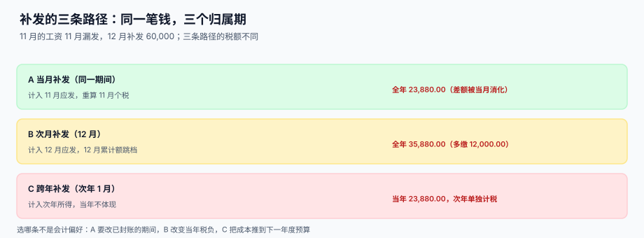

# 补发、追溯与跨期归属

<p style="text-align:center;"></p>

「11 月的工资算错了，12 月补给他」——这句话里藏着一个所有薪酬系统都会踩的坑：**这笔钱属于 11 月，但它在 12 月被支付**。归属期与支付期一旦混成一个字段，个税会跳档、成本会落到错的月份、社保基数会在下一年莫名其妙变高。

::: tip 一句话理解
**补发不是「这个月多发一笔」，而是「一笔属于过去期间的钱，在今天支付」。** 所以每一条补发记录必须同时带两个期间：`origin_period`（它属于哪个月）和 `paid_in_period`（它哪个月发出去）。
:::

本页判据族 `PYR-A` ~ `PYR-H`，共 8 条，定义在最后一节。

## 一、两条轴：归属期与支付期

| 轴 | 字段 | 决定什么 | 谁在看 |
| --- | --- | --- | --- |
| 归属期 | `origin_period` | 成本落在哪个月、绩效算哪个季度、社保基数算哪一年 | 财务、预算、审计 |
| 支付期 | `paid_in_period` | 个税并入哪个月的累计额、银行哪一批代发 | 税务、出纳、员工 |

这两条轴在**正常发薪**时重合（11 月的工资 11 月发），在**补发**时分离。系统如果在设计时只留了一个 `period` 字段，后面所有的补发都只能二选一：要么成本错月，要么个税错期。

## 二、三条路径



场景：11 月工资漏发 60,000（假设某高管 11 月有一次性奖金），12 月发现。三条路都合法，代价不同：

| 路径 | 做法 | 当年个税 | 成本归属 | 代价 |
| --- | --- | --- | --- | --- |
| A 当期重算 | 重开 11 月工资单，重算后 11 月多发 | 23,880.00（差额被 11 月消化） | 11 月 | 已封账期间要红冲，改动大 |
| B 次月补发 | 12 月新增补发行，并入 12 月应发 | **35,880.00（多缴 12,000.00）** | 11 月（归属）/ 12 月（支付） | 员工 12 月税负陡增 |
| C 跨年补发 | 次年 1 月补发，计入次年所得 | 当年 23,880.00，次年单独累计 | 11 月（归属）/ 次年（支付） | 成本跨年，预算执行率失真 |

本机读数（月薪 30,000、个人社保 5,000、专项附加 3,000）：

| 场景 | 全年个税 |
| --- | --- |
| 无补发 | 23,880.00 |
| 12 月补发 60,000 | **35,880.00** |
| 次年 1 月补发（当年不体现） | 23,880.00 |

::: danger 为什么 B 路径会多缴 12,000
累计预扣法的税率是**跳档**的：12 月突然多出 60,000 收入，累计应纳税所得额从 12 月的 204,000 直接跳到 264,000，跨过 144,000 与 300,000 两个档位之间的这一段，**这一笔钱按 20%~25% 的边际税率扣**。而它本该分摊在全年，按 10%~20% 扣。

这不是系统算错，是税法按「支付期」累计的必然结果。所以：
1. **必须提前告知**：补发金额超过月薪 2 倍时，工资条要标注「本期含补发，个税已按累计口径计算」。
2. **不要试图「摊平」到几个月**：把 60,000 拆成 3 个月各 20,000 发放，法律上是三次独立支付，但会被认定为「分解工资」，风险更大。
3. **优先走 A 路径**：能重开当月就走 A，成本与税负都更准。
:::

## 三、追溯调整：已封账的期间怎么改

11 月已经出报表、报完税、发完钱。此时发现算错了，正确做法是**红冲 + 新单**，不是改数：

```text
① 原单红冲：pay_slip(2026-11) 状态改为 REVERSED，金额取负写入 pay_adjust
② 新单重出：pay_slip(2026-11) 新版本，version + 1，标记 supersedes = 原单 id
③ 差额补发：新旧之差落 pay_adjust，paid_in_period = 当期
```

三条硬规则：

1. **原记录不删、不改金额**：审计要看到「原来是多少、改成多少、谁改的」。
2. **申报表的更正申报**与账面红冲是两个动作：账面改完，税务端的更正申报要单独做，且有时间窗（多数地区次月申报期内可更正）。
3. **红冲与重出必须成对**：只红冲不重出，这个人当月工资就没了；只重出不红冲，就是双倍。

## 四、补发对社保的影响

多数地区社保按**年度基数**征收，当月补发不改变当月社保。但有一条例外必须记住：

> 补发会计入「上年度月平均工资」，从而影响**次年 7 月调整后的基数**。

所以一笔 60,000 的补发，在次年 7 月会让这个人的社保基数上升 5,000/月（60,000 ÷ 12），个人每月多缴 1,125，单位多缴 1,975。财务在算补发成本时如果只算「工资 + 个税」，会漏掉这一块。

## 五、表结构与幂等

```sql
CREATE TABLE pay_adjust (
  id              INTEGER PRIMARY KEY,
  emp_id          TEXT    NOT NULL,
  origin_period   TEXT    NOT NULL,        -- 归属期：这笔钱属于哪个月
  paid_in_period  TEXT    NOT NULL,        -- 支付期：哪个月发出去
  item_code       TEXT    NOT NULL,        -- RETRO_BASE / RETRO_BONUS / SI_DIFF / SEVERANCE ...
  amount          NUMERIC NOT NULL,        -- 可正可负
  reason_code     TEXT    NOT NULL,        -- CALC_ERROR / LATE_HIRE / SI_BASE_ADJUST ...
  source_slip_id  INTEGER,                 -- 被红冲的原单
  idempotency_key TEXT    NOT NULL UNIQUE, -- 同一笔补发只能入账一次
  created_at      TEXT    NOT NULL
);

CREATE INDEX idx_adjust_paid ON pay_adjust(paid_in_period);
CREATE INDEX idx_adjust_origin ON pay_adjust(origin_period);
```

`idempotency_key` 是这一块最容易被省掉、也最容易出事的字段：一次补发重跑两次，就是双倍工资。它的构造建议是 `emp_id + origin_period + item_code + reason_code`，天然唯一。

```sql
-- 补发入账：重复执行不会双发
INSERT INTO pay_adjust(emp_id, origin_period, paid_in_period, item_code, amount, reason_code, idempotency_key, created_at)
VALUES (:emp, :origin, :paid, :item, :amount, :reason,
        :emp || '|' || :origin || '|' || :item || '|' || :reason, datetime('now'))
ON CONFLICT(idempotency_key) DO NOTHING;

SELECT changes() AS inserted;   -- 0 表示这笔补发已经入过账
```

## 六、判据清单

| 编号 | 判据 | 怎么验 |
| --- | --- | --- |
| `PYR-A` | 每条调整记录同时有 `origin_period` 与 `paid_in_period` | 两列均非空，且可不同 |
| `PYR-B` | 正常发薪时两期相等，补发时允许不等 | 存在两期不等的记录 |
| `PYR-C` | 已封账期间不直接改金额，走红冲 + 新单 | 原单 `status='REVERSED'` 且金额不变 |
| `PYR-D` | 红冲与重出成对，净额 = 新旧之差 | 按 `origin_period` 汇总差额与 `pay_adjust` 一致 |
| `PYR-E` | 补发并入 `paid_in_period` 的累计额，不并入归属期 | 个税 `cum_income` 按支付期增长 |
| `PYR-F` | 同一笔补发重复入账被唯一键挡住 | `idempotency_key` 冲突时 `changes()=0` |
| `PYR-G` | 补发金额超过月薪 2 倍时，工资条带提示标记 | `pay_slip.notice_code` 含 `RETRO_LARGE` |
| `PYR-H` | 补发计入上年月平均工资，次年基数可追溯到来源 | 基数计算 SQL 能列出参与平均的调整记录 |

## 验证方式

```shell
# 1) 结构性判据：归属期与支付期都存在
sqlite3 /tmp/pay.db "SELECT count(*) FROM pragma_table_info('pay_adjust')
  WHERE name IN ('origin_period','paid_in_period');"
# 期望：2

# 2) 幂等：同一条补发插两次，第二次不应入账
sqlite3 /tmp/pay.db "INSERT INTO pay_adjust(emp_id,origin_period,paid_in_period,item_code,amount,reason_code,idempotency_key,created_at)
  VALUES('E0001','2026-11','2026-12','RETRO_BASE',60000,'CALC_ERROR','E0001|2026-11|RETRO_BASE|CALC_ERROR','2026-12-05');
  INSERT INTO pay_adjust(emp_id,origin_period,paid_in_period,item_code,amount,reason_code,idempotency_key,created_at)
  VALUES('E0001','2026-11','2026-12','RETRO_BASE',60000,'CALC_ERROR','E0001|2026-11|RETRO_BASE|CALC_ERROR','2026-12-05');
  SELECT count(*) FROM pay_adjust WHERE idempotency_key='E0001|2026-11|RETRO_BASE|CALC_ERROR';"
# 期望：1

# 3) 红冲必须成对：孤立的红冲应能查出来（期望无输出）
sqlite3 /tmp/pay.db "SELECT a.emp_id, a.origin_period FROM pay_adjust a
  WHERE a.item_code='REVERSAL'
    AND NOT EXISTS (SELECT 1 FROM pay_slip s WHERE s.supersedes = a.source_slip_id);"
# 期望：无输出
```

## 参考资料

- [个税累计预扣与年度重置](../IIT/index.md)：补发为什么会在支付期跳档
- [社保公积金基数与比例](../SocialInsurance/index.md)：补发如何影响次年基数
- [离职结算与年终奖](../Settlement/index.md)：另一类一次性的「非月度」支付
- [批量数据交换的行级校验](../../BulkDataExchange/RowValidation/index.md)：补发批量导入的行级回执
- 国家税务总局：个人所得税扣缴申报管理办法（2018 年第 61 号）：<https://www.gov.cn/gongbao/content/2019/content_5386991.htm>
