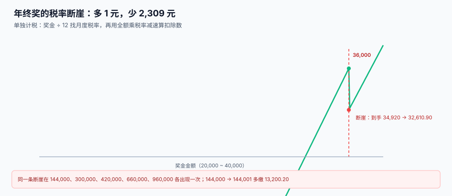

# 离职结算与年终奖

<p style="text-align:center;"></p>

离职结算和年终奖是同一类东西：**一次性的、非月度的、金额通常大于月薪的支付**。它们与月度工资最大的区别不是算法，而是「一年只有一次」「一次只有一个人」「错了没法下个月修正」——发错一笔年终奖，只能在次年汇算时由员工自己去退税。

::: tip 一句话理解
**离职是「把这个人所有未结项一次结清」，年终奖是「把一年的钱按 12 个月找一个税率」。** 前者最怕漏项，后者最怕踩在税率断崖上多 1 元少 2,309 元。
:::

本页判据族 `PYE-A` ~ `PYE-H`，共 8 条，定义在最后一节。

## 一、离职结算的七个项目

| 项目 | 算法 | 是否计税 | 常见漏项 |
| --- | --- | --- | --- |
| 当月工资 | 月薪 ÷ 21.75 × 实际计薪天数 | 是 | 按当月工作日折算，差 328~657 元 |
| 未休年假补偿 | 日薪 × 天数 × **200%**（正常工资那 100% 已在应发） | 是 | 按 300% 另发一次，多发一倍 |
| 经济补偿金 | 月薪 × N（N = 工作年限，满半年按 1 年、不满半年按 0.5） | **3 倍社平以内免征** | 全额计税，员工多缴上万 |
| 代通知金 | 未提前 30 天通知时 +1 个月工资 | 是 | 与 N+1 的「+1」混为一谈 |
| 竞业限制补偿 | 按月支付，不低于当地最低标准 | 是 | 一次性发完，税负陡增 |
| 社保公积金最后一个月 | 按当月基数正常缴 | 个人部分税前扣除 | 离职当天停缴，导致断月 |
| 其他扣款 | 借款、押金、设备赔偿 | 否 | 漏扣，无法追回 |

### 未休年假的 300% 是个陷阱

5 天未休、月薪 20,000（日薪 919.54）：

```text
300% 口径合计 = 919.54 × 5 × 3 = 13,793.10
其中「正常工资」那 100% 已含在当月应发里
所以额外应补  = 919.54 × 5 × 2 =  9,195.40
```

如果离职结算单上写「未休年假补偿 13,793.10」并**另外**发了当月工资，就等于把正常工资那一倍发了两次。

### 经济补偿金的免税额度

按财税〔2018〕164 号：在当地上年职工平均工资 **3 倍**以内的部分免征个人所得税，超过部分**不并入当年综合所得，单独适用综合所得税率表**。

月薪 30,000、工作 5.5 年（N = 5.5）、社平 12,000：

| 步骤 | 计算 | 金额 |
| --- | --- | --- |
| 补偿金 | 30,000 × 5.5 | 165,000.00 |
| 免税额度 | 12,000 × 3 | 36,000.00 |
| 应税部分 | 165,000 − 36,000 | 129,000.00 |
| 单独计税（10%，速算 2,520） | 129,000 × 10% − 2,520 | **10,380.00** |

::: danger 三个必错点
1. **把「N+1」的 +1 当成补偿金的一部分去算免税**：+1 是代通知金，属于工资薪金，全额计税，不享受 3 倍社平免征。
2. **用「当月工资」当补偿金的月薪基数**：应按离职前 12 个月平均工资，且**卡在 3 倍社平上限**（高薪员工的经济补偿金本身也有封顶）。
3. **离职当天停缴社保**：当月已过申报期，停缴会造成断月，影响购房、落户、医保连续性。正确做法是「当月照缴，次月停缴」。
:::

## 二、年终奖：除以 12 找税率，再乘全额

依据财政部 税务总局公告 2023 年第 30 号，全年一次性奖金**单独计税**政策延续至 **2027-12-31**：

```text
① 奖金 ÷ 12，得到「月均值」
② 用月均值查「按月换算后的综合所得税率表」，得到税率与速算扣除数
③ 应纳税额 = 奖金全额 × 税率 − 速算扣除数
```

注意第 ③ 步：乘的是**全额**，减的是**月度速算扣除数**——这正是断崖的来源。



## 三、断崖：本机读数

| 奖金 | 月均 | 税率 | 速算扣除 | 税额 | 到手 |
| --- | --- | --- | --- | --- | --- |
| 36,000 | 3,000 | 3% | 0 | 1,080.00 | 34,920.00 |
| **36,001** | 3,000.08 | **10%** | 210 | **3,390.10** | **32,610.90** |
| 144,000 | 12,000 | 10% | 210 | 14,190.00 | 129,810.00 |
| **144,001** | 12,000.08 | **20%** | 1,410 | **27,390.20** | 116,610.80 |
| 300,000 | 25,000 | 20% | 1,410 | 58,590.00 | 241,410.00 |
| 300,001 | 25,000.08 | 25% | 2,660 | 72,340.25 | 227,660.75 |
| 420,000 | 35,000 | 25% | 2,660 | 102,340.00 | 317,660.00 |
| 420,001 | 35,000.08 | 30% | 4,410 | 121,590.30 | 298,410.70 |

两条最刺眼的：

- **36,000 → 36,001**：多 1 元，税多 2,310.10，**到手少 2,309.10**
- **144,000 → 144,001**：多 1 元，税多 **13,200.20**

所以年终奖发放表必须有一步「断崖检查」：如果奖金落在断崖上方 1 元到「到手持平点」之间的区间，要么压到断崖值，要么加发到持平点以上。

```text
36,001 的到手 = 32,610.90
要让 36,000 以上的人到手不低于 34,920，需满足：
  奖金 × (1 − 10%) + 210 ≥ 34,920
  奖金 ≥ 38,566.67 → 取 38,567
```

本机读数：38,567 时税 3,646.70，到手 **34,920.30**，刚刚越过 36,000 的到手线。

## 四、单独计税还是并入综合所得

同一个奖金，两种选择差多少？月薪 30,000、个人社保 5,000、专项附加 3,000、奖金 36,000：

| 选择 | 工资个税 | 奖金个税 | 全年合计 |
| --- | --- | --- | --- |
| 单独计税 | 23,880.00 | 1,080.00 | **24,960.00** |
| 并入综合所得 | 31,080.00（含奖金边际 7,200.00） | — | 31,080.00 |
| 差 | — | — | **6,120.00** |

规律：**当这个人全年综合所得税率低于奖金单独计税的档位时，并入更省；反之单独更省。** 本例中工资部分的边际税率是 20%，而奖金单独只按 10%，所以单独省 6,120。

工程上不要写死「一律单独」：要提供一个 `tax_option` 字段，允许按人选择，并在年度汇算前给每个人算一遍两种口径——这是唯一能让员工不多缴税的做法。

::: warning 一个纳税年度只能用一次
「全年一次性奖金」单独计税，**一个纳税年度内每个纳税人只允许使用一次**。系统必须在发放时检查：同一 `emp_id` + `tax_year` 是否已有 `bonus_type='ANNUAL'` 且 `tax_option='SEPARATE'` 的记录。第二次发放（如季度奖、半年奖）只能并入当月工资。
:::

## 五、表结构

```sql
CREATE TABLE pay_settlement (
  id             INTEGER PRIMARY KEY,
  emp_id         TEXT    NOT NULL,
  settle_type    TEXT    NOT NULL,      -- RESIGN / TERMINATE / RETIRE
  last_work_date TEXT    NOT NULL,
  n_years        NUMERIC NOT NULL,      -- 补偿年限 N
  severance      NUMERIC NOT NULL,      -- 经济补偿金
  notice_pay     NUMERIC NOT NULL,      -- 代通知金（全额计税）
  leave_days     NUMERIC NOT NULL,      -- 未休年假天数
  leave_pay      NUMERIC NOT NULL,      -- 只补 200% 的部分
  tax_free_cap   NUMERIC NOT NULL,      -- 3 倍社平
  severance_tax  NUMERIC NOT NULL,      -- 补偿金单独计税金额
  UNIQUE (emp_id, settle_type, last_work_date)
);

CREATE TABLE pay_bonus (
  id            INTEGER PRIMARY KEY,
  emp_id        TEXT    NOT NULL,
  tax_year      INTEGER NOT NULL,
  bonus_type    TEXT    NOT NULL,       -- ANNUAL / QUARTERLY / SPECIAL
  amount        NUMERIC NOT NULL,
  tax_option    TEXT    NOT NULL,       -- SEPARATE / COMBINED
  tax_amount    NUMERIC NOT NULL,
  cliff_flag    INTEGER NOT NULL DEFAULT 0,  -- 是否落在断崖区间
  UNIQUE (emp_id, tax_year, bonus_type)
);
```

`cliff_flag` 是这一块最值钱的字段：它让「发多少」这件事在出账前就被检查一次，而不是等员工来问「为什么我多拿了 1 元却少了 2,309」。

## 六、判据清单

| 编号 | 判据 | 怎么验 |
| --- | --- | --- |
| `PYE-A` | 离职结算七项齐全，缺项要显式写 0 而不是留空 | 七个字段均 NOT NULL |
| `PYE-B` | 未休年假只补 200%，与当月工资不重复 | `leave_pay` = 日薪 × 天数 × 2 |
| `PYE-C` | 经济补偿金按 3 倍社平免征，超出部分单独计税 | `severance_tax` 可复算 |
| `PYE-D` | 代通知金全额计税，不享受免征 | `notice_pay` 不计入 `tax_free_cap` |
| `PYE-E` | 年终奖单独计税一年只能用一次 | `UNIQUE (emp_id, tax_year, bonus_type)` + 选项校验 |
| `PYE-F` | 落在断崖区间时必须打 `cliff_flag` | 36,001 ~ 38,566 区间内 `cliff_flag=1` |
| `PYE-G` | 单独与并入两种口径都可算，且可选 | `tax_option` 有值，且两套结果都能出 |
| `PYE-H` | 政策到期日可配置（2027-12-31），不硬编码 | 配置项 `bonus_separate_until` |

## 验证方式

```shell
# 1) 断崖标记：36,001 应被标记
sqlite3 /tmp/pay.db "SELECT amount, tax_amount, cliff_flag FROM pay_bonus WHERE emp_id='E0001' AND tax_year=2026;"
# 期望：36001.0|3390.1|1

# 2) 年终奖单独计税一年只能一次：第二次插入应失败
sqlite3 /tmp/pay.db "INSERT INTO pay_bonus(emp_id,tax_year,bonus_type,amount,tax_option,tax_amount)
  VALUES('E0001',2026,'ANNUAL',10000,'SEPARATE',300);"
# 期望：UNIQUE constraint failed: pay_bonus.emp_id, pay_bonus.tax_year, pay_bonus.bonus_type

# 3) 补偿金可复算：应税部分 = 总额 − 3 倍社平
sqlite3 /tmp/pay.db "SELECT severance, tax_free_cap, severance_tax FROM pay_settlement;"
# 期望：165000.0|36000.0|10380.0
```

## 参考资料

- [个税累计预扣与年度重置](../IIT/index.md)：为什么并入综合所得会改变全年税额
- [补发、追溯与跨期归属](../RetroPay/index.md)：跨年补发的另一条路径
- [应发、扣款与计薪天数](../GrossToNet/index.md)：离职当月折算与日薪
- 财政部 税务总局：关于延续实施全年一次性奖金个人所得税政策的公告（2023 年第 30 号）：<https://www.gov.cn/lianbo/bumen/202308/content_6900630.htm>
- 财政部 税务总局：关于个人所得税法修改后有关优惠政策衔接问题的通知（财税〔2018〕164 号）：<https://www.chinatax.gov.cn/>
