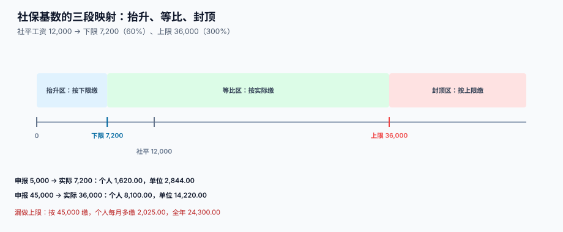

# 社保公积金基数与比例

<p style="text-align:center;"></p>

社保是这个专题里**唯一一个「有上限」的数**。工资可以一直涨，社保基数涨到 3 倍社平就停了。停与不停之间，一个人每月差 2,025 元，一年差 24,300 元——而这笔钱既不会报错，也不会被员工发现，因为工资条上只是「社保」那一栏的数字比同事大一点。

::: tip 一句话理解
**社保基数不是「这个月发了多少」，而是「上年月平均工资，卡在社平工资的 60% 到 300% 之间」。** 三段映射：低了抬到下限、中间按实际、高了压到上限。
:::

本页判据族 `PYS-A` ~ `PYS-H`，共 8 条，定义在最后一节。

## 一、三段映射



设当地社平工资 12,000：

| 区间 | 实际基数 | 说明 |
| --- | --- | --- |
| 申报值 < 7,200（60%） | **7,200** | 抬升区：按下限缴，工资低于下限也要按 7,200 缴 |
| 7,200 ≤ 申报值 ≤ 36,000 | 申报值 | 等比区：按实际缴 |
| 申报值 > 36,000（300%） | **36,000** | 封顶区：按上限缴，超出部分不缴 |

本机读数：

| 申报基数 | 实际基数 | 个人合计（22.5%） | 单位合计（39.5%） |
| --- | --- | --- | --- |
| 5,000 | 7,200 | 1,620.00 | 2,844.00 |
| 12,000 | 12,000 | 2,700.00 | 4,740.00 |
| 45,000 | 36,000 | 8,100.00 | 14,220.00 |
| 45,000（漏封顶） | 45,000 | **10,125.00** | 17,775.00 |

漏封顶的代价：个人每月多缴 2,025.00，单位多缴 3,555.00，**合计每月多缴 5,580.00，全年 66,960.00**。这笔钱不是白交——多缴的部分会进个人账户或统筹，但**单位的那 3,555 是白出的**，而且退不回来。

## 二、比例表（以常见口径为例）

| 险种 | 个人 | 单位 | 个人是否可免 | 备注 |
| --- | --- | --- | --- | --- |
| 养老保险 | 8% | 16% | 否 | 个人部分全额进个人账户 |
| 医疗保险 | 2% | 9.8%（含地方附加） | 否 | 各地差异最大的一项 |
| 失业保险 | 0.5% | 0.5% | 部分城市农民工可免 | 阶段性降费常见 |
| 工伤保险 | 0% | 0.2%~1.9%（按行业浮动） | 是 | 个人不缴 |
| 生育保险 | 0% | 1%（多地已并入医疗） | 是 | 个人不缴 |
| 住房公积金 | 5%~12% | **与个人同比例** | 否 | 单位与个人必须同比例 |

个人合计 **22.5%**（按公积金 12%），单位合计 **39.5%**。所以「公司为一个人花的钱」比「他挣的钱」多出 39.5%——这就是 [总览](../Overview/index.md) 里那个 41,850 的来源。

::: danger 三个必错点
1. **把公积金比例写成 5%，单位也按 5% 缴**：同一个人基数 12,000，12% 是 1,440、5% 是 600，个人与单位各差 840，**双边合计每月差 1,680，全年 20,160**。而且公积金是税前扣除，比例错了，个税的 `cum_special` 也跟着错。
2. **让单位与个人用不同比例**：除极少数城市有特殊政策，公积金要求同比例。不同比例会被公积金中心退回。
3. **把工伤、生育算进个人扣款**：个人不缴这两项，扣了就是多扣，且工资条上无法解释。
:::

## 三、基数申报：三个口径不要混

| 口径 | 取值 | 什么时候用 | 不能用来做什么 |
| --- | --- | --- | --- |
| 上年月平均工资 | 上年应发合计 ÷ 12 | **每年调基**（多数地区 7 月） | 不能用于新入职员工 |
| 首月全月工资 | 入职当月应发 | 新入职、无上年数据 | 不能年中改（除调薪） |
| 当月应发 | 每月变动 | **不用** | 用它当基数，社保每月都变，无法申报 |

关键区别：**基数是「年度」概念，不是「月度」概念**。每月按当月应发去算社保，是薪酬系统里最常见的一种「看起来更公平、实际完全错」的写法——社保局按年度基数征收，你按月度算出来的数申报不上去。

## 四、调基与补差：7 月的那一笔

多数地区 7 月调整基数，新基数从 1 月起追溯。基数从 12,000 调到 15,000 时：

| 项目 | 每月差额 | 补 1~6 月 |
| --- | --- | --- |
| 个人（22.5%） | 3,000 × 22.5% = 675.00 | 4,050.00 |
| 单位（39.5%） | 3,000 × 39.5% = 1,185.00 | 7,110.00 |
| 合计 | 1,860.00 | **11,160.00** |

这笔补差有三个工程要求：

1. **它属于「补发与调整」，不是「本月社保」**：要落 `pay_adjust`，不能塞进 7 月的 `pay_si_item`，否则 7 月的社保额会变成正常月份的 7 倍，工资条无法解释。
2. **个人补差要从当月工资里扣，但归属期是 1~6 月**：`period` 与 `paid_in_period` 是两个字段。
3. **单位补差进当期成本**，不追溯调整已出报表的历史期间——除非金额重大到需要追溯重述。

## 五、表结构

```sql
CREATE TABLE pay_si_item (
  id            INTEGER PRIMARY KEY,
  slip_id       INTEGER NOT NULL,          -- 关联工资单
  emp_id        TEXT    NOT NULL,
  period        TEXT    NOT NULL,          -- 归属期
  city_code     TEXT    NOT NULL,          -- 参保城市，决定比例与上下限
  item_code     TEXT    NOT NULL,          -- PENSION / MEDICAL / UNEMPLOY / INJURY / MATERNITY / HOUSING
  base_declared NUMERIC NOT NULL,          -- 申报基数
  base_actual   NUMERIC NOT NULL,          -- 卡过上下限后的实际基数
  rate_personal NUMERIC NOT NULL,
  rate_company  NUMERIC NOT NULL,
  amt_personal  NUMERIC NOT NULL,
  amt_company   NUMERIC NOT NULL,
  CHECK (base_actual BETWEEN 0 AND base_declared + 1e9),
  CHECK (amt_personal >= 0 AND amt_company >= 0)
);

CREATE TABLE si_base_rule (               -- 每个城市每个年度一条
  city_code     TEXT    NOT NULL,
  year          INTEGER NOT NULL,
  avg_wage      NUMERIC NOT NULL,
  floor_ratio   NUMERIC NOT NULL DEFAULT 0.6,
  ceil_ratio    NUMERIC NOT NULL DEFAULT 3.0,
  effective_from TEXT   NOT NULL,
  effective_to   TEXT,
  PRIMARY KEY (city_code, year)
);
```

把上下限放进 `si_base_rule` 而不是写死在代码里，是这一块唯一正确的做法：**每年 7 月，全国几百个城市各改一次**，改数据不改代码。

```sql
-- 卡上下限只有这三行，别再散落在业务代码里
SELECT MIN(MAX(:declared, avg_wage * floor_ratio), avg_wage * ceil_ratio) AS base_actual
FROM   si_base_rule
WHERE  city_code = :city AND year = :year;
```

## 六、判据清单

| 编号 | 判据 | 怎么验 |
| --- | --- | --- |
| `PYS-A` | 基数上下限来自配置表，不写死在代码里 | `si_base_rule` 存在且有 `effective_from/to` |
| `PYS-B` | `base_actual` 恒在 `[下限, 上限]` 区间内 | 越界查询应返回 0 行 |
| `PYS-C` | 个人与单位金额分列两列，不合并 | `amt_personal` 与 `amt_company` 均非空 |
| `PYS-D` | 个人比例合计 = 22.5%，单位合计 = 39.5%（按城市配置） | 逐人求和与配置一致 |
| `PYS-E` | 公积金单位与个人同比例 | 同一 `emp_id` 的 `rate_personal = rate_company` |
| `PYS-F` | 工伤、生育的个人金额恒为 0 | 查询 `amt_personal > 0` 应返回 0 行 |
| `PYS-G` | 调基补差落 `pay_adjust`，不混入当月 `pay_si_item` | 补差记录的 `period` 与 `paid_in_period` 不同 |
| `PYS-H` | 个人社保合计写入个税的 `cum_special`，口径唯一 | 两表按月对账差额恒 0 |

## 验证方式

```shell
# 1) 实际基数不越界：应输出 0 行
sqlite3 /tmp/pay.db "SELECT s.emp_id, s.period, s.item_code, s.base_actual, r.avg_wage
  FROM pay_si_item s JOIN si_base_rule r ON r.city_code=s.city_code
  WHERE s.base_actual < r.avg_wage*r.floor_ratio - 0.01
     OR s.base_actual > r.avg_wage*r.ceil_ratio + 0.01;"
# 期望：无输出

# 2) 工伤/生育个人部分为 0
sqlite3 /tmp/pay.db "SELECT count(*) FROM pay_si_item
  WHERE item_code IN ('INJURY','MATERNITY') AND amt_personal > 0;"
# 期望：0

# 3) 个人社保合计与个税口径一致：应输出 0 行
sqlite3 /tmp/pay.db "SELECT i.emp_id, i.period FROM pay_iit i
  JOIN (SELECT emp_id, period, SUM(amt_personal) s FROM pay_si_item GROUP BY 1,2) x
    ON x.emp_id=i.emp_id AND x.period=i.period
  WHERE ABS(i.cum_special - x.s) > 0.001 AND i.period = '2026-01';"
# 期望：无输出（首月口径，其余月份是累计值，需按区间比对）
```

## 参考资料

- [个税累计预扣与年度重置](../IIT/index.md)：`cum_special` 在个税里的位置
- [应发、扣款与计薪天数](../GrossToNet/index.md)：哪些项目进基数
- [补发、追溯与跨期归属](../RetroPay/index.md)：调基补差怎么落
- 中华人民共和国社会保险法（第十二条、第三十五条）：<https://www.gov.cn/>
- 住房公积金管理条例（第十六条、第十八条 缴存比例）：<https://www.gov.cn/>
