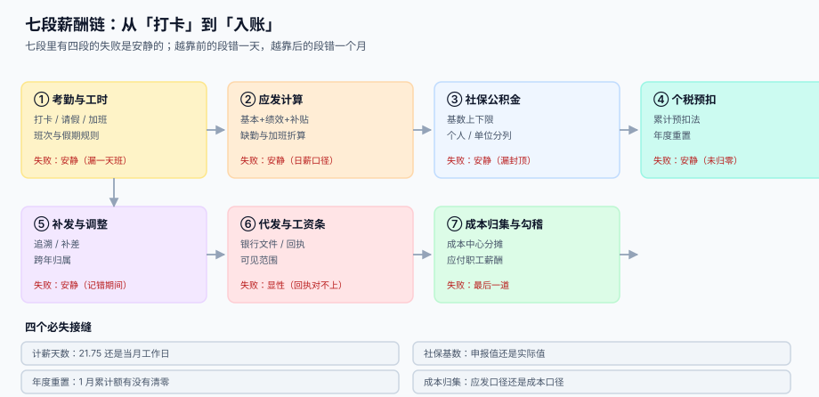

# 薪酬核算与个税社保

<p style="text-align:center;"></p>

工资系统最容易出的错，不是「算不出来」，而是**算出来了没人验**。一个人的月薪是 30,000，打卡少了一天、社保基数漏了封顶、12 月的累计额忘了清零——这三个错误都不会报错，也都不会让一个人的工资变成负数。它们只会让这个月多扣 300 元、下个月多扣 2,025 元、第二年 1 月多扣 2,890 元，然后被当成「这个月怎么少了这么多」的一次口头解释。

::: tip 一句话理解
**薪酬不是「发一笔钱」，而是把一个月的时间翻译成三个口径的数字：应发多少、扣掉多少、公司为此付出多少。** 三个口径各自有各自的规则，任何一次混用都会在某张报表上留下一笔永远说不清的数。
:::

## 这个专题讲什么

一次发薪从「打卡」到「入账」，要过七道工序。本专题按这七段组织，每一段都标出它的产物与失败方式：

| 段 | 这一段在做什么 | 产物 | 失败是否安静 |
| --- | --- | --- | --- |
| ① 考勤与工时 | 打卡、请假、加班、班次与假期规则 | 考勤汇总 `attendance_day` | **安静**（漏一天班，只少算一天） |
| ② 应发计算 | 基本工资 + 绩效 + 补贴 − 缺勤 + 加班 | 应发明细 `pay_gross_item` | **安静**（日薪口径选错，全年都错） |
| ③ 社保公积金 | 基数上下限、个人与单位分列 | 缴费明细 `pay_si_item` | **安静**（漏封顶，每月多缴 2,025） |
| ④ 个税预扣 | 累计预扣法、税率跳档、年度重置 | 个税明细 `pay_iit` | **安静**（1 月不归零，多扣 2,890） |
| ⑤ 补发与调整 | 追溯、补差、跨期归属 | 调整单 `pay_adjust` | **安静**（记错期间，税负差 12,000） |
| ⑥ 代发与工资条 | 银行文件、回执、可见范围 | 代发批次 `pay_batch` | 显性（回执金额对不上会被退） |
| ⑦ 成本归集与勾稽 | 成本中心分摊、应付职工薪酬 | 凭证 `gl_voucher` | **最后一道**（前六段错了，这里才暴露） |



## 与其它专题的分工

库里已经有好几册在写「钱」和「成本」，问的问题都不一样。先看这张表再决定读哪一册：

| 你关心的问题 | 该读哪一册 | 为什么不是本册 |
| --- | --- | --- |
| 「这笔工资怎么记账」 | [复式记账与分录](../Ledger/DoubleEntry/index.md) | 那册讲**一笔业务怎么拆两腿**，本册讲**这两腿的数从哪里算出来** |
| 「人工成本算不算产品成本」 | [容量与成本](../../Ops/CapacityCost/Overview/index.md) | 那册讲**单位成本与预算**，本册讲**人力的应发与单位部分** |
| 「设备折旧和工资都是按月摊吗」 | [折旧方法与月度引擎](../FixedAsset/Depreciation/index.md) | 那册摊的是**资产账面价值**，本册发的是**当期劳务对价** |
| 「员工报销怎么走审批」 | [采购到付款](../ProcureToPay/Overview/index.md) | 那册讲**三单匹配**，本册讲**工资单**；报销不是薪酬 |
| 「海外员工发薪按哪个汇率」 | [多币种与汇率折算](../MultiCurrency/Conversion/index.md) | 那册讲**折算路径与重估**，本册只取「发薪月的记账汇率」一个值 |
| 「几千人的工资表怎么批量导入」 | [批量数据交换](../BulkDataExchange/RowValidation/index.md) | 那册讲**文件契约与行级回执**，本册讲**导入之后怎么保证算得对** |
| 「工资条推送失败怎么办」 | [消息通知与触达](../NotificationDelivery/Delivery/index.md) | 那册讲**七段触达链**，本册只讲「谁能看哪一行」 |
| 「员工自助登录与越权」 | [认证与授权](../Auth/Authorization/index.md) | 那册讲**身份与权限模型**，本册讲**字段级可见范围** |

::: info 为什么不并入「复式记账」
两册的判据没有一条可以复用：那一册的核心是「借贷必须平」（一笔业务两腿相等），本册的核心是「三个口径各自闭合」（应发 = 各明细之和、实发 = 应发 − 各项扣减、成本 = 应发 + 单位部分）。一个判「横平」，一个判「三本账各自竖直」，合并只会造出一个两万字的怪物。
:::

## 本专题的章节

- [总览：七段薪酬链与三个「发多少」](Overview/index.md)
- [应发、扣款与计薪天数](GrossToNet/index.md)
- [个税累计预扣与年度重置](IIT/index.md)
- [社保公积金基数与比例](SocialInsurance/index.md)
- [补发、追溯与跨期归属](RetroPay/index.md)
- [离职结算与年终奖](Settlement/index.md)
- [银行代发、工资条与可见范围](Payout/index.md)
- [成本归集与总账勾稽](Ledger/index.md)
- [实战：从考勤到入账的可运行闭环](Practice/index.md)
- [常见问题与分诊](FAQ/index.md)

## 版本与标准

薪酬这一块**没有「大版本」概念**，因此本专题不建版本目录（如 `Spring5/`、`Spring6/` 那种）。三条理由：

1. **换代的是税法与社保政策，而判据未变**：不管按哪一版个税法，「累计应纳 − 累计已纳 = 本期应扣」一字不差；2019 年个税改革换掉的是「按月独立」这件事，而本册讲的是「累计」这条结构，旧口径在 [个税累计预扣](IIT/index.md) 里作为对照表出现，不另开一册。
2. **并存的差异是辖区而不是代际**：同一个集团在各省的社保基数上下限、公积金比例都不一样，差异是同一张配置表里的几行，不是两套内容线。
3. **真正需要版本目录的是「同一份代码两套写法」**，而本专题写的是账模型与数据契约。可参考按大版本组织的先例：[Spring5](../Java/Frame/Spring/Spring5/index.md)、[Vue2](../../Frontend/Frame/Vue/Vue2/index.md)。

涉及外部依据时，本专题引用的是**长期稳定的编号**，而非某一年的版本号：

| 依据 | 编号 | 本专题用它说明什么 |
| --- | --- | --- |
| 个人所得税法（2018 年修正） | 综合所得按年计税 | 为什么工资要「累计」而不是「按月独立」 |
| 个人所得税扣缴申报管理办法 | 国家税务总局公告 2018 年第 61 号 | 累计预扣法的公式、`5000 × 任职月数`、余额为负暂不退税 |
| 全年一次性奖金政策 | 财政部 税务总局公告 2023 年第 30 号 | 单独计税延续至 **2027-12-31**，也可选择并入综合所得 |
| 月计薪天数 | 劳社部发〔2008〕3 号 | 21.75 的来源与适用边界（折算日工资、小时工资） |
| 社会保险法 | 第十二条、第三十五条 | 单位与个人分别缴费、基数上下限的授权来源 |

::: warning 政策有有效期，读的时候先看年份
上面这几条里，只有年终奖单独计税带**明确到期日**（2027-12-31）。写进代码时不要把它硬编码成「永久规则」，要落成一条带 `effective_to` 的配置——到期那天你只需要改一行数据，而不是发一版程序。
:::

## 判据纪律

| 页 | 判据族 | 这一族管什么 | 条数 |
| --- | --- | --- | --- |
| 总览 | `PYO-A` ~ `PYO-H` | 七段产物齐全、三个口径分列、错误可归因 | 8 |
| 应发与计薪天数 | `PYG-A` ~ `PYG-H` | 日薪口径唯一、缺勤与加班可复算、离职折算 | 8 |
| 个税累计预扣 | `PYT-A` ~ `PYT-H` | 累计额可重算、年度重置、负数不退税 | 8 |
| 社保公积金 | `PYS-A` ~ `PYS-H` | 基数上下限、个人单位分列、补差可追 | 8 |
| 补发与追溯 | `PYR-A` ~ `PYR-H` | 归属期明确、跨年可解释、重跑幂等 | 8 |
| 离职结算与年终奖 | `PYE-A` ~ `PYE-H` | 结算项目齐全、盲区提示、单独与并入可选 | 8 |
| 代发与工资条 | `PYP-A` ~ `PYP-H` | 文件合计恒等、回执对账、字段级可见 | 8 |
| 成本归集与勾稽 | `PYL-A` ~ `PYL-H` | 三条勾稽为 0、分摊合计守恒、凭证可追 | 8 |
| 实战 | `PYX-A` ~ `PYX-H` | 建库一次成功、闭合查询恒 0、负向用例必须失败 | 8 |
| 常见问题 | `PYQ-A` ~ `PYQ-H` | 分诊可落地、止血有序、术语一致 | 8 |

每条判据回答三件事：**看什么现象、判成什么、不满足时改哪里**。编号逐页唯一，可被 `utils/audit` 下的判据类巡检机械核对。

## 验证方式

```shell
# 1) 专题结构：应为 11（目录页 + 10 章），每个子目录都有 index.md
find docs/Backend/Payroll -name "index.md" | wc -l
# 期望：11

# 2) 每页判据族 8 条：应输出 10 行，每行前面都是 8
for f in docs/Backend/Payroll/*/index.md; do
  echo "$(grep -oE '`PY[A-Z]-[A-H]`' "$f" | sort -u | wc -l | tr -d ' ') $f"; done

# 3) 目录页的判据表按「区间」写，10 族 × 起止两端 = 20 个编号
grep -oE '`PY[A-Z]-[A-H]`' docs/Backend/Payroll/index.md | sort -u | wc -l
# 期望：20（不是 80——区间写法只出现首尾两个编号）

# 4) 全专题编号总数：10 章 × 8 条 = 80
grep -rhoE '`PY[A-Z]-[A-H]`' docs/Backend/Payroll/*/index.md | sort -u | wc -l
# 期望：80

# 5) 配图齐全：应为 10 张 SVG + 1 张 Logo
ls docs/Backend/Payroll/assets/*.svg | wc -l && ls docs/Backend/Payroll/assets/*.png
# 期望：10 与 pay-logo.png
```

## 参考资料

- [总览：七段薪酬链与三个「发多少」](Overview/index.md)
- [实战：从考勤到入账的可运行闭环](Practice/index.md)
- 国家税务总局：个人所得税扣缴申报管理办法（2018 年第 61 号）：<https://www.gov.cn/gongbao/content/2019/content_5386991.htm>
- 财政部 税务总局：关于延续实施全年一次性奖金个人所得税政策的公告（2023 年第 30 号）：<https://www.gov.cn/lianbo/bumen/202308/content_6900630.htm>
- 人力资源和社会保障部：关于职工全年月平均工作时间和工资折算问题的通知（劳社部发〔2008〕3 号）：<https://www.mohrss.gov.cn/>
