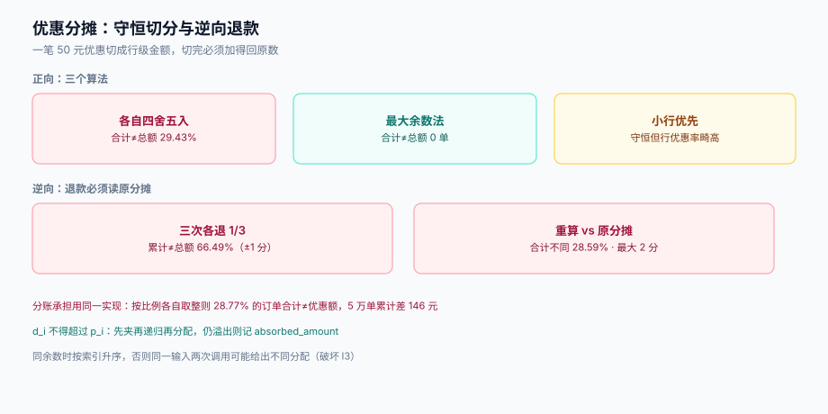

# 优惠分摊：最大余数法与逆向退款

「满 300 减 50」减的是订单，可订单里有一件 89 元的袜子和一件 211 元的外套。**这 50 元该记在谁头上**，决定了四件事：退款退多少、商家与平台各承担多少、发票每行开多少、对账怎么对上。

这一页只讲一件事：**怎么把一笔整单优惠切成行级金额，且切完还能加得回原数**。



本页判据族 `PPA-A` ~ `PPA-H`，共 8 条。定义表见文末「本页判据」一节。

## 一、为什么一定要摊

四个下游消费者都需要「行级」的金额，而它们没有一个能接受「整单优惠」这种粒度：

| 消费者 | 需要的行级数据 | 不摊的后果 |
| --- | --- | --- |
| **退款** | 退某一行时该退多少钱 | 只能按行原价退，等于把优惠「退回来了」，多退钱 |
| **分账/结算** | 每个商家承担多少优惠 | 平台与商家的账算不清，结算单对不上 |
| **开票** | 每行的实付与优惠 | 发票行金额之和 ≠ 订单金额，税务口径不成立 |
| **对账** | 订单、支付、记账三方的行级差集 | 只能对总额，差额出现时无法定位到行 |

所以分摊不是「为了订单详情页好看」，它是**一份账**，必须守恒。

## 二、三种算法与实测

设订单优惠 `D`，行金额 `p₁..pₙ`，需要求 `d₁..dₙ`，满足 `Σdᵢ = D` 且 `dᵢ ≥ 0`。

### 算法 A：各自按比例四舍五入

```python
d_i = round(D * p_i / Σp)
```

最直觉，也最错。本机实测（20,000 单，2~6 行，`D` 取 1 分~订单一半）：

| 观测 | 读数 |
| --- | --- |
| 合计 ≠ `D` 的订单 | **5,887 / 20,000（29.43%）** |
| 偏差分布 | `-1` 分 2,900 单、`+1` 分 2,898 单、`-2` 分 54 单、`+2` 分 35 单 |
| 最大偏差 | **2 分** |

29.43% 意味着**每三单就有一单分摊加不回总额**。2 分的偏差听起来微小，但它的性质是「账不平」——下游任何一个 `assert sum == total` 都会红，而如果没有这个 assert，偏差就会静默流进退款与分账，一年后变成一笔谁也说不清的历史差额。

### 算法 B：最大余数法（Largest Remainder）

先把「地板值」分下去，再把剩下的整数单位按余数从大到小逐个补给各行：

```python
import math

def allocate_largest_remainder(total: int, parts: list[int]) -> list[int]:
    s = sum(parts)
    raw = [total * p / s for p in parts]      # 精确到小数的份额
    base = [math.floor(x) for x in raw]        # 先给地板
    remainders = [raw[i] - base[i] for i in range(len(raw))]
    left = total - sum(base)                   # 还剩几个最小单位（0 ~ n-1）
    order = sorted(range(len(raw)), key=lambda i: (-remainders[i], i))  # 余数降序，同余按索引
    for i in order[:left]:
        base[i] += 1
    return base
```

`left` 一定落在 `[0, n-1]`，所以循环最多跑 `n-1` 次；`Σbase = total` 恒成立。本机实测 20,000 单：**合计 ≠ `D` 的订单 0 单**。

两个实现细节必须写死：

1. **同余时按索引升序**。否则同样输入的两次调用可能给出不同分配（`sorted` 在同值时依赖原顺序，而原顺序取决于上游的行顺序），破坏可重算性。
2. **用整数运算，不要先算浮点再 floor**。`total * p / s` 在 Python 里是浮点，`floor` 在恰好整数处可能因 1e-16 的误差少 1。安全写法是整数除法：`raw_num = total * p`，`base = raw_num // s`，`rem = raw_num % s`。

### 算法 C：按金额从小到大补偿

把 `D` 依次从最小行开始减，减到 0 为止。优点是实现最简单、天然守恒；缺点是**小额行的优惠率可能极高**（一件 1 元商品承担了 50 元优惠，行实付为负，必须再夹一次）。除非有业务理由（例如「优惠优先给小件」），否则不用。

| 算法 | 守恒 | 公平性 | 可解释性 | 建议 |
| --- | --- | --- | --- | --- |
| A 各自四舍五入 | **否**（29.43%） | 近似 | 好 | 禁用 |
| **B 最大余数法** | **是**（0） | 好（差额 ≤ 1 分） | 好 | **默认** |
| C 小行优先 | 是 | 差 | 一般 | 特殊场景 |

## 三、封顶与再分配

算法 B 保证守恒，但**不保证 `dᵢ ≤ pᵢ`**。反例：一行 5 元、一行 95 元，优惠 50 元，按比例该行分摊 2.5 元没问题；但如果优惠是 98 元，5 元行会分摊 4.9 元，行实付 0.1 元——还没问题。真正出问题的是**优惠 ≥ 订单额**（叠加封顶前的中间状态）或**按件分摊**（第二件半价）时。

规则只有一条：**任何行的 `dᵢ` 不得超过 `pᵢ`**。超出部分的处理是一个显式策略：

```text
1. 先按最大余数法分配
2. 逐行夹到 min(d_i, p_i)，把被夹掉的量记为 overflow
3. 若 overflow > 0，按「尚未封顶的行」的金额比例再分配一次（递归，直到 overflow=0 或无行可分）
4. 若无行可分（说明 D > Σp），剩余部分记入 absorbed_amount，并要求上层封顶
```

第 3 步必须递归而不是「一次补齐」——第二次分配又可能让某行封顶，产生新的 overflow。递归深度最多 `n`，代价可忽略。

## 四、逆向：退款时必须用原分摊，不能重算

这是分摊里最贵的一个坑。部分退款时，有两种写法：

| 写法 | 做法 | 实测 |
| --- | --- | --- |
| **重算** | 按「退款行的原价占比 × 订单优惠」重新算一遍该行优惠 | 与原始分摊合计不同的订单 **28.59%**，最大差 2 分 |
| **用原分摊** | 直接读分摊表 `dᵢ` | 恒等，无偏差 |

更直观的例子：一笔订单分三次各退 1/3。

| 观测 | 读数 |
| --- | --- |
| 三次 `round(T/3)` 累计 ≠ `T` | **13,298 / 20,000（66.49%）** |
| 其中累计多退 | 6,718 单（各 **+1 分**） |
| 其中累计少退 | 6,580 单（各 **−1 分**） |

三分之二的订单，分三次退完拿不回原额。多退的那部分是**平台白送**，少退的那部分是**客诉**——而两种都不该发生，因为原分摊表里本来就有精确答案。

```sql
-- 分摊表：订单行与优惠的一对多关系，一行可以有多种优惠来源
CREATE TABLE order_line_alloc (
  id             bigserial PRIMARY KEY,
  order_id       bigint      NOT NULL REFERENCES orders(id),
  line_id        bigint      NOT NULL REFERENCES order_items(id),
  source_type    text        NOT NULL CHECK (source_type IN ('ITEM','ORDER','COUPON','ADJUST')),
  source_id      bigint      NOT NULL,             -- rule_id 或 coupon_instance_id
  alloc_amount   bigint      NOT NULL CHECK (alloc_amount >= 0),  -- 分摊到的优惠（分）
  alloc_method   text        NOT NULL DEFAULT 'LARGEST_REMAINDER',
  created_at     timestamptz NOT NULL DEFAULT now(),
  UNIQUE (order_id, line_id, source_type, source_id)
);

-- 守恒校验：每个 (order, source) 的分摊合计必须等于该来源的优惠总额
CREATE OR REPLACE VIEW v_alloc_check AS
SELECT order_id, source_type, source_id,
       sum(alloc_amount) AS alloc_sum
FROM order_line_alloc
GROUP BY order_id, source_type, source_id;
```

`UNIQUE (order_id, line_id, source_type, source_id)` 这条约束是幂等的来源：重复提交同一笔分摊会撞唯一键而不是插两遍。

## 五、分账：谁承担这笔优惠

优惠不是「平台白送」，它有承担方。承担方的分摊必须与行分摊**用同一套算法**，否则两边加不回同一个数。本机实测（5 万单，按行金额比例分商家承担额）：

| 观测 | 读数 |
| --- | --- |
| 各行承担之和 ≠ 优惠额 | **14,384 / 50,000（28.77%）** |
| 累计误差 | **14,600 分（146 元）** |
| 单笔最大误差 | 2 分 |

对账时这 146 元就是「平台账上少了的钱」。它不会自己消失，只会在某个月的结算差异里爆出来，而且因为单笔只有 1~2 分，逐单追查的成本远高于金额本身。

::: danger 注意
1. **承担方分摊不要独立实现一遍**。它和行分摊是同一个数学问题（按金额比例切分整数），应该复用同一个函数，只是输入不同。写两遍必然分叉——「行分摊用最大余数、商家分摊用四舍五入」是本库见过的真实事故形态。
2. **不要用「先到先得」的整数元分配**（每行取整元，剩下的给第一行）。它守恒，但会让某一行承担全部零头，在大额订单上表现为「这一行亏得特别多」，商家会来问。
3. **退款时的承担方冲回必须与承担方分摊同源**。退款冲回若按「退款额 × 承担比例」重算，同样会漂 1~2 分，与第 4 节的结论一致。
:::

## 六、本页判据

| 编号 | 看什么现象 | 判成什么 | 不满足时改哪里 |
| --- | --- | --- | --- |
| `PPA-A` | 每个 `(order, source)` 的分摊合计是否等于该来源优惠额 | 不等即失败：账不平 | 改用最大余数法，见 `allocate_largest_remainder` |
| `PPA-B` | 是否存在 `dᵢ > pᵢ`（行优惠 > 行金额） | 存在即失败：行实付为负 | 封顶 + 递归再分配 |
| `PPA-C` | `Σ line_paid + freight + tax` 是否等于 `settle_amount` | 不等即失败 | 把运费与税排除在优惠分摊之外，各自独立成列 |
| `PPA-D` | 部分退款是否读原分摊表，而非重算 | 重算即失败：28.59% 会漂 | 退款按 `order_line_alloc` 取值 |
| `PPA-E` | 分多次退完的累计金额是否等于订单实付 | 不等即失败：66.49% 会差 1 分 | 每次退「该行剩余未退分摊」，而不是 `T/3` |
| `PPA-F` | 商家/平台承担额是否与行分摊用同一实现 | 两套实现即失败 | 抽成公共函数，输入换成承担比例 |
| `PPA-G` | 分摊结果的舍入是否只发生在「落到最小单位」这一步 | 中途多次舍入即失败 | 全程整数分，只在切分处取整一次 |
| `PPA-H` | 重复提交同一笔分摊是否幂等（撞唯一键而非插两份） | 不幂等即失败 | 加 `UNIQUE(order_id, line_id, source_type, source_id)` |

## 七、一段可复制的验收脚本

```shell
# 1) 造一笔 3 行、优惠 50 元的订单
curl -sS -X POST http://localhost:8080/api/orders \
  -H 'Content-Type: application/json' -H 'Idempotency-Key: alloc-demo-1' \
  -d '{"lines":[{"sku":"A","price":8900,"qty":1},{"sku":"B","price":21100,"qty":1},{"sku":"C","price":1000,"qty":1}],
       "coupon":"CPN-50OFF300"}' | jq '.settle_amount,.line_paid'

# 期望：settle_amount = 26000（30000 - 5000 + 运费 1000）
#      line_paid 之和 + 运费 = 26000

# 2) 守恒校验（必须返回 0 行）
psql "$DSN" -c "SELECT * FROM v_alloc_check a
                JOIN (SELECT order_id, source_type, source_id, amount FROM discount_source) s
                  USING (order_id, source_type, source_id)
                WHERE a.alloc_sum <> s.amount;"

# 3) 三次部分退款后累计必须等于行实付
psql "$DSN" -c "SELECT sum(refund_amount) FROM refund WHERE order_id = 1;"  # 期望 = 该行 line_paid
```

## 参考资料

- [计价链路与三条不变式](../PriceChain/index.md)（I2 可分账）
- [试算与结算同源](../Consistency/index.md)（分摊结果的快照与复核）
- [EventOrderHub · 退款与部分退款](../../../../project/Complete/EventOrderHub/Refund/index.md)（项目侧落地）
- PostgreSQL `numeric` 与整数运算文档：<https://www.postgresql.org/docs/18/datatype-numeric.html>
- Balinski & Young, *Fair Representation: Meeting the Ideal of One Man, One Vote*（最大余数法的数学性质与 Alabama paradox）
