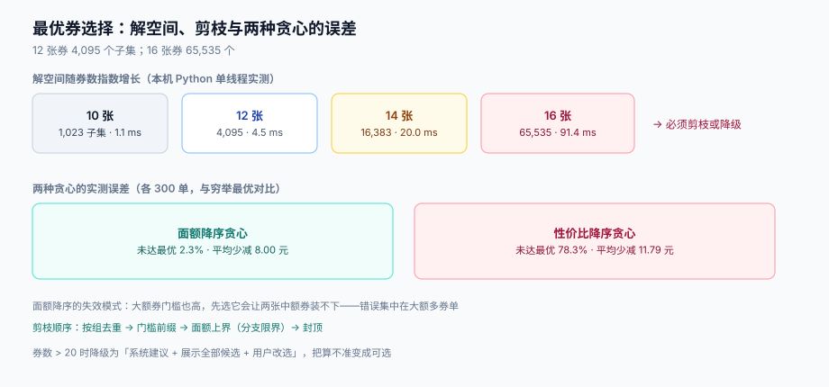

# 最优券选择：组合空间、剪枝与贪心的误差

「用户有 12 张券，帮他选最省的组合」这句话在需求评审上只需要一秒，在实现上是一个**带约束的子集选择问题**：券有门槛、有互斥组、有封顶，目标是最大化总减免。它的解空间是 `2^n - 1`，n=16 时已经 65,535 个。

这一页回答三个问题：解空间到底有多大、贪心差多少、以及**什么时候可以不求最优**。



本页判据族 `PPB-A` ~ `PPB-H`，共 8 条。定义表见文末「本页判据」一节。

## 一、问题定义

给定订单（行集合 `L`、金额 `T`）与候选券集合 `C`（每张券有 `min_spend`、`amount`、`group`），求子集 `S ⊆ C` 使得：

```text
maximize   Σ amount(c)          for c ∈ S
subject to 任意两张 c1,c2 ∈ S 的 group 不同        （组内互斥）
           Σ min_spend(c) ≤ T   for c ∈ S          （门槛可叠加性，见下）
           Σ amount(c) ≤ T                          （不许减穿）
```

第三个约束容易被忽略：券叠加必须封顶在 `T`，否则会产出负应付。

第二个约束其实是**简化**：严格来说，门槛应按「用了其他券之后的金额」判定（`threshold_base=PAYABLE`），此时约束变成顺序相关，问题从「子集选择」升级为「带顺序的序列决策」。实践中两个选择：

| 门槛口径 | 建模 | 复杂度 | 建议 |
| --- | --- | --- | --- |
| `LIST` / `TRADE`（与顺序无关） | 子集选择，可枚举 | `O(2^n · n)` | **默认**，可精确求最优 |
| `PAYABLE`（与顺序有关） | 需要搜索顺序 | `O(n! )` 最坏，或 DP | 只在运营明确要求时启用，且 n 限制在 6 以内 |

## 二、解空间有多大

本机实测（Python 3.13，单线程，12 张券 8 个互斥组，枚举全部子集并校验约束）：

| 券数 | 子集数 | 枚举耗时 | 备注 |
| --- | --- | --- | --- |
| 10 | 1,023 | 1.1 ms | 无压力 |
| 12 | 4,095 | 4.5 ms | 单次结算可接受 |
| 14 | 16,383 | 20.0 ms | 已占 50 ms 预算的四成 |
| 16 | 65,535 | 91.4 ms | 超过常见接口预算，必须剪枝 |

注意这是**纯 Python** 的数。换 Java 或 Go 大概能快一个数量级，但**不要用这个理由跳过剪枝**：券数是运营配出来的，今天 12 张、大促 25 张，`2^25 = 3,355 万`，任何语言都救不了。

## 三、剪枝：先砍掉不可能的分支

四个剪枝按「代价从低到高」排序，前两个几乎免费：

1. **按组去重**：同一组内只保留「面额最大」的那张参与枚举？**不行**——门槛不同，面额大的可能用不了。正确做法是组内保留全部候选，但枚举时「每组至多选 1」，这把 `2^n` 降到 `Π(size(group)+1)`。8 组 × 每组 2 张时是 `3^8 = 6,561`，比 `2^16` 小 10 倍。
2. **门槛前缀剪枝**：把券按 `min_spend` 升序，DFS 时累计门槛，一旦超过 `T` 就整枝剪掉。
3. **面额上界剪枝**：剩余券的面额总和 + 当前累计 ≤ 当前最优，剪枝（分支限界）。
4. **封顶剪枝**：当前累计已达 `T`，剪枝并直接返回 `T`。

```java [CouponBest.java]
/** 分支限界：groups 已按组聚合，bound[k] = 第 k 组起的面额上界（含本组） */
void dfs(int k, int spend, int discount, Set<Integer> used) {
    if (discount > best) { best = discount; bestSel = new ArrayList<>(picked); }
    if (k == groups.size() || discount + bound[k] <= best) return;   // 上界剪枝
    if (discount >= total) return;                                    // 封顶剪枝
    for (Coupon c : groups.get(k)) {                                  // 每组至多选 1
        if (spend + c.minSpend > total) continue;                     // 门槛剪枝
        picked.add(c); dfs(k + 1, spend + c.minSpend, discount + c.amount, used); picked.remove(c);
    }
    dfs(k + 1, spend, discount, used);                                 // 本组不选
}
```

## 四、贪心差多少：两种常见写法的实测

很多人第一版都会写贪心，理由是「券不多，够用」。本机实测（各 300 单，12 张券、8 个互斥组，与穷举最优解对比）：

| 贪心策略 | 未达最优的单数 | 占比 | 平均少减 | 最多少减 |
| --- | --- | --- | --- | --- |
| 按**面额降序**，能叠就叠 | 7 / 300 | **2.3%** | 8.00 元 | 13.00 元 |
| 按**性价比**（面额/门槛）降序 | 235 / 300 | **78.3%** | 11.79 元 | 45.00 元 |

两个结论都很反直觉：

1. **按性价比排序几乎必然算错**。因为它的目标是「单位门槛的收益率」，而订单只有一个总门槛——收益率高的券往往面额小，早早把门槛预算花光，反而装不下大额券。78.3% 的错误率意味着这个策略基本不可用。
2. **按面额降序只错 2.3%，但那 2.3% 恰恰是最贵的单**。它的失效模式是：大额券门槛也高，先选它之后，剩下的金额装不下另一张「门槛低但面额也不小」的券，而最优解是「放弃大额券，选两张中额券」。错误集中在高客单、多券场景——也就是最该算准的场景。

::: danger 注意
1. **不要用「贪心 + 事后交换一次」当最优解**。两两交换只能跳出「局部一阶」的坑，而上面的失效模式需要「同时换掉两张」，一次交换看不到。
2. **不要以为「用户自己会选」就不用算**。默认选中哪一组直接决定用户付多少；默认选错等于把差额从用户口袋里多拿了，而用户并不知道还有更省的组合——这类投诉的措辞通常是「你们故意不让我用券」。
3. **封顶后必须提示**。`Σ amount > T` 时实际只减 `T`，必须把「超出部分已失效」显式展示，否则用户会以为券没用完，下次发现「券怎么没了」。
:::

## 五、什么时候可以不求最优

有三种场景可以不枚举，但**每一种都要有明确的判据**：

| 场景 | 做法 | 判据 |
| --- | --- | --- |
| 只有 1 张券可用 | 直接返回 | 候选数 = 1 |
| 所有券同组（全互斥） | 取面额最大且门槛满足的 | 组数 = 1，退化为「单券最优」 |
| 券数 > 20 且都是 `PAYABLE` 口径 | 用「面额降序贪心 + 展示全部候选让用户改选」 | 必须展示候选与差额，把选择权交回用户 |

第三种是工程上最务实的：**系统给建议，用户有最终决定权，且差额可见**。它把「算不准」从「静默多收钱」变成「用户自己选」，风险性质完全不同。

## 六、结果要能被解释

最优解不能只返回一个数字，否则客服无法回答「为什么只减了 30」。返回结构至少要包含：

```json
{
  "selected": ["CPN-8812", "CPN-9903"],
  "discount_total": 3000,
  "candidates": [
    {"code": "CPN-8812", "amount": 2000, "chosen": true,  "reason": "best"},
    {"code": "CPN-7710", "amount": 2500, "chosen": false, "reason": "conflict_with:CPN-8812"},
    {"code": "CPN-9903", "amount": 1000, "chosen": true,  "reason": "best"},
    {"code": "CPN-6650", "amount": 1800, "chosen": false, "reason": "min_spend_unmet"}
  ],
  "absorbed": 0
}
```

`reason` 只有四个合法取值：`best` / `conflict_with:<code>` / `min_spend_unmet` / `expired`。**没有第五种**——如果你发现自己想加「其他」，说明规则模型漏了一个维度。

## 七、本页判据

| 编号 | 看什么现象 | 判成什么 | 不满足时改哪里 |
| --- | --- | --- | --- |
| `PPB-A` | 同组内是否最多选中 1 张 | 选中 2 张即失败 | 枚举按组聚合，每组至多选 1 |
| `PPB-B` | 选中券的门槛之和是否 ≤ 订单金额（`LIST`/`TRADE` 口径） | 超门槛即失败 | 门槛前缀剪枝 |
| `PPB-C` | `discount_total` 是否 ≤ `trade_amount`，超出部分是否记 `absorbed` | 减穿即失败 | 封顶剪枝 + `absorbed` 字段 |
| `PPB-D` | 是否用「性价比降序」贪心作为唯一策略 | 是即失败：实测错误率 78.3% | 改枚举或面额降序 + 候选展示 |
| `PPB-E` | 券数 > 16 时是否有剪枝或降级策略 | 无即失败：耗时随 `2^n` 爆炸 | 分支限界 + 超过阈值降级为「建议 + 用户选」 |
| `PPB-F` | 返回结构是否列出全部候选与未选中原因 | 只返回选中项即失败 | 返回 `candidates` + `reason` 四值枚举 |
| `PPB-G` | `PAYABLE` 口径下是否固定了叠加顺序 | 未固定即失败：结果不可复现 | 用三级排序键固定顺序，见[计价链路](../PriceChain/index.md) |
| `PPB-H` | 用户改选券后，是否重算分摊并刷新 `quote` | 未重算即失败：分摊与券不一致 | 改选触发全量重算，旧 `quote` 作废 |

## 参考资料

- [优惠规则模型](../RuleModel/index.md)（互斥组与 `threshold_base` 的定义）
- [优惠分摊](../Allocation/index.md)（选定券之后怎么摊到行）
- Martello & Toth, *Knapsack Problems: Algorithms and Computer Implementations*（分支限界与上界剪枝）
- Python `itertools.combinations` 文档（枚举实现参考）：<https://docs.python.org/3/library/itertools.html>
