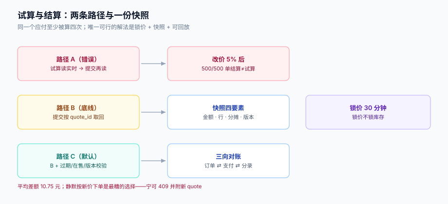

# 试算与结算同源：快照、锁价与漂移

用户在结算页看到 87.30 元，点提交，扣了 98.05 元。这类投诉的可怕之处不是差 10 元，而是**你无法证明自己没错**——结算页早就被下一次刷新覆盖了。

这一页把「同一个数在哪里被算出来」摊开，然后给出唯一可行的解法：**锁价 + 快照 + 可回放**。



本页判据族 `PPK-A` ~ `PPK-H`，共 8 条。定义表见文末「本页判据」一节。

## 一、同一个应付，至少被算四次

| 时刻 | 算的人 | 读的数据 | 用途 |
| --- | --- | --- | --- |
| 详情页 | 前端 + 轻量接口 | 当前价目表 + 部分规则 | 展示「到手价」 |
| 结算页（试算） | 计价服务 | 价目表 + 全部规则 + 券 + 运费 | 展示 `quote` |
| 提交（结算） | 计价服务 | **同上，但可能已经变了** | 生成订单 |
| 支付回调 | 订单服务 | 订单快照 | 传给通道 |
| 退款 / 对账 | 退款服务 / 对账任务 | 分摊表 + 快照 | 计算应退 / 比对 |

前三个都在「算同一个数」，而它们的输入可能不同：价目表被改、规则到点生效、券被别处用掉、运费模板改了。本机实测（500 单，试算与结算之间价目表上调 5%）：

| 观测 | 读数 |
| --- | --- |
| 结算金额 ≠ 试算金额的订单 | **500 / 500（100%）** |
| 平均差额 | **1,075 分（10.75 元）** |

100% 不是夸张，是必然：只要两次读的是不同版本的价格，差额就一定会出现。5% 的改价只是让它更明显。

## 二、三条路径与两种解法

```text
路径 A（错误）：试算读实时 → 提交再读实时
路径 B（可行）：试算读实时 → 返回 quote_id → 提交按 quote_id 取回 quote
路径 C（更强）：路径 B + 提交时校验 quote 是否过期 / 关联数据是否变更
```

**路径 B 是底线，路径 C 是默认**。区别在于：路径 B 只保证「提交时用的是同一份 quote」，但如果 quote 已经放了 3 天、商品下架了，仍然会生成一笔不该有的订单。路径 C 在提交时做三项校验：

1. `quote.expire_at > now()`；
2. 参与计算的 SKU 仍在售（`sku.status = 'ON_SALE'`）；
3. 规则版本未被强制下线（`rule_version` 仍在 `ACTIVE` 集合里）。

任一项不通过，返回 `409 QUOTE_STALE` 并附上**新 quote**，让前端展示「价格有变化，请确认」——而不是静默按新价下单。

```sql
CREATE TABLE price_quote (
  id             uuid        PRIMARY KEY,             -- 即 quote_id
  user_id        bigint      NOT NULL,
  currency       char(3)     NOT NULL,
  list_amount    bigint      NOT NULL,
  trade_amount   bigint      NOT NULL,
  freight        bigint      NOT NULL DEFAULT 0,
  tax            bigint      NOT NULL DEFAULT 0,
  settle_amount  bigint      NOT NULL,
  absorbed       bigint      NOT NULL DEFAULT 0,
  items_json     jsonb       NOT NULL,               -- 行快照：sku / 单价 / 数量 / 行优惠
  alloc_json     jsonb       NOT NULL,               -- 分摊结果快照
  price_version  text        NOT NULL,               -- 价目表版本
  rule_version   int[]       NOT NULL,               -- 命中的规则版本集合
  bucket         int         NOT NULL,               -- 灰度桶号
  expire_at      timestamptz NOT NULL,
  created_at     timestamptz NOT NULL DEFAULT now()
);

CREATE INDEX price_quote_expire_idx ON price_quote (expire_at);
```

四列的关键性：

- `items_json` / `alloc_json`：让「当时怎么算的」可以**原样重放**，不依赖任何外部表；
- `price_version` + `rule_version`：让「当时用的是哪版规则」可查；
- `bucket`：让灰度出问题时能定位到「哪些桶受影响」；
- `expire_at`：让「过期 quote 不能下单」成为数据库层的判断，而不是应用层的记忆。

## 三、锁价窗口：多长合适

锁价窗口是一个**业务与风险的取舍**，没有标准答案，但有三个必须考虑的输入：

| 输入 | 影响 | 典型取值 |
| --- | --- | --- |
| 用户决策时间 | 太短会频繁 `QUOTE_STALE`，体验差 | 15~30 分钟 |
| 大促改价频率 | 太短会在活动开始瞬间产生大量过期 | 大促期间 5~10 分钟 |
| 秒杀/限量商品 | 太长会让「锁价」变成「锁库存」 | 单品单独配置，1~5 分钟 |

本库的默认值是 **30 分钟**，并且**锁价只锁价格，不锁库存**。这是一个重要的分离：锁价是「我承诺这个价」，锁库存是「我给你留着货」。混在一起会让「加了购物车没付款」变成占用库存，而库存的占用应该由预占机制（见[EventOrderHub · 库存预占](../../../../project/Complete/EventOrderHub/StockRelease/index.md)）负责。

::: danger 注意
1. **不要在锁价窗口内「静默改用新价」**。这是最糟的选择：用户看到旧价、扣了新价、系统认为自己没错。宁可拒绝下单并提示，也不要静默改价。
2. **不要把 `quote_id` 当幂等键**。`quote_id` 标识「一次试算」，幂等键标识「一次提交意图」。用户对同一份 quote 点两次提交，应该是**同一个订单**，此时幂等键相同而 `quote_id` 相同；但如果用户刷新页面拿到新 quote 再提交，是**新的一次意图**，应当允许生成新订单（或按业务规则拒绝）。
3. **快照里不要只存 JSON 而不存版本号**。JSON 能重放计算，但回答不了「当时用的是哪版规则」；版本号能回答后者，但重放不了细节。两者都要。
:::

## 四、改价的生效与灰度

改价本身也是一个「发布」，需要与计价链路对齐：

| 动作 | 做法 | 反例 |
| --- | --- | --- |
| 调价 | 插入新的 `sku_price` 行，带 `effective_from`，不 `UPDATE` 旧行 | `UPDATE price SET amount=?`：历史订单重算全变 |
| 生效 | 计价按 `now >= effective_from` 取当前有效行 | 用「最新的那行」：定时生效会失效 |
| 灰度 | 按 `bucket` 分流，`quote.bucket` 落库 | 无桶号：出问题只能全量回滚 |
| 回滚 | 插入一条「恢复价」，或把新行 `effective_from` 推后 | 删新行：已下单用户的快照指向不存在的价格 |

价格表的时间化设计：

```sql
CREATE TABLE sku_price (
  sku_id         bigint      NOT NULL,
  currency       char(3)     NOT NULL,
  amount         bigint      NOT NULL CHECK (amount >= 0),
  effective_from timestamptz NOT NULL,
  effective_to   timestamptz,                        -- NULL = 至今有效
  PRIMARY KEY (sku_id, currency, effective_from),
  CHECK (effective_to IS NULL OR effective_to > effective_from)
);

-- 取当前有效价：注意用 effective_from <= now < coalesce(effective_to, 'infinity')
SELECT amount FROM sku_price
 WHERE sku_id = $1 AND currency = $2
   AND effective_from <= $3
   AND (effective_to IS NULL OR effective_to > $3)
 ORDER BY effective_from DESC LIMIT 1;
```

## 五、对账：三个数必须能被证明相等

计价链路的终点是对账，而对账只需要三个数：

| 数 | 来源 | 与谁比 | 不平的含义 |
| --- | --- | --- | --- |
| `settle_amount` | 订单快照 | 支付通道回执 `total` | 通道金额与订单不一致（最严重） |
| `Σ line_paid + freight + tax` | 分摊表 | `settle_amount` | 分摊不守恒 |
| `Σ 分录借方` | 记账 | `settle_amount` | 记账漏记或重复 |

三向比较的写法必须是**差集**而不是「比总数」——总数为 0 可能是两个方向互相抵消：

```sql
-- 订单 vs 支付的差集（两个方向都要查）
SELECT o.id, o.settle_amount, p.total, 'ORDER_ONLY' AS kind
  FROM orders o LEFT JOIN payment p ON p.order_id = o.id
 WHERE p.order_id IS NULL OR p.total <> o.settle_amount
UNION ALL
SELECT p.order_id, NULL, p.total, 'PAYMENT_ONLY'
  FROM payment p LEFT JOIN orders o ON o.id = p.order_id
 WHERE o.id IS NULL;
```

## 六、本页判据

| 编号 | 看什么现象 | 判成什么 | 不满足时改哪里 |
| --- | --- | --- | --- |
| `PPK-A` | 提交时是否按 `quote_id` 取回试算结果，而非重新计价 | 重新计价即失败：必然漂移 | 提交接口收 `quote_id`，读 `price_quote` |
| `PPK-B` | `quote.expire_at` 是否在提交时校验 | 未校验即失败：可下过期单 | 提交时 `now() < expire_at`，否则 409 |
| `PPK-C` | 快照是否含 `price_version`、`rule_version`、`bucket` | 缺一即失败：无法定位影响面 | 三列均落库 |
| `PPK-D` | 是否存在 `UPDATE sku_price SET amount` 这类就地改价 | 存在即失败：历史不可重算 | 改时间化表，插新行 |
| `PPK-E` | 取当前价是否用 `effective_from <= now AND (effective_to IS NULL OR > now)` | 用「最新一行」即失败 | 改区间查询 + `ORDER BY effective_from DESC` |
| `PPK-F` | `QUOTE_STALE` 时是否返回新 quote 并提示，而非静默按新价 | 静默改价即失败 | 返回 409 + 新 quote |
| `PPK-G` | 对账是否做双向差集（`ORDER_ONLY` / `PAYMENT_ONLY`） | 只比总数即失败 | 改 `UNION ALL` 双向差集 |
| `PPK-H` | 价格变更是否可回滚且不影响已下单快照 | 删除旧行即失败 | 插入恢复价或推后 `effective_from` |

## 七、一段可以复现漂移的验收

```shell
# 1) 试算，拿 quote_id
QID=$(curl -sS -X POST http://localhost:8080/api/quotes \
  -H 'Content-Type: application/json' \
  -d '{"items":[{"sku":"SKU-1","qty":2}]}' | jq -r '.quote_id')
echo "quote: $(curl -sS http://localhost:8080/api/quotes/$QID | jq '.settle_amount')"

# 2) 改价 5%
psql "$DSN" -c "INSERT INTO sku_price(sku_id,currency,amount,effective_from)
                SELECT sku_id, currency, (amount*1.05)::bigint, now()
                  FROM sku_price WHERE sku_id=1 AND effective_to IS NULL;
                UPDATE sku_price SET effective_to=now() WHERE sku_id=1 AND effective_to IS NULL
                  AND effective_from < now();"

# 3) 用旧 quote 提交 —— 金额必须与第 1 步完全一致
curl -sS -X POST http://localhost:8080/api/orders \
  -H 'Content-Type: application/json' -H 'Idempotency-Key: q-1' \
  -d "{\"quote_id\":\"$QID\"}" | jq '.settle_amount'

# 4) 用过期 quote 提交 —— 必须 409 且带新 quote
curl -sS -o /dev/null -w '%{http_code}\n' -X POST http://localhost:8080/api/orders \
  -H 'Content-Type: application/json' -d "{\"quote_id\":\"$QID\"}"   # 期望 409
```

## 参考资料

- [计价链路与三条不变式](../PriceChain/index.md)（I3 可重算）
- [优惠分摊](../Allocation/index.md)（分摊快照的必要性）
- [EventOrderHub · 库存预占的释放与超时回滚](../../../../project/Complete/EventOrderHub/StockRelease/index.md)（锁价与锁库存的分离）
- PostgreSQL 范围类型与 `tstzrange` 文档（时间化价格表的另一种实现）：<https://www.postgresql.org/docs/18/rangetypes.html>
- 国家市场监督管理总局《明码标价和禁止价格欺诈规定》（价格变动应及时调整标价）：<https://www.samr.gov.cn/zw/zfxxgk/fdzdgknr/jls/art/2023/art_72865dc294a14432aff931038b02c210.html>
