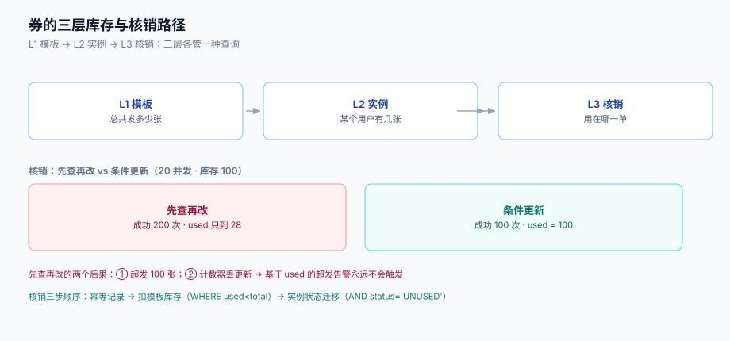

# 券库存与核销：超发、幂等与退券

券是一种**有库存的资产**：一张「满 100 减 10」的券，发 10,000 张就是 10 万元的负债。它和商品库存的区别只在于——商品超卖会被投诉，券超发会被**静默地多减钱**，而多减的钱在活动结束前没人发现。

这一页讲三件事：三层库存各管什么、核销为什么必须是条件更新、以及取消与退款时券怎么退。



本页判据族 `PPS-A` ~ `PPS-H`，共 8 条。定义表见文末「本页判据」一节。

## 一、三层库存

「券库存」经常被当成一个数字，实际上有三层，每层的语义完全不同：

| 层 | 表 | 语义 | 何时减 | 谁关心 |
| --- | --- | --- | --- | --- |
| **L1 模板库存** | `coupon_template.total` | 这次活动总共发多少张 | 领券时 | 运营、预算 |
| **L2 用户券** | `coupon_instance` | 某个用户手里有哪些券 | 领券时插入一行 | 用户、客服 |
| **L3 核销记录** | `coupon_redeem` | 哪张券在哪笔订单上被用掉了 | 下单时 | 财务、对账 |

三层之间是**一对多**：一个模板 → N 张实例 → 每张实例至多 1 条核销记录（可退券重置）。

::: danger 注意
1. **不要把三层压成一层**。只看 L1，你无法回答「这个用户为什么有 3 张」；只看 L2，你无法回答「活动还剩多少张」；只看 L3，你无法回答「领了没用的是多少」。三层各有各的查询，缺一层就得靠日志拼。
2. **L1 的减法必须和领券的插入同一个事务**。分两步做（先 `UPDATE total` 再 `INSERT instance`）会出现「库存减了但券没发」的洞，而洞的数量只能靠对账发现。
3. **L3 的核销记录不可删**。退券是把实例状态改回 `UNUSED` 并写一条 `reverse` 记录，不是删掉原来的核销行——否则「这张券被用过又被退了」这件事就没了痕迹。
:::

## 二、核销：为什么必须条件更新

核销的语义是「把一张可用券标记为已用，并把模板的已用数 +1」。最直觉的写法：

```python
# 错误：先查再改
used, total = db.query("SELECT used, total FROM coupon_template WHERE id = ?", tpl)
if used < total:
    db.execute("UPDATE coupon_template SET used = ? WHERE id = ?", used + 1, tpl)   # ← 丢更新
    return True
return False
```

本机实测（SQLite，20 线程并发、每线程 10 次、模板库存 100）：

| 写法 | 报告「核销成功」次数 | 计数器 `used` | 实际超发 |
| --- | --- | --- | --- |
| 先查再改 | **200** | **28** | **100 张**（库存 100，成功 200 次） |
| 条件更新 | 100 | 100 | 0 |

两个数字都值得看：

1. **成功 200 次**。所有线程都读到了「还有余量」，于是全部返回成功——真实的超发是 100 张（本该只成功 100 次）。
2. **计数器只有 28**。因为 20 个线程互相覆盖写入，200 次自增里只有 28 次真正落到了最终值上。

第 2 点是更危险的：**基于 `used` 的超发告警永远不会触发**，因为 `used = 28 < total = 100`，看上去「还剩 72 张」。你不但超发了，还失去了发现超发的手段。

正确写法只有一种——**把判断和修改压进同一个原子操作**：

```sql
-- 条件更新：数据库保证「判断 + 修改」是一个原子动作
UPDATE coupon_template
   SET used = used + 1
 WHERE id = $1
   AND used < total
RETURNING used;

-- rowcount = 1 才是真的核销成功；0 表示库存已耗尽或 id 不存在
```

```java [CouponRedeemService.java]
@Transactional
public RedeemResult redeem(long instanceId, long orderId, String idemKey) {
    // ① 幂等：同一张券 + 同一订单只允许一条核销记录
    int inserted = jdbc.update("""
        INSERT INTO coupon_redeem (instance_id, order_id, idem_key, amount, created_at)
        VALUES (?, ?, ?, ?, now())
        ON CONFLICT (instance_id, order_id) DO NOTHING
        """, instanceId, orderId, idemKey, amountOf(instanceId));
    if (inserted == 0) {
        return RedeemResult.alreadyRedeemed(orderId);      // 重复提交，直接返回上一次结果
    }
    // ② 原子扣库存
    int updated = jdbc.update("""
        UPDATE coupon_template SET used = used + 1
         WHERE id = (SELECT template_id FROM coupon_instance WHERE id = ?)
           AND used < total
        """, instanceId);
    if (updated == 0) throw new SoldOutException(instanceId);
    // ③ L2 状态迁移：UNUSED → USED，带条件，防止同一张券被两个订单同时用
    int moved = jdbc.update("""
        UPDATE coupon_instance SET status = 'USED', used_order_id = ?, used_at = now()
         WHERE id = ? AND status = 'UNUSED'
        """, orderId, instanceId);
    if (moved == 0) throw new IllegalStateException("instance not UNUSED: " + instanceId);
    return RedeemResult.ok();
}
```

三步的顺序不能换：

- **① 先写幂等记录**：它保证重复提交不会走到 ②；
- **② 再扣模板库存**：先扣库存再改状态，失败时状态还没动，回滚代价最小；
- **③ 最后改实例状态**：带 `AND status='UNUSED'` 的条件，防止同一张券被两个并发订单同时通过前面两步。

## 三、幂等：一张券只能被一单用

「券被核销两次」在线上有四种常见来路：

| 来路 | 现象 | 防御 |
| --- | --- | --- |
| 用户双击提交 | 两条订单都核销成功 | `UNIQUE(instance_id, order_id)` + 幂等键 |
| 网关重试 | 同一请求被处理两次 | 幂等键表 + 返回首次结果 |
| 消费者重投（MQ） | 事件被消费两次 | 消费端按 `event_id` 去重 |
| 人工补单 | 客服手工重放订单 | 补单接口必须传原幂等键 |

`UNIQUE (instance_id, order_id)` 只挡住「同一张券用在同一单两次」，挡不住「同一张券用在两个不同订单」——后者要靠 `coupon_instance.status` 的条件迁移（见上一步 ③）。

::: warning 说明
幂等键的**生命周期**比很多人以为的长。常见的 24 小时不够：用户可能今天下单失败、明天重试同一个请求（比如浏览器恢复了表单）。建议 **≥ 7 天**，且用「券实例 + 订单意图」而不是「请求体哈希」——请求体里带时间戳的写法会让每次都算成新键。
:::

## 四、退券：三种策略

取消订单或退款时，券要不要还？这不是技术选择，是**业务规则**，但技术必须把三种都支持：

| 策略 | 语义 | 适用 | 复杂度 |
| --- | --- | --- | --- |
| `RETURN_SAME` | 原券退回 `UNUSED`，有效期不变 | 取消未支付订单 | 低：改状态 + 模板 `used - 1` |
| `RETURN_EXTEND` | 原券退回，有效期延长 N 天 | 商家责任导致的取消 | 中：要改 `expire_at`，且要防「无限续期」 |
| `COMPENSATE` | 原券作废，发一张等额新券 | 券已过期、或活动已结束 | 高：新券要落新模板或复用原模板（影响库存口径） |

两个必须写死的细节：

1. **退款退券只能发生在「全额退款 + 券未被部分消耗」时**。部分退款（退了一件商品）不退券——因为券已经按分摊用掉了其中一部分，退券等于让用户既拿回钱又拿回券。
2. **模板 `used - 1` 必须带条件 `used > 0`**，否则并发退券会把计数打成负数；负数比超发更难查，因为所有「已用 < 总数」的判断都会通过。

```sql
-- 退券：模板计数回滚 + 实例回 UNUSED + 写逆向记录，三步同一事务
UPDATE coupon_template SET used = used - 1 WHERE id = $1 AND used > 0;
UPDATE coupon_instance SET status = 'UNUSED', used_order_id = NULL, used_at = NULL
 WHERE id = $2 AND status = 'USED';
INSERT INTO coupon_redeem_reverse (redeem_id, reason, operator, created_at)
SELECT id, $3, $4, now() FROM coupon_redeem WHERE instance_id = $2 AND order_id = $5;
```

## 五、券实例状态机

```text
ISSUED ──领取──▶ UNUSED ──核销──▶ USED ──退券──▶ UNUSED
                   │                 │
                   │过期              │退款（不退券）
                   ▼                 ▼
                EXPIRED           CONSUMED
```

五个状态、六条迁移，其中三条是**终态**（`EXPIRED`、`CONSUMED`、`REVOKED`）。状态机的价值不在于画得清楚，而在于**每条迁移都有一个条件更新语句守着**；没有条件更新的状态机只是注释。

| 迁移 | 守卫条件 | 失败时的错误码 |
| --- | --- | --- |
| `UNUSED → USED` | `status='UNUSED' AND now() < expire_at` | `COUPON_EXPIRED` / `COUPON_ALREADY_USED` |
| `USED → UNUSED` | `status='USED' AND order.status IN ('CANCELLED')` | `REFUND_NOT_FULL` |
| `UNUSED → EXPIRED` | `status='UNUSED' AND now() >= expire_at` | —（定时任务，可重入） |

## 六、本页判据

| 编号 | 看什么现象 | 判成什么 | 不满足时改哪里 |
| --- | --- | --- | --- |
| `PPS-A` | 核销是否为条件更新（`WHERE used < total`），而非先查再改 | 先查再改即失败 | 改 `UPDATE ... WHERE used < total`，看 `rowcount` |
| `PPS-B` | 并发压测后 `成功次数` 是否 ≤ 库存 | 超出即失败 | 同 A，并补 `SoldOutException` |
| `PPS-C` | 核销后 `used` 是否等于核销记录条数 | 不等即失败：计数器丢更新 | 同 A；并加「`used` ⇄ `count(redeem)`」日对账 |
| `PPS-D` | 是否存在 `UNIQUE(instance_id, order_id)` | 缺失即失败：可重复核销 | 加唯一键，重复提交走 `ON CONFLICT DO NOTHING` |
| `PPS-E` | 实例状态迁移是否都带 `AND status='...'` 条件 | 无条件即失败 | 逐条补守卫 |
| `PPS-F` | 部分退款是否退券 | 退了即失败：重复获益 | 退券仅在「全额退款且券未部分消耗」时执行 |
| `PPS-G` | 退券时 `used - 1` 是否带 `AND used > 0` | 缺失即失败：计数可为负 | 补条件，并加 `CHECK (used >= 0)` |
| `PPS-H` | 幂等键保留期是否 ≥ 7 天 | 短于 7 天即失败：长尾重试重复核销 | 延长 TTL，键用「券实例 + 订单意图」 |

## 七、一段可跑的并发验收

```shell
# 起 20 个并发，抢 100 张库存（券实例已提前发好）
seq 1 20 | xargs -P 20 -I{} curl -sS -o /dev/null -w '%{http_code}\n' \
  -X POST http://localhost:8080/api/coupons/redeem \
  -H 'Content-Type: application/json' \
  -d '{"templateId":1,"instanceId":{},"orderId":{}}'

# 期望：200 的数量 = 100（成功），409 的数量 = 0（本例每个实例独立，故都成功）
# 关键校验：
psql "$DSN" -c "SELECT total, used, (SELECT count(*) FROM coupon_redeem) AS redeems
                FROM coupon_template WHERE id = 1;"
# 期望：used = redeems = 100，且 used <= total
```

## 参考资料

- [幂等与状态机工程](../../IdempotencyStateMachine/index.md)（幂等键的形状与去重窗口）
- [电商系统设计 · 秒杀](../../Ecommerce/FlashSale/index.md)（同一类「有条件资源」的并发写法）
- [优惠分摊](../Allocation/index.md)（券优惠额怎么摊到行）
- PostgreSQL `UPDATE ... RETURNING` 与 `ON CONFLICT` 文档：<https://www.postgresql.org/docs/18/sql-update.html>
- MySQL 8.4 原子 DDL 与行锁文档：<https://dev.mysql.com/doc/refman/8.4/en/innodb-locking.html>
