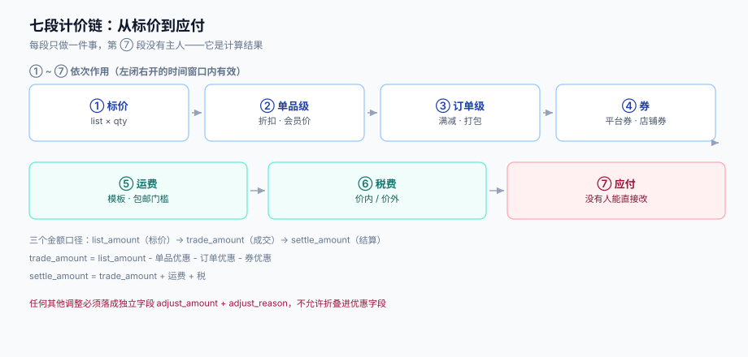

# 总览：从标价到应付的七段链

一笔订单的金额不是「一次算出来的」，而是**七段依次作用的结果**：每一段只允许在前一段的输出上做一件特定的事，任何一段越权（比如在券的阶段偷偷改行价格），后面的分摊、退款、对账就全都失去依据。

这一页给整条链的全局图，并回答一个所有计价事故都会回到的问题：**七段里哪一段的出问题是「可解释」的，哪一段是「不可解释」的**。



本页判据族 `PPO-A` ~ `PPO-H`，共 8 条。定义表见文末「本页判据」一节。

## 一、七段链

| # | 段 | 输入 | 输出 | 谁有权改 | 不可逆性 |
| --- | --- | --- | --- | --- | --- |
| ① | 标价 | SKU、币种、价目表 | `list_price × qty` 的行原价 | 商品/价目表 | 高：改标价影响所有未下单的人 |
| ② | 单品级优惠 | 限时折扣、会员价、第二件半价 | 行成交价 | 营销规则 | 中：可按行回滚 |
| ③ | 订单级优惠 | 满减、跨店满减、打包价 | 订单优惠额（待分摊） | 营销规则 | 中 |
| ④ | 券 | 平台券、店铺券、兑换码 | 券优惠额（待分摊） | 用户选择 + 券库存 | **高：一旦核销就消耗了资源** |
| ⑤ | 运费 | 模板、地区、包邮门槛 | 运费 | 履约/物流 | 低 |
| ⑥ | 税费 | 税率、价内/价外 | 税额 | 财务 | 中：与发票绑定 |
| ⑦ | 应付 | 以上全部 | `payable` | **没有人**——它是计算结果 | 低：重算即得 |

「谁有权改」这一列是这张表最重要的部分。**第 ⑦ 段没有主人**：`payable` 只能由 ①~⑥ 推导，任何一处「直接改应付」的代码（运营补偿、客服手工改价、活动临时减免）都必须落成一条**显式的调整项**（记在 `price_adjustment` 表里，带原因码与操作人），否则对账时这个差额永远找不到来源。

::: danger 注意
1. **不要在第 ③ 段改行价格**。订单级优惠的作用对象是「订单」，它的结果必须保留为**一个待分摊的总额**。一旦在第 ③ 段就把满减摊进行价格，第 ④ 段的券就无法判断「门槛按原价还是按券后价算」——本机实测两种口径在 20 万次抽样里命中率相差 **8.78%**，见[计价链路](../PriceChain/index.md)。
2. **不要在第 ⑦ 段做四舍五入的「补差」**。`payable` 与「各行实付之和」必须天然相等；如果要用 `payable -= 0.01` 这类补差把它凑平，说明第 ③④ 段的分摊已经错了，补差只是把错误藏进一个没人看得见的常数里。
3. **不要在券的阶段「顺手」校验库存**。库存校验与券的可用性判定是两个不同生命周期的判断：前者决定「这张券还能不能被领/被用」，后者决定「这张券在这单上减多少」。混在一起会让「券在结算页显示可用、提交时提示已抢光」成为常态。
:::

## 二、三个金额口径，三种读者

同一笔订单有三个「金额」，它们经常被混用，而对账事故几乎都源于混用：

| 口径 | 定义 | 谁在看 | 允许的误差 |
| --- | --- | --- | --- |
| **标价金额**（`list_amount`） | ① 的输出，未减任何优惠 | 商品页、比价、监管明码标价 | 0（必须与页面展示逐分相等） |
| **成交金额**（`trade_amount`） | ①②③④ 之后、⑤⑥ 之前的金额 | 用户、订单快照、退款计算 | 0（用户看到的「已优惠 X 元」由它推出） |
| **结算金额**（`settle_amount`） | ⑦ 的输出，含运费与税 | 支付通道、记账、结算 | 0（与通道回执逐分相等） |

三个数之间只有两种关系是合法的：

```text
trade_amount = list_amount - item_discount - order_discount - coupon_discount
settle_amount = trade_amount + freight + tax
```

**除了这两个等式，任何其他「调整」都必须以独立字段出现**（`adjust_amount` + `adjust_reason`），不允许折叠进已有的优惠字段。原因是：优惠字段要参与分摊（按行分），调整项往往不分摊（整单加减）。把它们混在一个字段里，分摊算法就无法判断该不该摊。

## 三、五个必失点

这五条是**结构性**的，不是「注意一下就好」的实现细节：

1. **优惠券的门槛口径不一致**。门槛判定用「优惠前金额」还是「优惠后金额」，必须在规则模型里显式声明（见[优惠规则模型](../RuleModel/index.md) 的 `threshold_base` 字段），而不是由每个营销活动的开发各自决定。实测两种口径的命中率差 8.78%，等于同一张券在不同活动里的可用性完全不同。
2. **分摊没有守恒约束**。只要没有「Σ 行分摊 = 订单优惠额」这条断言，任何四舍五入实现都会漂。实测 29.43% 的订单会漂 ±1~2 分（见[优惠分摊](../Allocation/index.md)）。
3. **券核销没有条件更新**。`SELECT used` 再 `UPDATE used` 在并发下必然丢更新：20 并发 × 100 库存，实测 200 次核销成功、计数器只到 28（见[券库存与核销](../CouponStock/index.md)）。
4. **试算与结算不同源**。两条代码路径各自读当前价目表，中间任何一次改价都会让两者分叉；实测改价 5% 后 100% 分叉、平均差 10.75 元（见[试算与结算同源](../Consistency/index.md)）。
5. **没有规则版本号**。规则一改，历史订单重算就变；客服想复核「当时为什么减了 30 元」，只能猜。规则必须带 `rule_version`，订单快照必须记下它。

## 四、五问决策

在动手写第一行计价代码前，先回答这五个问题，答案会决定后面所有设计：

| 问题 | 选项 | 选错的代价 |
| --- | --- | --- |
| **金额用什么类型？** | 整数分 / `decimal` / 浮点 | 用浮点：任何 `==` 比较都可能错；用 `decimal` 累加：跨语言序列化千奇百怪。**默认整数分** |
| **优惠叠加怎么定？** | 组内互斥 + 跨组叠加 / 全互斥 / 全叠加 | 全互斥：用户领了 5 张券只能用 1 张，客诉；全叠加：一次能减穿成本。**默认「组内互斥 + 跨组叠加」，组由运营显式配** |
| **谁选券？** | 用户选 / 系统推荐最优 / 两者结合 | 只让用户选：用户会漏掉更优组合；只让系统选：用户觉得「我的券被偷了」。**默认系统给最优建议 + 允许改选，差额展示** |
| **门槛按哪个金额判？** | 优惠前 / 优惠后 / 逐段递进 | 不写死：同一张券在不同活动里表现不同，且无法解释 |
| **退款怎么退优惠？** | 按原分摊退 / 按比例重算 | 重算：28.59% 的订单退款总额与原分摊不符，累计偏差最大 2 分/单（见[优惠分摊](../Allocation/index.md)） |

::: tip 一条判断标准
如果一个问题**在需求评审时没有答案**，它最后一定变成代码里某个 `if` 的默认分支——而这个默认分支没人测过、没人记得、也没人为它的错误负责。计价引擎里 80% 的线上事故都出自这种「没答案就默认」。
:::

## 五、一次计价的完整时间线

以「加购 → 结算 → 下单 → 支付 → 部分退款」为主线，把七段链放进时间里看：

| 时刻 | 动作 | 读了什么 | 写了什么 | 关键风险 |
| --- | --- | --- | --- | --- |
| T0 | 加购 | 价目表（实时） | 购物车行 | 价格只在展示时取，不落库 |
| T1 | 进结算页（试算） | 价目表 + 规则 + 券 + 运费模板 | **不写库**，返回 `quote_id` | 试算结果必须带 `quote_id` 与有效期，否则无法锁价 |
| T2 | 点提交 | `quote_id` + 幂等键 | 订单 + 行 + 分摊 + 券核销 + 快照 | **T1→T2 之间改价**：靠快照与锁价窗口解决 |
| T3 | 支付 | 订单 `settle_amount` | 支付单 + 回调日志 | 通道金额必须与快照逐分相等 |
| T4 | 部分退款 | 分摊表 | 退款单 + 逆向分摊 | 用原分摊，不重算 |

注意 T1 与 T2 之间的那个窗口：它不是「几毫秒」，而是**用户犹豫的时间**——可以是几分钟，也可以是几小时（关掉页面第二天回来）。所以锁价必须有明确的有效期（常见 30 分钟），过期后必须重新试算并要求用户确认，而不是静默按新价下单。

## 六、四条常见误解

| 误解 | 实际情况 |
| --- | --- |
| 「用 `BigDecimal` 就不会有精度问题」 | `BigDecimal` 只解决「表示」，不解决「舍入策略」与「累加守恒」。实测随机 20 万金额 `HALF_UP` 与 `HALF_EVEN` 结果全同，但构造 `.xx5` 边界后 **50% 不同**——问题不在类型，在策略没定 |
| 「优惠分摊只是为了让订单详情页好看」 | 分摊表是退款、分账、开票、对账的共同输入。分摊错了，退款必错、分账必错、发票行金额对不上 |
| 「券库存用 Redis 就不会超发」 | 用什么存储都可能超发，取决于**写操作是不是条件更新**。用 Redis 的 `INCR` 也会超发，只要你先 `GET` 判断再 `INCR` |
| 「试算和结算用同一个函数就够了」 | 同一个函数不够，还要**同一份输入**。函数相同、但一个读缓存一个读库，照样分叉 |

## 七、本页判据

| 编号 | 看什么现象 | 判成什么 | 不满足时改哪里 |
| --- | --- | --- | --- |
| `PPO-A` | 订单表里是否存在「应付 ≠ 行实付之和 + 运费 + 税」的订单 | 存在即失败：账不守恒 | 检查第 ③④ 段是否漏分摊，或是否有未登记的 `adjust_amount` |
| `PPO-B` | 是否有代码路径「直接写 `payable`」而不经过七段链 | 存在即失败：应付无主人 | 改为写 `price_adjustment`，带原因码与操作人 |
| `PPO-C` | 订单快照里是否记录 `rule_version` 与 `price_version` | 缺失即失败：无法复核 | 快照表加两列，写入时从计价上下文取 |
| `PPO-D` | 三个金额口径是否各有独立字段（`list_amount` / `trade_amount` / `settle_amount`） | 缺一即失败：口径被混用 | 拆字段，禁止用同一个字段承担两种含义 |
| `PPO-E` | 运费与税是否在第 ⑤⑥ 段加入，而不是摊进优惠 | 混入即失败：分摊失去语义 | 运费、税各自独立成列，不参与优惠分摊 |
| `PPO-F` | 是否存在「展示价取实时价目表、下单取快照」这类**同一请求内两次取数** | 存在即失败：必然漂移 | 一次请求只取一次价格，之后全部走同一份上下文 |
| `PPO-G` | 手工改价、补偿、活动临时减免是否都有原因码 | 缺失即失败：对账找不到来源 | 建原因码枚举，非空校验 |
| `PPO-H` | 计价链路的每一段是否都能单独回放（给定输入得到同一输出） | 不能即失败：无法复现事故 | 把「时间」与「随机」从链路里剔除，或显式注入 |

## 与「广告投放与实时竞价工程」的分工（第 210 天补充）

两个专题都在算「钱」，但算的是**两笔不同的钱**：

| 事项 | 本页（营销计价） | 广告专题 |
| --- | --- | --- |
| 算什么 | 用户实付（商品行 + 优惠 + 税） | 广告主为一次展示/点击付多少 |
| 分摊对象 | 订单行金额 | 计费事件（impression / click） |
| 四舍五入 | 最大余数法保证分摊守恒 | 按千次展示计价，允许分币差 |
| 失败形态 | 账单与优惠对不上 | 排序错、预算错、归因错 |
| 归属 | 本页第三、五节 | [广告投放与实时竞价工程](../../AdDelivery/index.md) |

本页特有的一个坑：**把广告消耗当促销费用摊进商品行**。一旦把「这次下单的广告点击成本」按行摊进订单，分摊基数就从「优惠额」变成了「优惠额 + 广告费」，最大余数法算出来的分摊不再守恒（各行之和 ≠ 优惠额 + 广告费），而对账时又只核优惠额——**两个口径都对不上**。广告费应当独立成账（进[账务与结算](../../Ledger/Settlement/index.md)），促销分摊只处理优惠额。

## 参考资料

- [电商系统设计 · 购物车](../../Ecommerce/Cart/index.md)（行金额与优惠分摊骨架）
- [账务与清结算](../../Ledger/index.md)（成交金额之后怎么记账）
- [幂等与状态机工程](../../IdempotencyStateMachine/index.md)（提交与核销的幂等键）
- Fowler, *Analysis Patterns*（Account / Quantity / Money 的建模取舍）
- 国家市场监督管理总局《明码标价和禁止价格欺诈规定》全文：<https://www.samr.gov.cn/zw/zfxxgk/fdzdgknr/jls/art/2023/art_72865dc294a14432aff931038b02c210.html>
