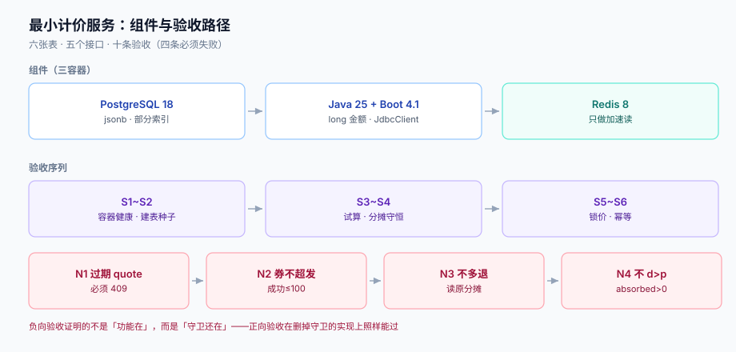

# 实战：一个能跑起来的最小计价服务

前面八页讲的都是「单点正确」。这一页把它们串成一个**能本地跑起来、能验收**的最小服务：四张核心表、五个接口、十条验收（其中四条是**必须失败**的负向验收）。

范围刻意压到最小：不做活动排期、不做人群圈选、不做发票。只做「给定购物车和券，算出应付，并保证这个数可复现」。



本页判据族 `PPP-A` ~ `PPP-H`，共 8 条。定义表见文末「本页判据」一节。

## 一、最小可跑集

| 组件 | 版本 | 为什么是它 |
| --- | --- | --- |
| PostgreSQL | 18.x | 需要 `jsonb`、部分索引、`ON CONFLICT`、`timestamptz` |
| Java | 25（LTS） | `record` + `Math.addExact` 溢出检查，金额用 `long` |
| Spring Boot | 4.1.x | Web + JdbcClient，不引 ORM（计价 SQL 要可读） |
| Redis | 8.x | **只用于券库存的加速读**，不作为唯一真相 |

三容器最小编排（`deploy/compose.yaml`）：

```yaml
services:
  pg:
    image: postgres:18.6
    environment:
      POSTGRES_PASSWORD: dev
      POSTGRES_DB: pricing
    ports: ["5432:5432"]
    healthcheck:
      test: ["CMD-SHELL", "pg_isready -U postgres -d pricing"]
      interval: 3s
      retries: 20
  redis:
    image: redis:8.2
    ports: ["6379:6379"]
    healthcheck:
      test: ["CMD", "redis-cli", "ping"]
      interval: 3s
      retries: 20
  app:
    build: ..
    depends_on:
      pg: { condition: service_healthy }
      redis: { condition: service_healthy }
    ports: ["8080:8080"]
    environment:
      SPRING_DATASOURCE_URL: jdbc:postgresql://pg:5432/pricing
```

验收第一段（容器起来就算过）：

```shell
docker compose -f deploy/compose.yaml config -q && echo "compose OK"
docker compose -f deploy/compose.yaml up -d
docker compose -f deploy/compose.yaml ps --format '{{.Name}} {{.Health}}'
# 期望：三行，全部 healthy
```

## 二、四张核心表

```sql
-- ① 价目表：时间化，不 UPDATE
CREATE TABLE sku_price (
  sku_id bigint NOT NULL, currency char(3) NOT NULL, amount bigint NOT NULL CHECK (amount>=0),
  effective_from timestamptz NOT NULL, effective_to timestamptz,
  PRIMARY KEY (sku_id, currency, effective_from),
  CHECK (effective_to IS NULL OR effective_to > effective_from)
);

-- ② 规则表：版本化 + 生效窗口 + 互斥组
CREATE TABLE promo_rule (
  id bigserial PRIMARY KEY,
  code text NOT NULL, rule_version int NOT NULL,
  scope_type text NOT NULL, scope_ids bigint[] NOT NULL DEFAULT '{}',
  benefit_type text NOT NULL, benefit_json jsonb NOT NULL,
  group_code text NOT NULL, priority int NOT NULL DEFAULT 100,
  stackable boolean NOT NULL DEFAULT true,
  threshold_base text NOT NULL CHECK (threshold_base IN ('LIST','TRADE','PAYABLE')),
  start_at timestamptz NOT NULL, end_at timestamptz NOT NULL,
  status text NOT NULL DEFAULT 'DRAFT' CHECK (status IN ('DRAFT','ACTIVE','RETIRED')),
  UNIQUE (code, rule_version), CHECK (end_at > start_at)
);

-- ③ 券：模板（L1）+ 实例（L2）
CREATE TABLE coupon_template (
  id bigserial PRIMARY KEY, code text NOT NULL UNIQUE,
  total int NOT NULL CHECK (total >= 0), used int NOT NULL DEFAULT 0,
  amount bigint NOT NULL, min_spend bigint NOT NULL, group_code text NOT NULL,
  expires_at timestamptz NOT NULL,
  CHECK (used >= 0 AND used <= total)
);
CREATE TABLE coupon_instance (
  id bigserial PRIMARY KEY,
  template_id bigint NOT NULL REFERENCES coupon_template(id),
  user_id bigint NOT NULL,
  status text NOT NULL DEFAULT 'UNUSED' CHECK (status IN ('UNUSED','USED','EXPIRED','REVOKED')),
  used_order_id bigint, expire_at timestamptz NOT NULL,
  UNIQUE (template_id, user_id, id)          -- 便于按用户+模板定位
);

-- ④ 试算快照：一份 quote 就是一次可重放的计价
CREATE TABLE price_quote (
  id uuid PRIMARY KEY, user_id bigint NOT NULL, currency char(3) NOT NULL,
  list_amount bigint NOT NULL, trade_amount bigint NOT NULL,
  freight bigint NOT NULL DEFAULT 0, tax bigint NOT NULL DEFAULT 0,
  settle_amount bigint NOT NULL, absorbed bigint NOT NULL DEFAULT 0,
  items_json jsonb NOT NULL, alloc_json jsonb NOT NULL,
  price_version text NOT NULL, rule_version int[] NOT NULL, bucket int NOT NULL,
  expire_at timestamptz NOT NULL, created_at timestamptz NOT NULL DEFAULT now()
);
```

再加两张辅助表：`order_line_alloc`（分摊，见[优惠分摊](../Allocation/index.md)）与 `coupon_redeem`（核销记录）。**六张表就够跑通全链路**。

## 三、五个接口

| 接口 | 方法 | 幂等 | 关键约束 |
| --- | --- | --- | --- |
| `/api/quotes` | POST | 否（每次试算新 quote） | 返回 `quote_id` + `expire_at` + 全部候选券 |
| `/api/quotes/{id}` | GET | 是 | 过期也返回，但带 `stale: true` |
| `/api/orders` | POST | **是**（`Idempotency-Key`） | 必须带 `quote_id`，不重新计价 |
| `/api/orders/{id}/refunds` | POST | 是 | 按 `order_line_alloc` 取值，不重算 |
| `/api/coupons/{instanceId}/redeem` | POST | 是（`UNIQUE(instance,order)`） | 条件更新，见[券库存](../CouponStock/index.md) |

`POST /api/quotes` 的请求与响应示例：

```json
// 请求
{"items":[{"sku":"SKU-1","qty":2},{"sku":"SKU-2","qty":1}],"couponCodes":["CPN-50OFF300"]}
// 响应
{
  "quote_id":"8e0f...","expire_at":"2026-10-25T02:00:00Z",
  "list_amount":30000,"trade_amount":25000,"freight":1000,"tax":0,"settle_amount":26000,
  "lines":[{"sku":"SKU-1","qty":2,"list":17800,"paid":14833,"discount":2967},
           {"sku":"SKU-2","qty":1,"list":12200,"paid":10167,"discount":2033}],
  "candidates":[{"code":"CPN-50OFF300","chosen":true,"reason":"best","amount":5000}],
  "absorbed":0
}
```

注意响应里有两处容易被忽略的契约：

1. **`lines[].paid` 是分摊后的实付**，且 `Σ paid = trade_amount`（本例 14833 + 10167 = 25000）。
2. **`reason` 只能是四值枚举**（`best` / `conflict_with:<code>` / `min_spend_unmet` / `expired`），前端据此渲染提示语。

## 四、十条验收（四条必须失败）

| # | 验收 | 命令要点 | 期望 |
| --- | --- | --- | --- |
| S1 | 容器健康 | `docker compose ps` | 三行 `healthy` |
| S2 | 建表 + 种子 | `psql -f schema.sql -f seed.sql` | 6 表、≥3 行价格、≥4 条规则、≥2 张券 |
| S3 | 试算可用 | `POST /api/quotes` | 200，`settle_amount > 0`，`quote_id` 非空 |
| S4 | 分摊守恒 | 查 `v_alloc_check` | 0 行 |
| S5 | 锁价生效 | 改价后用旧 quote 提交 | 金额与 S3 完全一致 |
| S6 | 重复提交幂等 | 同 `Idempotency-Key` 提交两次 | 两个响应 `order_id` 相同，DB 只有 1 行 |
| **N1** | 过期 quote 必须拒 | 把 `expire_at` 改成过去再提交 | **409 `QUOTE_STALE`** |
| **N2** | 券库存必须不超发 | 20 并发抢 100 张 | 成功 ≤ 100，`used = redeems ≤ total` |
| **N3** | 部分退款不得多退 | 三次各退一行 | 累计 ≤ 行实付，且与原分摊逐分相等 |
| **N4** | 分摊不得 `dᵢ > pᵢ` | 构造「优惠 > 订单额」 | 200 且 `absorbed > 0`，行实付 ≥ 0 |

四条负向验收是本页最重要的部分：**它们证明的不是「功能在」，而是「守卫还在」**。正向验收在一个把守卫全删掉的实现上照样能过——因为正常路径本来就该通。

## 五、三条关键断言（pytest 版）

```python
# tests/test_pricing.py
import requests

BASE = "http://localhost:8080"

def test_alloc_is_conserved():
    q = requests.post(f"{BASE}/api/quotes", json={
        "items": [{"sku": "SKU-1", "qty": 2}, {"sku": "SKU-2", "qty": 1}],
        "couponCodes": ["CPN-50OFF300"]}).json()
    paid = sum(l["paid"] for l in q["lines"])
    assert paid + q["freight"] + q["tax"] == q["settle_amount"], "I2 violated"

def test_quote_locks_price():
    q = requests.post(f"{BASE}/api/quotes",
                      json={"items": [{"sku": "SKU-1", "qty": 1}]}).json()
    # 外部改价后，用旧 quote 下单金额不变
    requests.post(f"{BASE}/admin/price/bump", json={"sku": "SKU-1", "pct": 5})
    o = requests.post(f"{BASE}/api/orders",
                      json={"quote_id": q["quote_id"]},
                      headers={"Idempotency-Key": "lock-1"}).json()
    assert o["settle_amount"] == q["settle_amount"], "price drifted"

def test_stale_quote_rejected():
    q = requests.post(f"{BASE}/api/quotes",
                      json={"items": [{"sku": "SKU-1", "qty": 1}]}).json()
    requests.post(f"{BASE}/admin/quote/expire", json={"quote_id": q["quote_id"]})
    r = requests.post(f"{BASE}/api/orders", json={"quote_id": q["quote_id"]})
    assert r.status_code == 409 and r.json()["code"] == "QUOTE_STALE"
```

第三条断言（`test_stale_quote_rejected`）如果只断言状态码，很容易被「所有错误都返回 409」的实现蒙过去，所以必须同时断言 `code` 字段。

## 六、本页判据

| 编号 | 看什么现象 | 判成什么 | 不满足时改哪里 |
| --- | --- | --- | --- |
| `PPP-A` | 表结构是否含 `sku_price` / `promo_rule` / `coupon_template` / `coupon_instance` / `price_quote` / `order_line_alloc` | 缺表即失败 | 按第二节 DDL 建，`order_line_alloc` 见[优惠分摊](../Allocation/index.md) |
| `PPP-B` | 下单接口是否收 `quote_id` 且**不重新计价** | 重新计价即失败 | 改为读 `price_quote` 并校验 `expire_at` |
| `PPP-C` | 六项正向验收是否全部通过 | 任一失败即停下修 | S1~S6 逐条跑 |
| `PPP-D` | 四条负向验收是否**真的会失败**（把守卫删掉应转红） | 删守卫仍全绿即失败 | 逐条做「删守卫 → 跑 → 恢复」验证 |
| `PPP-E` | 分摊守恒查询是否 0 行 | 非 0 即失败 | 见[优惠分摊](../Allocation/index.md) |
| `PPP-F` | 重复提交同一幂等键是否只产生一行订单 | 两行即失败 | 幂等键表 + `ON CONFLICT` |
| `PPP-G` | `compose.yaml` 是否 `config -q` 通过且三容器 healthy | 起不来即失败 | 检查 `depends_on` 健康条件与端口 |
| `PPP-H` | 结算金额是否与支付回调金额逐分相等 | 不等即失败 | 通道金额只从快照取 |

## 七、下一步

跑通这十条之后，按缺口依次扩：

1. **规则管理面**：规则的 CRUD + 冲突检测接 CI（见[优惠规则模型](../RuleModel/index.md)）；
2. **多币种**：`currency` 已有列，但 minor unit 仍写死 2 位，需引入币种表（见[总览](../Overview/index.md) 的事实速览）；
3. **灰度**：`bucket` 已落库，但没有分流实现；
4. **开票**：需要行级的税额分摊，当前 `tax` 是整单值。

## 参考资料

- [优惠规则模型](../RuleModel/index.md) / [优惠分摊](../Allocation/index.md) / [券库存与核销](../CouponStock/index.md) / [试算与结算同源](../Consistency/index.md)
- Docker Compose 健康检查与依赖顺序：<https://docs.docker.com/compose/compose-file/05-services/#depends_on>
- PostgreSQL `jsonb` 索引与部分索引：<https://www.postgresql.org/docs/18/datatype-json.html>
- pytest 官方文档（fixture 与参数化）：<https://docs.pytest.org/en/stable/>
