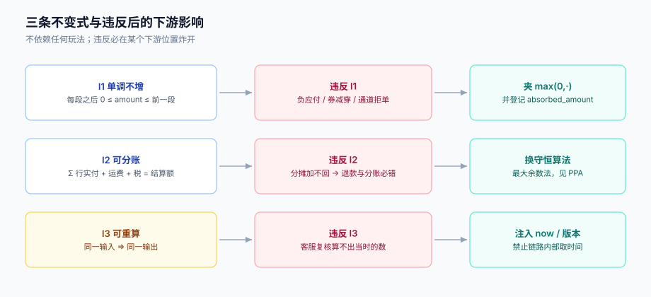

# 计价链路与三条不变式

七段链只是「顺序」，真正让实现可验收的是**三条不变式**。它们不依赖任何具体玩法，也不需要理解业务规则，只要违反就一定会在某个下游位置炸开：分摊对不上、退款多退、对账差几分钱。

这一页把三条不变式写成可以断言的表达式，再逐个用本机读数说明「违反了会怎样」。



本页判据族 `PPC-A` ~ `PPC-H`，共 8 条。定义表见文末「本页判据」一节。

## 一、三条不变式

| 不变式 | 表达式 | 违反后谁先炸 |
| --- | --- | --- |
| **I1 单调不增** | 对任意一段 `n`，`amount(n) <= amount(n-1)`，且 `amount(n) >= 0` | 用户端：出现负应付或「优惠后更贵」 |
| **I2 可分账** | `Σ line_paid_i + freight + tax = settle_amount`，且每一 `line_paid_i >= 0` | 财务端：分摊表加不回订单额 |
| **I3 可重算** | 相同输入（含 `rule_version`、`price_version`、`quote_id`）⇒ 相同输出 | 客服端：复核时算不出当时那个数 |

三条不变式的关系不是并列的：**I3 是 I1 与 I2 能被验证的前提**。如果同一份输入能算出两个结果，你连「这次到底对不对」都无法判定——这也是为什么计价链路里必须把「当前时间」和「随机数」显式注入，而不是让函数自己去取。

::: danger 注意
1. **I1 的 `>= 0` 不是废话**。叠加不设上限时，5 张券可以减穿订单额，产出负应付；某些通道会直接拒单，某些通道会把负数当成退款处理。正确做法是**每段之后夹一次 `max(0, ·)`，并把被夹掉的金额记为 `absorbed_amount`**，否则「为什么这张 50 元券只减了 12 元」永远解释不清。
2. **I2 的 `>= 0` 同样不是废话**。按比例分摊时，如果某行金额极小、优惠极大，该行分摊额可能超过行金额，行实付变负数。此时必须把该行「封顶」并把溢出部分按规则转给其他行（见[优惠分摊](../Allocation/index.md) 的封顶与再分配）。
3. **不要在链路里读 `now()`**。`if (now() < coupon.expire_at)` 这种写法让函数不可重算：明天复核今天的单，结论会变。正确做法是把 `now` 作为参数传进链路。
:::

## 二、顺序敏感：同样的券，不同顺序不同结果

当门槛按「当前应付」判定（`threshold_base = PAYABLE`）时，叠加顺序会改变最终金额。本机实测（200 单、每单 6 张券、3 个互斥组、枚举全部 720 种排列）：

| 观测 | 读数 |
| --- | --- |
| 存在「不同顺序 → 不同应付」的订单 | **4 / 200（2.0%）** |
| 同一单不同顺序的最大差额 | **2,000 分（20 元）** |

2% 听起来不高，但它的分布很讨厌：**只在大额券与小门槛券共存时出现**，也就是运营最爱配的那种组合。而且它表现为「同一辆车，用户点两次结算，价格不同」，是最容易被截图投诉的形态。

```java [PricingChain.java]
// 错误：让规则自己决定顺序（顺序由 Map 遍历顺序决定，跨 JVM 版本可能变）
for (Rule r : rules) { payable = r.apply(payable); }

// 正确：顺序由一个显式的、可持久化的排序键决定
List<Rule> ordered = rules.stream()
    .sorted(Comparator.comparingInt(Rule::stage)        // ① 段序：单品 → 订单 → 券
                      .thenComparingInt(Rule::priority) // ② 同段内优先级
                      .thenComparing(Rule::code))       // ③ 最后用 code 兜底，保证全序
    .toList();
for (Rule r : ordered) { payable = r.apply(payable); }
```

排序键必须**三级全序**。只写前两级时，同级规则之间的相对顺序取决于集合实现（`HashMap` 的遍历顺序在不同容量下不同），这在单测里永远不会暴露，因为它依赖插入顺序。

## 三、门槛口径：优惠前还是优惠后

这是计价里最容易被忽略、影响面最大的一个开关。实测（20 万次抽样，门槛与应付均取 20~200 元）：

| 口径 | 命中次数 | 相对差 |
| --- | --- | --- |
| 按「优惠前金额」判定 | 99,857 | 基准 |
| 按「优惠后金额」判定 | 82,294 | **−8.78%** |

差 8.78% 意味着：同一张「满 100 减 10」的券，在「先用了一张 15 元券」的订单上，一种口径能再用、另一种不能。用户视角就是「我明明满了 100」。

所以 `threshold_base` 必须是规则模型的必填字段：

```sql
CREATE TYPE threshold_base AS ENUM ('LIST', 'TRADE', 'PAYABLE');
-- LIST    ：按 ① 的标价金额判（最常见，用户最易理解）
-- TRADE   ：按 ②③ 之后、券之前的金额判（"店铺优惠后再判平台券"）
-- PAYABLE ：按当前应付判（逐段递进，顺序敏感，慎用）
```

::: warning 说明
选 `PAYABLE` 不是错，但要接受两个后果：① 顺序必须由排序键固定（见上一节）；② 前台展示的「还差 X 元可用」必须用**同一个口径**实时计算，否则用户会看到「差 0 元」却不能用的荒唐提示。
:::

## 四、精度：整数分是默认答案

计价链路里的金额只有一种表示：**整数分**（`long` / `bigint`）。

| 表示 | 加法 100 万次 | 相等比较 | 序列化 | 结论 |
| --- | --- | --- | --- | --- |
| `double` | 累加 `0.01` 误差 **1.7e-7 元**（本机实测） | `0.1+0.2 != 0.3`，恒不相等 | JSON 里出现 `19.989999999999998` | 禁用 |
| `BigDecimal` | 精确 | `.equals` 还比较 scale，`1.0` ≠ `1.00` | 各语言字符串格式不一 | 只用于展示与报表 |
| **整数分 `long`** | 精确 | 直接 `==` | 就是整数 | **默认** |

浮点误差本身很小（100 万次累加才 1.7e-7 元），所以很多人误以为「够用」。真正致命的不是累加误差，是**相等判断**：任何一处 `if (a == b)`、`if (a > b)` 的边界判断，在浮点下都可能给出反直觉的结果，而这恰恰是门槛判定、最优券比较最常做的事。

```typescript [money.ts]
/** 全链路金额类型：整数分。命名带 Cents 后缀，防止误用。 */
export type Cents = number & { readonly __brand: 'Cents' };

export const yuan = (v: number): Cents => Math.round(v * 100) as Cents;

/** 只在最终展示时转成元，且只在 UI 层调用。 */
export const toYuan = (c: Cents): string => (c / 100).toFixed(2);
```

`toYuan` 用 `toFixed(2)` 是可以的，因为此时值已经是一个整数分除以 100，误差不超过 1e-13，`toFixed` 的四舍五入不会翻车。但**绝不允许**把 `toFixed` 的结果再算回来参与运算。

## 五、舍入：`HALF_UP` 还是 `HALF_EVEN`

这不是理论问题。同一个金额 `1.005`：

| 模式 | 结果 | 说明 |
| --- | --- | --- |
| `HALF_UP` | `1.01` | 商业惯例，四舍五入 |
| `HALF_EVEN` | `1.00` | IEEE 754 默认，逢半取偶，也叫银行家舍入 |

本机实测两组数据：

| 样本 | 差异率 |
| --- | --- |
| 随机 20 万个两位小数金额 | **0.000%** |
| 构造的 `.xx5` 边界值（100 个） | **50.0%** |

第一行解释了为什么这个 bug 极难被发现：随机数据下两种模式完全一致。第二行解释了它为什么真实存在：**恰好落在半分位的金额在真实业务里并不罕见**——折扣率 85 折、税率 6%、按比例分摊，都会稳定产出 `.xx5`。

结论：

- 引擎内部**不做舍入**（整数分天然无舍入）；
- 只在「必须落到最小单位」的那一步做一次舍入（分摊、税率计算）；
- 舍入模式写进接口契约，并在数据库里存一个全局配置项，**不允许各模块自选**。

## 六、一个可断言的链路骨架

把三条不变式落成代码，只需要在链路的出口加三个断言：

```java [PricingEngine.java]
public Quote price(PriceContext ctx) {
    long amount = 0;
    for (LineCtx l : ctx.lines()) {
        amount = Math.addExact(amount, stage1(l));           // ① 标价
    }
    long listAmount = amount;

    long itemDiscount  = stage2(ctx, amount);                 // ② 单品级
    long afterItem     = amount - itemDiscount;
    long orderDiscount = stage3(ctx, afterItem);              // ③ 订单级
    long afterOrder    = afterItem - orderDiscount;
    long couponDiscount = stage4(ctx, afterOrder);            // ④ 券（门槛口径由规则声明）

    long tradeAmount = listAmount - itemDiscount - orderDiscount - couponDiscount;

    // I1：单调不增且非负；被夹掉的金额必须显式登记
    long absorbed = 0;
    if (tradeAmount < 0) { absorbed = -tradeAmount; tradeAmount = 0; }

    long settle = Math.addExact(Math.addExact(tradeAmount, stage5(ctx)), stage6(ctx));

    // I2：行实付之和必须加得回成交金额
    List<Long> linePaid = allocate(tradeAmount, ctx.lines());
    if (linePaid.stream().mapToLong(Long::longValue).sum() != tradeAmount) {
        throw new IllegalStateException("I2 violated: allocation not conserved");
    }
    return new Quote(listAmount, tradeAmount, settle, linePaid, absorbed, ctx.versions());
}
```

三个断言对应三条不变式：`absorbed` 让 I1 可观测、`allocate` 的守恒检查守 I2、`ctx.versions()` 让 I3 可复现。**没有这三个断言，链路照样跑，但事故来了没有抓手。**

## 七、本页判据

| 编号 | 看什么现象 | 判成什么 | 不满足时改哪里 |
| --- | --- | --- | --- |
| `PPC-A` | 是否存在 `settle_amount < 0` 或「优惠后金额 > 优惠前金额」的订单 | 存在即失败：I1 被破坏 | 每段后夹 `max(0,·)`，并登记 `absorbed_amount` |
| `PPC-B` | `Σ line_paid + freight + tax` 是否恒等于 `settle_amount` | 不等即失败：I2 被破坏 | 分摊改用守恒算法，见[优惠分摊](../Allocation/index.md) |
| `PPC-C` | 同一 `quote_id` 重放是否得到同一金额 | 不同即失败：I3 被破坏 | 把 `now`、随机数、外部读都移出链路或注入 |
| `PPC-D` | 规则执行顺序是否由**三级全序**排序键决定 | 依赖集合遍历顺序即失败 | 加 `stage` / `priority` / `code` 三级排序 |
| `PPC-E` | 每条规则的 `threshold_base` 是否显式声明 | 缺失即失败：口径由开发各自决定 | 规则模型加必填枚举字段 |
| `PPC-F` | 链路内部是否存在浮点金额字段 | 存在即失败：比较不可靠 | 全部改整数分，展示层才转元 |
| `PPC-G` | 舍入模式是否在配置里唯一，且只在分摊/税率处调用 | 多处自选即失败 | 收敛成一个 `Money.round()`，加调用点白名单 |
| `PPC-H` | 是否存在「展示取实时价、下单取快照」的同一请求两次取数 | 存在即失败 | 一次请求一份 `PriceContext`，见[试算与结算同源](../Consistency/index.md) |

## 参考资料

- IEEE 754-2019 浮点标准（默认舍入 roundTiesToEven）：<https://ieeexplore.ieee.org/document/8766229>
- Oracle Java SE `RoundingMode` 文档：<https://docs.oracle.com/en/java/javase/25/docs/api/java.base/java/math/RoundingMode.html>
- ISO 4217 币种最小单位：<https://www.iso.org/iso-4217-currency-codes.html>
- [优惠分摊](../Allocation/index.md)（守恒算法的完整实现）
- [试算与结算同源](../Consistency/index.md)（I3 在分布式下的落地）
